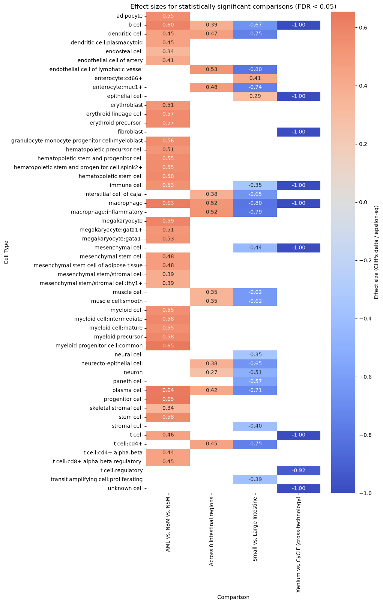

# Endothelial-Cell Distance Analysis: Sample-Level Statistical Testing


<!-- WARNING: THIS FILE WAS AUTOGENERATED! DO NOT EDIT! -->

## 1. Imports and shared setup

``` python
import os
import numpy as np
import pandas as pd
import matplotlib.pyplot as plt
import seaborn as sns
from scipy import stats
from statsmodels.stats.multitest import multipletests

try:
    import scikit_posthocs as sp
    HAVE_POSTHOCS = True
except ImportError:
    HAVE_POSTHOCS = False
    print("scikit-posthocs not installed — pairwise post-hoc tests after "
          "Kruskal-Wallis will be skipped. Install with: "
          "pip install scikit-posthocs --break-system-packages")

pd.set_option('display.max_columns', None)
pd.set_option('display.max_rows', None)

import warnings
warnings.filterwarnings("ignore")

# Minimum number of samples (Dataset values) required per group before we will
# run a test at all. Below this, the comparison is reported as descriptive only.
MIN_SAMPLES_PER_GROUP = 3

# Where the master results table (CSV) will be written.

basepath = "/Users/yashjain/Coding/cns/hra-cell-distance-analysis/data"

RESULTS_OUTPUT_PATH = basepath + "/distance_analysis_statistical_results.csv"
```

## 2. Shared data-loading functions

Two loader variants are needed because the file-naming convention
differs by one dataset (`lung-codex-urmc` uses a 4-part dataset name
before the anchor level/type suffix; everything else uses a single-part
name). Both are reused unchanged from the individual notebooks.

``` python
def load_data(path, edges=False):
    if edges:
        column_names = ['cell_id', 'x1', 'y1', 'z1', 'x2', 'y2', 'z2']
        data = pd.read_csv(path, header=None, names=column_names)
    else:
        data = pd.read_csv(path)
    return data


def read_all_edge_datasets(basepath, data_filedir, output_edge_dir):
    """Standard loader: filename format is '<dataset>-<level>-<anchor>-edges.csv'.
    Used by every dataset except lung-codex-urmc.
    """
    all_nodes_files = []
    all_edges_files = []
    all_nodes_edges_files = []
    for file in os.listdir(os.path.join(basepath, output_edge_dir)):
        if file.endswith("-edges.csv"):
            file_path = os.path.join(basepath, output_edge_dir, file)
            dataset_name, anchor_cell_type_level, anchor_cell_type = (
                file.replace("-edges.csv", "").split('-')
            )
            edges_df = load_data(file_path, edges=False)
            edges_df['Dataset'] = dataset_name
            edges_df['Anchor Cell Type'] = anchor_cell_type
            edges_df['Anchor Cell Type Level'] = anchor_cell_type_level
            edges_df.rename(columns={"distance": "Distance"}, inplace=True)
            all_edges_files.append(edges_df)

            nodes_file_path = os.path.join(basepath, data_filedir, f"{dataset_name}-nodes.csv")
            nodes_df = load_data(nodes_file_path)
            nodes_df['Dataset'] = dataset_name
            all_nodes_files.append(nodes_df)

            nodes_df['cell_id'] = range(len(nodes_df))
            nodes_df.set_index('cell_id', inplace=True)
            edges_nodes_df = pd.merge(
                edges_df,
                nodes_df[['Level Three Cell Type', 'Level Two Cell Type', 'Level One Cell Type']],
                how='left', left_on='cell_id', right_index=True
            )
            all_nodes_edges_files.append(edges_nodes_df)

    merged_edges = pd.concat(all_edges_files, ignore_index=True)
    merged_nodes = pd.concat(all_nodes_files, ignore_index=True)
    merged_nodes_for_all_edges = pd.concat(all_nodes_edges_files, ignore_index=True)

    return merged_nodes, merged_edges, merged_nodes_for_all_edges


def read_all_edge_datasets_lung(basepath, data_filedir, output_edge_dir):
    """Lung-specific loader: filename format is
    '<d1>-<d2>-<d3>-<d4>-<level>-<anchor>-edges.csv', i.e. the dataset name
    itself contains hyphens (e.g. 'D265-LLL-7A7-12'), so the first four
    hyphen-separated parts are joined back into the dataset name.
    """
    all_nodes_files = []
    all_edges_files = []
    all_nodes_edges_files = []
    for file in os.listdir(os.path.join(basepath, output_edge_dir)):
        if file.endswith("-edges.csv"):
            file_path = os.path.join(basepath, output_edge_dir, file)
            d1, d2, d3, d4, anchor_cell_type_level, anchor_cell_type = (
                file.replace("-edges.csv", "").split('-')
            )
            dataset_name = f'{d1}-{d2}-{d3}-{d4}'
            edges_df = load_data(file_path, edges=False)
            edges_df['Dataset'] = dataset_name
            edges_df['Anchor Cell Type'] = anchor_cell_type
            edges_df['Anchor Cell Type Level'] = anchor_cell_type_level
            edges_df.rename(columns={"distance": "Distance"}, inplace=True)
            all_edges_files.append(edges_df)

            nodes_file_path = os.path.join(basepath, data_filedir, f"{dataset_name}-nodes.csv")
            nodes_df = load_data(nodes_file_path)
            nodes_df['Dataset'] = dataset_name
            all_nodes_files.append(nodes_df)

            nodes_df['cell_id'] = range(len(nodes_df))
            nodes_df.set_index('cell_id', inplace=True)
            edges_nodes_df = pd.merge(
                edges_df,
                nodes_df[['Level Three Cell Type', 'Level Two Cell Type', 'Level One Cell Type']],
                how='left', left_on='cell_id', right_index=True
            )
            all_nodes_edges_files.append(edges_nodes_df)

    merged_edges = pd.concat(all_edges_files, ignore_index=True)
    merged_nodes = pd.concat(all_nodes_files, ignore_index=True)
    merged_nodes_for_all_edges = pd.concat(all_nodes_edges_files, ignore_index=True)

    return merged_nodes, merged_edges, merged_nodes_for_all_edges
```

## 3. Statistical testing functions

``` python
def sample_level_table(df_edges, cell_type_level, group_col):
    """Collapse cell-level edges to one median Distance per Dataset per cell type."""
    return (
        df_edges
        .groupby(['Dataset', cell_type_level, group_col])['Distance']
        .median()
        .reset_index()
        .rename(columns={'Distance': 'median_distance'})
    )


def cliffs_delta(a, b):
    """Rank-based effect size. -1 to 1; 0.11 small, 0.28 medium, 0.43 large."""
    a = np.asarray(a)
    b = np.asarray(b)
    n_a, n_b = len(a), len(b)
    greater = sum(x > y for x in a for y in b)
    less = sum(x < y for x in a for y in b)
    return (greater - less) / (n_a * n_b)


def epsilon_squared(h_stat, n):
    """Effect size for Kruskal-Wallis. 0.01 small, 0.06 medium, 0.14 large."""
    return h_stat / (n - 1) if n > 1 else np.nan


def test_one_cell_type(sample_df, cell_type_level, group_col, cell_type, groups,
                        min_n=MIN_SAMPLES_PER_GROUP):
    sub = sample_df[sample_df[cell_type_level] == cell_type]
    group_values = {g: sub[sub[group_col] == g]['median_distance'].values for g in groups}
    group_sizes = {g: len(v) for g, v in group_values.items()}

    underpowered = any(n < min_n for n in group_sizes.values())

    result = {
        'Cell Type': cell_type,
        'Groups Compared': ' vs '.join(str(g) for g in groups),
        **{f'n_{g}': group_sizes[g] for g in groups},
    }

    if underpowered:
        result.update({
            'Test': 'None (insufficient samples)',
            'Statistic': np.nan,
            'p_value': np.nan,
            'Effect Size': np.nan,
            'Effect Size Type': None,
            'Status': 'Descriptive only — not tested',
        })
        return result

    if len(groups) == 2:
        a, b = group_values[groups[0]], group_values[groups[1]]
        stat, p = stats.mannwhitneyu(a, b, alternative='two-sided')
        delta = cliffs_delta(a, b)
        result.update({
            'Test': 'Mann-Whitney U',
            'Statistic': stat,
            'p_value': p,
            'Effect Size': delta,
            'Effect Size Type': "Cliff's delta",
            'Status': 'Tested',
        })
    else:
        arrays = [group_values[g] for g in groups]
        stat, p = stats.kruskal(*arrays)
        n_total = sum(group_sizes.values())
        eps2 = epsilon_squared(stat, n_total)
        result.update({
            'Test': 'Kruskal-Wallis',
            'Statistic': stat,
            'p_value': p,
            'Effect Size': eps2,
            'Effect Size Type': 'epsilon-squared',
            'Status': 'Tested',
        })

    return result


def run_comparison(df_edges, cell_type_level, group_col, groups, study_name,
                    comparison_name, anchor_cell_type=None, anchor_cell_type_level=None,
                    min_n=MIN_SAMPLES_PER_GROUP):
    df = df_edges.copy()
    if anchor_cell_type is not None:
        df = df[df['Anchor Cell Type'] == anchor_cell_type]
    if anchor_cell_type_level is not None:
        df = df[df['Anchor Cell Type Level'] == anchor_cell_type_level]
    df = df[df[group_col].isin(groups)]

    sample_df = sample_level_table(df, cell_type_level, group_col)

    rows = []
    for ct in sorted(sample_df[cell_type_level].dropna().unique()):
        row = test_one_cell_type(sample_df, cell_type_level, group_col, ct, groups, min_n=min_n)
        rows.append(row)

    results = pd.DataFrame(rows)
    results.insert(0, 'Study', study_name)
    results.insert(1, 'Comparison', comparison_name)
    results.insert(2, 'Cell Type Level', cell_type_level)

    tested_mask = results['Status'] == 'Tested'
    if tested_mask.sum() > 0:
        results.loc[tested_mask, 'p_adj (FDR)'] = multipletests(
            results.loc[tested_mask, 'p_value'], method='fdr_bh'
        )[1]
    else:
        results['p_adj (FDR)'] = np.nan

    return results


def run_posthoc_dunn(df_edges, cell_type_level, group_col, cell_type, groups,
                      anchor_cell_type=None, anchor_cell_type_level=None):
    """Pairwise Dunn's test (BH-corrected) after a significant Kruskal-Wallis.
    Requires scikit-posthocs.
    """
    if not HAVE_POSTHOCS:
        print("scikit-posthocs not available — skipping post-hoc test.")
        return None

    df = df_edges.copy()
    if anchor_cell_type is not None:
        df = df[df['Anchor Cell Type'] == anchor_cell_type]
    if anchor_cell_type_level is not None:
        df = df[df['Anchor Cell Type Level'] == anchor_cell_type_level]
    df = df[df[group_col].isin(groups)]

    sample_df = sample_level_table(df, cell_type_level, group_col)
    sub = sample_df[sample_df[cell_type_level] == cell_type]

    return sp.posthoc_dunn(sub, val_col='median_distance', group_col=group_col, p_adjust='fdr_bh')
```

## 4. Master results collector

``` python
all_results = []

def register_results(results_df):
    all_results.append(results_df)
    n_tested = (results_df['Status'] == 'Tested').sum()
    n_skipped = (results_df['Status'] != 'Tested').sum()
    print(f"[{results_df['Study'].iloc[0]} | {results_df['Comparison'].iloc[0]}] "
          f"{n_tested} cell types tested, {n_skipped} descriptive-only "
          f"(insufficient samples).")
```

## 5. Dataset-by-dataset comparisons

### 5a. intestine-codex-stanford — Small vs. Large Intestine

``` python
dataset_dir = "intestine-codex-stanford"
data_filedir = os.path.join("data-processed-nodes-with-harmonized-cell-types", dataset_dir)
output_edge_dir = os.path.join("data-processed-edges", dataset_dir)

_, _, df_intestine_edges = read_all_edge_datasets(basepath, data_filedir, output_edge_dir)

si = ['Duodenum', 'Ileum', 'Mid', 'ProximalJejunum', 'Midjejunum', 'Proximaljejunum']
li = ['Ascending', 'Descending', 'Transverse', 'Left', 'Right', 'Sigmoid', 'Trans']

df_intestine_edges['Donor'] = df_intestine_edges['Dataset'].str.split('_').str[0]
df_intestine_edges['Tissue Subtype'] = df_intestine_edges['Dataset'].str.split('_').str[1].apply(
    lambda x: 'Small Intestine' if x in si else ('Large Intestine' if x in li else 'Unknown')
)

for level, anchor in [('Level One Cell Type', 'endothelial cell'),
                       ('Level Two Cell Type', 'endothelial cell'),
                       ('Level Three Cell Type', 'endothelial cell')]:
    res = run_comparison(
        df_intestine_edges, level, 'Tissue Subtype',
        ['Small Intestine', 'Large Intestine'],
        'intestine-codex-stanford', 'Small vs. Large Intestine',
        anchor_cell_type=anchor, anchor_cell_type_level=level,
    )
    register_results(res)
```

    [intestine-codex-stanford | Small vs. Large Intestine] 4 cell types tested, 0 descriptive-only (insufficient samples).
    [intestine-codex-stanford | Small vs. Large Intestine] 16 cell types tested, 0 descriptive-only (insufficient samples).
    [intestine-codex-stanford | Small vs. Large Intestine] 24 cell types tested, 0 descriptive-only (insufficient samples).

#### Regional comparison (8 regions)

``` python
region_map_intestine = {
    'Duodenum': 'Duodenum', 'Ileum': 'Ileum', 'Mid': 'Mid Jejunum',
    'ProximalJejunum': 'Proximal Jejunum', 'Midjejunum': 'Mid Jejunum',
    'Proximaljejunum': 'Proximal Jejunum', 'Ascending': 'Ascending',
    'Descending': 'Descending', 'Transverse': 'Transverse', 'Left': 'Descending',
    'Right': 'Ascending', 'Sigmoid': 'Sigmoid', 'Trans': 'Transverse',
}
df_intestine_edges['Unique Region'] = df_intestine_edges['Dataset'].str.split('_').str[1].map(region_map_intestine)
intestine_regions = df_intestine_edges['Unique Region'].dropna().unique().tolist()

for level, anchor in [('Level One Cell Type', 'endothelial cell'),
                       ('Level Two Cell Type', 'endothelial cell'),
                       ('Level Three Cell Type', 'endothelial cell')]:
    res = run_comparison(
        df_intestine_edges, level, 'Unique Region', intestine_regions,
        'intestine-codex-stanford', 'Across 8 intestinal regions',
        anchor_cell_type=anchor, anchor_cell_type_level=level,
    )
    register_results(res)
```

    [intestine-codex-stanford | Across 8 intestinal regions] 4 cell types tested, 0 descriptive-only (insufficient samples).
    [intestine-codex-stanford | Across 8 intestinal regions] 15 cell types tested, 1 descriptive-only (insufficient samples).
    [intestine-codex-stanford | Across 8 intestinal regions] 23 cell types tested, 1 descriptive-only (insufficient samples).

### 5b. bonemarrow-codex-chop — AML vs. NBM vs. NSM

``` python
dataset_dir = "bonemarrow-codex-chop"
data_filedir = os.path.join("data-processed-nodes-with-harmonized-cell-types", dataset_dir)
output_edge_dir = os.path.join("data-processed-edges", dataset_dir)

_, _, df_bonemarrow_edges = read_all_edge_datasets(basepath, data_filedir, output_edge_dir)

region_map_bm = {
    'SB67_NBM48_NSM1_1720': 'NSM', 'SB67_NBM49_NSM2_1086': 'NSM', 'SB67_NBM47_NSM3_1996': 'NSM',
    'SB67_NBM51_AML1_183': 'AML', 'SB67_NBM46_AML1_382': 'AML', 'SB67_NBM44_AML2_191': 'AML',
    'SB67_NBM52_AML3_1329': 'AML', 'SB67_NBM54_AML3_1443': 'AML',
    'SB67_NBM27_H10': 'NBM', 'SB67_NBM28_H14': 'NBM', 'SB67_NBM36_H26': 'NBM',
    'SB67_NBM41_H27': 'NBM', 'SB67_NBM31_H32': 'NBM', 'SB67_NBM38_H33': 'NBM',
    'SB67_NBM37_H35': 'NBM', 'SB67_NBM33_H36': 'NBM', 'SB67_NBM32_H37': 'NBM',
    'SB67_NBM34_H38': 'NBM', 'SB67_NBM40_H39': 'NBM', 'SB67_NBM39_H41': 'NBM',
}
df_bonemarrow_edges['Condition'] = df_bonemarrow_edges['Dataset'].map(region_map_bm)

# NSM has only 3 samples — right at MIN_SAMPLES_PER_GROUP. Omnibus test is valid;
# treat any NSM-specific pairwise post-hoc result with caution.

for level, anchor in [('Level One Cell Type', 'endothelial cell'),
                       ('Level Two Cell Type', 'endothelial cell of sinusoid'),
                       ('Level Three Cell Type', 'endothelial cell of sinusoid')]:
    res = run_comparison(
        df_bonemarrow_edges, level, 'Condition', ['AML', 'NBM', 'NSM'],
        'bonemarrow-codex-chop', 'AML vs. NBM vs. NSM',
        anchor_cell_type=anchor, anchor_cell_type_level=level,
    )
    register_results(res)
```

    [bonemarrow-codex-chop | AML vs. NBM vs. NSM] 3 cell types tested, 2 descriptive-only (insufficient samples).
    [bonemarrow-codex-chop | AML vs. NBM vs. NSM] 18 cell types tested, 3 descriptive-only (insufficient samples).
    [bonemarrow-codex-chop | AML vs. NBM vs. NSM] 27 cell types tested, 5 descriptive-only (insufficient samples).

### 5c. mouth-codex-czi — Across 5 regions

Sample counts per region: Buccal Mucosa And Minor Salivary Glands (2),
Gingiva (2), Parotid (4), Submandibular (2), Tongue (3). The
Kruskal-Wallis omnibus test runs across all 5 regions per cell type —
but because 3 of the 5 groups are below `MIN_SAMPLES_PER_GROUP`, every
cell type here will be flagged descriptive-only unless you lower the
threshold. This is intentional: with 2 samples in 3 of 5 groups, a
“significant” regional difference would be driven almost entirely by n=1
comparisons hidden inside the omnibus stat.

``` python
dataset_dir = "mouth-codex-czi"
data_filedir = os.path.join("data-processed-nodes-with-harmonized-cell-types", dataset_dir)
output_edge_dir = os.path.join("data-processed-edges", dataset_dir)

_, _, df_oral_edges = read_all_edge_datasets(basepath, data_filedir, output_edge_dir)

region_map_oral = {
    'Buccal_Mucosa_And_Minor_Salivary_Glands_1': 'Buccal Mucosa And Minor Salivary Glands',
    'Buccal_Mucosa_And_Minor_Salivary_Glands_2': 'Buccal Mucosa And Minor Salivary Glands',
    'Gingiva_ID1_shiny': 'Gingiva',
    'Gingiva_ID5_shiny': 'Gingiva',
    'Parotid_1': 'Parotid', 'Parotid_2': 'Parotid', 'Parotid_3': 'Parotid', 'Parotid_4': 'Parotid',
    'Submandibular_1': 'Submandibular', 'Submandibular_2': 'Submandibular',
    'Tongue_3': 'Tongue', 'Tongue__1': 'Tongue', 'Tongue__2': 'Tongue',
}
df_oral_edges['Unique Region'] = df_oral_edges['Dataset'].map(region_map_oral)
oral_regions = df_oral_edges['Unique Region'].dropna().unique().tolist()

for level, anchor in [('Level One Cell Type', 'endothelial cell'),
                       ('Level Two Cell Type', 'endothelial cell of vascular tree'),
                       ('Level Three Cell Type', 'endothelial cell of vascular tree')]:
    res = run_comparison(
        df_oral_edges, level, 'Unique Region', oral_regions,
        'mouth-codex-czi', 'Across 5 mouth regions',
        anchor_cell_type=anchor, anchor_cell_type_level=level,
        min_n=2,  # lowered so Buccal/Gingiva/Submandibular (n=2) are included;
                  # results for these groups should still be read with caution.
    )
    register_results(res)
```

    [mouth-codex-czi | Across 5 mouth regions] 4 cell types tested, 1 descriptive-only (insufficient samples).
    [mouth-codex-czi | Across 5 mouth regions] 6 cell types tested, 13 descriptive-only (insufficient samples).
    [mouth-codex-czi | Across 5 mouth regions] 6 cell types tested, 21 descriptive-only (insufficient samples).

### 5d. colon-xenium-stanford vs. colon-cycif-sorgerlab — Cross-technology

29 Xenium sections vs. 25 CyCIF sections — well-powered at the sample
level. **Caveat that survives regardless of the p-value:** technology,
donor, and disease stage are fully confounded here (Xenium = colon polyp
from one donor; CyCIF = stage IIIb adenocarcinoma from a different
donor). Report effect size and significance, but keep this listed as a
technical/biological confound in the Results text.

``` python
dataset_dir_1 = "colon-xenium-stanford"
dataset_dir_2 = "colon-cycif-sorgerlab"

_, _, df_xenium_edges = read_all_edge_datasets(
    basepath,
    os.path.join("data-processed-nodes-with-harmonized-cell-types", dataset_dir_1),
    os.path.join("data-processed-edges", dataset_dir_1),
)
df_xenium_edges['Technology'] = 'xenium-stanford'

_, _, df_cycif_edges = read_all_edge_datasets(
    basepath,
    os.path.join("data-processed-nodes-with-harmonized-cell-types", dataset_dir_2),
    os.path.join("data-processed-edges", dataset_dir_2),
)
df_cycif_edges['Technology'] = 'cycif-sorgerlab'

df_colon_edges = pd.concat([df_xenium_edges, df_cycif_edges], ignore_index=True)

for level, anchor in [('Level One Cell Type', 'endothelial cell'),
                       ('Level Two Cell Type', 'endothelial cell'),
                       ('Level Three Cell Type', 'endothelial cell')]:
    res = run_comparison(
        df_colon_edges, level, 'Technology', ['xenium-stanford', 'cycif-sorgerlab'],
        'colon-xenium-vs-cycif', 'Xenium vs. CyCIF (cross-technology)',
        anchor_cell_type=anchor, anchor_cell_type_level=level,
    )
    register_results(res)
```

    [colon-xenium-vs-cycif | Xenium vs. CyCIF (cross-technology)] 4 cell types tested, 1 descriptive-only (insufficient samples).
    [colon-xenium-vs-cycif | Xenium vs. CyCIF (cross-technology)] 5 cell types tested, 15 descriptive-only (insufficient samples).
    [colon-xenium-vs-cycif | Xenium vs. CyCIF (cross-technology)] 2 cell types tested, 53 descriptive-only (insufficient samples).

### 5e. lymphnode-codex-yale — Inter-donor variability (5 donors)

Each of the 5 donors (LN00560, LN00837, LN22921, LN24336, LN27766) is
its own `Dataset`/`Unique Region` with exactly one sample. There is no
“condition” to compare — this is run through the pipeline purely to
confirm, via the descriptive-only flag, that no formal significance
claim should be attached to cross-donor differences reported in the
manuscript text.

``` python
dataset_dir = "lymphnode-codex-yale"
data_filedir = os.path.join("data-processed-nodes-with-harmonized-cell-types", dataset_dir)
output_edge_dir = os.path.join("data-processed-edges", dataset_dir)

_, _, df_lymphnode_edges = read_all_edge_datasets(basepath, data_filedir, output_edge_dir)
df_lymphnode_edges['Unique Region'] = df_lymphnode_edges['Dataset']
lymphnode_donors = df_lymphnode_edges['Unique Region'].unique().tolist()

for level, anchor in [('Level One Cell Type', 'endothelial cell'),
                       ('Level Two Cell Type', 'endothelial cell'),
                       ('Level Three Cell Type', 'endothelial cell')]:
    res = run_comparison(
        df_lymphnode_edges, level, 'Unique Region', lymphnode_donors,
        'lymphnode-codex-yale', 'Inter-donor (5 donors)',
        anchor_cell_type=anchor, anchor_cell_type_level=level,
    )
    register_results(res)
```

    [lymphnode-codex-yale | Inter-donor (5 donors)] 0 cell types tested, 2 descriptive-only (insufficient samples).
    [lymphnode-codex-yale | Inter-donor (5 donors)] 0 cell types tested, 9 descriptive-only (insufficient samples).
    [lymphnode-codex-yale | Inter-donor (5 donors)] 0 cell types tested, 28 descriptive-only (insufficient samples).

### 5f. spleen-codex-ufl — Inter-donor variability (6 donors)

``` python
dataset_dir = "spleen-codex-ufl"
data_filedir = os.path.join("data-processed-nodes-with-harmonized-cell-types", dataset_dir)
output_edge_dir = os.path.join("data-processed-edges", dataset_dir)

_, _, df_spleen_edges = read_all_edge_datasets(basepath, data_filedir, output_edge_dir)
df_spleen_edges['Unique Region'] = df_spleen_edges['Dataset']
spleen_donors = df_spleen_edges['Unique Region'].unique().tolist()

for level, anchor in [('Level One Cell Type', 'endothelial cell'),
                       ('Level Two Cell Type', 'endothelial cell of sinusoid'),
                       ('Level Three Cell Type', 'endothelial cell of sinusoid')]:
    res = run_comparison(
        df_spleen_edges, level, 'Unique Region', spleen_donors,
        'spleen-codex-ufl', 'Inter-donor (6 donors)',
        anchor_cell_type=anchor, anchor_cell_type_level=level,
    )
    register_results(res)
```

    [spleen-codex-ufl | Inter-donor (6 donors)] 0 cell types tested, 2 descriptive-only (insufficient samples).
    [spleen-codex-ufl | Inter-donor (6 donors)] 0 cell types tested, 8 descriptive-only (insufficient samples).
    [spleen-codex-ufl | Inter-donor (6 donors)] 0 cell types tested, 11 descriptive-only (insufficient samples).

### 5g. tonsil-codex-stanford vs. esophagus-codex-stanford — Cross-tissue (n=1 vs. n=1)

``` python
dataset_dir_1 = "tonsil-codex-stanford"
dataset_dir_2 = "esophagus-codex-stanford"

_, _, df_tonsil_edges = read_all_edge_datasets(
    basepath,
    os.path.join("data-processed-nodes-with-harmonized-cell-types", dataset_dir_1),
    os.path.join("data-processed-edges", dataset_dir_1),
)
df_tonsil_edges['Tissue Type'] = dataset_dir_1

_, _, df_esophagus_edges = read_all_edge_datasets(
    basepath,
    os.path.join("data-processed-nodes-with-harmonized-cell-types", dataset_dir_2),
    os.path.join("data-processed-edges", dataset_dir_2),
)
df_esophagus_edges['Tissue Type'] = dataset_dir_2

df_tonsil_esophagus_edges = pd.concat([df_tonsil_edges, df_esophagus_edges], ignore_index=True)
df_tonsil_esophagus_edges['Unique Region'] = df_tonsil_esophagus_edges['Tissue Type']

for level, anchor in [('Level One Cell Type', 'endothelial cell'),
                       ('Level Two Cell Type', 'endothelial cell'),
                       ('Level Three Cell Type', 'endothelial cell')]:
    res = run_comparison(
        df_tonsil_esophagus_edges, level, 'Unique Region',
        ['tonsil-codex-stanford', 'esophagus-codex-stanford'],
        'tonsil-vs-esophagus', 'Tonsil vs. Esophagus (cross-tissue)',
        anchor_cell_type=anchor, anchor_cell_type_level=level,
    )
    register_results(res)
```

    [tonsil-vs-esophagus | Tonsil vs. Esophagus (cross-tissue)] 0 cell types tested, 4 descriptive-only (insufficient samples).
    [tonsil-vs-esophagus | Tonsil vs. Esophagus (cross-tissue)] 0 cell types tested, 10 descriptive-only (insufficient samples).
    [tonsil-vs-esophagus | Tonsil vs. Esophagus (cross-tissue)] 0 cell types tested, 12 descriptive-only (insufficient samples).

### 5h. skin-confocal-sorgerlab — Melanoma in situ vs. Invasive margin (n=1 vs. n=1)

``` python
dataset_dir = "skin-confocal-sorgerlab"
data_filedir = os.path.join("data-processed-nodes-with-harmonized-cell-types", dataset_dir)
output_edge_dir = os.path.join("data-processed-edges", dataset_dir)

_, _, df_skin_confocal_edges = read_all_edge_datasets(basepath, data_filedir, output_edge_dir)

region_map_skin_confocal = {
    'phenotypes_invasive_margin': 'Invasive Margin',
    'phenotypes_melanoma_in_situ': 'Melanoma In Situ',
}
df_skin_confocal_edges['Condition'] = df_skin_confocal_edges['Dataset'].map(region_map_skin_confocal)

for level, anchor in [('Level One Cell Type', 'endothelial cell'),
                       ('Level Two Cell Type', 'endothelial cell'),
                       ('Level Three Cell Type', 'endothelial cell')]:
    res = run_comparison(
        df_skin_confocal_edges, level, 'Condition', ['Invasive Margin', 'Melanoma In Situ'],
        'skin-confocal-sorgerlab', 'Melanoma in situ vs. Invasive margin',
        anchor_cell_type=anchor, anchor_cell_type_level=level,
    )
    register_results(res)
```

    [skin-confocal-sorgerlab | Melanoma in situ vs. Invasive margin] 0 cell types tested, 3 descriptive-only (insufficient samples).
    [skin-confocal-sorgerlab | Melanoma in situ vs. Invasive margin] 0 cell types tested, 10 descriptive-only (insufficient samples).
    [skin-confocal-sorgerlab | Melanoma in situ vs. Invasive margin] 0 cell types tested, 14 descriptive-only (insufficient samples).

### 5i. lung-codex-urmc — Healthy vs. Bronchopulmonary Dysplasia (n=1 vs. n=1)

``` python
dataset_dir = "lung-codex-urmc"
data_filedir = os.path.join("data-processed-nodes-with-harmonized-cell-types", dataset_dir)
output_edge_dir = os.path.join("data-processed-edges", dataset_dir)

# NOTE: uses the lung-specific loader — dataset names contain hyphens
# (e.g. 'D265-LLL-7A7-12'), so the standard loader's split('-') would break.
_, _, df_lung_edges = read_all_edge_datasets_lung(basepath, data_filedir, output_edge_dir)

region_map_lung = {
    'D115-RLL-10A3-40': 'Disease',
    'D265-LLL-7A7-12': 'Normal',
}
df_lung_edges['Condition'] = df_lung_edges['Dataset'].map(region_map_lung)

for level, anchor in [('Level One Cell Type', 'endothelial cell'),
                       ('Level Two Cell Type', 'endothelial cell'),
                       ('Level Three Cell Type', 'endothelial cell')]:
    res = run_comparison(
        df_lung_edges, level, 'Condition', ['Normal', 'Disease'],
        'lung-codex-urmc', 'Healthy vs. Bronchopulmonary Dysplasia',
        anchor_cell_type=anchor, anchor_cell_type_level=level,
    )
    register_results(res)
```

    [lung-codex-urmc | Healthy vs. Bronchopulmonary Dysplasia] 0 cell types tested, 6 descriptive-only (insufficient samples).
    [lung-codex-urmc | Healthy vs. Bronchopulmonary Dysplasia] 0 cell types tested, 16 descriptive-only (insufficient samples).
    [lung-codex-urmc | Healthy vs. Bronchopulmonary Dysplasia] 0 cell types tested, 19 descriptive-only (insufficient samples).

### 5j. skin-celldive-ge — Inter-region variability (10 regions)

All 10 regions have exactly one sample each. As with lymph node and
spleen, this is run purely to produce the descriptive-only flag.

``` python
dataset_dir = "skin-celldive-ge"
data_filedir = os.path.join("data-processed-nodes-with-harmonized-cell-types", dataset_dir)
output_edge_dir = os.path.join("data-processed-edges", dataset_dir)

_, _, df_skin_celldive_edges = read_all_edge_datasets(basepath, data_filedir, output_edge_dir)
df_skin_celldive_edges['Unique Region'] = df_skin_celldive_edges['Dataset']
skin_celldive_regions = df_skin_celldive_edges['Unique Region'].unique().tolist()

for level, anchor in [('Level One Cell Type', 'endothelial cell'),
                       ('Level Two Cell Type', 'endothelial cell'),
                       ('Level Three Cell Type', 'endothelial cell')]:
    res = run_comparison(
        df_skin_celldive_edges, level, 'Unique Region', skin_celldive_regions,
        'skin-celldive-ge', 'Inter-region (10 regions)',
        anchor_cell_type=anchor, anchor_cell_type_level=level,
    )
    register_results(res)
```

    [skin-celldive-ge | Inter-region (10 regions)] 0 cell types tested, 2 descriptive-only (insufficient samples).
    [skin-celldive-ge | Inter-region (10 regions)] 0 cell types tested, 3 descriptive-only (insufficient samples).
    [skin-celldive-ge | Inter-region (10 regions)] 0 cell types tested, 7 descriptive-only (insufficient samples).

### 5k. maternalfetalinterface-mibitof-stanford — No grouping variable available

This dataset is the best-powered in the entire collection at the sample
level — **209** unique `Dataset` values (individual tissue sections) —
but the notebook’s own processing assigns every one of them to a single
`'Unique Region'` value (`'maternalfetalinterface-mibitof-stanford'`
itself). There is no disease/region/condition split to compare groups
against, so it is **not run through `run_comparison()`** — there is
nothing to compare it to.

If a future revision wants to use this dataset’s statistical power, the
natural comparison is **cell type vs. cell type across the 209
sections** (e.g., “is trophoblast EC-distance significantly different
from muscle-cell EC-distance?”), treating each section as a paired
replicate. That is a different test design (a paired/repeated-measures
comparison across cell types within the same samples, e.g. Wilcoxon
signed-rank per pair) than the between-group tests used everywhere else
in this notebook, and is left out of scope here rather than shoehorned
into the existing `run_comparison()` shape.

## 6. Combine, export, and summarize all results

``` python
master_results = pd.concat(all_results, ignore_index=True)

front_cols = ['Study', 'Comparison', 'Cell Type Level', 'Cell Type',
              'Groups Compared', 'Test', 'Status']
other_cols = [c for c in master_results.columns if c not in front_cols]
master_results = master_results[front_cols + other_cols]

master_results.to_csv(RESULTS_OUTPUT_PATH, index=False)
print(f"Saved {len(master_results)} rows to {RESULTS_OUTPUT_PATH}")

master_results
```

    Saved 443 rows to distance_analysis_statistical_results.csv

<div>
<style scoped>
    .dataframe tbody tr th:only-of-type {
        vertical-align: middle;
    }
&#10;    .dataframe tbody tr th {
        vertical-align: top;
    }
&#10;    .dataframe thead th {
        text-align: right;
    }
</style>

<table class="dataframe" data-quarto-postprocess="true" data-border="1">
<thead>
<tr style="text-align: right;">
<th data-quarto-table-cell-role="th"></th>
<th data-quarto-table-cell-role="th">Study</th>
<th data-quarto-table-cell-role="th">Comparison</th>
<th data-quarto-table-cell-role="th">Cell Type Level</th>
<th data-quarto-table-cell-role="th">Cell Type</th>
<th data-quarto-table-cell-role="th">Groups Compared</th>
<th data-quarto-table-cell-role="th">Test</th>
<th data-quarto-table-cell-role="th">Status</th>
<th data-quarto-table-cell-role="th">n_Small Intestine</th>
<th data-quarto-table-cell-role="th">n_Large Intestine</th>
<th data-quarto-table-cell-role="th">Statistic</th>
<th data-quarto-table-cell-role="th">p_value</th>
<th data-quarto-table-cell-role="th">Effect Size</th>
<th data-quarto-table-cell-role="th">Effect Size Type</th>
<th data-quarto-table-cell-role="th">p_adj (FDR)</th>
<th data-quarto-table-cell-role="th">n_Proximal Jejunum</th>
<th data-quarto-table-cell-role="th">n_Duodenum</th>
<th data-quarto-table-cell-role="th">n_Transverse</th>
<th data-quarto-table-cell-role="th">n_Mid Jejunum</th>
<th data-quarto-table-cell-role="th">n_Ileum</th>
<th data-quarto-table-cell-role="th">n_Sigmoid</th>
<th data-quarto-table-cell-role="th">n_Descending</th>
<th data-quarto-table-cell-role="th">n_Ascending</th>
<th data-quarto-table-cell-role="th">n_AML</th>
<th data-quarto-table-cell-role="th">n_NBM</th>
<th data-quarto-table-cell-role="th">n_NSM</th>
<th data-quarto-table-cell-role="th">n_Parotid</th>
<th data-quarto-table-cell-role="th">n_Submandibular</th>
<th data-quarto-table-cell-role="th">n_Tongue</th>
<th data-quarto-table-cell-role="th">n_Buccal Mucosa And Minor Salivary
Glands</th>
<th data-quarto-table-cell-role="th">n_Gingiva</th>
<th data-quarto-table-cell-role="th">n_xenium-stanford</th>
<th data-quarto-table-cell-role="th">n_cycif-sorgerlab</th>
<th data-quarto-table-cell-role="th">n_LN22921</th>
<th data-quarto-table-cell-role="th">n_LN00560</th>
<th data-quarto-table-cell-role="th">n_LN00837</th>
<th data-quarto-table-cell-role="th">n_LN24336</th>
<th data-quarto-table-cell-role="th">n_LN27766</th>
<th data-quarto-table-cell-role="th">n_FSLD</th>
<th data-quarto-table-cell-role="th">n_PKHL</th>
<th data-quarto-table-cell-role="th">n_PBVN</th>
<th data-quarto-table-cell-role="th">n_XXCD</th>
<th data-quarto-table-cell-role="th">n_KSFB</th>
<th data-quarto-table-cell-role="th">n_NGPL</th>
<th data-quarto-table-cell-role="th">n_tonsil-codex-stanford</th>
<th data-quarto-table-cell-role="th">n_esophagus-codex-stanford</th>
<th data-quarto-table-cell-role="th">n_Invasive Margin</th>
<th data-quarto-table-cell-role="th">n_Melanoma In Situ</th>
<th data-quarto-table-cell-role="th">n_Normal</th>
<th data-quarto-table-cell-role="th">n_Disease</th>
<th data-quarto-table-cell-role="th">n_region_3</th>
<th data-quarto-table-cell-role="th">n_region_4</th>
<th data-quarto-table-cell-role="th">n_region_11</th>
<th data-quarto-table-cell-role="th">n_region_10</th>
<th data-quarto-table-cell-role="th">n_region_2</th>
<th data-quarto-table-cell-role="th">n_region_9</th>
<th data-quarto-table-cell-role="th">n_region_1</th>
<th data-quarto-table-cell-role="th">n_region_5</th>
<th data-quarto-table-cell-role="th">n_region_7</th>
<th data-quarto-table-cell-role="th">n_region_8</th>
</tr>
</thead>
<tbody>
<tr>
<td data-quarto-table-cell-role="th">0</td>
<td>intestine-codex-stanford</td>
<td>Small vs. Large Intestine</td>
<td>Level One Cell Type</td>
<td>epithelial cell</td>
<td>Small Intestine vs Large Intestine</td>
<td>Mann-Whitney U</td>
<td>Tested</td>
<td>32.0</td>
<td>32.0</td>
<td>659.000000</td>
<td>4.917162e-02</td>
<td>0.287109</td>
<td>Cliff's delta</td>
<td>4.917162e-02</td>
<td>NaN</td>
<td>NaN</td>
<td>NaN</td>
<td>NaN</td>
<td>NaN</td>
<td>NaN</td>
<td>NaN</td>
<td>NaN</td>
<td>NaN</td>
<td>NaN</td>
<td>NaN</td>
<td>NaN</td>
<td>NaN</td>
<td>NaN</td>
<td>NaN</td>
<td>NaN</td>
<td>NaN</td>
<td>NaN</td>
<td>NaN</td>
<td>NaN</td>
<td>NaN</td>
<td>NaN</td>
<td>NaN</td>
<td>NaN</td>
<td>NaN</td>
<td>NaN</td>
<td>NaN</td>
<td>NaN</td>
<td>NaN</td>
<td>NaN</td>
<td>NaN</td>
<td>NaN</td>
<td>NaN</td>
<td>NaN</td>
<td>NaN</td>
<td>NaN</td>
<td>NaN</td>
<td>NaN</td>
<td>NaN</td>
<td>NaN</td>
<td>NaN</td>
<td>NaN</td>
<td>NaN</td>
<td>NaN</td>
<td>NaN</td>
</tr>
<tr>
<td data-quarto-table-cell-role="th">1</td>
<td>intestine-codex-stanford</td>
<td>Small vs. Large Intestine</td>
<td>Level One Cell Type</td>
<td>immune cell</td>
<td>Small Intestine vs Large Intestine</td>
<td>Mann-Whitney U</td>
<td>Tested</td>
<td>32.0</td>
<td>32.0</td>
<td>335.000000</td>
<td>1.779325e-02</td>
<td>-0.345703</td>
<td>Cliff's delta</td>
<td>2.372433e-02</td>
<td>NaN</td>
<td>NaN</td>
<td>NaN</td>
<td>NaN</td>
<td>NaN</td>
<td>NaN</td>
<td>NaN</td>
<td>NaN</td>
<td>NaN</td>
<td>NaN</td>
<td>NaN</td>
<td>NaN</td>
<td>NaN</td>
<td>NaN</td>
<td>NaN</td>
<td>NaN</td>
<td>NaN</td>
<td>NaN</td>
<td>NaN</td>
<td>NaN</td>
<td>NaN</td>
<td>NaN</td>
<td>NaN</td>
<td>NaN</td>
<td>NaN</td>
<td>NaN</td>
<td>NaN</td>
<td>NaN</td>
<td>NaN</td>
<td>NaN</td>
<td>NaN</td>
<td>NaN</td>
<td>NaN</td>
<td>NaN</td>
<td>NaN</td>
<td>NaN</td>
<td>NaN</td>
<td>NaN</td>
<td>NaN</td>
<td>NaN</td>
<td>NaN</td>
<td>NaN</td>
<td>NaN</td>
<td>NaN</td>
<td>NaN</td>
</tr>
<tr>
<td data-quarto-table-cell-role="th">2</td>
<td>intestine-codex-stanford</td>
<td>Small vs. Large Intestine</td>
<td>Level One Cell Type</td>
<td>mesenchymal cell</td>
<td>Small Intestine vs Large Intestine</td>
<td>Mann-Whitney U</td>
<td>Tested</td>
<td>32.0</td>
<td>32.0</td>
<td>288.000000</td>
<td>2.691221e-03</td>
<td>-0.437500</td>
<td>Cliff's delta</td>
<td>1.076488e-02</td>
<td>NaN</td>
<td>NaN</td>
<td>NaN</td>
<td>NaN</td>
<td>NaN</td>
<td>NaN</td>
<td>NaN</td>
<td>NaN</td>
<td>NaN</td>
<td>NaN</td>
<td>NaN</td>
<td>NaN</td>
<td>NaN</td>
<td>NaN</td>
<td>NaN</td>
<td>NaN</td>
<td>NaN</td>
<td>NaN</td>
<td>NaN</td>
<td>NaN</td>
<td>NaN</td>
<td>NaN</td>
<td>NaN</td>
<td>NaN</td>
<td>NaN</td>
<td>NaN</td>
<td>NaN</td>
<td>NaN</td>
<td>NaN</td>
<td>NaN</td>
<td>NaN</td>
<td>NaN</td>
<td>NaN</td>
<td>NaN</td>
<td>NaN</td>
<td>NaN</td>
<td>NaN</td>
<td>NaN</td>
<td>NaN</td>
<td>NaN</td>
<td>NaN</td>
<td>NaN</td>
<td>NaN</td>
<td>NaN</td>
<td>NaN</td>
</tr>
<tr>
<td data-quarto-table-cell-role="th">3</td>
<td>intestine-codex-stanford</td>
<td>Small vs. Large Intestine</td>
<td>Level One Cell Type</td>
<td>neural cell</td>
<td>Small Intestine vs Large Intestine</td>
<td>Mann-Whitney U</td>
<td>Tested</td>
<td>32.0</td>
<td>32.0</td>
<td>334.000000</td>
<td>1.715728e-02</td>
<td>-0.347656</td>
<td>Cliff's delta</td>
<td>2.372433e-02</td>
<td>NaN</td>
<td>NaN</td>
<td>NaN</td>
<td>NaN</td>
<td>NaN</td>
<td>NaN</td>
<td>NaN</td>
<td>NaN</td>
<td>NaN</td>
<td>NaN</td>
<td>NaN</td>
<td>NaN</td>
<td>NaN</td>
<td>NaN</td>
<td>NaN</td>
<td>NaN</td>
<td>NaN</td>
<td>NaN</td>
<td>NaN</td>
<td>NaN</td>
<td>NaN</td>
<td>NaN</td>
<td>NaN</td>
<td>NaN</td>
<td>NaN</td>
<td>NaN</td>
<td>NaN</td>
<td>NaN</td>
<td>NaN</td>
<td>NaN</td>
<td>NaN</td>
<td>NaN</td>
<td>NaN</td>
<td>NaN</td>
<td>NaN</td>
<td>NaN</td>
<td>NaN</td>
<td>NaN</td>
<td>NaN</td>
<td>NaN</td>
<td>NaN</td>
<td>NaN</td>
<td>NaN</td>
<td>NaN</td>
<td>NaN</td>
</tr>
<tr>
<td data-quarto-table-cell-role="th">4</td>
<td>intestine-codex-stanford</td>
<td>Small vs. Large Intestine</td>
<td>Level Two Cell Type</td>
<td>b cell</td>
<td>Small Intestine vs Large Intestine</td>
<td>Mann-Whitney U</td>
<td>Tested</td>
<td>32.0</td>
<td>32.0</td>
<td>169.000000</td>
<td>4.249311e-06</td>
<td>-0.669922</td>
<td>Cliff's delta</td>
<td>1.699724e-05</td>
<td>NaN</td>
<td>NaN</td>
<td>NaN</td>
<td>NaN</td>
<td>NaN</td>
<td>NaN</td>
<td>NaN</td>
<td>NaN</td>
<td>NaN</td>
<td>NaN</td>
<td>NaN</td>
<td>NaN</td>
<td>NaN</td>
<td>NaN</td>
<td>NaN</td>
<td>NaN</td>
<td>NaN</td>
<td>NaN</td>
<td>NaN</td>
<td>NaN</td>
<td>NaN</td>
<td>NaN</td>
<td>NaN</td>
<td>NaN</td>
<td>NaN</td>
<td>NaN</td>
<td>NaN</td>
<td>NaN</td>
<td>NaN</td>
<td>NaN</td>
<td>NaN</td>
<td>NaN</td>
<td>NaN</td>
<td>NaN</td>
<td>NaN</td>
<td>NaN</td>
<td>NaN</td>
<td>NaN</td>
<td>NaN</td>
<td>NaN</td>
<td>NaN</td>
<td>NaN</td>
<td>NaN</td>
<td>NaN</td>
<td>NaN</td>
</tr>
<tr>
<td data-quarto-table-cell-role="th">5</td>
<td>intestine-codex-stanford</td>
<td>Small vs. Large Intestine</td>
<td>Level Two Cell Type</td>
<td>dendritic cell</td>
<td>Small Intestine vs Large Intestine</td>
<td>Mann-Whitney U</td>
<td>Tested</td>
<td>32.0</td>
<td>32.0</td>
<td>127.000000</td>
<td>2.433602e-07</td>
<td>-0.751953</td>
<td>Cliff's delta</td>
<td>1.297921e-06</td>
<td>NaN</td>
<td>NaN</td>
<td>NaN</td>
<td>NaN</td>
<td>NaN</td>
<td>NaN</td>
<td>NaN</td>
<td>NaN</td>
<td>NaN</td>
<td>NaN</td>
<td>NaN</td>
<td>NaN</td>
<td>NaN</td>
<td>NaN</td>
<td>NaN</td>
<td>NaN</td>
<td>NaN</td>
<td>NaN</td>
<td>NaN</td>
<td>NaN</td>
<td>NaN</td>
<td>NaN</td>
<td>NaN</td>
<td>NaN</td>
<td>NaN</td>
<td>NaN</td>
<td>NaN</td>
<td>NaN</td>
<td>NaN</td>
<td>NaN</td>
<td>NaN</td>
<td>NaN</td>
<td>NaN</td>
<td>NaN</td>
<td>NaN</td>
<td>NaN</td>
<td>NaN</td>
<td>NaN</td>
<td>NaN</td>
<td>NaN</td>
<td>NaN</td>
<td>NaN</td>
<td>NaN</td>
<td>NaN</td>
<td>NaN</td>
</tr>
<tr>
<td data-quarto-table-cell-role="th">6</td>
<td>intestine-codex-stanford</td>
<td>Small vs. Large Intestine</td>
<td>Level Two Cell Type</td>
<td>endocrine cell</td>
<td>Small Intestine vs Large Intestine</td>
<td>Mann-Whitney U</td>
<td>Tested</td>
<td>32.0</td>
<td>32.0</td>
<td>495.000000</td>
<td>8.246657e-01</td>
<td>-0.033203</td>
<td>Cliff's delta</td>
<td>8.246657e-01</td>
<td>NaN</td>
<td>NaN</td>
<td>NaN</td>
<td>NaN</td>
<td>NaN</td>
<td>NaN</td>
<td>NaN</td>
<td>NaN</td>
<td>NaN</td>
<td>NaN</td>
<td>NaN</td>
<td>NaN</td>
<td>NaN</td>
<td>NaN</td>
<td>NaN</td>
<td>NaN</td>
<td>NaN</td>
<td>NaN</td>
<td>NaN</td>
<td>NaN</td>
<td>NaN</td>
<td>NaN</td>
<td>NaN</td>
<td>NaN</td>
<td>NaN</td>
<td>NaN</td>
<td>NaN</td>
<td>NaN</td>
<td>NaN</td>
<td>NaN</td>
<td>NaN</td>
<td>NaN</td>
<td>NaN</td>
<td>NaN</td>
<td>NaN</td>
<td>NaN</td>
<td>NaN</td>
<td>NaN</td>
<td>NaN</td>
<td>NaN</td>
<td>NaN</td>
<td>NaN</td>
<td>NaN</td>
<td>NaN</td>
<td>NaN</td>
</tr>
<tr>
<td data-quarto-table-cell-role="th">7</td>
<td>intestine-codex-stanford</td>
<td>Small vs. Large Intestine</td>
<td>Level Two Cell Type</td>
<td>endothelial cell of lymphatic vessel</td>
<td>Small Intestine vs Large Intestine</td>
<td>Mann-Whitney U</td>
<td>Tested</td>
<td>32.0</td>
<td>32.0</td>
<td>101.000000</td>
<td>3.550882e-08</td>
<td>-0.802734</td>
<td>Cliff's delta</td>
<td>2.840706e-07</td>
<td>NaN</td>
<td>NaN</td>
<td>NaN</td>
<td>NaN</td>
<td>NaN</td>
<td>NaN</td>
<td>NaN</td>
<td>NaN</td>
<td>NaN</td>
<td>NaN</td>
<td>NaN</td>
<td>NaN</td>
<td>NaN</td>
<td>NaN</td>
<td>NaN</td>
<td>NaN</td>
<td>NaN</td>
<td>NaN</td>
<td>NaN</td>
<td>NaN</td>
<td>NaN</td>
<td>NaN</td>
<td>NaN</td>
<td>NaN</td>
<td>NaN</td>
<td>NaN</td>
<td>NaN</td>
<td>NaN</td>
<td>NaN</td>
<td>NaN</td>
<td>NaN</td>
<td>NaN</td>
<td>NaN</td>
<td>NaN</td>
<td>NaN</td>
<td>NaN</td>
<td>NaN</td>
<td>NaN</td>
<td>NaN</td>
<td>NaN</td>
<td>NaN</td>
<td>NaN</td>
<td>NaN</td>
<td>NaN</td>
<td>NaN</td>
</tr>
<tr>
<td data-quarto-table-cell-role="th">8</td>
<td>intestine-codex-stanford</td>
<td>Small vs. Large Intestine</td>
<td>Level Two Cell Type</td>
<td>enterocyte</td>
<td>Small Intestine vs Large Intestine</td>
<td>Mann-Whitney U</td>
<td>Tested</td>
<td>32.0</td>
<td>32.0</td>
<td>531.000000</td>
<td>8.038231e-01</td>
<td>0.037109</td>
<td>Cliff's delta</td>
<td>8.246657e-01</td>
<td>NaN</td>
<td>NaN</td>
<td>NaN</td>
<td>NaN</td>
<td>NaN</td>
<td>NaN</td>
<td>NaN</td>
<td>NaN</td>
<td>NaN</td>
<td>NaN</td>
<td>NaN</td>
<td>NaN</td>
<td>NaN</td>
<td>NaN</td>
<td>NaN</td>
<td>NaN</td>
<td>NaN</td>
<td>NaN</td>
<td>NaN</td>
<td>NaN</td>
<td>NaN</td>
<td>NaN</td>
<td>NaN</td>
<td>NaN</td>
<td>NaN</td>
<td>NaN</td>
<td>NaN</td>
<td>NaN</td>
<td>NaN</td>
<td>NaN</td>
<td>NaN</td>
<td>NaN</td>
<td>NaN</td>
<td>NaN</td>
<td>NaN</td>
<td>NaN</td>
<td>NaN</td>
<td>NaN</td>
<td>NaN</td>
<td>NaN</td>
<td>NaN</td>
<td>NaN</td>
<td>NaN</td>
<td>NaN</td>
<td>NaN</td>
</tr>
<tr>
<td data-quarto-table-cell-role="th">9</td>
<td>intestine-codex-stanford</td>
<td>Small vs. Large Intestine</td>
<td>Level Two Cell Type</td>
<td>goblet cell</td>
<td>Small Intestine vs Large Intestine</td>
<td>Mann-Whitney U</td>
<td>Tested</td>
<td>32.0</td>
<td>32.0</td>
<td>392.000000</td>
<td>1.085940e-01</td>
<td>-0.234375</td>
<td>Cliff's delta</td>
<td>1.579549e-01</td>
<td>NaN</td>
<td>NaN</td>
<td>NaN</td>
<td>NaN</td>
<td>NaN</td>
<td>NaN</td>
<td>NaN</td>
<td>NaN</td>
<td>NaN</td>
<td>NaN</td>
<td>NaN</td>
<td>NaN</td>
<td>NaN</td>
<td>NaN</td>
<td>NaN</td>
<td>NaN</td>
<td>NaN</td>
<td>NaN</td>
<td>NaN</td>
<td>NaN</td>
<td>NaN</td>
<td>NaN</td>
<td>NaN</td>
<td>NaN</td>
<td>NaN</td>
<td>NaN</td>
<td>NaN</td>
<td>NaN</td>
<td>NaN</td>
<td>NaN</td>
<td>NaN</td>
<td>NaN</td>
<td>NaN</td>
<td>NaN</td>
<td>NaN</td>
<td>NaN</td>
<td>NaN</td>
<td>NaN</td>
<td>NaN</td>
<td>NaN</td>
<td>NaN</td>
<td>NaN</td>
<td>NaN</td>
<td>NaN</td>
<td>NaN</td>
</tr>
<tr>
<td data-quarto-table-cell-role="th">10</td>
<td>intestine-codex-stanford</td>
<td>Small vs. Large Intestine</td>
<td>Level Two Cell Type</td>
<td>lymphoid cell</td>
<td>Small Intestine vs Large Intestine</td>
<td>Mann-Whitney U</td>
<td>Tested</td>
<td>32.0</td>
<td>31.0</td>
<td>605.000000</td>
<td>1.357841e-01</td>
<td>0.219758</td>
<td>Cliff's delta</td>
<td>1.810454e-01</td>
<td>NaN</td>
<td>NaN</td>
<td>NaN</td>
<td>NaN</td>
<td>NaN</td>
<td>NaN</td>
<td>NaN</td>
<td>NaN</td>
<td>NaN</td>
<td>NaN</td>
<td>NaN</td>
<td>NaN</td>
<td>NaN</td>
<td>NaN</td>
<td>NaN</td>
<td>NaN</td>
<td>NaN</td>
<td>NaN</td>
<td>NaN</td>
<td>NaN</td>
<td>NaN</td>
<td>NaN</td>
<td>NaN</td>
<td>NaN</td>
<td>NaN</td>
<td>NaN</td>
<td>NaN</td>
<td>NaN</td>
<td>NaN</td>
<td>NaN</td>
<td>NaN</td>
<td>NaN</td>
<td>NaN</td>
<td>NaN</td>
<td>NaN</td>
<td>NaN</td>
<td>NaN</td>
<td>NaN</td>
<td>NaN</td>
<td>NaN</td>
<td>NaN</td>
<td>NaN</td>
<td>NaN</td>
<td>NaN</td>
<td>NaN</td>
</tr>
<tr>
<td data-quarto-table-cell-role="th">11</td>
<td>intestine-codex-stanford</td>
<td>Small vs. Large Intestine</td>
<td>Level Two Cell Type</td>
<td>macrophage</td>
<td>Small Intestine vs Large Intestine</td>
<td>Mann-Whitney U</td>
<td>Tested</td>
<td>32.0</td>
<td>32.0</td>
<td>100.000000</td>
<td>3.289721e-08</td>
<td>-0.804688</td>
<td>Cliff's delta</td>
<td>2.840706e-07</td>
<td>NaN</td>
<td>NaN</td>
<td>NaN</td>
<td>NaN</td>
<td>NaN</td>
<td>NaN</td>
<td>NaN</td>
<td>NaN</td>
<td>NaN</td>
<td>NaN</td>
<td>NaN</td>
<td>NaN</td>
<td>NaN</td>
<td>NaN</td>
<td>NaN</td>
<td>NaN</td>
<td>NaN</td>
<td>NaN</td>
<td>NaN</td>
<td>NaN</td>
<td>NaN</td>
<td>NaN</td>
<td>NaN</td>
<td>NaN</td>
<td>NaN</td>
<td>NaN</td>
<td>NaN</td>
<td>NaN</td>
<td>NaN</td>
<td>NaN</td>
<td>NaN</td>
<td>NaN</td>
<td>NaN</td>
<td>NaN</td>
<td>NaN</td>
<td>NaN</td>
<td>NaN</td>
<td>NaN</td>
<td>NaN</td>
<td>NaN</td>
<td>NaN</td>
<td>NaN</td>
<td>NaN</td>
<td>NaN</td>
<td>NaN</td>
</tr>
<tr>
<td data-quarto-table-cell-role="th">12</td>
<td>intestine-codex-stanford</td>
<td>Small vs. Large Intestine</td>
<td>Level Two Cell Type</td>
<td>muscle cell</td>
<td>Small Intestine vs Large Intestine</td>
<td>Mann-Whitney U</td>
<td>Tested</td>
<td>32.0</td>
<td>32.0</td>
<td>196.000000</td>
<td>2.272665e-05</td>
<td>-0.617188</td>
<td>Cliff's delta</td>
<td>6.060439e-05</td>
<td>NaN</td>
<td>NaN</td>
<td>NaN</td>
<td>NaN</td>
<td>NaN</td>
<td>NaN</td>
<td>NaN</td>
<td>NaN</td>
<td>NaN</td>
<td>NaN</td>
<td>NaN</td>
<td>NaN</td>
<td>NaN</td>
<td>NaN</td>
<td>NaN</td>
<td>NaN</td>
<td>NaN</td>
<td>NaN</td>
<td>NaN</td>
<td>NaN</td>
<td>NaN</td>
<td>NaN</td>
<td>NaN</td>
<td>NaN</td>
<td>NaN</td>
<td>NaN</td>
<td>NaN</td>
<td>NaN</td>
<td>NaN</td>
<td>NaN</td>
<td>NaN</td>
<td>NaN</td>
<td>NaN</td>
<td>NaN</td>
<td>NaN</td>
<td>NaN</td>
<td>NaN</td>
<td>NaN</td>
<td>NaN</td>
<td>NaN</td>
<td>NaN</td>
<td>NaN</td>
<td>NaN</td>
<td>NaN</td>
<td>NaN</td>
</tr>
<tr>
<td data-quarto-table-cell-role="th">13</td>
<td>intestine-codex-stanford</td>
<td>Small vs. Large Intestine</td>
<td>Level Two Cell Type</td>
<td>natural killer cell</td>
<td>Small Intestine vs Large Intestine</td>
<td>Mann-Whitney U</td>
<td>Tested</td>
<td>32.0</td>
<td>30.0</td>
<td>378.000000</td>
<td>1.527976e-01</td>
<td>-0.212500</td>
<td>Cliff's delta</td>
<td>1.880586e-01</td>
<td>NaN</td>
<td>NaN</td>
<td>NaN</td>
<td>NaN</td>
<td>NaN</td>
<td>NaN</td>
<td>NaN</td>
<td>NaN</td>
<td>NaN</td>
<td>NaN</td>
<td>NaN</td>
<td>NaN</td>
<td>NaN</td>
<td>NaN</td>
<td>NaN</td>
<td>NaN</td>
<td>NaN</td>
<td>NaN</td>
<td>NaN</td>
<td>NaN</td>
<td>NaN</td>
<td>NaN</td>
<td>NaN</td>
<td>NaN</td>
<td>NaN</td>
<td>NaN</td>
<td>NaN</td>
<td>NaN</td>
<td>NaN</td>
<td>NaN</td>
<td>NaN</td>
<td>NaN</td>
<td>NaN</td>
<td>NaN</td>
<td>NaN</td>
<td>NaN</td>
<td>NaN</td>
<td>NaN</td>
<td>NaN</td>
<td>NaN</td>
<td>NaN</td>
<td>NaN</td>
<td>NaN</td>
<td>NaN</td>
<td>NaN</td>
</tr>
<tr>
<td data-quarto-table-cell-role="th">14</td>
<td>intestine-codex-stanford</td>
<td>Small vs. Large Intestine</td>
<td>Level Two Cell Type</td>
<td>neurecto-epithelial cell</td>
<td>Small Intestine vs Large Intestine</td>
<td>Mann-Whitney U</td>
<td>Tested</td>
<td>32.0</td>
<td>32.0</td>
<td>177.000000</td>
<td>7.076218e-06</td>
<td>-0.654297</td>
<td>Cliff's delta</td>
<td>2.264390e-05</td>
<td>NaN</td>
<td>NaN</td>
<td>NaN</td>
<td>NaN</td>
<td>NaN</td>
<td>NaN</td>
<td>NaN</td>
<td>NaN</td>
<td>NaN</td>
<td>NaN</td>
<td>NaN</td>
<td>NaN</td>
<td>NaN</td>
<td>NaN</td>
<td>NaN</td>
<td>NaN</td>
<td>NaN</td>
<td>NaN</td>
<td>NaN</td>
<td>NaN</td>
<td>NaN</td>
<td>NaN</td>
<td>NaN</td>
<td>NaN</td>
<td>NaN</td>
<td>NaN</td>
<td>NaN</td>
<td>NaN</td>
<td>NaN</td>
<td>NaN</td>
<td>NaN</td>
<td>NaN</td>
<td>NaN</td>
<td>NaN</td>
<td>NaN</td>
<td>NaN</td>
<td>NaN</td>
<td>NaN</td>
<td>NaN</td>
<td>NaN</td>
<td>NaN</td>
<td>NaN</td>
<td>NaN</td>
<td>NaN</td>
<td>NaN</td>
</tr>
<tr>
<td data-quarto-table-cell-role="th">15</td>
<td>intestine-codex-stanford</td>
<td>Small vs. Large Intestine</td>
<td>Level Two Cell Type</td>
<td>neuron</td>
<td>Small Intestine vs Large Intestine</td>
<td>Mann-Whitney U</td>
<td>Tested</td>
<td>32.0</td>
<td>32.0</td>
<td>253.000000</td>
<td>5.186799e-04</td>
<td>-0.505859</td>
<td>Cliff's delta</td>
<td>1.185554e-03</td>
<td>NaN</td>
<td>NaN</td>
<td>NaN</td>
<td>NaN</td>
<td>NaN</td>
<td>NaN</td>
<td>NaN</td>
<td>NaN</td>
<td>NaN</td>
<td>NaN</td>
<td>NaN</td>
<td>NaN</td>
<td>NaN</td>
<td>NaN</td>
<td>NaN</td>
<td>NaN</td>
<td>NaN</td>
<td>NaN</td>
<td>NaN</td>
<td>NaN</td>
<td>NaN</td>
<td>NaN</td>
<td>NaN</td>
<td>NaN</td>
<td>NaN</td>
<td>NaN</td>
<td>NaN</td>
<td>NaN</td>
<td>NaN</td>
<td>NaN</td>
<td>NaN</td>
<td>NaN</td>
<td>NaN</td>
<td>NaN</td>
<td>NaN</td>
<td>NaN</td>
<td>NaN</td>
<td>NaN</td>
<td>NaN</td>
<td>NaN</td>
<td>NaN</td>
<td>NaN</td>
<td>NaN</td>
<td>NaN</td>
<td>NaN</td>
</tr>
<tr>
<td data-quarto-table-cell-role="th">16</td>
<td>intestine-codex-stanford</td>
<td>Small vs. Large Intestine</td>
<td>Level Two Cell Type</td>
<td>neutrophil</td>
<td>Small Intestine vs Large Intestine</td>
<td>Mann-Whitney U</td>
<td>Tested</td>
<td>32.0</td>
<td>32.0</td>
<td>470.000000</td>
<td>5.773724e-01</td>
<td>-0.082031</td>
<td>Cliff's delta</td>
<td>6.598542e-01</td>
<td>NaN</td>
<td>NaN</td>
<td>NaN</td>
<td>NaN</td>
<td>NaN</td>
<td>NaN</td>
<td>NaN</td>
<td>NaN</td>
<td>NaN</td>
<td>NaN</td>
<td>NaN</td>
<td>NaN</td>
<td>NaN</td>
<td>NaN</td>
<td>NaN</td>
<td>NaN</td>
<td>NaN</td>
<td>NaN</td>
<td>NaN</td>
<td>NaN</td>
<td>NaN</td>
<td>NaN</td>
<td>NaN</td>
<td>NaN</td>
<td>NaN</td>
<td>NaN</td>
<td>NaN</td>
<td>NaN</td>
<td>NaN</td>
<td>NaN</td>
<td>NaN</td>
<td>NaN</td>
<td>NaN</td>
<td>NaN</td>
<td>NaN</td>
<td>NaN</td>
<td>NaN</td>
<td>NaN</td>
<td>NaN</td>
<td>NaN</td>
<td>NaN</td>
<td>NaN</td>
<td>NaN</td>
<td>NaN</td>
<td>NaN</td>
</tr>
<tr>
<td data-quarto-table-cell-role="th">17</td>
<td>intestine-codex-stanford</td>
<td>Small vs. Large Intestine</td>
<td>Level Two Cell Type</td>
<td>paneth cell</td>
<td>Small Intestine vs Large Intestine</td>
<td>Mann-Whitney U</td>
<td>Tested</td>
<td>32.0</td>
<td>14.0</td>
<td>96.000000</td>
<td>2.336280e-03</td>
<td>-0.571429</td>
<td>Cliff's delta</td>
<td>4.672561e-03</td>
<td>NaN</td>
<td>NaN</td>
<td>NaN</td>
<td>NaN</td>
<td>NaN</td>
<td>NaN</td>
<td>NaN</td>
<td>NaN</td>
<td>NaN</td>
<td>NaN</td>
<td>NaN</td>
<td>NaN</td>
<td>NaN</td>
<td>NaN</td>
<td>NaN</td>
<td>NaN</td>
<td>NaN</td>
<td>NaN</td>
<td>NaN</td>
<td>NaN</td>
<td>NaN</td>
<td>NaN</td>
<td>NaN</td>
<td>NaN</td>
<td>NaN</td>
<td>NaN</td>
<td>NaN</td>
<td>NaN</td>
<td>NaN</td>
<td>NaN</td>
<td>NaN</td>
<td>NaN</td>
<td>NaN</td>
<td>NaN</td>
<td>NaN</td>
<td>NaN</td>
<td>NaN</td>
<td>NaN</td>
<td>NaN</td>
<td>NaN</td>
<td>NaN</td>
<td>NaN</td>
<td>NaN</td>
<td>NaN</td>
<td>NaN</td>
</tr>
<tr>
<td data-quarto-table-cell-role="th">18</td>
<td>intestine-codex-stanford</td>
<td>Small vs. Large Intestine</td>
<td>Level Two Cell Type</td>
<td>stromal cell</td>
<td>Small Intestine vs Large Intestine</td>
<td>Mann-Whitney U</td>
<td>Tested</td>
<td>32.0</td>
<td>32.0</td>
<td>309.000000</td>
<td>6.547987e-03</td>
<td>-0.396484</td>
<td>Cliff's delta</td>
<td>1.164087e-02</td>
<td>NaN</td>
<td>NaN</td>
<td>NaN</td>
<td>NaN</td>
<td>NaN</td>
<td>NaN</td>
<td>NaN</td>
<td>NaN</td>
<td>NaN</td>
<td>NaN</td>
<td>NaN</td>
<td>NaN</td>
<td>NaN</td>
<td>NaN</td>
<td>NaN</td>
<td>NaN</td>
<td>NaN</td>
<td>NaN</td>
<td>NaN</td>
<td>NaN</td>
<td>NaN</td>
<td>NaN</td>
<td>NaN</td>
<td>NaN</td>
<td>NaN</td>
<td>NaN</td>
<td>NaN</td>
<td>NaN</td>
<td>NaN</td>
<td>NaN</td>
<td>NaN</td>
<td>NaN</td>
<td>NaN</td>
<td>NaN</td>
<td>NaN</td>
<td>NaN</td>
<td>NaN</td>
<td>NaN</td>
<td>NaN</td>
<td>NaN</td>
<td>NaN</td>
<td>NaN</td>
<td>NaN</td>
<td>NaN</td>
<td>NaN</td>
</tr>
<tr>
<td data-quarto-table-cell-role="th">19</td>
<td>intestine-codex-stanford</td>
<td>Small vs. Large Intestine</td>
<td>Level Two Cell Type</td>
<td>t cell</td>
<td>Small Intestine vs Large Intestine</td>
<td>Mann-Whitney U</td>
<td>Tested</td>
<td>32.0</td>
<td>32.0</td>
<td>359.000000</td>
<td>4.059519e-02</td>
<td>-0.298828</td>
<td>Cliff's delta</td>
<td>6.495231e-02</td>
<td>NaN</td>
<td>NaN</td>
<td>NaN</td>
<td>NaN</td>
<td>NaN</td>
<td>NaN</td>
<td>NaN</td>
<td>NaN</td>
<td>NaN</td>
<td>NaN</td>
<td>NaN</td>
<td>NaN</td>
<td>NaN</td>
<td>NaN</td>
<td>NaN</td>
<td>NaN</td>
<td>NaN</td>
<td>NaN</td>
<td>NaN</td>
<td>NaN</td>
<td>NaN</td>
<td>NaN</td>
<td>NaN</td>
<td>NaN</td>
<td>NaN</td>
<td>NaN</td>
<td>NaN</td>
<td>NaN</td>
<td>NaN</td>
<td>NaN</td>
<td>NaN</td>
<td>NaN</td>
<td>NaN</td>
<td>NaN</td>
<td>NaN</td>
<td>NaN</td>
<td>NaN</td>
<td>NaN</td>
<td>NaN</td>
<td>NaN</td>
<td>NaN</td>
<td>NaN</td>
<td>NaN</td>
<td>NaN</td>
<td>NaN</td>
</tr>
<tr>
<td data-quarto-table-cell-role="th">20</td>
<td>intestine-codex-stanford</td>
<td>Small vs. Large Intestine</td>
<td>Level Three Cell Type</td>
<td>b cell</td>
<td>Small Intestine vs Large Intestine</td>
<td>Mann-Whitney U</td>
<td>Tested</td>
<td>32.0</td>
<td>31.0</td>
<td>283.000000</td>
<td>3.483665e-03</td>
<td>-0.429435</td>
<td>Cliff's delta</td>
<td>6.967330e-03</td>
<td>NaN</td>
<td>NaN</td>
<td>NaN</td>
<td>NaN</td>
<td>NaN</td>
<td>NaN</td>
<td>NaN</td>
<td>NaN</td>
<td>NaN</td>
<td>NaN</td>
<td>NaN</td>
<td>NaN</td>
<td>NaN</td>
<td>NaN</td>
<td>NaN</td>
<td>NaN</td>
<td>NaN</td>
<td>NaN</td>
<td>NaN</td>
<td>NaN</td>
<td>NaN</td>
<td>NaN</td>
<td>NaN</td>
<td>NaN</td>
<td>NaN</td>
<td>NaN</td>
<td>NaN</td>
<td>NaN</td>
<td>NaN</td>
<td>NaN</td>
<td>NaN</td>
<td>NaN</td>
<td>NaN</td>
<td>NaN</td>
<td>NaN</td>
<td>NaN</td>
<td>NaN</td>
<td>NaN</td>
<td>NaN</td>
<td>NaN</td>
<td>NaN</td>
<td>NaN</td>
<td>NaN</td>
<td>NaN</td>
<td>NaN</td>
</tr>
<tr>
<td data-quarto-table-cell-role="th">21</td>
<td>intestine-codex-stanford</td>
<td>Small vs. Large Intestine</td>
<td>Level Three Cell Type</td>
<td>dendritic cell</td>
<td>Small Intestine vs Large Intestine</td>
<td>Mann-Whitney U</td>
<td>Tested</td>
<td>32.0</td>
<td>32.0</td>
<td>127.000000</td>
<td>2.433602e-07</td>
<td>-0.751953</td>
<td>Cliff's delta</td>
<td>1.168129e-06</td>
<td>NaN</td>
<td>NaN</td>
<td>NaN</td>
<td>NaN</td>
<td>NaN</td>
<td>NaN</td>
<td>NaN</td>
<td>NaN</td>
<td>NaN</td>
<td>NaN</td>
<td>NaN</td>
<td>NaN</td>
<td>NaN</td>
<td>NaN</td>
<td>NaN</td>
<td>NaN</td>
<td>NaN</td>
<td>NaN</td>
<td>NaN</td>
<td>NaN</td>
<td>NaN</td>
<td>NaN</td>
<td>NaN</td>
<td>NaN</td>
<td>NaN</td>
<td>NaN</td>
<td>NaN</td>
<td>NaN</td>
<td>NaN</td>
<td>NaN</td>
<td>NaN</td>
<td>NaN</td>
<td>NaN</td>
<td>NaN</td>
<td>NaN</td>
<td>NaN</td>
<td>NaN</td>
<td>NaN</td>
<td>NaN</td>
<td>NaN</td>
<td>NaN</td>
<td>NaN</td>
<td>NaN</td>
<td>NaN</td>
<td>NaN</td>
</tr>
<tr>
<td data-quarto-table-cell-role="th">22</td>
<td>intestine-codex-stanford</td>
<td>Small vs. Large Intestine</td>
<td>Level Three Cell Type</td>
<td>endothelial cell of lymphatic vessel</td>
<td>Small Intestine vs Large Intestine</td>
<td>Mann-Whitney U</td>
<td>Tested</td>
<td>32.0</td>
<td>32.0</td>
<td>101.000000</td>
<td>3.550882e-08</td>
<td>-0.802734</td>
<td>Cliff's delta</td>
<td>7.238132e-07</td>
<td>NaN</td>
<td>NaN</td>
<td>NaN</td>
<td>NaN</td>
<td>NaN</td>
<td>NaN</td>
<td>NaN</td>
<td>NaN</td>
<td>NaN</td>
<td>NaN</td>
<td>NaN</td>
<td>NaN</td>
<td>NaN</td>
<td>NaN</td>
<td>NaN</td>
<td>NaN</td>
<td>NaN</td>
<td>NaN</td>
<td>NaN</td>
<td>NaN</td>
<td>NaN</td>
<td>NaN</td>
<td>NaN</td>
<td>NaN</td>
<td>NaN</td>
<td>NaN</td>
<td>NaN</td>
<td>NaN</td>
<td>NaN</td>
<td>NaN</td>
<td>NaN</td>
<td>NaN</td>
<td>NaN</td>
<td>NaN</td>
<td>NaN</td>
<td>NaN</td>
<td>NaN</td>
<td>NaN</td>
<td>NaN</td>
<td>NaN</td>
<td>NaN</td>
<td>NaN</td>
<td>NaN</td>
<td>NaN</td>
<td>NaN</td>
</tr>
<tr>
<td data-quarto-table-cell-role="th">23</td>
<td>intestine-codex-stanford</td>
<td>Small vs. Large Intestine</td>
<td>Level Three Cell Type</td>
<td>enterocyte</td>
<td>Small Intestine vs Large Intestine</td>
<td>Mann-Whitney U</td>
<td>Tested</td>
<td>32.0</td>
<td>32.0</td>
<td>604.000000</td>
<td>2.192276e-01</td>
<td>0.179688</td>
<td>Cliff's delta</td>
<td>2.630731e-01</td>
<td>NaN</td>
<td>NaN</td>
<td>NaN</td>
<td>NaN</td>
<td>NaN</td>
<td>NaN</td>
<td>NaN</td>
<td>NaN</td>
<td>NaN</td>
<td>NaN</td>
<td>NaN</td>
<td>NaN</td>
<td>NaN</td>
<td>NaN</td>
<td>NaN</td>
<td>NaN</td>
<td>NaN</td>
<td>NaN</td>
<td>NaN</td>
<td>NaN</td>
<td>NaN</td>
<td>NaN</td>
<td>NaN</td>
<td>NaN</td>
<td>NaN</td>
<td>NaN</td>
<td>NaN</td>
<td>NaN</td>
<td>NaN</td>
<td>NaN</td>
<td>NaN</td>
<td>NaN</td>
<td>NaN</td>
<td>NaN</td>
<td>NaN</td>
<td>NaN</td>
<td>NaN</td>
<td>NaN</td>
<td>NaN</td>
<td>NaN</td>
<td>NaN</td>
<td>NaN</td>
<td>NaN</td>
<td>NaN</td>
<td>NaN</td>
</tr>
<tr>
<td data-quarto-table-cell-role="th">24</td>
<td>intestine-codex-stanford</td>
<td>Small vs. Large Intestine</td>
<td>Level Three Cell Type</td>
<td>enterocyte:cd57+</td>
<td>Small Intestine vs Large Intestine</td>
<td>Mann-Whitney U</td>
<td>Tested</td>
<td>30.0</td>
<td>23.0</td>
<td>376.000000</td>
<td>5.841349e-01</td>
<td>0.089855</td>
<td>Cliff's delta</td>
<td>6.095321e-01</td>
<td>NaN</td>
<td>NaN</td>
<td>NaN</td>
<td>NaN</td>
<td>NaN</td>
<td>NaN</td>
<td>NaN</td>
<td>NaN</td>
<td>NaN</td>
<td>NaN</td>
<td>NaN</td>
<td>NaN</td>
<td>NaN</td>
<td>NaN</td>
<td>NaN</td>
<td>NaN</td>
<td>NaN</td>
<td>NaN</td>
<td>NaN</td>
<td>NaN</td>
<td>NaN</td>
<td>NaN</td>
<td>NaN</td>
<td>NaN</td>
<td>NaN</td>
<td>NaN</td>
<td>NaN</td>
<td>NaN</td>
<td>NaN</td>
<td>NaN</td>
<td>NaN</td>
<td>NaN</td>
<td>NaN</td>
<td>NaN</td>
<td>NaN</td>
<td>NaN</td>
<td>NaN</td>
<td>NaN</td>
<td>NaN</td>
<td>NaN</td>
<td>NaN</td>
<td>NaN</td>
<td>NaN</td>
<td>NaN</td>
<td>NaN</td>
</tr>
<tr>
<td data-quarto-table-cell-role="th">25</td>
<td>intestine-codex-stanford</td>
<td>Small vs. Large Intestine</td>
<td>Level Three Cell Type</td>
<td>enterocyte:cd66+</td>
<td>Small Intestine vs Large Intestine</td>
<td>Mann-Whitney U</td>
<td>Tested</td>
<td>32.0</td>
<td>32.0</td>
<td>724.000000</td>
<td>4.513574e-03</td>
<td>0.414062</td>
<td>Cliff's delta</td>
<td>8.332751e-03</td>
<td>NaN</td>
<td>NaN</td>
<td>NaN</td>
<td>NaN</td>
<td>NaN</td>
<td>NaN</td>
<td>NaN</td>
<td>NaN</td>
<td>NaN</td>
<td>NaN</td>
<td>NaN</td>
<td>NaN</td>
<td>NaN</td>
<td>NaN</td>
<td>NaN</td>
<td>NaN</td>
<td>NaN</td>
<td>NaN</td>
<td>NaN</td>
<td>NaN</td>
<td>NaN</td>
<td>NaN</td>
<td>NaN</td>
<td>NaN</td>
<td>NaN</td>
<td>NaN</td>
<td>NaN</td>
<td>NaN</td>
<td>NaN</td>
<td>NaN</td>
<td>NaN</td>
<td>NaN</td>
<td>NaN</td>
<td>NaN</td>
<td>NaN</td>
<td>NaN</td>
<td>NaN</td>
<td>NaN</td>
<td>NaN</td>
<td>NaN</td>
<td>NaN</td>
<td>NaN</td>
<td>NaN</td>
<td>NaN</td>
<td>NaN</td>
</tr>
<tr>
<td data-quarto-table-cell-role="th">26</td>
<td>intestine-codex-stanford</td>
<td>Small vs. Large Intestine</td>
<td>Level Three Cell Type</td>
<td>enterocyte:muc1+</td>
<td>Small Intestine vs Large Intestine</td>
<td>Mann-Whitney U</td>
<td>Tested</td>
<td>32.0</td>
<td>30.0</td>
<td>124.000000</td>
<td>5.513040e-07</td>
<td>-0.741667</td>
<td>Cliff's delta</td>
<td>2.205216e-06</td>
<td>NaN</td>
<td>NaN</td>
<td>NaN</td>
<td>NaN</td>
<td>NaN</td>
<td>NaN</td>
<td>NaN</td>
<td>NaN</td>
<td>NaN</td>
<td>NaN</td>
<td>NaN</td>
<td>NaN</td>
<td>NaN</td>
<td>NaN</td>
<td>NaN</td>
<td>NaN</td>
<td>NaN</td>
<td>NaN</td>
<td>NaN</td>
<td>NaN</td>
<td>NaN</td>
<td>NaN</td>
<td>NaN</td>
<td>NaN</td>
<td>NaN</td>
<td>NaN</td>
<td>NaN</td>
<td>NaN</td>
<td>NaN</td>
<td>NaN</td>
<td>NaN</td>
<td>NaN</td>
<td>NaN</td>
<td>NaN</td>
<td>NaN</td>
<td>NaN</td>
<td>NaN</td>
<td>NaN</td>
<td>NaN</td>
<td>NaN</td>
<td>NaN</td>
<td>NaN</td>
<td>NaN</td>
<td>NaN</td>
<td>NaN</td>
</tr>
<tr>
<td data-quarto-table-cell-role="th">27</td>
<td>intestine-codex-stanford</td>
<td>Small vs. Large Intestine</td>
<td>Level Three Cell Type</td>
<td>goblet cell</td>
<td>Small Intestine vs Large Intestine</td>
<td>Mann-Whitney U</td>
<td>Tested</td>
<td>32.0</td>
<td>32.0</td>
<td>392.000000</td>
<td>1.085940e-01</td>
<td>-0.234375</td>
<td>Cliff's delta</td>
<td>1.533092e-01</td>
<td>NaN</td>
<td>NaN</td>
<td>NaN</td>
<td>NaN</td>
<td>NaN</td>
<td>NaN</td>
<td>NaN</td>
<td>NaN</td>
<td>NaN</td>
<td>NaN</td>
<td>NaN</td>
<td>NaN</td>
<td>NaN</td>
<td>NaN</td>
<td>NaN</td>
<td>NaN</td>
<td>NaN</td>
<td>NaN</td>
<td>NaN</td>
<td>NaN</td>
<td>NaN</td>
<td>NaN</td>
<td>NaN</td>
<td>NaN</td>
<td>NaN</td>
<td>NaN</td>
<td>NaN</td>
<td>NaN</td>
<td>NaN</td>
<td>NaN</td>
<td>NaN</td>
<td>NaN</td>
<td>NaN</td>
<td>NaN</td>
<td>NaN</td>
<td>NaN</td>
<td>NaN</td>
<td>NaN</td>
<td>NaN</td>
<td>NaN</td>
<td>NaN</td>
<td>NaN</td>
<td>NaN</td>
<td>NaN</td>
<td>NaN</td>
</tr>
<tr>
<td data-quarto-table-cell-role="th">28</td>
<td>intestine-codex-stanford</td>
<td>Small vs. Large Intestine</td>
<td>Level Three Cell Type</td>
<td>interstitial cell of cajal</td>
<td>Small Intestine vs Large Intestine</td>
<td>Mann-Whitney U</td>
<td>Tested</td>
<td>32.0</td>
<td>32.0</td>
<td>177.000000</td>
<td>7.076218e-06</td>
<td>-0.654297</td>
<td>Cliff's delta</td>
<td>2.122865e-05</td>
<td>NaN</td>
<td>NaN</td>
<td>NaN</td>
<td>NaN</td>
<td>NaN</td>
<td>NaN</td>
<td>NaN</td>
<td>NaN</td>
<td>NaN</td>
<td>NaN</td>
<td>NaN</td>
<td>NaN</td>
<td>NaN</td>
<td>NaN</td>
<td>NaN</td>
<td>NaN</td>
<td>NaN</td>
<td>NaN</td>
<td>NaN</td>
<td>NaN</td>
<td>NaN</td>
<td>NaN</td>
<td>NaN</td>
<td>NaN</td>
<td>NaN</td>
<td>NaN</td>
<td>NaN</td>
<td>NaN</td>
<td>NaN</td>
<td>NaN</td>
<td>NaN</td>
<td>NaN</td>
<td>NaN</td>
<td>NaN</td>
<td>NaN</td>
<td>NaN</td>
<td>NaN</td>
<td>NaN</td>
<td>NaN</td>
<td>NaN</td>
<td>NaN</td>
<td>NaN</td>
<td>NaN</td>
<td>NaN</td>
<td>NaN</td>
</tr>
<tr>
<td data-quarto-table-cell-role="th">29</td>
<td>intestine-codex-stanford</td>
<td>Small vs. Large Intestine</td>
<td>Level Three Cell Type</td>
<td>lymphocyte:cd7+</td>
<td>Small Intestine vs Large Intestine</td>
<td>Mann-Whitney U</td>
<td>Tested</td>
<td>32.0</td>
<td>31.0</td>
<td>605.000000</td>
<td>1.357841e-01</td>
<td>0.219758</td>
<td>Cliff's delta</td>
<td>1.810454e-01</td>
<td>NaN</td>
<td>NaN</td>
<td>NaN</td>
<td>NaN</td>
<td>NaN</td>
<td>NaN</td>
<td>NaN</td>
<td>NaN</td>
<td>NaN</td>
<td>NaN</td>
<td>NaN</td>
<td>NaN</td>
<td>NaN</td>
<td>NaN</td>
<td>NaN</td>
<td>NaN</td>
<td>NaN</td>
<td>NaN</td>
<td>NaN</td>
<td>NaN</td>
<td>NaN</td>
<td>NaN</td>
<td>NaN</td>
<td>NaN</td>
<td>NaN</td>
<td>NaN</td>
<td>NaN</td>
<td>NaN</td>
<td>NaN</td>
<td>NaN</td>
<td>NaN</td>
<td>NaN</td>
<td>NaN</td>
<td>NaN</td>
<td>NaN</td>
<td>NaN</td>
<td>NaN</td>
<td>NaN</td>
<td>NaN</td>
<td>NaN</td>
<td>NaN</td>
<td>NaN</td>
<td>NaN</td>
<td>NaN</td>
<td>NaN</td>
</tr>
<tr>
<td data-quarto-table-cell-role="th">30</td>
<td>intestine-codex-stanford</td>
<td>Small vs. Large Intestine</td>
<td>Level Three Cell Type</td>
<td>macrophage</td>
<td>Small Intestine vs Large Intestine</td>
<td>Mann-Whitney U</td>
<td>Tested</td>
<td>32.0</td>
<td>32.0</td>
<td>114.000000</td>
<td>9.434417e-08</td>
<td>-0.777344</td>
<td>Cliff's delta</td>
<td>7.547533e-07</td>
<td>NaN</td>
<td>NaN</td>
<td>NaN</td>
<td>NaN</td>
<td>NaN</td>
<td>NaN</td>
<td>NaN</td>
<td>NaN</td>
<td>NaN</td>
<td>NaN</td>
<td>NaN</td>
<td>NaN</td>
<td>NaN</td>
<td>NaN</td>
<td>NaN</td>
<td>NaN</td>
<td>NaN</td>
<td>NaN</td>
<td>NaN</td>
<td>NaN</td>
<td>NaN</td>
<td>NaN</td>
<td>NaN</td>
<td>NaN</td>
<td>NaN</td>
<td>NaN</td>
<td>NaN</td>
<td>NaN</td>
<td>NaN</td>
<td>NaN</td>
<td>NaN</td>
<td>NaN</td>
<td>NaN</td>
<td>NaN</td>
<td>NaN</td>
<td>NaN</td>
<td>NaN</td>
<td>NaN</td>
<td>NaN</td>
<td>NaN</td>
<td>NaN</td>
<td>NaN</td>
<td>NaN</td>
<td>NaN</td>
<td>NaN</td>
</tr>
<tr>
<td data-quarto-table-cell-role="th">31</td>
<td>intestine-codex-stanford</td>
<td>Small vs. Large Intestine</td>
<td>Level Three Cell Type</td>
<td>macrophage:inflammatory</td>
<td>Small Intestine vs Large Intestine</td>
<td>Mann-Whitney U</td>
<td>Tested</td>
<td>32.0</td>
<td>32.0</td>
<td>108.000000</td>
<td>6.031776e-08</td>
<td>-0.789062</td>
<td>Cliff's delta</td>
<td>7.238132e-07</td>
<td>NaN</td>
<td>NaN</td>
<td>NaN</td>
<td>NaN</td>
<td>NaN</td>
<td>NaN</td>
<td>NaN</td>
<td>NaN</td>
<td>NaN</td>
<td>NaN</td>
<td>NaN</td>
<td>NaN</td>
<td>NaN</td>
<td>NaN</td>
<td>NaN</td>
<td>NaN</td>
<td>NaN</td>
<td>NaN</td>
<td>NaN</td>
<td>NaN</td>
<td>NaN</td>
<td>NaN</td>
<td>NaN</td>
<td>NaN</td>
<td>NaN</td>
<td>NaN</td>
<td>NaN</td>
<td>NaN</td>
<td>NaN</td>
<td>NaN</td>
<td>NaN</td>
<td>NaN</td>
<td>NaN</td>
<td>NaN</td>
<td>NaN</td>
<td>NaN</td>
<td>NaN</td>
<td>NaN</td>
<td>NaN</td>
<td>NaN</td>
<td>NaN</td>
<td>NaN</td>
<td>NaN</td>
<td>NaN</td>
<td>NaN</td>
</tr>
<tr>
<td data-quarto-table-cell-role="th">32</td>
<td>intestine-codex-stanford</td>
<td>Small vs. Large Intestine</td>
<td>Level Three Cell Type</td>
<td>muscle cell:smooth</td>
<td>Small Intestine vs Large Intestine</td>
<td>Mann-Whitney U</td>
<td>Tested</td>
<td>32.0</td>
<td>32.0</td>
<td>196.000000</td>
<td>2.272665e-05</td>
<td>-0.617188</td>
<td>Cliff's delta</td>
<td>6.060439e-05</td>
<td>NaN</td>
<td>NaN</td>
<td>NaN</td>
<td>NaN</td>
<td>NaN</td>
<td>NaN</td>
<td>NaN</td>
<td>NaN</td>
<td>NaN</td>
<td>NaN</td>
<td>NaN</td>
<td>NaN</td>
<td>NaN</td>
<td>NaN</td>
<td>NaN</td>
<td>NaN</td>
<td>NaN</td>
<td>NaN</td>
<td>NaN</td>
<td>NaN</td>
<td>NaN</td>
<td>NaN</td>
<td>NaN</td>
<td>NaN</td>
<td>NaN</td>
<td>NaN</td>
<td>NaN</td>
<td>NaN</td>
<td>NaN</td>
<td>NaN</td>
<td>NaN</td>
<td>NaN</td>
<td>NaN</td>
<td>NaN</td>
<td>NaN</td>
<td>NaN</td>
<td>NaN</td>
<td>NaN</td>
<td>NaN</td>
<td>NaN</td>
<td>NaN</td>
<td>NaN</td>
<td>NaN</td>
<td>NaN</td>
<td>NaN</td>
</tr>
<tr>
<td data-quarto-table-cell-role="th">33</td>
<td>intestine-codex-stanford</td>
<td>Small vs. Large Intestine</td>
<td>Level Three Cell Type</td>
<td>natural killer cell</td>
<td>Small Intestine vs Large Intestine</td>
<td>Mann-Whitney U</td>
<td>Tested</td>
<td>32.0</td>
<td>30.0</td>
<td>378.000000</td>
<td>1.527976e-01</td>
<td>-0.212500</td>
<td>Cliff's delta</td>
<td>1.930075e-01</td>
<td>NaN</td>
<td>NaN</td>
<td>NaN</td>
<td>NaN</td>
<td>NaN</td>
<td>NaN</td>
<td>NaN</td>
<td>NaN</td>
<td>NaN</td>
<td>NaN</td>
<td>NaN</td>
<td>NaN</td>
<td>NaN</td>
<td>NaN</td>
<td>NaN</td>
<td>NaN</td>
<td>NaN</td>
<td>NaN</td>
<td>NaN</td>
<td>NaN</td>
<td>NaN</td>
<td>NaN</td>
<td>NaN</td>
<td>NaN</td>
<td>NaN</td>
<td>NaN</td>
<td>NaN</td>
<td>NaN</td>
<td>NaN</td>
<td>NaN</td>
<td>NaN</td>
<td>NaN</td>
<td>NaN</td>
<td>NaN</td>
<td>NaN</td>
<td>NaN</td>
<td>NaN</td>
<td>NaN</td>
<td>NaN</td>
<td>NaN</td>
<td>NaN</td>
<td>NaN</td>
<td>NaN</td>
<td>NaN</td>
<td>NaN</td>
</tr>
<tr>
<td data-quarto-table-cell-role="th">34</td>
<td>intestine-codex-stanford</td>
<td>Small vs. Large Intestine</td>
<td>Level Three Cell Type</td>
<td>neuroendocrine cell</td>
<td>Small Intestine vs Large Intestine</td>
<td>Mann-Whitney U</td>
<td>Tested</td>
<td>32.0</td>
<td>32.0</td>
<td>495.000000</td>
<td>8.246657e-01</td>
<td>-0.033203</td>
<td>Cliff's delta</td>
<td>8.246657e-01</td>
<td>NaN</td>
<td>NaN</td>
<td>NaN</td>
<td>NaN</td>
<td>NaN</td>
<td>NaN</td>
<td>NaN</td>
<td>NaN</td>
<td>NaN</td>
<td>NaN</td>
<td>NaN</td>
<td>NaN</td>
<td>NaN</td>
<td>NaN</td>
<td>NaN</td>
<td>NaN</td>
<td>NaN</td>
<td>NaN</td>
<td>NaN</td>
<td>NaN</td>
<td>NaN</td>
<td>NaN</td>
<td>NaN</td>
<td>NaN</td>
<td>NaN</td>
<td>NaN</td>
<td>NaN</td>
<td>NaN</td>
<td>NaN</td>
<td>NaN</td>
<td>NaN</td>
<td>NaN</td>
<td>NaN</td>
<td>NaN</td>
<td>NaN</td>
<td>NaN</td>
<td>NaN</td>
<td>NaN</td>
<td>NaN</td>
<td>NaN</td>
<td>NaN</td>
<td>NaN</td>
<td>NaN</td>
<td>NaN</td>
<td>NaN</td>
</tr>
<tr>
<td data-quarto-table-cell-role="th">35</td>
<td>intestine-codex-stanford</td>
<td>Small vs. Large Intestine</td>
<td>Level Three Cell Type</td>
<td>neuron</td>
<td>Small Intestine vs Large Intestine</td>
<td>Mann-Whitney U</td>
<td>Tested</td>
<td>32.0</td>
<td>32.0</td>
<td>253.000000</td>
<td>5.186799e-04</td>
<td>-0.505859</td>
<td>Cliff's delta</td>
<td>1.244832e-03</td>
<td>NaN</td>
<td>NaN</td>
<td>NaN</td>
<td>NaN</td>
<td>NaN</td>
<td>NaN</td>
<td>NaN</td>
<td>NaN</td>
<td>NaN</td>
<td>NaN</td>
<td>NaN</td>
<td>NaN</td>
<td>NaN</td>
<td>NaN</td>
<td>NaN</td>
<td>NaN</td>
<td>NaN</td>
<td>NaN</td>
<td>NaN</td>
<td>NaN</td>
<td>NaN</td>
<td>NaN</td>
<td>NaN</td>
<td>NaN</td>
<td>NaN</td>
<td>NaN</td>
<td>NaN</td>
<td>NaN</td>
<td>NaN</td>
<td>NaN</td>
<td>NaN</td>
<td>NaN</td>
<td>NaN</td>
<td>NaN</td>
<td>NaN</td>
<td>NaN</td>
<td>NaN</td>
<td>NaN</td>
<td>NaN</td>
<td>NaN</td>
<td>NaN</td>
<td>NaN</td>
<td>NaN</td>
<td>NaN</td>
<td>NaN</td>
</tr>
<tr>
<td data-quarto-table-cell-role="th">36</td>
<td>intestine-codex-stanford</td>
<td>Small vs. Large Intestine</td>
<td>Level Three Cell Type</td>
<td>neutrophil</td>
<td>Small Intestine vs Large Intestine</td>
<td>Mann-Whitney U</td>
<td>Tested</td>
<td>32.0</td>
<td>32.0</td>
<td>470.000000</td>
<td>5.773724e-01</td>
<td>-0.082031</td>
<td>Cliff's delta</td>
<td>6.095321e-01</td>
<td>NaN</td>
<td>NaN</td>
<td>NaN</td>
<td>NaN</td>
<td>NaN</td>
<td>NaN</td>
<td>NaN</td>
<td>NaN</td>
<td>NaN</td>
<td>NaN</td>
<td>NaN</td>
<td>NaN</td>
<td>NaN</td>
<td>NaN</td>
<td>NaN</td>
<td>NaN</td>
<td>NaN</td>
<td>NaN</td>
<td>NaN</td>
<td>NaN</td>
<td>NaN</td>
<td>NaN</td>
<td>NaN</td>
<td>NaN</td>
<td>NaN</td>
<td>NaN</td>
<td>NaN</td>
<td>NaN</td>
<td>NaN</td>
<td>NaN</td>
<td>NaN</td>
<td>NaN</td>
<td>NaN</td>
<td>NaN</td>
<td>NaN</td>
<td>NaN</td>
<td>NaN</td>
<td>NaN</td>
<td>NaN</td>
<td>NaN</td>
<td>NaN</td>
<td>NaN</td>
<td>NaN</td>
<td>NaN</td>
<td>NaN</td>
</tr>
<tr>
<td data-quarto-table-cell-role="th">37</td>
<td>intestine-codex-stanford</td>
<td>Small vs. Large Intestine</td>
<td>Level Three Cell Type</td>
<td>paneth cell</td>
<td>Small Intestine vs Large Intestine</td>
<td>Mann-Whitney U</td>
<td>Tested</td>
<td>32.0</td>
<td>14.0</td>
<td>96.000000</td>
<td>2.336280e-03</td>
<td>-0.571429</td>
<td>Cliff's delta</td>
<td>5.097339e-03</td>
<td>NaN</td>
<td>NaN</td>
<td>NaN</td>
<td>NaN</td>
<td>NaN</td>
<td>NaN</td>
<td>NaN</td>
<td>NaN</td>
<td>NaN</td>
<td>NaN</td>
<td>NaN</td>
<td>NaN</td>
<td>NaN</td>
<td>NaN</td>
<td>NaN</td>
<td>NaN</td>
<td>NaN</td>
<td>NaN</td>
<td>NaN</td>
<td>NaN</td>
<td>NaN</td>
<td>NaN</td>
<td>NaN</td>
<td>NaN</td>
<td>NaN</td>
<td>NaN</td>
<td>NaN</td>
<td>NaN</td>
<td>NaN</td>
<td>NaN</td>
<td>NaN</td>
<td>NaN</td>
<td>NaN</td>
<td>NaN</td>
<td>NaN</td>
<td>NaN</td>
<td>NaN</td>
<td>NaN</td>
<td>NaN</td>
<td>NaN</td>
<td>NaN</td>
<td>NaN</td>
<td>NaN</td>
<td>NaN</td>
<td>NaN</td>
</tr>
<tr>
<td data-quarto-table-cell-role="th">38</td>
<td>intestine-codex-stanford</td>
<td>Small vs. Large Intestine</td>
<td>Level Three Cell Type</td>
<td>plasma cell</td>
<td>Small Intestine vs Large Intestine</td>
<td>Mann-Whitney U</td>
<td>Tested</td>
<td>32.0</td>
<td>31.0</td>
<td>143.000000</td>
<td>1.258303e-06</td>
<td>-0.711694</td>
<td>Cliff's delta</td>
<td>4.314183e-06</td>
<td>NaN</td>
<td>NaN</td>
<td>NaN</td>
<td>NaN</td>
<td>NaN</td>
<td>NaN</td>
<td>NaN</td>
<td>NaN</td>
<td>NaN</td>
<td>NaN</td>
<td>NaN</td>
<td>NaN</td>
<td>NaN</td>
<td>NaN</td>
<td>NaN</td>
<td>NaN</td>
<td>NaN</td>
<td>NaN</td>
<td>NaN</td>
<td>NaN</td>
<td>NaN</td>
<td>NaN</td>
<td>NaN</td>
<td>NaN</td>
<td>NaN</td>
<td>NaN</td>
<td>NaN</td>
<td>NaN</td>
<td>NaN</td>
<td>NaN</td>
<td>NaN</td>
<td>NaN</td>
<td>NaN</td>
<td>NaN</td>
<td>NaN</td>
<td>NaN</td>
<td>NaN</td>
<td>NaN</td>
<td>NaN</td>
<td>NaN</td>
<td>NaN</td>
<td>NaN</td>
<td>NaN</td>
<td>NaN</td>
<td>NaN</td>
</tr>
<tr>
<td data-quarto-table-cell-role="th">39</td>
<td>intestine-codex-stanford</td>
<td>Small vs. Large Intestine</td>
<td>Level Three Cell Type</td>
<td>stromal cell</td>
<td>Small Intestine vs Large Intestine</td>
<td>Mann-Whitney U</td>
<td>Tested</td>
<td>32.0</td>
<td>32.0</td>
<td>309.000000</td>
<td>6.547987e-03</td>
<td>-0.396484</td>
<td>Cliff's delta</td>
<td>1.122512e-02</td>
<td>NaN</td>
<td>NaN</td>
<td>NaN</td>
<td>NaN</td>
<td>NaN</td>
<td>NaN</td>
<td>NaN</td>
<td>NaN</td>
<td>NaN</td>
<td>NaN</td>
<td>NaN</td>
<td>NaN</td>
<td>NaN</td>
<td>NaN</td>
<td>NaN</td>
<td>NaN</td>
<td>NaN</td>
<td>NaN</td>
<td>NaN</td>
<td>NaN</td>
<td>NaN</td>
<td>NaN</td>
<td>NaN</td>
<td>NaN</td>
<td>NaN</td>
<td>NaN</td>
<td>NaN</td>
<td>NaN</td>
<td>NaN</td>
<td>NaN</td>
<td>NaN</td>
<td>NaN</td>
<td>NaN</td>
<td>NaN</td>
<td>NaN</td>
<td>NaN</td>
<td>NaN</td>
<td>NaN</td>
<td>NaN</td>
<td>NaN</td>
<td>NaN</td>
<td>NaN</td>
<td>NaN</td>
<td>NaN</td>
<td>NaN</td>
</tr>
<tr>
<td data-quarto-table-cell-role="th">40</td>
<td>intestine-codex-stanford</td>
<td>Small vs. Large Intestine</td>
<td>Level Three Cell Type</td>
<td>t cell:cd4+</td>
<td>Small Intestine vs Large Intestine</td>
<td>Mann-Whitney U</td>
<td>Tested</td>
<td>32.0</td>
<td>32.0</td>
<td>127.000000</td>
<td>2.433602e-07</td>
<td>-0.751953</td>
<td>Cliff's delta</td>
<td>1.168129e-06</td>
<td>NaN</td>
<td>NaN</td>
<td>NaN</td>
<td>NaN</td>
<td>NaN</td>
<td>NaN</td>
<td>NaN</td>
<td>NaN</td>
<td>NaN</td>
<td>NaN</td>
<td>NaN</td>
<td>NaN</td>
<td>NaN</td>
<td>NaN</td>
<td>NaN</td>
<td>NaN</td>
<td>NaN</td>
<td>NaN</td>
<td>NaN</td>
<td>NaN</td>
<td>NaN</td>
<td>NaN</td>
<td>NaN</td>
<td>NaN</td>
<td>NaN</td>
<td>NaN</td>
<td>NaN</td>
<td>NaN</td>
<td>NaN</td>
<td>NaN</td>
<td>NaN</td>
<td>NaN</td>
<td>NaN</td>
<td>NaN</td>
<td>NaN</td>
<td>NaN</td>
<td>NaN</td>
<td>NaN</td>
<td>NaN</td>
<td>NaN</td>
<td>NaN</td>
<td>NaN</td>
<td>NaN</td>
<td>NaN</td>
<td>NaN</td>
</tr>
<tr>
<td data-quarto-table-cell-role="th">41</td>
<td>intestine-codex-stanford</td>
<td>Small vs. Large Intestine</td>
<td>Level Three Cell Type</td>
<td>t cell:cd8+ alpha-beta</td>
<td>Small Intestine vs Large Intestine</td>
<td>Mann-Whitney U</td>
<td>Tested</td>
<td>32.0</td>
<td>32.0</td>
<td>390.000000</td>
<td>1.028061e-01</td>
<td>-0.238281</td>
<td>Cliff's delta</td>
<td>1.533092e-01</td>
<td>NaN</td>
<td>NaN</td>
<td>NaN</td>
<td>NaN</td>
<td>NaN</td>
<td>NaN</td>
<td>NaN</td>
<td>NaN</td>
<td>NaN</td>
<td>NaN</td>
<td>NaN</td>
<td>NaN</td>
<td>NaN</td>
<td>NaN</td>
<td>NaN</td>
<td>NaN</td>
<td>NaN</td>
<td>NaN</td>
<td>NaN</td>
<td>NaN</td>
<td>NaN</td>
<td>NaN</td>
<td>NaN</td>
<td>NaN</td>
<td>NaN</td>
<td>NaN</td>
<td>NaN</td>
<td>NaN</td>
<td>NaN</td>
<td>NaN</td>
<td>NaN</td>
<td>NaN</td>
<td>NaN</td>
<td>NaN</td>
<td>NaN</td>
<td>NaN</td>
<td>NaN</td>
<td>NaN</td>
<td>NaN</td>
<td>NaN</td>
<td>NaN</td>
<td>NaN</td>
<td>NaN</td>
<td>NaN</td>
<td>NaN</td>
</tr>
<tr>
<td data-quarto-table-cell-role="th">42</td>
<td>intestine-codex-stanford</td>
<td>Small vs. Large Intestine</td>
<td>Level Three Cell Type</td>
<td>transit amplifying cell</td>
<td>Small Intestine vs Large Intestine</td>
<td>Mann-Whitney U</td>
<td>Tested</td>
<td>32.0</td>
<td>32.0</td>
<td>468.000000</td>
<td>5.591657e-01</td>
<td>-0.085938</td>
<td>Cliff's delta</td>
<td>6.095321e-01</td>
<td>NaN</td>
<td>NaN</td>
<td>NaN</td>
<td>NaN</td>
<td>NaN</td>
<td>NaN</td>
<td>NaN</td>
<td>NaN</td>
<td>NaN</td>
<td>NaN</td>
<td>NaN</td>
<td>NaN</td>
<td>NaN</td>
<td>NaN</td>
<td>NaN</td>
<td>NaN</td>
<td>NaN</td>
<td>NaN</td>
<td>NaN</td>
<td>NaN</td>
<td>NaN</td>
<td>NaN</td>
<td>NaN</td>
<td>NaN</td>
<td>NaN</td>
<td>NaN</td>
<td>NaN</td>
<td>NaN</td>
<td>NaN</td>
<td>NaN</td>
<td>NaN</td>
<td>NaN</td>
<td>NaN</td>
<td>NaN</td>
<td>NaN</td>
<td>NaN</td>
<td>NaN</td>
<td>NaN</td>
<td>NaN</td>
<td>NaN</td>
<td>NaN</td>
<td>NaN</td>
<td>NaN</td>
<td>NaN</td>
<td>NaN</td>
</tr>
<tr>
<td data-quarto-table-cell-role="th">43</td>
<td>intestine-codex-stanford</td>
<td>Small vs. Large Intestine</td>
<td>Level Three Cell Type</td>
<td>transit amplifying cell:proliferating</td>
<td>Small Intestine vs Large Intestine</td>
<td>Mann-Whitney U</td>
<td>Tested</td>
<td>32.0</td>
<td>32.0</td>
<td>311.000000</td>
<td>7.099421e-03</td>
<td>-0.392578</td>
<td>Cliff's delta</td>
<td>1.135907e-02</td>
<td>NaN</td>
<td>NaN</td>
<td>NaN</td>
<td>NaN</td>
<td>NaN</td>
<td>NaN</td>
<td>NaN</td>
<td>NaN</td>
<td>NaN</td>
<td>NaN</td>
<td>NaN</td>
<td>NaN</td>
<td>NaN</td>
<td>NaN</td>
<td>NaN</td>
<td>NaN</td>
<td>NaN</td>
<td>NaN</td>
<td>NaN</td>
<td>NaN</td>
<td>NaN</td>
<td>NaN</td>
<td>NaN</td>
<td>NaN</td>
<td>NaN</td>
<td>NaN</td>
<td>NaN</td>
<td>NaN</td>
<td>NaN</td>
<td>NaN</td>
<td>NaN</td>
<td>NaN</td>
<td>NaN</td>
<td>NaN</td>
<td>NaN</td>
<td>NaN</td>
<td>NaN</td>
<td>NaN</td>
<td>NaN</td>
<td>NaN</td>
<td>NaN</td>
<td>NaN</td>
<td>NaN</td>
<td>NaN</td>
<td>NaN</td>
</tr>
<tr>
<td data-quarto-table-cell-role="th">44</td>
<td>intestine-codex-stanford</td>
<td>Across 8 intestinal regions</td>
<td>Level One Cell Type</td>
<td>epithelial cell</td>
<td>Proximal Jejunum vs Duodenum vs Transverse vs ...</td>
<td>Kruskal-Wallis</td>
<td>Tested</td>
<td>NaN</td>
<td>NaN</td>
<td>5.762990</td>
<td>5.676803e-01</td>
<td>0.091476</td>
<td>epsilon-squared</td>
<td>5.676803e-01</td>
<td>8.0</td>
<td>8.0</td>
<td>8.0</td>
<td>8.0</td>
<td>8.0</td>
<td>5.0</td>
<td>11.0</td>
<td>8.0</td>
<td>NaN</td>
<td>NaN</td>
<td>NaN</td>
<td>NaN</td>
<td>NaN</td>
<td>NaN</td>
<td>NaN</td>
<td>NaN</td>
<td>NaN</td>
<td>NaN</td>
<td>NaN</td>
<td>NaN</td>
<td>NaN</td>
<td>NaN</td>
<td>NaN</td>
<td>NaN</td>
<td>NaN</td>
<td>NaN</td>
<td>NaN</td>
<td>NaN</td>
<td>NaN</td>
<td>NaN</td>
<td>NaN</td>
<td>NaN</td>
<td>NaN</td>
<td>NaN</td>
<td>NaN</td>
<td>NaN</td>
<td>NaN</td>
<td>NaN</td>
<td>NaN</td>
<td>NaN</td>
<td>NaN</td>
<td>NaN</td>
<td>NaN</td>
<td>NaN</td>
<td>NaN</td>
</tr>
<tr>
<td data-quarto-table-cell-role="th">45</td>
<td>intestine-codex-stanford</td>
<td>Across 8 intestinal regions</td>
<td>Level One Cell Type</td>
<td>immune cell</td>
<td>Proximal Jejunum vs Duodenum vs Transverse vs ...</td>
<td>Kruskal-Wallis</td>
<td>Tested</td>
<td>NaN</td>
<td>NaN</td>
<td>8.765015</td>
<td>2.699702e-01</td>
<td>0.139127</td>
<td>epsilon-squared</td>
<td>4.616263e-01</td>
<td>8.0</td>
<td>8.0</td>
<td>8.0</td>
<td>8.0</td>
<td>8.0</td>
<td>5.0</td>
<td>11.0</td>
<td>8.0</td>
<td>NaN</td>
<td>NaN</td>
<td>NaN</td>
<td>NaN</td>
<td>NaN</td>
<td>NaN</td>
<td>NaN</td>
<td>NaN</td>
<td>NaN</td>
<td>NaN</td>
<td>NaN</td>
<td>NaN</td>
<td>NaN</td>
<td>NaN</td>
<td>NaN</td>
<td>NaN</td>
<td>NaN</td>
<td>NaN</td>
<td>NaN</td>
<td>NaN</td>
<td>NaN</td>
<td>NaN</td>
<td>NaN</td>
<td>NaN</td>
<td>NaN</td>
<td>NaN</td>
<td>NaN</td>
<td>NaN</td>
<td>NaN</td>
<td>NaN</td>
<td>NaN</td>
<td>NaN</td>
<td>NaN</td>
<td>NaN</td>
<td>NaN</td>
<td>NaN</td>
<td>NaN</td>
</tr>
<tr>
<td data-quarto-table-cell-role="th">46</td>
<td>intestine-codex-stanford</td>
<td>Across 8 intestinal regions</td>
<td>Level One Cell Type</td>
<td>mesenchymal cell</td>
<td>Proximal Jejunum vs Duodenum vs Transverse vs ...</td>
<td>Kruskal-Wallis</td>
<td>Tested</td>
<td>NaN</td>
<td>NaN</td>
<td>11.968859</td>
<td>1.015876e-01</td>
<td>0.189982</td>
<td>epsilon-squared</td>
<td>4.063504e-01</td>
<td>8.0</td>
<td>8.0</td>
<td>8.0</td>
<td>8.0</td>
<td>8.0</td>
<td>5.0</td>
<td>11.0</td>
<td>8.0</td>
<td>NaN</td>
<td>NaN</td>
<td>NaN</td>
<td>NaN</td>
<td>NaN</td>
<td>NaN</td>
<td>NaN</td>
<td>NaN</td>
<td>NaN</td>
<td>NaN</td>
<td>NaN</td>
<td>NaN</td>
<td>NaN</td>
<td>NaN</td>
<td>NaN</td>
<td>NaN</td>
<td>NaN</td>
<td>NaN</td>
<td>NaN</td>
<td>NaN</td>
<td>NaN</td>
<td>NaN</td>
<td>NaN</td>
<td>NaN</td>
<td>NaN</td>
<td>NaN</td>
<td>NaN</td>
<td>NaN</td>
<td>NaN</td>
<td>NaN</td>
<td>NaN</td>
<td>NaN</td>
<td>NaN</td>
<td>NaN</td>
<td>NaN</td>
<td>NaN</td>
<td>NaN</td>
</tr>
<tr>
<td data-quarto-table-cell-role="th">47</td>
<td>intestine-codex-stanford</td>
<td>Across 8 intestinal regions</td>
<td>Level One Cell Type</td>
<td>neural cell</td>
<td>Proximal Jejunum vs Duodenum vs Transverse vs ...</td>
<td>Kruskal-Wallis</td>
<td>Tested</td>
<td>NaN</td>
<td>NaN</td>
<td>7.847649</td>
<td>3.462197e-01</td>
<td>0.124566</td>
<td>epsilon-squared</td>
<td>4.616263e-01</td>
<td>8.0</td>
<td>8.0</td>
<td>8.0</td>
<td>8.0</td>
<td>8.0</td>
<td>5.0</td>
<td>11.0</td>
<td>8.0</td>
<td>NaN</td>
<td>NaN</td>
<td>NaN</td>
<td>NaN</td>
<td>NaN</td>
<td>NaN</td>
<td>NaN</td>
<td>NaN</td>
<td>NaN</td>
<td>NaN</td>
<td>NaN</td>
<td>NaN</td>
<td>NaN</td>
<td>NaN</td>
<td>NaN</td>
<td>NaN</td>
<td>NaN</td>
<td>NaN</td>
<td>NaN</td>
<td>NaN</td>
<td>NaN</td>
<td>NaN</td>
<td>NaN</td>
<td>NaN</td>
<td>NaN</td>
<td>NaN</td>
<td>NaN</td>
<td>NaN</td>
<td>NaN</td>
<td>NaN</td>
<td>NaN</td>
<td>NaN</td>
<td>NaN</td>
<td>NaN</td>
<td>NaN</td>
<td>NaN</td>
<td>NaN</td>
</tr>
<tr>
<td data-quarto-table-cell-role="th">48</td>
<td>intestine-codex-stanford</td>
<td>Across 8 intestinal regions</td>
<td>Level Two Cell Type</td>
<td>b cell</td>
<td>Proximal Jejunum vs Duodenum vs Transverse vs ...</td>
<td>Kruskal-Wallis</td>
<td>Tested</td>
<td>NaN</td>
<td>NaN</td>
<td>24.436639</td>
<td>9.544719e-04</td>
<td>0.387883</td>
<td>epsilon-squared</td>
<td>3.579269e-03</td>
<td>8.0</td>
<td>8.0</td>
<td>8.0</td>
<td>8.0</td>
<td>8.0</td>
<td>5.0</td>
<td>11.0</td>
<td>8.0</td>
<td>NaN</td>
<td>NaN</td>
<td>NaN</td>
<td>NaN</td>
<td>NaN</td>
<td>NaN</td>
<td>NaN</td>
<td>NaN</td>
<td>NaN</td>
<td>NaN</td>
<td>NaN</td>
<td>NaN</td>
<td>NaN</td>
<td>NaN</td>
<td>NaN</td>
<td>NaN</td>
<td>NaN</td>
<td>NaN</td>
<td>NaN</td>
<td>NaN</td>
<td>NaN</td>
<td>NaN</td>
<td>NaN</td>
<td>NaN</td>
<td>NaN</td>
<td>NaN</td>
<td>NaN</td>
<td>NaN</td>
<td>NaN</td>
<td>NaN</td>
<td>NaN</td>
<td>NaN</td>
<td>NaN</td>
<td>NaN</td>
<td>NaN</td>
<td>NaN</td>
<td>NaN</td>
</tr>
<tr>
<td data-quarto-table-cell-role="th">49</td>
<td>intestine-codex-stanford</td>
<td>Across 8 intestinal regions</td>
<td>Level Two Cell Type</td>
<td>dendritic cell</td>
<td>Proximal Jejunum vs Duodenum vs Transverse vs ...</td>
<td>Kruskal-Wallis</td>
<td>Tested</td>
<td>NaN</td>
<td>NaN</td>
<td>29.653046</td>
<td>1.099297e-04</td>
<td>0.470683</td>
<td>epsilon-squared</td>
<td>5.496484e-04</td>
<td>8.0</td>
<td>8.0</td>
<td>8.0</td>
<td>8.0</td>
<td>8.0</td>
<td>5.0</td>
<td>11.0</td>
<td>8.0</td>
<td>NaN</td>
<td>NaN</td>
<td>NaN</td>
<td>NaN</td>
<td>NaN</td>
<td>NaN</td>
<td>NaN</td>
<td>NaN</td>
<td>NaN</td>
<td>NaN</td>
<td>NaN</td>
<td>NaN</td>
<td>NaN</td>
<td>NaN</td>
<td>NaN</td>
<td>NaN</td>
<td>NaN</td>
<td>NaN</td>
<td>NaN</td>
<td>NaN</td>
<td>NaN</td>
<td>NaN</td>
<td>NaN</td>
<td>NaN</td>
<td>NaN</td>
<td>NaN</td>
<td>NaN</td>
<td>NaN</td>
<td>NaN</td>
<td>NaN</td>
<td>NaN</td>
<td>NaN</td>
<td>NaN</td>
<td>NaN</td>
<td>NaN</td>
<td>NaN</td>
<td>NaN</td>
</tr>
<tr>
<td data-quarto-table-cell-role="th">50</td>
<td>intestine-codex-stanford</td>
<td>Across 8 intestinal regions</td>
<td>Level Two Cell Type</td>
<td>endocrine cell</td>
<td>Proximal Jejunum vs Duodenum vs Transverse vs ...</td>
<td>Kruskal-Wallis</td>
<td>Tested</td>
<td>NaN</td>
<td>NaN</td>
<td>3.700385</td>
<td>8.135678e-01</td>
<td>0.058736</td>
<td>epsilon-squared</td>
<td>8.716797e-01</td>
<td>8.0</td>
<td>8.0</td>
<td>8.0</td>
<td>8.0</td>
<td>8.0</td>
<td>5.0</td>
<td>11.0</td>
<td>8.0</td>
<td>NaN</td>
<td>NaN</td>
<td>NaN</td>
<td>NaN</td>
<td>NaN</td>
<td>NaN</td>
<td>NaN</td>
<td>NaN</td>
<td>NaN</td>
<td>NaN</td>
<td>NaN</td>
<td>NaN</td>
<td>NaN</td>
<td>NaN</td>
<td>NaN</td>
<td>NaN</td>
<td>NaN</td>
<td>NaN</td>
<td>NaN</td>
<td>NaN</td>
<td>NaN</td>
<td>NaN</td>
<td>NaN</td>
<td>NaN</td>
<td>NaN</td>
<td>NaN</td>
<td>NaN</td>
<td>NaN</td>
<td>NaN</td>
<td>NaN</td>
<td>NaN</td>
<td>NaN</td>
<td>NaN</td>
<td>NaN</td>
<td>NaN</td>
<td>NaN</td>
<td>NaN</td>
</tr>
<tr>
<td data-quarto-table-cell-role="th">51</td>
<td>intestine-codex-stanford</td>
<td>Across 8 intestinal regions</td>
<td>Level Two Cell Type</td>
<td>endothelial cell of lymphatic vessel</td>
<td>Proximal Jejunum vs Duodenum vs Transverse vs ...</td>
<td>Kruskal-Wallis</td>
<td>Tested</td>
<td>NaN</td>
<td>NaN</td>
<td>33.131296</td>
<td>2.502616e-05</td>
<td>0.525894</td>
<td>epsilon-squared</td>
<td>2.299822e-04</td>
<td>8.0</td>
<td>8.0</td>
<td>8.0</td>
<td>8.0</td>
<td>8.0</td>
<td>5.0</td>
<td>11.0</td>
<td>8.0</td>
<td>NaN</td>
<td>NaN</td>
<td>NaN</td>
<td>NaN</td>
<td>NaN</td>
<td>NaN</td>
<td>NaN</td>
<td>NaN</td>
<td>NaN</td>
<td>NaN</td>
<td>NaN</td>
<td>NaN</td>
<td>NaN</td>
<td>NaN</td>
<td>NaN</td>
<td>NaN</td>
<td>NaN</td>
<td>NaN</td>
<td>NaN</td>
<td>NaN</td>
<td>NaN</td>
<td>NaN</td>
<td>NaN</td>
<td>NaN</td>
<td>NaN</td>
<td>NaN</td>
<td>NaN</td>
<td>NaN</td>
<td>NaN</td>
<td>NaN</td>
<td>NaN</td>
<td>NaN</td>
<td>NaN</td>
<td>NaN</td>
<td>NaN</td>
<td>NaN</td>
<td>NaN</td>
</tr>
<tr>
<td data-quarto-table-cell-role="th">52</td>
<td>intestine-codex-stanford</td>
<td>Across 8 intestinal regions</td>
<td>Level Two Cell Type</td>
<td>enterocyte</td>
<td>Proximal Jejunum vs Duodenum vs Transverse vs ...</td>
<td>Kruskal-Wallis</td>
<td>Tested</td>
<td>NaN</td>
<td>NaN</td>
<td>4.236759</td>
<td>7.521393e-01</td>
<td>0.067250</td>
<td>epsilon-squared</td>
<td>8.678530e-01</td>
<td>8.0</td>
<td>8.0</td>
<td>8.0</td>
<td>8.0</td>
<td>8.0</td>
<td>5.0</td>
<td>11.0</td>
<td>8.0</td>
<td>NaN</td>
<td>NaN</td>
<td>NaN</td>
<td>NaN</td>
<td>NaN</td>
<td>NaN</td>
<td>NaN</td>
<td>NaN</td>
<td>NaN</td>
<td>NaN</td>
<td>NaN</td>
<td>NaN</td>
<td>NaN</td>
<td>NaN</td>
<td>NaN</td>
<td>NaN</td>
<td>NaN</td>
<td>NaN</td>
<td>NaN</td>
<td>NaN</td>
<td>NaN</td>
<td>NaN</td>
<td>NaN</td>
<td>NaN</td>
<td>NaN</td>
<td>NaN</td>
<td>NaN</td>
<td>NaN</td>
<td>NaN</td>
<td>NaN</td>
<td>NaN</td>
<td>NaN</td>
<td>NaN</td>
<td>NaN</td>
<td>NaN</td>
<td>NaN</td>
<td>NaN</td>
</tr>
<tr>
<td data-quarto-table-cell-role="th">53</td>
<td>intestine-codex-stanford</td>
<td>Across 8 intestinal regions</td>
<td>Level Two Cell Type</td>
<td>goblet cell</td>
<td>Proximal Jejunum vs Duodenum vs Transverse vs ...</td>
<td>Kruskal-Wallis</td>
<td>Tested</td>
<td>NaN</td>
<td>NaN</td>
<td>6.464764</td>
<td>4.866452e-01</td>
<td>0.102615</td>
<td>epsilon-squared</td>
<td>6.157654e-01</td>
<td>8.0</td>
<td>8.0</td>
<td>8.0</td>
<td>8.0</td>
<td>8.0</td>
<td>5.0</td>
<td>11.0</td>
<td>8.0</td>
<td>NaN</td>
<td>NaN</td>
<td>NaN</td>
<td>NaN</td>
<td>NaN</td>
<td>NaN</td>
<td>NaN</td>
<td>NaN</td>
<td>NaN</td>
<td>NaN</td>
<td>NaN</td>
<td>NaN</td>
<td>NaN</td>
<td>NaN</td>
<td>NaN</td>
<td>NaN</td>
<td>NaN</td>
<td>NaN</td>
<td>NaN</td>
<td>NaN</td>
<td>NaN</td>
<td>NaN</td>
<td>NaN</td>
<td>NaN</td>
<td>NaN</td>
<td>NaN</td>
<td>NaN</td>
<td>NaN</td>
<td>NaN</td>
<td>NaN</td>
<td>NaN</td>
<td>NaN</td>
<td>NaN</td>
<td>NaN</td>
<td>NaN</td>
<td>NaN</td>
<td>NaN</td>
</tr>
<tr>
<td data-quarto-table-cell-role="th">54</td>
<td>intestine-codex-stanford</td>
<td>Across 8 intestinal regions</td>
<td>Level Two Cell Type</td>
<td>lymphoid cell</td>
<td>Proximal Jejunum vs Duodenum vs Transverse vs ...</td>
<td>Kruskal-Wallis</td>
<td>Tested</td>
<td>NaN</td>
<td>NaN</td>
<td>7.296875</td>
<td>3.986376e-01</td>
<td>0.117692</td>
<td>epsilon-squared</td>
<td>5.979563e-01</td>
<td>8.0</td>
<td>8.0</td>
<td>8.0</td>
<td>8.0</td>
<td>8.0</td>
<td>5.0</td>
<td>10.0</td>
<td>8.0</td>
<td>NaN</td>
<td>NaN</td>
<td>NaN</td>
<td>NaN</td>
<td>NaN</td>
<td>NaN</td>
<td>NaN</td>
<td>NaN</td>
<td>NaN</td>
<td>NaN</td>
<td>NaN</td>
<td>NaN</td>
<td>NaN</td>
<td>NaN</td>
<td>NaN</td>
<td>NaN</td>
<td>NaN</td>
<td>NaN</td>
<td>NaN</td>
<td>NaN</td>
<td>NaN</td>
<td>NaN</td>
<td>NaN</td>
<td>NaN</td>
<td>NaN</td>
<td>NaN</td>
<td>NaN</td>
<td>NaN</td>
<td>NaN</td>
<td>NaN</td>
<td>NaN</td>
<td>NaN</td>
<td>NaN</td>
<td>NaN</td>
<td>NaN</td>
<td>NaN</td>
<td>NaN</td>
</tr>
<tr>
<td data-quarto-table-cell-role="th">55</td>
<td>intestine-codex-stanford</td>
<td>Across 8 intestinal regions</td>
<td>Level Two Cell Type</td>
<td>macrophage</td>
<td>Proximal Jejunum vs Duodenum vs Transverse vs ...</td>
<td>Kruskal-Wallis</td>
<td>Tested</td>
<td>NaN</td>
<td>NaN</td>
<td>32.657373</td>
<td>3.066430e-05</td>
<td>0.518371</td>
<td>epsilon-squared</td>
<td>2.299822e-04</td>
<td>8.0</td>
<td>8.0</td>
<td>8.0</td>
<td>8.0</td>
<td>8.0</td>
<td>5.0</td>
<td>11.0</td>
<td>8.0</td>
<td>NaN</td>
<td>NaN</td>
<td>NaN</td>
<td>NaN</td>
<td>NaN</td>
<td>NaN</td>
<td>NaN</td>
<td>NaN</td>
<td>NaN</td>
<td>NaN</td>
<td>NaN</td>
<td>NaN</td>
<td>NaN</td>
<td>NaN</td>
<td>NaN</td>
<td>NaN</td>
<td>NaN</td>
<td>NaN</td>
<td>NaN</td>
<td>NaN</td>
<td>NaN</td>
<td>NaN</td>
<td>NaN</td>
<td>NaN</td>
<td>NaN</td>
<td>NaN</td>
<td>NaN</td>
<td>NaN</td>
<td>NaN</td>
<td>NaN</td>
<td>NaN</td>
<td>NaN</td>
<td>NaN</td>
<td>NaN</td>
<td>NaN</td>
<td>NaN</td>
<td>NaN</td>
</tr>
<tr>
<td data-quarto-table-cell-role="th">56</td>
<td>intestine-codex-stanford</td>
<td>Across 8 intestinal regions</td>
<td>Level Two Cell Type</td>
<td>muscle cell</td>
<td>Proximal Jejunum vs Duodenum vs Transverse vs ...</td>
<td>Kruskal-Wallis</td>
<td>Tested</td>
<td>NaN</td>
<td>NaN</td>
<td>22.258826</td>
<td>2.292051e-03</td>
<td>0.353315</td>
<td>epsilon-squared</td>
<td>5.730128e-03</td>
<td>8.0</td>
<td>8.0</td>
<td>8.0</td>
<td>8.0</td>
<td>8.0</td>
<td>5.0</td>
<td>11.0</td>
<td>8.0</td>
<td>NaN</td>
<td>NaN</td>
<td>NaN</td>
<td>NaN</td>
<td>NaN</td>
<td>NaN</td>
<td>NaN</td>
<td>NaN</td>
<td>NaN</td>
<td>NaN</td>
<td>NaN</td>
<td>NaN</td>
<td>NaN</td>
<td>NaN</td>
<td>NaN</td>
<td>NaN</td>
<td>NaN</td>
<td>NaN</td>
<td>NaN</td>
<td>NaN</td>
<td>NaN</td>
<td>NaN</td>
<td>NaN</td>
<td>NaN</td>
<td>NaN</td>
<td>NaN</td>
<td>NaN</td>
<td>NaN</td>
<td>NaN</td>
<td>NaN</td>
<td>NaN</td>
<td>NaN</td>
<td>NaN</td>
<td>NaN</td>
<td>NaN</td>
<td>NaN</td>
<td>NaN</td>
</tr>
<tr>
<td data-quarto-table-cell-role="th">57</td>
<td>intestine-codex-stanford</td>
<td>Across 8 intestinal regions</td>
<td>Level Two Cell Type</td>
<td>natural killer cell</td>
<td>Proximal Jejunum vs Duodenum vs Transverse vs ...</td>
<td>Kruskal-Wallis</td>
<td>Tested</td>
<td>NaN</td>
<td>NaN</td>
<td>6.411422</td>
<td>4.926123e-01</td>
<td>0.105105</td>
<td>epsilon-squared</td>
<td>6.157654e-01</td>
<td>8.0</td>
<td>8.0</td>
<td>7.0</td>
<td>8.0</td>
<td>8.0</td>
<td>5.0</td>
<td>10.0</td>
<td>8.0</td>
<td>NaN</td>
<td>NaN</td>
<td>NaN</td>
<td>NaN</td>
<td>NaN</td>
<td>NaN</td>
<td>NaN</td>
<td>NaN</td>
<td>NaN</td>
<td>NaN</td>
<td>NaN</td>
<td>NaN</td>
<td>NaN</td>
<td>NaN</td>
<td>NaN</td>
<td>NaN</td>
<td>NaN</td>
<td>NaN</td>
<td>NaN</td>
<td>NaN</td>
<td>NaN</td>
<td>NaN</td>
<td>NaN</td>
<td>NaN</td>
<td>NaN</td>
<td>NaN</td>
<td>NaN</td>
<td>NaN</td>
<td>NaN</td>
<td>NaN</td>
<td>NaN</td>
<td>NaN</td>
<td>NaN</td>
<td>NaN</td>
<td>NaN</td>
<td>NaN</td>
<td>NaN</td>
</tr>
<tr>
<td data-quarto-table-cell-role="th">58</td>
<td>intestine-codex-stanford</td>
<td>Across 8 intestinal regions</td>
<td>Level Two Cell Type</td>
<td>neurecto-epithelial cell</td>
<td>Proximal Jejunum vs Duodenum vs Transverse vs ...</td>
<td>Kruskal-Wallis</td>
<td>Tested</td>
<td>NaN</td>
<td>NaN</td>
<td>23.662225</td>
<td>1.305984e-03</td>
<td>0.375591</td>
<td>epsilon-squared</td>
<td>3.917952e-03</td>
<td>8.0</td>
<td>8.0</td>
<td>8.0</td>
<td>8.0</td>
<td>8.0</td>
<td>5.0</td>
<td>11.0</td>
<td>8.0</td>
<td>NaN</td>
<td>NaN</td>
<td>NaN</td>
<td>NaN</td>
<td>NaN</td>
<td>NaN</td>
<td>NaN</td>
<td>NaN</td>
<td>NaN</td>
<td>NaN</td>
<td>NaN</td>
<td>NaN</td>
<td>NaN</td>
<td>NaN</td>
<td>NaN</td>
<td>NaN</td>
<td>NaN</td>
<td>NaN</td>
<td>NaN</td>
<td>NaN</td>
<td>NaN</td>
<td>NaN</td>
<td>NaN</td>
<td>NaN</td>
<td>NaN</td>
<td>NaN</td>
<td>NaN</td>
<td>NaN</td>
<td>NaN</td>
<td>NaN</td>
<td>NaN</td>
<td>NaN</td>
<td>NaN</td>
<td>NaN</td>
<td>NaN</td>
<td>NaN</td>
<td>NaN</td>
</tr>
<tr>
<td data-quarto-table-cell-role="th">59</td>
<td>intestine-codex-stanford</td>
<td>Across 8 intestinal regions</td>
<td>Level Two Cell Type</td>
<td>neuron</td>
<td>Proximal Jejunum vs Duodenum vs Transverse vs ...</td>
<td>Kruskal-Wallis</td>
<td>Tested</td>
<td>NaN</td>
<td>NaN</td>
<td>16.991683</td>
<td>1.744989e-02</td>
<td>0.269709</td>
<td>epsilon-squared</td>
<td>3.739263e-02</td>
<td>8.0</td>
<td>8.0</td>
<td>8.0</td>
<td>8.0</td>
<td>8.0</td>
<td>5.0</td>
<td>11.0</td>
<td>8.0</td>
<td>NaN</td>
<td>NaN</td>
<td>NaN</td>
<td>NaN</td>
<td>NaN</td>
<td>NaN</td>
<td>NaN</td>
<td>NaN</td>
<td>NaN</td>
<td>NaN</td>
<td>NaN</td>
<td>NaN</td>
<td>NaN</td>
<td>NaN</td>
<td>NaN</td>
<td>NaN</td>
<td>NaN</td>
<td>NaN</td>
<td>NaN</td>
<td>NaN</td>
<td>NaN</td>
<td>NaN</td>
<td>NaN</td>
<td>NaN</td>
<td>NaN</td>
<td>NaN</td>
<td>NaN</td>
<td>NaN</td>
<td>NaN</td>
<td>NaN</td>
<td>NaN</td>
<td>NaN</td>
<td>NaN</td>
<td>NaN</td>
<td>NaN</td>
<td>NaN</td>
<td>NaN</td>
</tr>
<tr>
<td data-quarto-table-cell-role="th">60</td>
<td>intestine-codex-stanford</td>
<td>Across 8 intestinal regions</td>
<td>Level Two Cell Type</td>
<td>neutrophil</td>
<td>Proximal Jejunum vs Duodenum vs Transverse vs ...</td>
<td>Kruskal-Wallis</td>
<td>Tested</td>
<td>NaN</td>
<td>NaN</td>
<td>2.402570</td>
<td>9.342532e-01</td>
<td>0.038136</td>
<td>epsilon-squared</td>
<td>9.342532e-01</td>
<td>8.0</td>
<td>8.0</td>
<td>8.0</td>
<td>8.0</td>
<td>8.0</td>
<td>5.0</td>
<td>11.0</td>
<td>8.0</td>
<td>NaN</td>
<td>NaN</td>
<td>NaN</td>
<td>NaN</td>
<td>NaN</td>
<td>NaN</td>
<td>NaN</td>
<td>NaN</td>
<td>NaN</td>
<td>NaN</td>
<td>NaN</td>
<td>NaN</td>
<td>NaN</td>
<td>NaN</td>
<td>NaN</td>
<td>NaN</td>
<td>NaN</td>
<td>NaN</td>
<td>NaN</td>
<td>NaN</td>
<td>NaN</td>
<td>NaN</td>
<td>NaN</td>
<td>NaN</td>
<td>NaN</td>
<td>NaN</td>
<td>NaN</td>
<td>NaN</td>
<td>NaN</td>
<td>NaN</td>
<td>NaN</td>
<td>NaN</td>
<td>NaN</td>
<td>NaN</td>
<td>NaN</td>
<td>NaN</td>
<td>NaN</td>
</tr>
<tr>
<td data-quarto-table-cell-role="th">61</td>
<td>intestine-codex-stanford</td>
<td>Across 8 intestinal regions</td>
<td>Level Two Cell Type</td>
<td>paneth cell</td>
<td>Proximal Jejunum vs Duodenum vs Transverse vs ...</td>
<td>None (insufficient samples)</td>
<td>Descriptive only — not tested</td>
<td>NaN</td>
<td>NaN</td>
<td>NaN</td>
<td>NaN</td>
<td>NaN</td>
<td>NaN</td>
<td>NaN</td>
<td>8.0</td>
<td>8.0</td>
<td>5.0</td>
<td>8.0</td>
<td>8.0</td>
<td>1.0</td>
<td>3.0</td>
<td>5.0</td>
<td>NaN</td>
<td>NaN</td>
<td>NaN</td>
<td>NaN</td>
<td>NaN</td>
<td>NaN</td>
<td>NaN</td>
<td>NaN</td>
<td>NaN</td>
<td>NaN</td>
<td>NaN</td>
<td>NaN</td>
<td>NaN</td>
<td>NaN</td>
<td>NaN</td>
<td>NaN</td>
<td>NaN</td>
<td>NaN</td>
<td>NaN</td>
<td>NaN</td>
<td>NaN</td>
<td>NaN</td>
<td>NaN</td>
<td>NaN</td>
<td>NaN</td>
<td>NaN</td>
<td>NaN</td>
<td>NaN</td>
<td>NaN</td>
<td>NaN</td>
<td>NaN</td>
<td>NaN</td>
<td>NaN</td>
<td>NaN</td>
<td>NaN</td>
<td>NaN</td>
<td>NaN</td>
</tr>
<tr>
<td data-quarto-table-cell-role="th">62</td>
<td>intestine-codex-stanford</td>
<td>Across 8 intestinal regions</td>
<td>Level Two Cell Type</td>
<td>stromal cell</td>
<td>Proximal Jejunum vs Duodenum vs Transverse vs ...</td>
<td>Kruskal-Wallis</td>
<td>Tested</td>
<td>NaN</td>
<td>NaN</td>
<td>11.757974</td>
<td>1.088042e-01</td>
<td>0.186635</td>
<td>epsilon-squared</td>
<td>2.040079e-01</td>
<td>8.0</td>
<td>8.0</td>
<td>8.0</td>
<td>8.0</td>
<td>8.0</td>
<td>5.0</td>
<td>11.0</td>
<td>8.0</td>
<td>NaN</td>
<td>NaN</td>
<td>NaN</td>
<td>NaN</td>
<td>NaN</td>
<td>NaN</td>
<td>NaN</td>
<td>NaN</td>
<td>NaN</td>
<td>NaN</td>
<td>NaN</td>
<td>NaN</td>
<td>NaN</td>
<td>NaN</td>
<td>NaN</td>
<td>NaN</td>
<td>NaN</td>
<td>NaN</td>
<td>NaN</td>
<td>NaN</td>
<td>NaN</td>
<td>NaN</td>
<td>NaN</td>
<td>NaN</td>
<td>NaN</td>
<td>NaN</td>
<td>NaN</td>
<td>NaN</td>
<td>NaN</td>
<td>NaN</td>
<td>NaN</td>
<td>NaN</td>
<td>NaN</td>
<td>NaN</td>
<td>NaN</td>
<td>NaN</td>
<td>NaN</td>
</tr>
<tr>
<td data-quarto-table-cell-role="th">63</td>
<td>intestine-codex-stanford</td>
<td>Across 8 intestinal regions</td>
<td>Level Two Cell Type</td>
<td>t cell</td>
<td>Proximal Jejunum vs Duodenum vs Transverse vs ...</td>
<td>Kruskal-Wallis</td>
<td>Tested</td>
<td>NaN</td>
<td>NaN</td>
<td>8.331392</td>
<td>3.042809e-01</td>
<td>0.132244</td>
<td>epsilon-squared</td>
<td>5.071349e-01</td>
<td>8.0</td>
<td>8.0</td>
<td>8.0</td>
<td>8.0</td>
<td>8.0</td>
<td>5.0</td>
<td>11.0</td>
<td>8.0</td>
<td>NaN</td>
<td>NaN</td>
<td>NaN</td>
<td>NaN</td>
<td>NaN</td>
<td>NaN</td>
<td>NaN</td>
<td>NaN</td>
<td>NaN</td>
<td>NaN</td>
<td>NaN</td>
<td>NaN</td>
<td>NaN</td>
<td>NaN</td>
<td>NaN</td>
<td>NaN</td>
<td>NaN</td>
<td>NaN</td>
<td>NaN</td>
<td>NaN</td>
<td>NaN</td>
<td>NaN</td>
<td>NaN</td>
<td>NaN</td>
<td>NaN</td>
<td>NaN</td>
<td>NaN</td>
<td>NaN</td>
<td>NaN</td>
<td>NaN</td>
<td>NaN</td>
<td>NaN</td>
<td>NaN</td>
<td>NaN</td>
<td>NaN</td>
<td>NaN</td>
<td>NaN</td>
</tr>
<tr>
<td data-quarto-table-cell-role="th">64</td>
<td>intestine-codex-stanford</td>
<td>Across 8 intestinal regions</td>
<td>Level Three Cell Type</td>
<td>b cell</td>
<td>Proximal Jejunum vs Duodenum vs Transverse vs ...</td>
<td>Kruskal-Wallis</td>
<td>Tested</td>
<td>NaN</td>
<td>NaN</td>
<td>10.608587</td>
<td>1.566269e-01</td>
<td>0.171106</td>
<td>epsilon-squared</td>
<td>2.771092e-01</td>
<td>8.0</td>
<td>8.0</td>
<td>8.0</td>
<td>8.0</td>
<td>8.0</td>
<td>5.0</td>
<td>11.0</td>
<td>7.0</td>
<td>NaN</td>
<td>NaN</td>
<td>NaN</td>
<td>NaN</td>
<td>NaN</td>
<td>NaN</td>
<td>NaN</td>
<td>NaN</td>
<td>NaN</td>
<td>NaN</td>
<td>NaN</td>
<td>NaN</td>
<td>NaN</td>
<td>NaN</td>
<td>NaN</td>
<td>NaN</td>
<td>NaN</td>
<td>NaN</td>
<td>NaN</td>
<td>NaN</td>
<td>NaN</td>
<td>NaN</td>
<td>NaN</td>
<td>NaN</td>
<td>NaN</td>
<td>NaN</td>
<td>NaN</td>
<td>NaN</td>
<td>NaN</td>
<td>NaN</td>
<td>NaN</td>
<td>NaN</td>
<td>NaN</td>
<td>NaN</td>
<td>NaN</td>
<td>NaN</td>
<td>NaN</td>
</tr>
<tr>
<td data-quarto-table-cell-role="th">65</td>
<td>intestine-codex-stanford</td>
<td>Across 8 intestinal regions</td>
<td>Level Three Cell Type</td>
<td>dendritic cell</td>
<td>Proximal Jejunum vs Duodenum vs Transverse vs ...</td>
<td>Kruskal-Wallis</td>
<td>Tested</td>
<td>NaN</td>
<td>NaN</td>
<td>29.653046</td>
<td>1.099297e-04</td>
<td>0.470683</td>
<td>epsilon-squared</td>
<td>5.227263e-04</td>
<td>8.0</td>
<td>8.0</td>
<td>8.0</td>
<td>8.0</td>
<td>8.0</td>
<td>5.0</td>
<td>11.0</td>
<td>8.0</td>
<td>NaN</td>
<td>NaN</td>
<td>NaN</td>
<td>NaN</td>
<td>NaN</td>
<td>NaN</td>
<td>NaN</td>
<td>NaN</td>
<td>NaN</td>
<td>NaN</td>
<td>NaN</td>
<td>NaN</td>
<td>NaN</td>
<td>NaN</td>
<td>NaN</td>
<td>NaN</td>
<td>NaN</td>
<td>NaN</td>
<td>NaN</td>
<td>NaN</td>
<td>NaN</td>
<td>NaN</td>
<td>NaN</td>
<td>NaN</td>
<td>NaN</td>
<td>NaN</td>
<td>NaN</td>
<td>NaN</td>
<td>NaN</td>
<td>NaN</td>
<td>NaN</td>
<td>NaN</td>
<td>NaN</td>
<td>NaN</td>
<td>NaN</td>
<td>NaN</td>
<td>NaN</td>
</tr>
<tr>
<td data-quarto-table-cell-role="th">66</td>
<td>intestine-codex-stanford</td>
<td>Across 8 intestinal regions</td>
<td>Level Three Cell Type</td>
<td>endothelial cell of lymphatic vessel</td>
<td>Proximal Jejunum vs Duodenum vs Transverse vs ...</td>
<td>Kruskal-Wallis</td>
<td>Tested</td>
<td>NaN</td>
<td>NaN</td>
<td>33.131296</td>
<td>2.502616e-05</td>
<td>0.525894</td>
<td>epsilon-squared</td>
<td>3.126968e-04</td>
<td>8.0</td>
<td>8.0</td>
<td>8.0</td>
<td>8.0</td>
<td>8.0</td>
<td>5.0</td>
<td>11.0</td>
<td>8.0</td>
<td>NaN</td>
<td>NaN</td>
<td>NaN</td>
<td>NaN</td>
<td>NaN</td>
<td>NaN</td>
<td>NaN</td>
<td>NaN</td>
<td>NaN</td>
<td>NaN</td>
<td>NaN</td>
<td>NaN</td>
<td>NaN</td>
<td>NaN</td>
<td>NaN</td>
<td>NaN</td>
<td>NaN</td>
<td>NaN</td>
<td>NaN</td>
<td>NaN</td>
<td>NaN</td>
<td>NaN</td>
<td>NaN</td>
<td>NaN</td>
<td>NaN</td>
<td>NaN</td>
<td>NaN</td>
<td>NaN</td>
<td>NaN</td>
<td>NaN</td>
<td>NaN</td>
<td>NaN</td>
<td>NaN</td>
<td>NaN</td>
<td>NaN</td>
<td>NaN</td>
<td>NaN</td>
</tr>
<tr>
<td data-quarto-table-cell-role="th">67</td>
<td>intestine-codex-stanford</td>
<td>Across 8 intestinal regions</td>
<td>Level Three Cell Type</td>
<td>enterocyte</td>
<td>Proximal Jejunum vs Duodenum vs Transverse vs ...</td>
<td>Kruskal-Wallis</td>
<td>Tested</td>
<td>NaN</td>
<td>NaN</td>
<td>5.810546</td>
<td>5.620371e-01</td>
<td>0.092231</td>
<td>epsilon-squared</td>
<td>6.803606e-01</td>
<td>8.0</td>
<td>8.0</td>
<td>8.0</td>
<td>8.0</td>
<td>8.0</td>
<td>5.0</td>
<td>11.0</td>
<td>8.0</td>
<td>NaN</td>
<td>NaN</td>
<td>NaN</td>
<td>NaN</td>
<td>NaN</td>
<td>NaN</td>
<td>NaN</td>
<td>NaN</td>
<td>NaN</td>
<td>NaN</td>
<td>NaN</td>
<td>NaN</td>
<td>NaN</td>
<td>NaN</td>
<td>NaN</td>
<td>NaN</td>
<td>NaN</td>
<td>NaN</td>
<td>NaN</td>
<td>NaN</td>
<td>NaN</td>
<td>NaN</td>
<td>NaN</td>
<td>NaN</td>
<td>NaN</td>
<td>NaN</td>
<td>NaN</td>
<td>NaN</td>
<td>NaN</td>
<td>NaN</td>
<td>NaN</td>
<td>NaN</td>
<td>NaN</td>
<td>NaN</td>
<td>NaN</td>
<td>NaN</td>
<td>NaN</td>
</tr>
<tr>
<td data-quarto-table-cell-role="th">68</td>
<td>intestine-codex-stanford</td>
<td>Across 8 intestinal regions</td>
<td>Level Three Cell Type</td>
<td>enterocyte:cd57+</td>
<td>Proximal Jejunum vs Duodenum vs Transverse vs ...</td>
<td>Kruskal-Wallis</td>
<td>Tested</td>
<td>NaN</td>
<td>NaN</td>
<td>3.273934</td>
<td>8.585580e-01</td>
<td>0.062960</td>
<td>epsilon-squared</td>
<td>8.975833e-01</td>
<td>7.0</td>
<td>8.0</td>
<td>7.0</td>
<td>8.0</td>
<td>7.0</td>
<td>4.0</td>
<td>6.0</td>
<td>6.0</td>
<td>NaN</td>
<td>NaN</td>
<td>NaN</td>
<td>NaN</td>
<td>NaN</td>
<td>NaN</td>
<td>NaN</td>
<td>NaN</td>
<td>NaN</td>
<td>NaN</td>
<td>NaN</td>
<td>NaN</td>
<td>NaN</td>
<td>NaN</td>
<td>NaN</td>
<td>NaN</td>
<td>NaN</td>
<td>NaN</td>
<td>NaN</td>
<td>NaN</td>
<td>NaN</td>
<td>NaN</td>
<td>NaN</td>
<td>NaN</td>
<td>NaN</td>
<td>NaN</td>
<td>NaN</td>
<td>NaN</td>
<td>NaN</td>
<td>NaN</td>
<td>NaN</td>
<td>NaN</td>
<td>NaN</td>
<td>NaN</td>
<td>NaN</td>
<td>NaN</td>
<td>NaN</td>
</tr>
<tr>
<td data-quarto-table-cell-role="th">69</td>
<td>intestine-codex-stanford</td>
<td>Across 8 intestinal regions</td>
<td>Level Three Cell Type</td>
<td>enterocyte:cd66+</td>
<td>Proximal Jejunum vs Duodenum vs Transverse vs ...</td>
<td>Kruskal-Wallis</td>
<td>Tested</td>
<td>NaN</td>
<td>NaN</td>
<td>8.315015</td>
<td>3.056374e-01</td>
<td>0.131984</td>
<td>epsilon-squared</td>
<td>5.021186e-01</td>
<td>8.0</td>
<td>8.0</td>
<td>8.0</td>
<td>8.0</td>
<td>8.0</td>
<td>5.0</td>
<td>11.0</td>
<td>8.0</td>
<td>NaN</td>
<td>NaN</td>
<td>NaN</td>
<td>NaN</td>
<td>NaN</td>
<td>NaN</td>
<td>NaN</td>
<td>NaN</td>
<td>NaN</td>
<td>NaN</td>
<td>NaN</td>
<td>NaN</td>
<td>NaN</td>
<td>NaN</td>
<td>NaN</td>
<td>NaN</td>
<td>NaN</td>
<td>NaN</td>
<td>NaN</td>
<td>NaN</td>
<td>NaN</td>
<td>NaN</td>
<td>NaN</td>
<td>NaN</td>
<td>NaN</td>
<td>NaN</td>
<td>NaN</td>
<td>NaN</td>
<td>NaN</td>
<td>NaN</td>
<td>NaN</td>
<td>NaN</td>
<td>NaN</td>
<td>NaN</td>
<td>NaN</td>
<td>NaN</td>
<td>NaN</td>
</tr>
<tr>
<td data-quarto-table-cell-role="th">70</td>
<td>intestine-codex-stanford</td>
<td>Across 8 intestinal regions</td>
<td>Level Three Cell Type</td>
<td>enterocyte:muc1+</td>
<td>Proximal Jejunum vs Duodenum vs Transverse vs ...</td>
<td>Kruskal-Wallis</td>
<td>Tested</td>
<td>NaN</td>
<td>NaN</td>
<td>29.574356</td>
<td>1.136361e-04</td>
<td>0.484826</td>
<td>epsilon-squared</td>
<td>5.227263e-04</td>
<td>8.0</td>
<td>8.0</td>
<td>8.0</td>
<td>8.0</td>
<td>8.0</td>
<td>5.0</td>
<td>9.0</td>
<td>8.0</td>
<td>NaN</td>
<td>NaN</td>
<td>NaN</td>
<td>NaN</td>
<td>NaN</td>
<td>NaN</td>
<td>NaN</td>
<td>NaN</td>
<td>NaN</td>
<td>NaN</td>
<td>NaN</td>
<td>NaN</td>
<td>NaN</td>
<td>NaN</td>
<td>NaN</td>
<td>NaN</td>
<td>NaN</td>
<td>NaN</td>
<td>NaN</td>
<td>NaN</td>
<td>NaN</td>
<td>NaN</td>
<td>NaN</td>
<td>NaN</td>
<td>NaN</td>
<td>NaN</td>
<td>NaN</td>
<td>NaN</td>
<td>NaN</td>
<td>NaN</td>
<td>NaN</td>
<td>NaN</td>
<td>NaN</td>
<td>NaN</td>
<td>NaN</td>
<td>NaN</td>
<td>NaN</td>
</tr>
<tr>
<td data-quarto-table-cell-role="th">71</td>
<td>intestine-codex-stanford</td>
<td>Across 8 intestinal regions</td>
<td>Level Three Cell Type</td>
<td>goblet cell</td>
<td>Proximal Jejunum vs Duodenum vs Transverse vs ...</td>
<td>Kruskal-Wallis</td>
<td>Tested</td>
<td>NaN</td>
<td>NaN</td>
<td>6.464764</td>
<td>4.866452e-01</td>
<td>0.102615</td>
<td>epsilon-squared</td>
<td>6.664755e-01</td>
<td>8.0</td>
<td>8.0</td>
<td>8.0</td>
<td>8.0</td>
<td>8.0</td>
<td>5.0</td>
<td>11.0</td>
<td>8.0</td>
<td>NaN</td>
<td>NaN</td>
<td>NaN</td>
<td>NaN</td>
<td>NaN</td>
<td>NaN</td>
<td>NaN</td>
<td>NaN</td>
<td>NaN</td>
<td>NaN</td>
<td>NaN</td>
<td>NaN</td>
<td>NaN</td>
<td>NaN</td>
<td>NaN</td>
<td>NaN</td>
<td>NaN</td>
<td>NaN</td>
<td>NaN</td>
<td>NaN</td>
<td>NaN</td>
<td>NaN</td>
<td>NaN</td>
<td>NaN</td>
<td>NaN</td>
<td>NaN</td>
<td>NaN</td>
<td>NaN</td>
<td>NaN</td>
<td>NaN</td>
<td>NaN</td>
<td>NaN</td>
<td>NaN</td>
<td>NaN</td>
<td>NaN</td>
<td>NaN</td>
<td>NaN</td>
</tr>
<tr>
<td data-quarto-table-cell-role="th">72</td>
<td>intestine-codex-stanford</td>
<td>Across 8 intestinal regions</td>
<td>Level Three Cell Type</td>
<td>interstitial cell of cajal</td>
<td>Proximal Jejunum vs Duodenum vs Transverse vs ...</td>
<td>Kruskal-Wallis</td>
<td>Tested</td>
<td>NaN</td>
<td>NaN</td>
<td>23.662225</td>
<td>1.305984e-03</td>
<td>0.375591</td>
<td>epsilon-squared</td>
<td>3.754704e-03</td>
<td>8.0</td>
<td>8.0</td>
<td>8.0</td>
<td>8.0</td>
<td>8.0</td>
<td>5.0</td>
<td>11.0</td>
<td>8.0</td>
<td>NaN</td>
<td>NaN</td>
<td>NaN</td>
<td>NaN</td>
<td>NaN</td>
<td>NaN</td>
<td>NaN</td>
<td>NaN</td>
<td>NaN</td>
<td>NaN</td>
<td>NaN</td>
<td>NaN</td>
<td>NaN</td>
<td>NaN</td>
<td>NaN</td>
<td>NaN</td>
<td>NaN</td>
<td>NaN</td>
<td>NaN</td>
<td>NaN</td>
<td>NaN</td>
<td>NaN</td>
<td>NaN</td>
<td>NaN</td>
<td>NaN</td>
<td>NaN</td>
<td>NaN</td>
<td>NaN</td>
<td>NaN</td>
<td>NaN</td>
<td>NaN</td>
<td>NaN</td>
<td>NaN</td>
<td>NaN</td>
<td>NaN</td>
<td>NaN</td>
<td>NaN</td>
</tr>
<tr>
<td data-quarto-table-cell-role="th">73</td>
<td>intestine-codex-stanford</td>
<td>Across 8 intestinal regions</td>
<td>Level Three Cell Type</td>
<td>lymphocyte:cd7+</td>
<td>Proximal Jejunum vs Duodenum vs Transverse vs ...</td>
<td>Kruskal-Wallis</td>
<td>Tested</td>
<td>NaN</td>
<td>NaN</td>
<td>7.296875</td>
<td>3.986376e-01</td>
<td>0.117692</td>
<td>epsilon-squared</td>
<td>6.112443e-01</td>
<td>8.0</td>
<td>8.0</td>
<td>8.0</td>
<td>8.0</td>
<td>8.0</td>
<td>5.0</td>
<td>10.0</td>
<td>8.0</td>
<td>NaN</td>
<td>NaN</td>
<td>NaN</td>
<td>NaN</td>
<td>NaN</td>
<td>NaN</td>
<td>NaN</td>
<td>NaN</td>
<td>NaN</td>
<td>NaN</td>
<td>NaN</td>
<td>NaN</td>
<td>NaN</td>
<td>NaN</td>
<td>NaN</td>
<td>NaN</td>
<td>NaN</td>
<td>NaN</td>
<td>NaN</td>
<td>NaN</td>
<td>NaN</td>
<td>NaN</td>
<td>NaN</td>
<td>NaN</td>
<td>NaN</td>
<td>NaN</td>
<td>NaN</td>
<td>NaN</td>
<td>NaN</td>
<td>NaN</td>
<td>NaN</td>
<td>NaN</td>
<td>NaN</td>
<td>NaN</td>
<td>NaN</td>
<td>NaN</td>
<td>NaN</td>
</tr>
<tr>
<td data-quarto-table-cell-role="th">74</td>
<td>intestine-codex-stanford</td>
<td>Across 8 intestinal regions</td>
<td>Level Three Cell Type</td>
<td>macrophage</td>
<td>Proximal Jejunum vs Duodenum vs Transverse vs ...</td>
<td>Kruskal-Wallis</td>
<td>Tested</td>
<td>NaN</td>
<td>NaN</td>
<td>30.688748</td>
<td>7.095205e-05</td>
<td>0.487123</td>
<td>epsilon-squared</td>
<td>5.227263e-04</td>
<td>8.0</td>
<td>8.0</td>
<td>8.0</td>
<td>8.0</td>
<td>8.0</td>
<td>5.0</td>
<td>11.0</td>
<td>8.0</td>
<td>NaN</td>
<td>NaN</td>
<td>NaN</td>
<td>NaN</td>
<td>NaN</td>
<td>NaN</td>
<td>NaN</td>
<td>NaN</td>
<td>NaN</td>
<td>NaN</td>
<td>NaN</td>
<td>NaN</td>
<td>NaN</td>
<td>NaN</td>
<td>NaN</td>
<td>NaN</td>
<td>NaN</td>
<td>NaN</td>
<td>NaN</td>
<td>NaN</td>
<td>NaN</td>
<td>NaN</td>
<td>NaN</td>
<td>NaN</td>
<td>NaN</td>
<td>NaN</td>
<td>NaN</td>
<td>NaN</td>
<td>NaN</td>
<td>NaN</td>
<td>NaN</td>
<td>NaN</td>
<td>NaN</td>
<td>NaN</td>
<td>NaN</td>
<td>NaN</td>
<td>NaN</td>
</tr>
<tr>
<td data-quarto-table-cell-role="th">75</td>
<td>intestine-codex-stanford</td>
<td>Across 8 intestinal regions</td>
<td>Level Three Cell Type</td>
<td>macrophage:inflammatory</td>
<td>Proximal Jejunum vs Duodenum vs Transverse vs ...</td>
<td>Kruskal-Wallis</td>
<td>Tested</td>
<td>NaN</td>
<td>NaN</td>
<td>32.937902</td>
<td>2.719103e-05</td>
<td>0.522824</td>
<td>epsilon-squared</td>
<td>3.126968e-04</td>
<td>8.0</td>
<td>8.0</td>
<td>8.0</td>
<td>8.0</td>
<td>8.0</td>
<td>5.0</td>
<td>11.0</td>
<td>8.0</td>
<td>NaN</td>
<td>NaN</td>
<td>NaN</td>
<td>NaN</td>
<td>NaN</td>
<td>NaN</td>
<td>NaN</td>
<td>NaN</td>
<td>NaN</td>
<td>NaN</td>
<td>NaN</td>
<td>NaN</td>
<td>NaN</td>
<td>NaN</td>
<td>NaN</td>
<td>NaN</td>
<td>NaN</td>
<td>NaN</td>
<td>NaN</td>
<td>NaN</td>
<td>NaN</td>
<td>NaN</td>
<td>NaN</td>
<td>NaN</td>
<td>NaN</td>
<td>NaN</td>
<td>NaN</td>
<td>NaN</td>
<td>NaN</td>
<td>NaN</td>
<td>NaN</td>
<td>NaN</td>
<td>NaN</td>
<td>NaN</td>
<td>NaN</td>
<td>NaN</td>
<td>NaN</td>
</tr>
<tr>
<td data-quarto-table-cell-role="th">76</td>
<td>intestine-codex-stanford</td>
<td>Across 8 intestinal regions</td>
<td>Level Three Cell Type</td>
<td>muscle cell:smooth</td>
<td>Proximal Jejunum vs Duodenum vs Transverse vs ...</td>
<td>Kruskal-Wallis</td>
<td>Tested</td>
<td>NaN</td>
<td>NaN</td>
<td>22.258826</td>
<td>2.292051e-03</td>
<td>0.353315</td>
<td>epsilon-squared</td>
<td>5.857464e-03</td>
<td>8.0</td>
<td>8.0</td>
<td>8.0</td>
<td>8.0</td>
<td>8.0</td>
<td>5.0</td>
<td>11.0</td>
<td>8.0</td>
<td>NaN</td>
<td>NaN</td>
<td>NaN</td>
<td>NaN</td>
<td>NaN</td>
<td>NaN</td>
<td>NaN</td>
<td>NaN</td>
<td>NaN</td>
<td>NaN</td>
<td>NaN</td>
<td>NaN</td>
<td>NaN</td>
<td>NaN</td>
<td>NaN</td>
<td>NaN</td>
<td>NaN</td>
<td>NaN</td>
<td>NaN</td>
<td>NaN</td>
<td>NaN</td>
<td>NaN</td>
<td>NaN</td>
<td>NaN</td>
<td>NaN</td>
<td>NaN</td>
<td>NaN</td>
<td>NaN</td>
<td>NaN</td>
<td>NaN</td>
<td>NaN</td>
<td>NaN</td>
<td>NaN</td>
<td>NaN</td>
<td>NaN</td>
<td>NaN</td>
<td>NaN</td>
</tr>
<tr>
<td data-quarto-table-cell-role="th">77</td>
<td>intestine-codex-stanford</td>
<td>Across 8 intestinal regions</td>
<td>Level Three Cell Type</td>
<td>natural killer cell</td>
<td>Proximal Jejunum vs Duodenum vs Transverse vs ...</td>
<td>Kruskal-Wallis</td>
<td>Tested</td>
<td>NaN</td>
<td>NaN</td>
<td>6.411422</td>
<td>4.926123e-01</td>
<td>0.105105</td>
<td>epsilon-squared</td>
<td>6.664755e-01</td>
<td>8.0</td>
<td>8.0</td>
<td>7.0</td>
<td>8.0</td>
<td>8.0</td>
<td>5.0</td>
<td>10.0</td>
<td>8.0</td>
<td>NaN</td>
<td>NaN</td>
<td>NaN</td>
<td>NaN</td>
<td>NaN</td>
<td>NaN</td>
<td>NaN</td>
<td>NaN</td>
<td>NaN</td>
<td>NaN</td>
<td>NaN</td>
<td>NaN</td>
<td>NaN</td>
<td>NaN</td>
<td>NaN</td>
<td>NaN</td>
<td>NaN</td>
<td>NaN</td>
<td>NaN</td>
<td>NaN</td>
<td>NaN</td>
<td>NaN</td>
<td>NaN</td>
<td>NaN</td>
<td>NaN</td>
<td>NaN</td>
<td>NaN</td>
<td>NaN</td>
<td>NaN</td>
<td>NaN</td>
<td>NaN</td>
<td>NaN</td>
<td>NaN</td>
<td>NaN</td>
<td>NaN</td>
<td>NaN</td>
<td>NaN</td>
</tr>
<tr>
<td data-quarto-table-cell-role="th">78</td>
<td>intestine-codex-stanford</td>
<td>Across 8 intestinal regions</td>
<td>Level Three Cell Type</td>
<td>neuroendocrine cell</td>
<td>Proximal Jejunum vs Duodenum vs Transverse vs ...</td>
<td>Kruskal-Wallis</td>
<td>Tested</td>
<td>NaN</td>
<td>NaN</td>
<td>3.700385</td>
<td>8.135678e-01</td>
<td>0.058736</td>
<td>epsilon-squared</td>
<td>8.948159e-01</td>
<td>8.0</td>
<td>8.0</td>
<td>8.0</td>
<td>8.0</td>
<td>8.0</td>
<td>5.0</td>
<td>11.0</td>
<td>8.0</td>
<td>NaN</td>
<td>NaN</td>
<td>NaN</td>
<td>NaN</td>
<td>NaN</td>
<td>NaN</td>
<td>NaN</td>
<td>NaN</td>
<td>NaN</td>
<td>NaN</td>
<td>NaN</td>
<td>NaN</td>
<td>NaN</td>
<td>NaN</td>
<td>NaN</td>
<td>NaN</td>
<td>NaN</td>
<td>NaN</td>
<td>NaN</td>
<td>NaN</td>
<td>NaN</td>
<td>NaN</td>
<td>NaN</td>
<td>NaN</td>
<td>NaN</td>
<td>NaN</td>
<td>NaN</td>
<td>NaN</td>
<td>NaN</td>
<td>NaN</td>
<td>NaN</td>
<td>NaN</td>
<td>NaN</td>
<td>NaN</td>
<td>NaN</td>
<td>NaN</td>
<td>NaN</td>
</tr>
<tr>
<td data-quarto-table-cell-role="th">79</td>
<td>intestine-codex-stanford</td>
<td>Across 8 intestinal regions</td>
<td>Level Three Cell Type</td>
<td>neuron</td>
<td>Proximal Jejunum vs Duodenum vs Transverse vs ...</td>
<td>Kruskal-Wallis</td>
<td>Tested</td>
<td>NaN</td>
<td>NaN</td>
<td>16.991683</td>
<td>1.744989e-02</td>
<td>0.269709</td>
<td>epsilon-squared</td>
<td>4.013475e-02</td>
<td>8.0</td>
<td>8.0</td>
<td>8.0</td>
<td>8.0</td>
<td>8.0</td>
<td>5.0</td>
<td>11.0</td>
<td>8.0</td>
<td>NaN</td>
<td>NaN</td>
<td>NaN</td>
<td>NaN</td>
<td>NaN</td>
<td>NaN</td>
<td>NaN</td>
<td>NaN</td>
<td>NaN</td>
<td>NaN</td>
<td>NaN</td>
<td>NaN</td>
<td>NaN</td>
<td>NaN</td>
<td>NaN</td>
<td>NaN</td>
<td>NaN</td>
<td>NaN</td>
<td>NaN</td>
<td>NaN</td>
<td>NaN</td>
<td>NaN</td>
<td>NaN</td>
<td>NaN</td>
<td>NaN</td>
<td>NaN</td>
<td>NaN</td>
<td>NaN</td>
<td>NaN</td>
<td>NaN</td>
<td>NaN</td>
<td>NaN</td>
<td>NaN</td>
<td>NaN</td>
<td>NaN</td>
<td>NaN</td>
<td>NaN</td>
</tr>
<tr>
<td data-quarto-table-cell-role="th">80</td>
<td>intestine-codex-stanford</td>
<td>Across 8 intestinal regions</td>
<td>Level Three Cell Type</td>
<td>neutrophil</td>
<td>Proximal Jejunum vs Duodenum vs Transverse vs ...</td>
<td>Kruskal-Wallis</td>
<td>Tested</td>
<td>NaN</td>
<td>NaN</td>
<td>2.402570</td>
<td>9.342532e-01</td>
<td>0.038136</td>
<td>epsilon-squared</td>
<td>9.342532e-01</td>
<td>8.0</td>
<td>8.0</td>
<td>8.0</td>
<td>8.0</td>
<td>8.0</td>
<td>5.0</td>
<td>11.0</td>
<td>8.0</td>
<td>NaN</td>
<td>NaN</td>
<td>NaN</td>
<td>NaN</td>
<td>NaN</td>
<td>NaN</td>
<td>NaN</td>
<td>NaN</td>
<td>NaN</td>
<td>NaN</td>
<td>NaN</td>
<td>NaN</td>
<td>NaN</td>
<td>NaN</td>
<td>NaN</td>
<td>NaN</td>
<td>NaN</td>
<td>NaN</td>
<td>NaN</td>
<td>NaN</td>
<td>NaN</td>
<td>NaN</td>
<td>NaN</td>
<td>NaN</td>
<td>NaN</td>
<td>NaN</td>
<td>NaN</td>
<td>NaN</td>
<td>NaN</td>
<td>NaN</td>
<td>NaN</td>
<td>NaN</td>
<td>NaN</td>
<td>NaN</td>
<td>NaN</td>
<td>NaN</td>
<td>NaN</td>
</tr>
<tr>
<td data-quarto-table-cell-role="th">81</td>
<td>intestine-codex-stanford</td>
<td>Across 8 intestinal regions</td>
<td>Level Three Cell Type</td>
<td>paneth cell</td>
<td>Proximal Jejunum vs Duodenum vs Transverse vs ...</td>
<td>None (insufficient samples)</td>
<td>Descriptive only — not tested</td>
<td>NaN</td>
<td>NaN</td>
<td>NaN</td>
<td>NaN</td>
<td>NaN</td>
<td>NaN</td>
<td>NaN</td>
<td>8.0</td>
<td>8.0</td>
<td>5.0</td>
<td>8.0</td>
<td>8.0</td>
<td>1.0</td>
<td>3.0</td>
<td>5.0</td>
<td>NaN</td>
<td>NaN</td>
<td>NaN</td>
<td>NaN</td>
<td>NaN</td>
<td>NaN</td>
<td>NaN</td>
<td>NaN</td>
<td>NaN</td>
<td>NaN</td>
<td>NaN</td>
<td>NaN</td>
<td>NaN</td>
<td>NaN</td>
<td>NaN</td>
<td>NaN</td>
<td>NaN</td>
<td>NaN</td>
<td>NaN</td>
<td>NaN</td>
<td>NaN</td>
<td>NaN</td>
<td>NaN</td>
<td>NaN</td>
<td>NaN</td>
<td>NaN</td>
<td>NaN</td>
<td>NaN</td>
<td>NaN</td>
<td>NaN</td>
<td>NaN</td>
<td>NaN</td>
<td>NaN</td>
<td>NaN</td>
<td>NaN</td>
<td>NaN</td>
<td>NaN</td>
</tr>
<tr>
<td data-quarto-table-cell-role="th">82</td>
<td>intestine-codex-stanford</td>
<td>Across 8 intestinal regions</td>
<td>Level Three Cell Type</td>
<td>plasma cell</td>
<td>Proximal Jejunum vs Duodenum vs Transverse vs ...</td>
<td>Kruskal-Wallis</td>
<td>Tested</td>
<td>NaN</td>
<td>NaN</td>
<td>26.159003</td>
<td>4.717566e-04</td>
<td>0.421919</td>
<td>epsilon-squared</td>
<td>1.550057e-03</td>
<td>8.0</td>
<td>8.0</td>
<td>8.0</td>
<td>8.0</td>
<td>8.0</td>
<td>5.0</td>
<td>10.0</td>
<td>8.0</td>
<td>NaN</td>
<td>NaN</td>
<td>NaN</td>
<td>NaN</td>
<td>NaN</td>
<td>NaN</td>
<td>NaN</td>
<td>NaN</td>
<td>NaN</td>
<td>NaN</td>
<td>NaN</td>
<td>NaN</td>
<td>NaN</td>
<td>NaN</td>
<td>NaN</td>
<td>NaN</td>
<td>NaN</td>
<td>NaN</td>
<td>NaN</td>
<td>NaN</td>
<td>NaN</td>
<td>NaN</td>
<td>NaN</td>
<td>NaN</td>
<td>NaN</td>
<td>NaN</td>
<td>NaN</td>
<td>NaN</td>
<td>NaN</td>
<td>NaN</td>
<td>NaN</td>
<td>NaN</td>
<td>NaN</td>
<td>NaN</td>
<td>NaN</td>
<td>NaN</td>
<td>NaN</td>
</tr>
<tr>
<td data-quarto-table-cell-role="th">83</td>
<td>intestine-codex-stanford</td>
<td>Across 8 intestinal regions</td>
<td>Level Three Cell Type</td>
<td>stromal cell</td>
<td>Proximal Jejunum vs Duodenum vs Transverse vs ...</td>
<td>Kruskal-Wallis</td>
<td>Tested</td>
<td>NaN</td>
<td>NaN</td>
<td>11.757974</td>
<td>1.088042e-01</td>
<td>0.186635</td>
<td>epsilon-squared</td>
<td>2.085414e-01</td>
<td>8.0</td>
<td>8.0</td>
<td>8.0</td>
<td>8.0</td>
<td>8.0</td>
<td>5.0</td>
<td>11.0</td>
<td>8.0</td>
<td>NaN</td>
<td>NaN</td>
<td>NaN</td>
<td>NaN</td>
<td>NaN</td>
<td>NaN</td>
<td>NaN</td>
<td>NaN</td>
<td>NaN</td>
<td>NaN</td>
<td>NaN</td>
<td>NaN</td>
<td>NaN</td>
<td>NaN</td>
<td>NaN</td>
<td>NaN</td>
<td>NaN</td>
<td>NaN</td>
<td>NaN</td>
<td>NaN</td>
<td>NaN</td>
<td>NaN</td>
<td>NaN</td>
<td>NaN</td>
<td>NaN</td>
<td>NaN</td>
<td>NaN</td>
<td>NaN</td>
<td>NaN</td>
<td>NaN</td>
<td>NaN</td>
<td>NaN</td>
<td>NaN</td>
<td>NaN</td>
<td>NaN</td>
<td>NaN</td>
<td>NaN</td>
</tr>
<tr>
<td data-quarto-table-cell-role="th">84</td>
<td>intestine-codex-stanford</td>
<td>Across 8 intestinal regions</td>
<td>Level Three Cell Type</td>
<td>t cell:cd4+</td>
<td>Proximal Jejunum vs Duodenum vs Transverse vs ...</td>
<td>Kruskal-Wallis</td>
<td>Tested</td>
<td>NaN</td>
<td>NaN</td>
<td>28.263219</td>
<td>1.970033e-04</td>
<td>0.448623</td>
<td>epsilon-squared</td>
<td>7.551795e-04</td>
<td>8.0</td>
<td>8.0</td>
<td>8.0</td>
<td>8.0</td>
<td>8.0</td>
<td>5.0</td>
<td>11.0</td>
<td>8.0</td>
<td>NaN</td>
<td>NaN</td>
<td>NaN</td>
<td>NaN</td>
<td>NaN</td>
<td>NaN</td>
<td>NaN</td>
<td>NaN</td>
<td>NaN</td>
<td>NaN</td>
<td>NaN</td>
<td>NaN</td>
<td>NaN</td>
<td>NaN</td>
<td>NaN</td>
<td>NaN</td>
<td>NaN</td>
<td>NaN</td>
<td>NaN</td>
<td>NaN</td>
<td>NaN</td>
<td>NaN</td>
<td>NaN</td>
<td>NaN</td>
<td>NaN</td>
<td>NaN</td>
<td>NaN</td>
<td>NaN</td>
<td>NaN</td>
<td>NaN</td>
<td>NaN</td>
<td>NaN</td>
<td>NaN</td>
<td>NaN</td>
<td>NaN</td>
<td>NaN</td>
<td>NaN</td>
</tr>
<tr>
<td data-quarto-table-cell-role="th">85</td>
<td>intestine-codex-stanford</td>
<td>Across 8 intestinal regions</td>
<td>Level Three Cell Type</td>
<td>t cell:cd8+ alpha-beta</td>
<td>Proximal Jejunum vs Duodenum vs Transverse vs ...</td>
<td>Kruskal-Wallis</td>
<td>Tested</td>
<td>NaN</td>
<td>NaN</td>
<td>5.890208</td>
<td>5.526263e-01</td>
<td>0.093495</td>
<td>epsilon-squared</td>
<td>6.803606e-01</td>
<td>8.0</td>
<td>8.0</td>
<td>8.0</td>
<td>8.0</td>
<td>8.0</td>
<td>5.0</td>
<td>11.0</td>
<td>8.0</td>
<td>NaN</td>
<td>NaN</td>
<td>NaN</td>
<td>NaN</td>
<td>NaN</td>
<td>NaN</td>
<td>NaN</td>
<td>NaN</td>
<td>NaN</td>
<td>NaN</td>
<td>NaN</td>
<td>NaN</td>
<td>NaN</td>
<td>NaN</td>
<td>NaN</td>
<td>NaN</td>
<td>NaN</td>
<td>NaN</td>
<td>NaN</td>
<td>NaN</td>
<td>NaN</td>
<td>NaN</td>
<td>NaN</td>
<td>NaN</td>
<td>NaN</td>
<td>NaN</td>
<td>NaN</td>
<td>NaN</td>
<td>NaN</td>
<td>NaN</td>
<td>NaN</td>
<td>NaN</td>
<td>NaN</td>
<td>NaN</td>
<td>NaN</td>
<td>NaN</td>
<td>NaN</td>
</tr>
<tr>
<td data-quarto-table-cell-role="th">86</td>
<td>intestine-codex-stanford</td>
<td>Across 8 intestinal regions</td>
<td>Level Three Cell Type</td>
<td>transit amplifying cell</td>
<td>Proximal Jejunum vs Duodenum vs Transverse vs ...</td>
<td>Kruskal-Wallis</td>
<td>Tested</td>
<td>NaN</td>
<td>NaN</td>
<td>3.669080</td>
<td>8.170058e-01</td>
<td>0.058239</td>
<td>epsilon-squared</td>
<td>8.948159e-01</td>
<td>8.0</td>
<td>8.0</td>
<td>8.0</td>
<td>8.0</td>
<td>8.0</td>
<td>5.0</td>
<td>11.0</td>
<td>8.0</td>
<td>NaN</td>
<td>NaN</td>
<td>NaN</td>
<td>NaN</td>
<td>NaN</td>
<td>NaN</td>
<td>NaN</td>
<td>NaN</td>
<td>NaN</td>
<td>NaN</td>
<td>NaN</td>
<td>NaN</td>
<td>NaN</td>
<td>NaN</td>
<td>NaN</td>
<td>NaN</td>
<td>NaN</td>
<td>NaN</td>
<td>NaN</td>
<td>NaN</td>
<td>NaN</td>
<td>NaN</td>
<td>NaN</td>
<td>NaN</td>
<td>NaN</td>
<td>NaN</td>
<td>NaN</td>
<td>NaN</td>
<td>NaN</td>
<td>NaN</td>
<td>NaN</td>
<td>NaN</td>
<td>NaN</td>
<td>NaN</td>
<td>NaN</td>
<td>NaN</td>
<td>NaN</td>
</tr>
<tr>
<td data-quarto-table-cell-role="th">87</td>
<td>intestine-codex-stanford</td>
<td>Across 8 intestinal regions</td>
<td>Level Three Cell Type</td>
<td>transit amplifying cell:proliferating</td>
<td>Proximal Jejunum vs Duodenum vs Transverse vs ...</td>
<td>Kruskal-Wallis</td>
<td>Tested</td>
<td>NaN</td>
<td>NaN</td>
<td>12.795938</td>
<td>7.723921e-02</td>
<td>0.203110</td>
<td>epsilon-squared</td>
<td>1.615002e-01</td>
<td>8.0</td>
<td>8.0</td>
<td>8.0</td>
<td>8.0</td>
<td>8.0</td>
<td>5.0</td>
<td>11.0</td>
<td>8.0</td>
<td>NaN</td>
<td>NaN</td>
<td>NaN</td>
<td>NaN</td>
<td>NaN</td>
<td>NaN</td>
<td>NaN</td>
<td>NaN</td>
<td>NaN</td>
<td>NaN</td>
<td>NaN</td>
<td>NaN</td>
<td>NaN</td>
<td>NaN</td>
<td>NaN</td>
<td>NaN</td>
<td>NaN</td>
<td>NaN</td>
<td>NaN</td>
<td>NaN</td>
<td>NaN</td>
<td>NaN</td>
<td>NaN</td>
<td>NaN</td>
<td>NaN</td>
<td>NaN</td>
<td>NaN</td>
<td>NaN</td>
<td>NaN</td>
<td>NaN</td>
<td>NaN</td>
<td>NaN</td>
<td>NaN</td>
<td>NaN</td>
<td>NaN</td>
<td>NaN</td>
<td>NaN</td>
</tr>
<tr>
<td data-quarto-table-cell-role="th">88</td>
<td>bonemarrow-codex-chop</td>
<td>AML vs. NBM vs. NSM</td>
<td>Level One Cell Type</td>
<td>hematopoietic precursor cell</td>
<td>AML vs NBM vs NSM</td>
<td>Kruskal-Wallis</td>
<td>Tested</td>
<td>NaN</td>
<td>NaN</td>
<td>9.739524</td>
<td>7.675192e-03</td>
<td>0.512607</td>
<td>epsilon-squared</td>
<td>1.151279e-02</td>
<td>NaN</td>
<td>NaN</td>
<td>NaN</td>
<td>NaN</td>
<td>NaN</td>
<td>NaN</td>
<td>NaN</td>
<td>NaN</td>
<td>5.0</td>
<td>12.0</td>
<td>3.0</td>
<td>NaN</td>
<td>NaN</td>
<td>NaN</td>
<td>NaN</td>
<td>NaN</td>
<td>NaN</td>
<td>NaN</td>
<td>NaN</td>
<td>NaN</td>
<td>NaN</td>
<td>NaN</td>
<td>NaN</td>
<td>NaN</td>
<td>NaN</td>
<td>NaN</td>
<td>NaN</td>
<td>NaN</td>
<td>NaN</td>
<td>NaN</td>
<td>NaN</td>
<td>NaN</td>
<td>NaN</td>
<td>NaN</td>
<td>NaN</td>
<td>NaN</td>
<td>NaN</td>
<td>NaN</td>
<td>NaN</td>
<td>NaN</td>
<td>NaN</td>
<td>NaN</td>
<td>NaN</td>
<td>NaN</td>
<td>NaN</td>
</tr>
<tr>
<td data-quarto-table-cell-role="th">89</td>
<td>bonemarrow-codex-chop</td>
<td>AML vs. NBM vs. NSM</td>
<td>Level One Cell Type</td>
<td>immune cell</td>
<td>AML vs NBM vs NSM</td>
<td>Kruskal-Wallis</td>
<td>Tested</td>
<td>NaN</td>
<td>NaN</td>
<td>10.158095</td>
<td>6.225836e-03</td>
<td>0.534637</td>
<td>epsilon-squared</td>
<td>1.151279e-02</td>
<td>NaN</td>
<td>NaN</td>
<td>NaN</td>
<td>NaN</td>
<td>NaN</td>
<td>NaN</td>
<td>NaN</td>
<td>NaN</td>
<td>5.0</td>
<td>12.0</td>
<td>3.0</td>
<td>NaN</td>
<td>NaN</td>
<td>NaN</td>
<td>NaN</td>
<td>NaN</td>
<td>NaN</td>
<td>NaN</td>
<td>NaN</td>
<td>NaN</td>
<td>NaN</td>
<td>NaN</td>
<td>NaN</td>
<td>NaN</td>
<td>NaN</td>
<td>NaN</td>
<td>NaN</td>
<td>NaN</td>
<td>NaN</td>
<td>NaN</td>
<td>NaN</td>
<td>NaN</td>
<td>NaN</td>
<td>NaN</td>
<td>NaN</td>
<td>NaN</td>
<td>NaN</td>
<td>NaN</td>
<td>NaN</td>
<td>NaN</td>
<td>NaN</td>
<td>NaN</td>
<td>NaN</td>
<td>NaN</td>
<td>NaN</td>
</tr>
<tr>
<td data-quarto-table-cell-role="th">90</td>
<td>bonemarrow-codex-chop</td>
<td>AML vs. NBM vs. NSM</td>
<td>Level One Cell Type</td>
<td>mesenchymal cell</td>
<td>AML vs NBM vs NSM</td>
<td>Kruskal-Wallis</td>
<td>Tested</td>
<td>NaN</td>
<td>NaN</td>
<td>5.641905</td>
<td>5.954920e-02</td>
<td>0.296942</td>
<td>epsilon-squared</td>
<td>5.954920e-02</td>
<td>NaN</td>
<td>NaN</td>
<td>NaN</td>
<td>NaN</td>
<td>NaN</td>
<td>NaN</td>
<td>NaN</td>
<td>NaN</td>
<td>5.0</td>
<td>12.0</td>
<td>3.0</td>
<td>NaN</td>
<td>NaN</td>
<td>NaN</td>
<td>NaN</td>
<td>NaN</td>
<td>NaN</td>
<td>NaN</td>
<td>NaN</td>
<td>NaN</td>
<td>NaN</td>
<td>NaN</td>
<td>NaN</td>
<td>NaN</td>
<td>NaN</td>
<td>NaN</td>
<td>NaN</td>
<td>NaN</td>
<td>NaN</td>
<td>NaN</td>
<td>NaN</td>
<td>NaN</td>
<td>NaN</td>
<td>NaN</td>
<td>NaN</td>
<td>NaN</td>
<td>NaN</td>
<td>NaN</td>
<td>NaN</td>
<td>NaN</td>
<td>NaN</td>
<td>NaN</td>
<td>NaN</td>
<td>NaN</td>
<td>NaN</td>
</tr>
<tr>
<td data-quarto-table-cell-role="th">91</td>
<td>bonemarrow-codex-chop</td>
<td>AML vs. NBM vs. NSM</td>
<td>Level One Cell Type</td>
<td>neural cell</td>
<td>AML vs NBM vs NSM</td>
<td>None (insufficient samples)</td>
<td>Descriptive only — not tested</td>
<td>NaN</td>
<td>NaN</td>
<td>NaN</td>
<td>NaN</td>
<td>NaN</td>
<td>NaN</td>
<td>NaN</td>
<td>NaN</td>
<td>NaN</td>
<td>NaN</td>
<td>NaN</td>
<td>NaN</td>
<td>NaN</td>
<td>NaN</td>
<td>NaN</td>
<td>1.0</td>
<td>7.0</td>
<td>0.0</td>
<td>NaN</td>
<td>NaN</td>
<td>NaN</td>
<td>NaN</td>
<td>NaN</td>
<td>NaN</td>
<td>NaN</td>
<td>NaN</td>
<td>NaN</td>
<td>NaN</td>
<td>NaN</td>
<td>NaN</td>
<td>NaN</td>
<td>NaN</td>
<td>NaN</td>
<td>NaN</td>
<td>NaN</td>
<td>NaN</td>
<td>NaN</td>
<td>NaN</td>
<td>NaN</td>
<td>NaN</td>
<td>NaN</td>
<td>NaN</td>
<td>NaN</td>
<td>NaN</td>
<td>NaN</td>
<td>NaN</td>
<td>NaN</td>
<td>NaN</td>
<td>NaN</td>
<td>NaN</td>
<td>NaN</td>
<td>NaN</td>
</tr>
<tr>
<td data-quarto-table-cell-role="th">92</td>
<td>bonemarrow-codex-chop</td>
<td>AML vs. NBM vs. NSM</td>
<td>Level One Cell Type</td>
<td>unknown cell</td>
<td>AML vs NBM vs NSM</td>
<td>None (insufficient samples)</td>
<td>Descriptive only — not tested</td>
<td>NaN</td>
<td>NaN</td>
<td>NaN</td>
<td>NaN</td>
<td>NaN</td>
<td>NaN</td>
<td>NaN</td>
<td>NaN</td>
<td>NaN</td>
<td>NaN</td>
<td>NaN</td>
<td>NaN</td>
<td>NaN</td>
<td>NaN</td>
<td>NaN</td>
<td>0.0</td>
<td>12.0</td>
<td>0.0</td>
<td>NaN</td>
<td>NaN</td>
<td>NaN</td>
<td>NaN</td>
<td>NaN</td>
<td>NaN</td>
<td>NaN</td>
<td>NaN</td>
<td>NaN</td>
<td>NaN</td>
<td>NaN</td>
<td>NaN</td>
<td>NaN</td>
<td>NaN</td>
<td>NaN</td>
<td>NaN</td>
<td>NaN</td>
<td>NaN</td>
<td>NaN</td>
<td>NaN</td>
<td>NaN</td>
<td>NaN</td>
<td>NaN</td>
<td>NaN</td>
<td>NaN</td>
<td>NaN</td>
<td>NaN</td>
<td>NaN</td>
<td>NaN</td>
<td>NaN</td>
<td>NaN</td>
<td>NaN</td>
<td>NaN</td>
<td>NaN</td>
</tr>
<tr>
<td data-quarto-table-cell-role="th">93</td>
<td>bonemarrow-codex-chop</td>
<td>AML vs. NBM vs. NSM</td>
<td>Level Two Cell Type</td>
<td>abnormal cell</td>
<td>AML vs NBM vs NSM</td>
<td>None (insufficient samples)</td>
<td>Descriptive only — not tested</td>
<td>NaN</td>
<td>NaN</td>
<td>NaN</td>
<td>NaN</td>
<td>NaN</td>
<td>NaN</td>
<td>NaN</td>
<td>NaN</td>
<td>NaN</td>
<td>NaN</td>
<td>NaN</td>
<td>NaN</td>
<td>NaN</td>
<td>NaN</td>
<td>NaN</td>
<td>5.0</td>
<td>0.0</td>
<td>0.0</td>
<td>NaN</td>
<td>NaN</td>
<td>NaN</td>
<td>NaN</td>
<td>NaN</td>
<td>NaN</td>
<td>NaN</td>
<td>NaN</td>
<td>NaN</td>
<td>NaN</td>
<td>NaN</td>
<td>NaN</td>
<td>NaN</td>
<td>NaN</td>
<td>NaN</td>
<td>NaN</td>
<td>NaN</td>
<td>NaN</td>
<td>NaN</td>
<td>NaN</td>
<td>NaN</td>
<td>NaN</td>
<td>NaN</td>
<td>NaN</td>
<td>NaN</td>
<td>NaN</td>
<td>NaN</td>
<td>NaN</td>
<td>NaN</td>
<td>NaN</td>
<td>NaN</td>
<td>NaN</td>
<td>NaN</td>
<td>NaN</td>
</tr>
<tr>
<td data-quarto-table-cell-role="th">94</td>
<td>bonemarrow-codex-chop</td>
<td>AML vs. NBM vs. NSM</td>
<td>Level Two Cell Type</td>
<td>adipocyte</td>
<td>AML vs NBM vs NSM</td>
<td>Kruskal-Wallis</td>
<td>Tested</td>
<td>NaN</td>
<td>NaN</td>
<td>10.531905</td>
<td>5.164472e-03</td>
<td>0.554311</td>
<td>epsilon-squared</td>
<td>9.807633e-03</td>
<td>NaN</td>
<td>NaN</td>
<td>NaN</td>
<td>NaN</td>
<td>NaN</td>
<td>NaN</td>
<td>NaN</td>
<td>NaN</td>
<td>5.0</td>
<td>12.0</td>
<td>3.0</td>
<td>NaN</td>
<td>NaN</td>
<td>NaN</td>
<td>NaN</td>
<td>NaN</td>
<td>NaN</td>
<td>NaN</td>
<td>NaN</td>
<td>NaN</td>
<td>NaN</td>
<td>NaN</td>
<td>NaN</td>
<td>NaN</td>
<td>NaN</td>
<td>NaN</td>
<td>NaN</td>
<td>NaN</td>
<td>NaN</td>
<td>NaN</td>
<td>NaN</td>
<td>NaN</td>
<td>NaN</td>
<td>NaN</td>
<td>NaN</td>
<td>NaN</td>
<td>NaN</td>
<td>NaN</td>
<td>NaN</td>
<td>NaN</td>
<td>NaN</td>
<td>NaN</td>
<td>NaN</td>
<td>NaN</td>
<td>NaN</td>
</tr>
<tr>
<td data-quarto-table-cell-role="th">95</td>
<td>bonemarrow-codex-chop</td>
<td>AML vs. NBM vs. NSM</td>
<td>Level Two Cell Type</td>
<td>b cell</td>
<td>AML vs NBM vs NSM</td>
<td>Kruskal-Wallis</td>
<td>Tested</td>
<td>NaN</td>
<td>NaN</td>
<td>11.491905</td>
<td>3.195690e-03</td>
<td>0.604837</td>
<td>epsilon-squared</td>
<td>9.807633e-03</td>
<td>NaN</td>
<td>NaN</td>
<td>NaN</td>
<td>NaN</td>
<td>NaN</td>
<td>NaN</td>
<td>NaN</td>
<td>NaN</td>
<td>5.0</td>
<td>12.0</td>
<td>3.0</td>
<td>NaN</td>
<td>NaN</td>
<td>NaN</td>
<td>NaN</td>
<td>NaN</td>
<td>NaN</td>
<td>NaN</td>
<td>NaN</td>
<td>NaN</td>
<td>NaN</td>
<td>NaN</td>
<td>NaN</td>
<td>NaN</td>
<td>NaN</td>
<td>NaN</td>
<td>NaN</td>
<td>NaN</td>
<td>NaN</td>
<td>NaN</td>
<td>NaN</td>
<td>NaN</td>
<td>NaN</td>
<td>NaN</td>
<td>NaN</td>
<td>NaN</td>
<td>NaN</td>
<td>NaN</td>
<td>NaN</td>
<td>NaN</td>
<td>NaN</td>
<td>NaN</td>
<td>NaN</td>
<td>NaN</td>
<td>NaN</td>
</tr>
<tr>
<td data-quarto-table-cell-role="th">96</td>
<td>bonemarrow-codex-chop</td>
<td>AML vs. NBM vs. NSM</td>
<td>Level Two Cell Type</td>
<td>dendritic cell</td>
<td>AML vs NBM vs NSM</td>
<td>Kruskal-Wallis</td>
<td>Tested</td>
<td>NaN</td>
<td>NaN</td>
<td>8.630952</td>
<td>1.336019e-02</td>
<td>0.454261</td>
<td>epsilon-squared</td>
<td>1.849872e-02</td>
<td>NaN</td>
<td>NaN</td>
<td>NaN</td>
<td>NaN</td>
<td>NaN</td>
<td>NaN</td>
<td>NaN</td>
<td>NaN</td>
<td>5.0</td>
<td>12.0</td>
<td>3.0</td>
<td>NaN</td>
<td>NaN</td>
<td>NaN</td>
<td>NaN</td>
<td>NaN</td>
<td>NaN</td>
<td>NaN</td>
<td>NaN</td>
<td>NaN</td>
<td>NaN</td>
<td>NaN</td>
<td>NaN</td>
<td>NaN</td>
<td>NaN</td>
<td>NaN</td>
<td>NaN</td>
<td>NaN</td>
<td>NaN</td>
<td>NaN</td>
<td>NaN</td>
<td>NaN</td>
<td>NaN</td>
<td>NaN</td>
<td>NaN</td>
<td>NaN</td>
<td>NaN</td>
<td>NaN</td>
<td>NaN</td>
<td>NaN</td>
<td>NaN</td>
<td>NaN</td>
<td>NaN</td>
<td>NaN</td>
<td>NaN</td>
</tr>
<tr>
<td data-quarto-table-cell-role="th">97</td>
<td>bonemarrow-codex-chop</td>
<td>AML vs. NBM vs. NSM</td>
<td>Level Two Cell Type</td>
<td>endothelial cell of artery</td>
<td>AML vs NBM vs NSM</td>
<td>Kruskal-Wallis</td>
<td>Tested</td>
<td>NaN</td>
<td>NaN</td>
<td>7.775238</td>
<td>2.049408e-02</td>
<td>0.409223</td>
<td>epsilon-squared</td>
<td>2.634954e-02</td>
<td>NaN</td>
<td>NaN</td>
<td>NaN</td>
<td>NaN</td>
<td>NaN</td>
<td>NaN</td>
<td>NaN</td>
<td>NaN</td>
<td>5.0</td>
<td>12.0</td>
<td>3.0</td>
<td>NaN</td>
<td>NaN</td>
<td>NaN</td>
<td>NaN</td>
<td>NaN</td>
<td>NaN</td>
<td>NaN</td>
<td>NaN</td>
<td>NaN</td>
<td>NaN</td>
<td>NaN</td>
<td>NaN</td>
<td>NaN</td>
<td>NaN</td>
<td>NaN</td>
<td>NaN</td>
<td>NaN</td>
<td>NaN</td>
<td>NaN</td>
<td>NaN</td>
<td>NaN</td>
<td>NaN</td>
<td>NaN</td>
<td>NaN</td>
<td>NaN</td>
<td>NaN</td>
<td>NaN</td>
<td>NaN</td>
<td>NaN</td>
<td>NaN</td>
<td>NaN</td>
<td>NaN</td>
<td>NaN</td>
<td>NaN</td>
</tr>
<tr>
<td data-quarto-table-cell-role="th">98</td>
<td>bonemarrow-codex-chop</td>
<td>AML vs. NBM vs. NSM</td>
<td>Level Two Cell Type</td>
<td>erythroid precursor</td>
<td>AML vs NBM vs NSM</td>
<td>Kruskal-Wallis</td>
<td>Tested</td>
<td>NaN</td>
<td>NaN</td>
<td>10.761905</td>
<td>4.603436e-03</td>
<td>0.566416</td>
<td>epsilon-squared</td>
<td>9.807633e-03</td>
<td>NaN</td>
<td>NaN</td>
<td>NaN</td>
<td>NaN</td>
<td>NaN</td>
<td>NaN</td>
<td>NaN</td>
<td>NaN</td>
<td>5.0</td>
<td>12.0</td>
<td>3.0</td>
<td>NaN</td>
<td>NaN</td>
<td>NaN</td>
<td>NaN</td>
<td>NaN</td>
<td>NaN</td>
<td>NaN</td>
<td>NaN</td>
<td>NaN</td>
<td>NaN</td>
<td>NaN</td>
<td>NaN</td>
<td>NaN</td>
<td>NaN</td>
<td>NaN</td>
<td>NaN</td>
<td>NaN</td>
<td>NaN</td>
<td>NaN</td>
<td>NaN</td>
<td>NaN</td>
<td>NaN</td>
<td>NaN</td>
<td>NaN</td>
<td>NaN</td>
<td>NaN</td>
<td>NaN</td>
<td>NaN</td>
<td>NaN</td>
<td>NaN</td>
<td>NaN</td>
<td>NaN</td>
<td>NaN</td>
<td>NaN</td>
</tr>
<tr>
<td data-quarto-table-cell-role="th">99</td>
<td>bonemarrow-codex-chop</td>
<td>AML vs. NBM vs. NSM</td>
<td>Level Two Cell Type</td>
<td>hematopoietic stem and progenitor cell</td>
<td>AML vs NBM vs NSM</td>
<td>Kruskal-Wallis</td>
<td>Tested</td>
<td>NaN</td>
<td>NaN</td>
<td>10.472381</td>
<td>5.320487e-03</td>
<td>0.551178</td>
<td>epsilon-squared</td>
<td>9.807633e-03</td>
<td>NaN</td>
<td>NaN</td>
<td>NaN</td>
<td>NaN</td>
<td>NaN</td>
<td>NaN</td>
<td>NaN</td>
<td>NaN</td>
<td>5.0</td>
<td>12.0</td>
<td>3.0</td>
<td>NaN</td>
<td>NaN</td>
<td>NaN</td>
<td>NaN</td>
<td>NaN</td>
<td>NaN</td>
<td>NaN</td>
<td>NaN</td>
<td>NaN</td>
<td>NaN</td>
<td>NaN</td>
<td>NaN</td>
<td>NaN</td>
<td>NaN</td>
<td>NaN</td>
<td>NaN</td>
<td>NaN</td>
<td>NaN</td>
<td>NaN</td>
<td>NaN</td>
<td>NaN</td>
<td>NaN</td>
<td>NaN</td>
<td>NaN</td>
<td>NaN</td>
<td>NaN</td>
<td>NaN</td>
<td>NaN</td>
<td>NaN</td>
<td>NaN</td>
<td>NaN</td>
<td>NaN</td>
<td>NaN</td>
<td>NaN</td>
</tr>
<tr>
<td data-quarto-table-cell-role="th">100</td>
<td>bonemarrow-codex-chop</td>
<td>AML vs. NBM vs. NSM</td>
<td>Level Two Cell Type</td>
<td>macrophage</td>
<td>AML vs NBM vs NSM</td>
<td>Kruskal-Wallis</td>
<td>Tested</td>
<td>NaN</td>
<td>NaN</td>
<td>11.891905</td>
<td>2.616409e-03</td>
<td>0.625890</td>
<td>epsilon-squared</td>
<td>9.807633e-03</td>
<td>NaN</td>
<td>NaN</td>
<td>NaN</td>
<td>NaN</td>
<td>NaN</td>
<td>NaN</td>
<td>NaN</td>
<td>NaN</td>
<td>5.0</td>
<td>12.0</td>
<td>3.0</td>
<td>NaN</td>
<td>NaN</td>
<td>NaN</td>
<td>NaN</td>
<td>NaN</td>
<td>NaN</td>
<td>NaN</td>
<td>NaN</td>
<td>NaN</td>
<td>NaN</td>
<td>NaN</td>
<td>NaN</td>
<td>NaN</td>
<td>NaN</td>
<td>NaN</td>
<td>NaN</td>
<td>NaN</td>
<td>NaN</td>
<td>NaN</td>
<td>NaN</td>
<td>NaN</td>
<td>NaN</td>
<td>NaN</td>
<td>NaN</td>
<td>NaN</td>
<td>NaN</td>
<td>NaN</td>
<td>NaN</td>
<td>NaN</td>
<td>NaN</td>
<td>NaN</td>
<td>NaN</td>
<td>NaN</td>
<td>NaN</td>
</tr>
<tr>
<td data-quarto-table-cell-role="th">101</td>
<td>bonemarrow-codex-chop</td>
<td>AML vs. NBM vs. NSM</td>
<td>Level Two Cell Type</td>
<td>megakaryocyte</td>
<td>AML vs NBM vs NSM</td>
<td>Kruskal-Wallis</td>
<td>Tested</td>
<td>NaN</td>
<td>NaN</td>
<td>11.293810</td>
<td>3.528421e-03</td>
<td>0.594411</td>
<td>epsilon-squared</td>
<td>9.807633e-03</td>
<td>NaN</td>
<td>NaN</td>
<td>NaN</td>
<td>NaN</td>
<td>NaN</td>
<td>NaN</td>
<td>NaN</td>
<td>NaN</td>
<td>5.0</td>
<td>12.0</td>
<td>3.0</td>
<td>NaN</td>
<td>NaN</td>
<td>NaN</td>
<td>NaN</td>
<td>NaN</td>
<td>NaN</td>
<td>NaN</td>
<td>NaN</td>
<td>NaN</td>
<td>NaN</td>
<td>NaN</td>
<td>NaN</td>
<td>NaN</td>
<td>NaN</td>
<td>NaN</td>
<td>NaN</td>
<td>NaN</td>
<td>NaN</td>
<td>NaN</td>
<td>NaN</td>
<td>NaN</td>
<td>NaN</td>
<td>NaN</td>
<td>NaN</td>
<td>NaN</td>
<td>NaN</td>
<td>NaN</td>
<td>NaN</td>
<td>NaN</td>
<td>NaN</td>
<td>NaN</td>
<td>NaN</td>
<td>NaN</td>
<td>NaN</td>
</tr>
<tr>
<td data-quarto-table-cell-role="th">102</td>
<td>bonemarrow-codex-chop</td>
<td>AML vs. NBM vs. NSM</td>
<td>Level Two Cell Type</td>
<td>mesenchymal stem cell</td>
<td>AML vs NBM vs NSM</td>
<td>Kruskal-Wallis</td>
<td>Tested</td>
<td>NaN</td>
<td>NaN</td>
<td>9.053810</td>
<td>1.081410e-02</td>
<td>0.476516</td>
<td>epsilon-squared</td>
<td>1.769579e-02</td>
<td>NaN</td>
<td>NaN</td>
<td>NaN</td>
<td>NaN</td>
<td>NaN</td>
<td>NaN</td>
<td>NaN</td>
<td>NaN</td>
<td>5.0</td>
<td>12.0</td>
<td>3.0</td>
<td>NaN</td>
<td>NaN</td>
<td>NaN</td>
<td>NaN</td>
<td>NaN</td>
<td>NaN</td>
<td>NaN</td>
<td>NaN</td>
<td>NaN</td>
<td>NaN</td>
<td>NaN</td>
<td>NaN</td>
<td>NaN</td>
<td>NaN</td>
<td>NaN</td>
<td>NaN</td>
<td>NaN</td>
<td>NaN</td>
<td>NaN</td>
<td>NaN</td>
<td>NaN</td>
<td>NaN</td>
<td>NaN</td>
<td>NaN</td>
<td>NaN</td>
<td>NaN</td>
<td>NaN</td>
<td>NaN</td>
<td>NaN</td>
<td>NaN</td>
<td>NaN</td>
<td>NaN</td>
<td>NaN</td>
<td>NaN</td>
</tr>
<tr>
<td data-quarto-table-cell-role="th">103</td>
<td>bonemarrow-codex-chop</td>
<td>AML vs. NBM vs. NSM</td>
<td>Level Two Cell Type</td>
<td>mesenchymal stem/stromal cell</td>
<td>AML vs NBM vs NSM</td>
<td>Kruskal-Wallis</td>
<td>Tested</td>
<td>NaN</td>
<td>NaN</td>
<td>7.476190</td>
<td>2.379939e-02</td>
<td>0.393484</td>
<td>epsilon-squared</td>
<td>2.855927e-02</td>
<td>NaN</td>
<td>NaN</td>
<td>NaN</td>
<td>NaN</td>
<td>NaN</td>
<td>NaN</td>
<td>NaN</td>
<td>NaN</td>
<td>5.0</td>
<td>12.0</td>
<td>3.0</td>
<td>NaN</td>
<td>NaN</td>
<td>NaN</td>
<td>NaN</td>
<td>NaN</td>
<td>NaN</td>
<td>NaN</td>
<td>NaN</td>
<td>NaN</td>
<td>NaN</td>
<td>NaN</td>
<td>NaN</td>
<td>NaN</td>
<td>NaN</td>
<td>NaN</td>
<td>NaN</td>
<td>NaN</td>
<td>NaN</td>
<td>NaN</td>
<td>NaN</td>
<td>NaN</td>
<td>NaN</td>
<td>NaN</td>
<td>NaN</td>
<td>NaN</td>
<td>NaN</td>
<td>NaN</td>
<td>NaN</td>
<td>NaN</td>
<td>NaN</td>
<td>NaN</td>
<td>NaN</td>
<td>NaN</td>
<td>NaN</td>
</tr>
<tr>
<td data-quarto-table-cell-role="th">104</td>
<td>bonemarrow-codex-chop</td>
<td>AML vs. NBM vs. NSM</td>
<td>Level Two Cell Type</td>
<td>monocyte</td>
<td>AML vs NBM vs NSM</td>
<td>Kruskal-Wallis</td>
<td>Tested</td>
<td>NaN</td>
<td>NaN</td>
<td>5.952381</td>
<td>5.098670e-02</td>
<td>0.313283</td>
<td>epsilon-squared</td>
<td>5.098670e-02</td>
<td>NaN</td>
<td>NaN</td>
<td>NaN</td>
<td>NaN</td>
<td>NaN</td>
<td>NaN</td>
<td>NaN</td>
<td>NaN</td>
<td>5.0</td>
<td>12.0</td>
<td>3.0</td>
<td>NaN</td>
<td>NaN</td>
<td>NaN</td>
<td>NaN</td>
<td>NaN</td>
<td>NaN</td>
<td>NaN</td>
<td>NaN</td>
<td>NaN</td>
<td>NaN</td>
<td>NaN</td>
<td>NaN</td>
<td>NaN</td>
<td>NaN</td>
<td>NaN</td>
<td>NaN</td>
<td>NaN</td>
<td>NaN</td>
<td>NaN</td>
<td>NaN</td>
<td>NaN</td>
<td>NaN</td>
<td>NaN</td>
<td>NaN</td>
<td>NaN</td>
<td>NaN</td>
<td>NaN</td>
<td>NaN</td>
<td>NaN</td>
<td>NaN</td>
<td>NaN</td>
<td>NaN</td>
<td>NaN</td>
<td>NaN</td>
</tr>
<tr>
<td data-quarto-table-cell-role="th">105</td>
<td>bonemarrow-codex-chop</td>
<td>AML vs. NBM vs. NSM</td>
<td>Level Two Cell Type</td>
<td>muscle cell</td>
<td>AML vs NBM vs NSM</td>
<td>Kruskal-Wallis</td>
<td>Tested</td>
<td>NaN</td>
<td>NaN</td>
<td>5.952381</td>
<td>5.098670e-02</td>
<td>0.313283</td>
<td>epsilon-squared</td>
<td>5.098670e-02</td>
<td>NaN</td>
<td>NaN</td>
<td>NaN</td>
<td>NaN</td>
<td>NaN</td>
<td>NaN</td>
<td>NaN</td>
<td>NaN</td>
<td>5.0</td>
<td>12.0</td>
<td>3.0</td>
<td>NaN</td>
<td>NaN</td>
<td>NaN</td>
<td>NaN</td>
<td>NaN</td>
<td>NaN</td>
<td>NaN</td>
<td>NaN</td>
<td>NaN</td>
<td>NaN</td>
<td>NaN</td>
<td>NaN</td>
<td>NaN</td>
<td>NaN</td>
<td>NaN</td>
<td>NaN</td>
<td>NaN</td>
<td>NaN</td>
<td>NaN</td>
<td>NaN</td>
<td>NaN</td>
<td>NaN</td>
<td>NaN</td>
<td>NaN</td>
<td>NaN</td>
<td>NaN</td>
<td>NaN</td>
<td>NaN</td>
<td>NaN</td>
<td>NaN</td>
<td>NaN</td>
<td>NaN</td>
<td>NaN</td>
<td>NaN</td>
</tr>
<tr>
<td data-quarto-table-cell-role="th">106</td>
<td>bonemarrow-codex-chop</td>
<td>AML vs. NBM vs. NSM</td>
<td>Level Two Cell Type</td>
<td>myeloid cell</td>
<td>AML vs NBM vs NSM</td>
<td>Kruskal-Wallis</td>
<td>Tested</td>
<td>NaN</td>
<td>NaN</td>
<td>10.424762</td>
<td>5.448685e-03</td>
<td>0.548672</td>
<td>epsilon-squared</td>
<td>9.807633e-03</td>
<td>NaN</td>
<td>NaN</td>
<td>NaN</td>
<td>NaN</td>
<td>NaN</td>
<td>NaN</td>
<td>NaN</td>
<td>NaN</td>
<td>5.0</td>
<td>12.0</td>
<td>3.0</td>
<td>NaN</td>
<td>NaN</td>
<td>NaN</td>
<td>NaN</td>
<td>NaN</td>
<td>NaN</td>
<td>NaN</td>
<td>NaN</td>
<td>NaN</td>
<td>NaN</td>
<td>NaN</td>
<td>NaN</td>
<td>NaN</td>
<td>NaN</td>
<td>NaN</td>
<td>NaN</td>
<td>NaN</td>
<td>NaN</td>
<td>NaN</td>
<td>NaN</td>
<td>NaN</td>
<td>NaN</td>
<td>NaN</td>
<td>NaN</td>
<td>NaN</td>
<td>NaN</td>
<td>NaN</td>
<td>NaN</td>
<td>NaN</td>
<td>NaN</td>
<td>NaN</td>
<td>NaN</td>
<td>NaN</td>
<td>NaN</td>
</tr>
<tr>
<td data-quarto-table-cell-role="th">107</td>
<td>bonemarrow-codex-chop</td>
<td>AML vs. NBM vs. NSM</td>
<td>Level Two Cell Type</td>
<td>myeloid precursor</td>
<td>AML vs NBM vs NSM</td>
<td>Kruskal-Wallis</td>
<td>Tested</td>
<td>NaN</td>
<td>NaN</td>
<td>11.011905</td>
<td>4.062518e-03</td>
<td>0.579574</td>
<td>epsilon-squared</td>
<td>9.807633e-03</td>
<td>NaN</td>
<td>NaN</td>
<td>NaN</td>
<td>NaN</td>
<td>NaN</td>
<td>NaN</td>
<td>NaN</td>
<td>NaN</td>
<td>5.0</td>
<td>12.0</td>
<td>3.0</td>
<td>NaN</td>
<td>NaN</td>
<td>NaN</td>
<td>NaN</td>
<td>NaN</td>
<td>NaN</td>
<td>NaN</td>
<td>NaN</td>
<td>NaN</td>
<td>NaN</td>
<td>NaN</td>
<td>NaN</td>
<td>NaN</td>
<td>NaN</td>
<td>NaN</td>
<td>NaN</td>
<td>NaN</td>
<td>NaN</td>
<td>NaN</td>
<td>NaN</td>
<td>NaN</td>
<td>NaN</td>
<td>NaN</td>
<td>NaN</td>
<td>NaN</td>
<td>NaN</td>
<td>NaN</td>
<td>NaN</td>
<td>NaN</td>
<td>NaN</td>
<td>NaN</td>
<td>NaN</td>
<td>NaN</td>
<td>NaN</td>
</tr>
<tr>
<td data-quarto-table-cell-role="th">108</td>
<td>bonemarrow-codex-chop</td>
<td>AML vs. NBM vs. NSM</td>
<td>Level Two Cell Type</td>
<td>neuroglial cell</td>
<td>AML vs NBM vs NSM</td>
<td>None (insufficient samples)</td>
<td>Descriptive only — not tested</td>
<td>NaN</td>
<td>NaN</td>
<td>NaN</td>
<td>NaN</td>
<td>NaN</td>
<td>NaN</td>
<td>NaN</td>
<td>NaN</td>
<td>NaN</td>
<td>NaN</td>
<td>NaN</td>
<td>NaN</td>
<td>NaN</td>
<td>NaN</td>
<td>NaN</td>
<td>1.0</td>
<td>7.0</td>
<td>0.0</td>
<td>NaN</td>
<td>NaN</td>
<td>NaN</td>
<td>NaN</td>
<td>NaN</td>
<td>NaN</td>
<td>NaN</td>
<td>NaN</td>
<td>NaN</td>
<td>NaN</td>
<td>NaN</td>
<td>NaN</td>
<td>NaN</td>
<td>NaN</td>
<td>NaN</td>
<td>NaN</td>
<td>NaN</td>
<td>NaN</td>
<td>NaN</td>
<td>NaN</td>
<td>NaN</td>
<td>NaN</td>
<td>NaN</td>
<td>NaN</td>
<td>NaN</td>
<td>NaN</td>
<td>NaN</td>
<td>NaN</td>
<td>NaN</td>
<td>NaN</td>
<td>NaN</td>
<td>NaN</td>
<td>NaN</td>
<td>NaN</td>
</tr>
<tr>
<td data-quarto-table-cell-role="th">109</td>
<td>bonemarrow-codex-chop</td>
<td>AML vs. NBM vs. NSM</td>
<td>Level Two Cell Type</td>
<td>progenitor cell</td>
<td>AML vs NBM vs NSM</td>
<td>Kruskal-Wallis</td>
<td>Tested</td>
<td>NaN</td>
<td>NaN</td>
<td>12.428571</td>
<td>2.000645e-03</td>
<td>0.654135</td>
<td>epsilon-squared</td>
<td>9.807633e-03</td>
<td>NaN</td>
<td>NaN</td>
<td>NaN</td>
<td>NaN</td>
<td>NaN</td>
<td>NaN</td>
<td>NaN</td>
<td>NaN</td>
<td>5.0</td>
<td>12.0</td>
<td>3.0</td>
<td>NaN</td>
<td>NaN</td>
<td>NaN</td>
<td>NaN</td>
<td>NaN</td>
<td>NaN</td>
<td>NaN</td>
<td>NaN</td>
<td>NaN</td>
<td>NaN</td>
<td>NaN</td>
<td>NaN</td>
<td>NaN</td>
<td>NaN</td>
<td>NaN</td>
<td>NaN</td>
<td>NaN</td>
<td>NaN</td>
<td>NaN</td>
<td>NaN</td>
<td>NaN</td>
<td>NaN</td>
<td>NaN</td>
<td>NaN</td>
<td>NaN</td>
<td>NaN</td>
<td>NaN</td>
<td>NaN</td>
<td>NaN</td>
<td>NaN</td>
<td>NaN</td>
<td>NaN</td>
<td>NaN</td>
<td>NaN</td>
</tr>
<tr>
<td data-quarto-table-cell-role="th">110</td>
<td>bonemarrow-codex-chop</td>
<td>AML vs. NBM vs. NSM</td>
<td>Level Two Cell Type</td>
<td>skeletal stromal cell</td>
<td>AML vs NBM vs NSM</td>
<td>Kruskal-Wallis</td>
<td>Tested</td>
<td>NaN</td>
<td>NaN</td>
<td>6.523810</td>
<td>3.831535e-02</td>
<td>0.343358</td>
<td>epsilon-squared</td>
<td>4.310477e-02</td>
<td>NaN</td>
<td>NaN</td>
<td>NaN</td>
<td>NaN</td>
<td>NaN</td>
<td>NaN</td>
<td>NaN</td>
<td>NaN</td>
<td>5.0</td>
<td>12.0</td>
<td>3.0</td>
<td>NaN</td>
<td>NaN</td>
<td>NaN</td>
<td>NaN</td>
<td>NaN</td>
<td>NaN</td>
<td>NaN</td>
<td>NaN</td>
<td>NaN</td>
<td>NaN</td>
<td>NaN</td>
<td>NaN</td>
<td>NaN</td>
<td>NaN</td>
<td>NaN</td>
<td>NaN</td>
<td>NaN</td>
<td>NaN</td>
<td>NaN</td>
<td>NaN</td>
<td>NaN</td>
<td>NaN</td>
<td>NaN</td>
<td>NaN</td>
<td>NaN</td>
<td>NaN</td>
<td>NaN</td>
<td>NaN</td>
<td>NaN</td>
<td>NaN</td>
<td>NaN</td>
<td>NaN</td>
<td>NaN</td>
<td>NaN</td>
</tr>
<tr>
<td data-quarto-table-cell-role="th">111</td>
<td>bonemarrow-codex-chop</td>
<td>AML vs. NBM vs. NSM</td>
<td>Level Two Cell Type</td>
<td>stem cell</td>
<td>AML vs NBM vs NSM</td>
<td>Kruskal-Wallis</td>
<td>Tested</td>
<td>NaN</td>
<td>NaN</td>
<td>10.939524</td>
<td>4.212235e-03</td>
<td>0.575764</td>
<td>epsilon-squared</td>
<td>9.807633e-03</td>
<td>NaN</td>
<td>NaN</td>
<td>NaN</td>
<td>NaN</td>
<td>NaN</td>
<td>NaN</td>
<td>NaN</td>
<td>NaN</td>
<td>5.0</td>
<td>12.0</td>
<td>3.0</td>
<td>NaN</td>
<td>NaN</td>
<td>NaN</td>
<td>NaN</td>
<td>NaN</td>
<td>NaN</td>
<td>NaN</td>
<td>NaN</td>
<td>NaN</td>
<td>NaN</td>
<td>NaN</td>
<td>NaN</td>
<td>NaN</td>
<td>NaN</td>
<td>NaN</td>
<td>NaN</td>
<td>NaN</td>
<td>NaN</td>
<td>NaN</td>
<td>NaN</td>
<td>NaN</td>
<td>NaN</td>
<td>NaN</td>
<td>NaN</td>
<td>NaN</td>
<td>NaN</td>
<td>NaN</td>
<td>NaN</td>
<td>NaN</td>
<td>NaN</td>
<td>NaN</td>
<td>NaN</td>
<td>NaN</td>
<td>NaN</td>
</tr>
<tr>
<td data-quarto-table-cell-role="th">112</td>
<td>bonemarrow-codex-chop</td>
<td>AML vs. NBM vs. NSM</td>
<td>Level Two Cell Type</td>
<td>t cell</td>
<td>AML vs NBM vs NSM</td>
<td>Kruskal-Wallis</td>
<td>Tested</td>
<td>NaN</td>
<td>NaN</td>
<td>8.703333</td>
<td>1.288532e-02</td>
<td>0.458070</td>
<td>epsilon-squared</td>
<td>1.849872e-02</td>
<td>NaN</td>
<td>NaN</td>
<td>NaN</td>
<td>NaN</td>
<td>NaN</td>
<td>NaN</td>
<td>NaN</td>
<td>NaN</td>
<td>5.0</td>
<td>12.0</td>
<td>3.0</td>
<td>NaN</td>
<td>NaN</td>
<td>NaN</td>
<td>NaN</td>
<td>NaN</td>
<td>NaN</td>
<td>NaN</td>
<td>NaN</td>
<td>NaN</td>
<td>NaN</td>
<td>NaN</td>
<td>NaN</td>
<td>NaN</td>
<td>NaN</td>
<td>NaN</td>
<td>NaN</td>
<td>NaN</td>
<td>NaN</td>
<td>NaN</td>
<td>NaN</td>
<td>NaN</td>
<td>NaN</td>
<td>NaN</td>
<td>NaN</td>
<td>NaN</td>
<td>NaN</td>
<td>NaN</td>
<td>NaN</td>
<td>NaN</td>
<td>NaN</td>
<td>NaN</td>
<td>NaN</td>
<td>NaN</td>
<td>NaN</td>
</tr>
<tr>
<td data-quarto-table-cell-role="th">113</td>
<td>bonemarrow-codex-chop</td>
<td>AML vs. NBM vs. NSM</td>
<td>Level Two Cell Type</td>
<td>unknown cell</td>
<td>AML vs NBM vs NSM</td>
<td>None (insufficient samples)</td>
<td>Descriptive only — not tested</td>
<td>NaN</td>
<td>NaN</td>
<td>NaN</td>
<td>NaN</td>
<td>NaN</td>
<td>NaN</td>
<td>NaN</td>
<td>NaN</td>
<td>NaN</td>
<td>NaN</td>
<td>NaN</td>
<td>NaN</td>
<td>NaN</td>
<td>NaN</td>
<td>NaN</td>
<td>0.0</td>
<td>12.0</td>
<td>0.0</td>
<td>NaN</td>
<td>NaN</td>
<td>NaN</td>
<td>NaN</td>
<td>NaN</td>
<td>NaN</td>
<td>NaN</td>
<td>NaN</td>
<td>NaN</td>
<td>NaN</td>
<td>NaN</td>
<td>NaN</td>
<td>NaN</td>
<td>NaN</td>
<td>NaN</td>
<td>NaN</td>
<td>NaN</td>
<td>NaN</td>
<td>NaN</td>
<td>NaN</td>
<td>NaN</td>
<td>NaN</td>
<td>NaN</td>
<td>NaN</td>
<td>NaN</td>
<td>NaN</td>
<td>NaN</td>
<td>NaN</td>
<td>NaN</td>
<td>NaN</td>
<td>NaN</td>
<td>NaN</td>
<td>NaN</td>
<td>NaN</td>
</tr>
<tr>
<td data-quarto-table-cell-role="th">114</td>
<td>bonemarrow-codex-chop</td>
<td>AML vs. NBM vs. NSM</td>
<td>Level Three Cell Type</td>
<td>adipocyte</td>
<td>AML vs NBM vs NSM</td>
<td>Kruskal-Wallis</td>
<td>Tested</td>
<td>NaN</td>
<td>NaN</td>
<td>10.531905</td>
<td>5.164472e-03</td>
<td>0.554311</td>
<td>epsilon-squared</td>
<td>1.337405e-02</td>
<td>NaN</td>
<td>NaN</td>
<td>NaN</td>
<td>NaN</td>
<td>NaN</td>
<td>NaN</td>
<td>NaN</td>
<td>NaN</td>
<td>5.0</td>
<td>12.0</td>
<td>3.0</td>
<td>NaN</td>
<td>NaN</td>
<td>NaN</td>
<td>NaN</td>
<td>NaN</td>
<td>NaN</td>
<td>NaN</td>
<td>NaN</td>
<td>NaN</td>
<td>NaN</td>
<td>NaN</td>
<td>NaN</td>
<td>NaN</td>
<td>NaN</td>
<td>NaN</td>
<td>NaN</td>
<td>NaN</td>
<td>NaN</td>
<td>NaN</td>
<td>NaN</td>
<td>NaN</td>
<td>NaN</td>
<td>NaN</td>
<td>NaN</td>
<td>NaN</td>
<td>NaN</td>
<td>NaN</td>
<td>NaN</td>
<td>NaN</td>
<td>NaN</td>
<td>NaN</td>
<td>NaN</td>
<td>NaN</td>
<td>NaN</td>
</tr>
<tr>
<td data-quarto-table-cell-role="th">115</td>
<td>bonemarrow-codex-chop</td>
<td>AML vs. NBM vs. NSM</td>
<td>Level Three Cell Type</td>
<td>b cell</td>
<td>AML vs NBM vs NSM</td>
<td>Kruskal-Wallis</td>
<td>Tested</td>
<td>NaN</td>
<td>NaN</td>
<td>11.297619</td>
<td>3.521707e-03</td>
<td>0.594612</td>
<td>epsilon-squared</td>
<td>1.337405e-02</td>
<td>NaN</td>
<td>NaN</td>
<td>NaN</td>
<td>NaN</td>
<td>NaN</td>
<td>NaN</td>
<td>NaN</td>
<td>NaN</td>
<td>5.0</td>
<td>12.0</td>
<td>3.0</td>
<td>NaN</td>
<td>NaN</td>
<td>NaN</td>
<td>NaN</td>
<td>NaN</td>
<td>NaN</td>
<td>NaN</td>
<td>NaN</td>
<td>NaN</td>
<td>NaN</td>
<td>NaN</td>
<td>NaN</td>
<td>NaN</td>
<td>NaN</td>
<td>NaN</td>
<td>NaN</td>
<td>NaN</td>
<td>NaN</td>
<td>NaN</td>
<td>NaN</td>
<td>NaN</td>
<td>NaN</td>
<td>NaN</td>
<td>NaN</td>
<td>NaN</td>
<td>NaN</td>
<td>NaN</td>
<td>NaN</td>
<td>NaN</td>
<td>NaN</td>
<td>NaN</td>
<td>NaN</td>
<td>NaN</td>
<td>NaN</td>
</tr>
<tr>
<td data-quarto-table-cell-role="th">116</td>
<td>bonemarrow-codex-chop</td>
<td>AML vs. NBM vs. NSM</td>
<td>Level Three Cell Type</td>
<td>b cell:immature</td>
<td>AML vs NBM vs NSM</td>
<td>Kruskal-Wallis</td>
<td>Tested</td>
<td>NaN</td>
<td>NaN</td>
<td>0.872381</td>
<td>6.464946e-01</td>
<td>0.045915</td>
<td>epsilon-squared</td>
<td>6.464946e-01</td>
<td>NaN</td>
<td>NaN</td>
<td>NaN</td>
<td>NaN</td>
<td>NaN</td>
<td>NaN</td>
<td>NaN</td>
<td>NaN</td>
<td>5.0</td>
<td>12.0</td>
<td>3.0</td>
<td>NaN</td>
<td>NaN</td>
<td>NaN</td>
<td>NaN</td>
<td>NaN</td>
<td>NaN</td>
<td>NaN</td>
<td>NaN</td>
<td>NaN</td>
<td>NaN</td>
<td>NaN</td>
<td>NaN</td>
<td>NaN</td>
<td>NaN</td>
<td>NaN</td>
<td>NaN</td>
<td>NaN</td>
<td>NaN</td>
<td>NaN</td>
<td>NaN</td>
<td>NaN</td>
<td>NaN</td>
<td>NaN</td>
<td>NaN</td>
<td>NaN</td>
<td>NaN</td>
<td>NaN</td>
<td>NaN</td>
<td>NaN</td>
<td>NaN</td>
<td>NaN</td>
<td>NaN</td>
<td>NaN</td>
<td>NaN</td>
</tr>
<tr>
<td data-quarto-table-cell-role="th">117</td>
<td>bonemarrow-codex-chop</td>
<td>AML vs. NBM vs. NSM</td>
<td>Level Three Cell Type</td>
<td>cell:cd34+ cd61+</td>
<td>AML vs NBM vs NSM</td>
<td>Kruskal-Wallis</td>
<td>Tested</td>
<td>NaN</td>
<td>NaN</td>
<td>6.190476</td>
<td>4.526423e-02</td>
<td>0.325815</td>
<td>epsilon-squared</td>
<td>5.555156e-02</td>
<td>NaN</td>
<td>NaN</td>
<td>NaN</td>
<td>NaN</td>
<td>NaN</td>
<td>NaN</td>
<td>NaN</td>
<td>NaN</td>
<td>5.0</td>
<td>12.0</td>
<td>3.0</td>
<td>NaN</td>
<td>NaN</td>
<td>NaN</td>
<td>NaN</td>
<td>NaN</td>
<td>NaN</td>
<td>NaN</td>
<td>NaN</td>
<td>NaN</td>
<td>NaN</td>
<td>NaN</td>
<td>NaN</td>
<td>NaN</td>
<td>NaN</td>
<td>NaN</td>
<td>NaN</td>
<td>NaN</td>
<td>NaN</td>
<td>NaN</td>
<td>NaN</td>
<td>NaN</td>
<td>NaN</td>
<td>NaN</td>
<td>NaN</td>
<td>NaN</td>
<td>NaN</td>
<td>NaN</td>
<td>NaN</td>
<td>NaN</td>
<td>NaN</td>
<td>NaN</td>
<td>NaN</td>
<td>NaN</td>
<td>NaN</td>
</tr>
<tr>
<td data-quarto-table-cell-role="th">118</td>
<td>bonemarrow-codex-chop</td>
<td>AML vs. NBM vs. NSM</td>
<td>Level Three Cell Type</td>
<td>dendritic cell:plasmacytoid</td>
<td>AML vs NBM vs NSM</td>
<td>Kruskal-Wallis</td>
<td>Tested</td>
<td>NaN</td>
<td>NaN</td>
<td>8.630952</td>
<td>1.336019e-02</td>
<td>0.454261</td>
<td>epsilon-squared</td>
<td>2.121912e-02</td>
<td>NaN</td>
<td>NaN</td>
<td>NaN</td>
<td>NaN</td>
<td>NaN</td>
<td>NaN</td>
<td>NaN</td>
<td>NaN</td>
<td>5.0</td>
<td>12.0</td>
<td>3.0</td>
<td>NaN</td>
<td>NaN</td>
<td>NaN</td>
<td>NaN</td>
<td>NaN</td>
<td>NaN</td>
<td>NaN</td>
<td>NaN</td>
<td>NaN</td>
<td>NaN</td>
<td>NaN</td>
<td>NaN</td>
<td>NaN</td>
<td>NaN</td>
<td>NaN</td>
<td>NaN</td>
<td>NaN</td>
<td>NaN</td>
<td>NaN</td>
<td>NaN</td>
<td>NaN</td>
<td>NaN</td>
<td>NaN</td>
<td>NaN</td>
<td>NaN</td>
<td>NaN</td>
<td>NaN</td>
<td>NaN</td>
<td>NaN</td>
<td>NaN</td>
<td>NaN</td>
<td>NaN</td>
<td>NaN</td>
<td>NaN</td>
</tr>
<tr>
<td data-quarto-table-cell-role="th">119</td>
<td>bonemarrow-codex-chop</td>
<td>AML vs. NBM vs. NSM</td>
<td>Level Three Cell Type</td>
<td>endosteal cell</td>
<td>AML vs NBM vs NSM</td>
<td>Kruskal-Wallis</td>
<td>Tested</td>
<td>NaN</td>
<td>NaN</td>
<td>6.523810</td>
<td>3.831535e-02</td>
<td>0.343358</td>
<td>epsilon-squared</td>
<td>4.926259e-02</td>
<td>NaN</td>
<td>NaN</td>
<td>NaN</td>
<td>NaN</td>
<td>NaN</td>
<td>NaN</td>
<td>NaN</td>
<td>NaN</td>
<td>5.0</td>
<td>12.0</td>
<td>3.0</td>
<td>NaN</td>
<td>NaN</td>
<td>NaN</td>
<td>NaN</td>
<td>NaN</td>
<td>NaN</td>
<td>NaN</td>
<td>NaN</td>
<td>NaN</td>
<td>NaN</td>
<td>NaN</td>
<td>NaN</td>
<td>NaN</td>
<td>NaN</td>
<td>NaN</td>
<td>NaN</td>
<td>NaN</td>
<td>NaN</td>
<td>NaN</td>
<td>NaN</td>
<td>NaN</td>
<td>NaN</td>
<td>NaN</td>
<td>NaN</td>
<td>NaN</td>
<td>NaN</td>
<td>NaN</td>
<td>NaN</td>
<td>NaN</td>
<td>NaN</td>
<td>NaN</td>
<td>NaN</td>
<td>NaN</td>
<td>NaN</td>
</tr>
<tr>
<td data-quarto-table-cell-role="th">120</td>
<td>bonemarrow-codex-chop</td>
<td>AML vs. NBM vs. NSM</td>
<td>Level Three Cell Type</td>
<td>endothelial cell of artery</td>
<td>AML vs NBM vs NSM</td>
<td>Kruskal-Wallis</td>
<td>Tested</td>
<td>NaN</td>
<td>NaN</td>
<td>7.775238</td>
<td>2.049408e-02</td>
<td>0.409223</td>
<td>epsilon-squared</td>
<td>2.912317e-02</td>
<td>NaN</td>
<td>NaN</td>
<td>NaN</td>
<td>NaN</td>
<td>NaN</td>
<td>NaN</td>
<td>NaN</td>
<td>NaN</td>
<td>5.0</td>
<td>12.0</td>
<td>3.0</td>
<td>NaN</td>
<td>NaN</td>
<td>NaN</td>
<td>NaN</td>
<td>NaN</td>
<td>NaN</td>
<td>NaN</td>
<td>NaN</td>
<td>NaN</td>
<td>NaN</td>
<td>NaN</td>
<td>NaN</td>
<td>NaN</td>
<td>NaN</td>
<td>NaN</td>
<td>NaN</td>
<td>NaN</td>
<td>NaN</td>
<td>NaN</td>
<td>NaN</td>
<td>NaN</td>
<td>NaN</td>
<td>NaN</td>
<td>NaN</td>
<td>NaN</td>
<td>NaN</td>
<td>NaN</td>
<td>NaN</td>
<td>NaN</td>
<td>NaN</td>
<td>NaN</td>
<td>NaN</td>
<td>NaN</td>
<td>NaN</td>
</tr>
<tr>
<td data-quarto-table-cell-role="th">121</td>
<td>bonemarrow-codex-chop</td>
<td>AML vs. NBM vs. NSM</td>
<td>Level Three Cell Type</td>
<td>erythroblast</td>
<td>AML vs NBM vs NSM</td>
<td>Kruskal-Wallis</td>
<td>Tested</td>
<td>NaN</td>
<td>NaN</td>
<td>9.625238</td>
<td>8.126548e-03</td>
<td>0.506591</td>
<td>epsilon-squared</td>
<td>1.567263e-02</td>
<td>NaN</td>
<td>NaN</td>
<td>NaN</td>
<td>NaN</td>
<td>NaN</td>
<td>NaN</td>
<td>NaN</td>
<td>NaN</td>
<td>5.0</td>
<td>12.0</td>
<td>3.0</td>
<td>NaN</td>
<td>NaN</td>
<td>NaN</td>
<td>NaN</td>
<td>NaN</td>
<td>NaN</td>
<td>NaN</td>
<td>NaN</td>
<td>NaN</td>
<td>NaN</td>
<td>NaN</td>
<td>NaN</td>
<td>NaN</td>
<td>NaN</td>
<td>NaN</td>
<td>NaN</td>
<td>NaN</td>
<td>NaN</td>
<td>NaN</td>
<td>NaN</td>
<td>NaN</td>
<td>NaN</td>
<td>NaN</td>
<td>NaN</td>
<td>NaN</td>
<td>NaN</td>
<td>NaN</td>
<td>NaN</td>
<td>NaN</td>
<td>NaN</td>
<td>NaN</td>
<td>NaN</td>
<td>NaN</td>
<td>NaN</td>
</tr>
<tr>
<td data-quarto-table-cell-role="th">122</td>
<td>bonemarrow-codex-chop</td>
<td>AML vs. NBM vs. NSM</td>
<td>Level Three Cell Type</td>
<td>erythroblast:basophilic</td>
<td>AML vs NBM vs NSM</td>
<td>Kruskal-Wallis</td>
<td>Tested</td>
<td>NaN</td>
<td>NaN</td>
<td>4.453216</td>
<td>1.078938e-01</td>
<td>0.261954</td>
<td>epsilon-squared</td>
<td>1.120435e-01</td>
<td>NaN</td>
<td>NaN</td>
<td>NaN</td>
<td>NaN</td>
<td>NaN</td>
<td>NaN</td>
<td>NaN</td>
<td>NaN</td>
<td>3.0</td>
<td>12.0</td>
<td>3.0</td>
<td>NaN</td>
<td>NaN</td>
<td>NaN</td>
<td>NaN</td>
<td>NaN</td>
<td>NaN</td>
<td>NaN</td>
<td>NaN</td>
<td>NaN</td>
<td>NaN</td>
<td>NaN</td>
<td>NaN</td>
<td>NaN</td>
<td>NaN</td>
<td>NaN</td>
<td>NaN</td>
<td>NaN</td>
<td>NaN</td>
<td>NaN</td>
<td>NaN</td>
<td>NaN</td>
<td>NaN</td>
<td>NaN</td>
<td>NaN</td>
<td>NaN</td>
<td>NaN</td>
<td>NaN</td>
<td>NaN</td>
<td>NaN</td>
<td>NaN</td>
<td>NaN</td>
<td>NaN</td>
<td>NaN</td>
<td>NaN</td>
</tr>
<tr>
<td data-quarto-table-cell-role="th">123</td>
<td>bonemarrow-codex-chop</td>
<td>AML vs. NBM vs. NSM</td>
<td>Level Three Cell Type</td>
<td>erythroid lineage cell</td>
<td>AML vs NBM vs NSM</td>
<td>Kruskal-Wallis</td>
<td>Tested</td>
<td>NaN</td>
<td>NaN</td>
<td>10.821429</td>
<td>4.468447e-03</td>
<td>0.569549</td>
<td>epsilon-squared</td>
<td>1.337405e-02</td>
<td>NaN</td>
<td>NaN</td>
<td>NaN</td>
<td>NaN</td>
<td>NaN</td>
<td>NaN</td>
<td>NaN</td>
<td>NaN</td>
<td>5.0</td>
<td>12.0</td>
<td>3.0</td>
<td>NaN</td>
<td>NaN</td>
<td>NaN</td>
<td>NaN</td>
<td>NaN</td>
<td>NaN</td>
<td>NaN</td>
<td>NaN</td>
<td>NaN</td>
<td>NaN</td>
<td>NaN</td>
<td>NaN</td>
<td>NaN</td>
<td>NaN</td>
<td>NaN</td>
<td>NaN</td>
<td>NaN</td>
<td>NaN</td>
<td>NaN</td>
<td>NaN</td>
<td>NaN</td>
<td>NaN</td>
<td>NaN</td>
<td>NaN</td>
<td>NaN</td>
<td>NaN</td>
<td>NaN</td>
<td>NaN</td>
<td>NaN</td>
<td>NaN</td>
<td>NaN</td>
<td>NaN</td>
<td>NaN</td>
<td>NaN</td>
</tr>
<tr>
<td data-quarto-table-cell-role="th">124</td>
<td>bonemarrow-codex-chop</td>
<td>AML vs. NBM vs. NSM</td>
<td>Level Three Cell Type</td>
<td>granulocyte monocyte progenitor cell</td>
<td>AML vs NBM vs NSM</td>
<td>None (insufficient samples)</td>
<td>Descriptive only — not tested</td>
<td>NaN</td>
<td>NaN</td>
<td>NaN</td>
<td>NaN</td>
<td>NaN</td>
<td>NaN</td>
<td>NaN</td>
<td>NaN</td>
<td>NaN</td>
<td>NaN</td>
<td>NaN</td>
<td>NaN</td>
<td>NaN</td>
<td>NaN</td>
<td>NaN</td>
<td>5.0</td>
<td>12.0</td>
<td>2.0</td>
<td>NaN</td>
<td>NaN</td>
<td>NaN</td>
<td>NaN</td>
<td>NaN</td>
<td>NaN</td>
<td>NaN</td>
<td>NaN</td>
<td>NaN</td>
<td>NaN</td>
<td>NaN</td>
<td>NaN</td>
<td>NaN</td>
<td>NaN</td>
<td>NaN</td>
<td>NaN</td>
<td>NaN</td>
<td>NaN</td>
<td>NaN</td>
<td>NaN</td>
<td>NaN</td>
<td>NaN</td>
<td>NaN</td>
<td>NaN</td>
<td>NaN</td>
<td>NaN</td>
<td>NaN</td>
<td>NaN</td>
<td>NaN</td>
<td>NaN</td>
<td>NaN</td>
<td>NaN</td>
<td>NaN</td>
<td>NaN</td>
</tr>
<tr>
<td data-quarto-table-cell-role="th">125</td>
<td>bonemarrow-codex-chop</td>
<td>AML vs. NBM vs. NSM</td>
<td>Level Three Cell Type</td>
<td>granulocyte monocyte progenitor cell/myeloblast</td>
<td>AML vs NBM vs NSM</td>
<td>Kruskal-Wallis</td>
<td>Tested</td>
<td>NaN</td>
<td>NaN</td>
<td>10.550952</td>
<td>5.115520e-03</td>
<td>0.555313</td>
<td>epsilon-squared</td>
<td>1.337405e-02</td>
<td>NaN</td>
<td>NaN</td>
<td>NaN</td>
<td>NaN</td>
<td>NaN</td>
<td>NaN</td>
<td>NaN</td>
<td>NaN</td>
<td>5.0</td>
<td>12.0</td>
<td>3.0</td>
<td>NaN</td>
<td>NaN</td>
<td>NaN</td>
<td>NaN</td>
<td>NaN</td>
<td>NaN</td>
<td>NaN</td>
<td>NaN</td>
<td>NaN</td>
<td>NaN</td>
<td>NaN</td>
<td>NaN</td>
<td>NaN</td>
<td>NaN</td>
<td>NaN</td>
<td>NaN</td>
<td>NaN</td>
<td>NaN</td>
<td>NaN</td>
<td>NaN</td>
<td>NaN</td>
<td>NaN</td>
<td>NaN</td>
<td>NaN</td>
<td>NaN</td>
<td>NaN</td>
<td>NaN</td>
<td>NaN</td>
<td>NaN</td>
<td>NaN</td>
<td>NaN</td>
<td>NaN</td>
<td>NaN</td>
<td>NaN</td>
</tr>
<tr>
<td data-quarto-table-cell-role="th">126</td>
<td>bonemarrow-codex-chop</td>
<td>AML vs. NBM vs. NSM</td>
<td>Level Three Cell Type</td>
<td>hematopoietic stem and progenitor cell:spink2+</td>
<td>AML vs NBM vs NSM</td>
<td>Kruskal-Wallis</td>
<td>Tested</td>
<td>NaN</td>
<td>NaN</td>
<td>10.472381</td>
<td>5.320487e-03</td>
<td>0.551178</td>
<td>epsilon-squared</td>
<td>1.337405e-02</td>
<td>NaN</td>
<td>NaN</td>
<td>NaN</td>
<td>NaN</td>
<td>NaN</td>
<td>NaN</td>
<td>NaN</td>
<td>NaN</td>
<td>5.0</td>
<td>12.0</td>
<td>3.0</td>
<td>NaN</td>
<td>NaN</td>
<td>NaN</td>
<td>NaN</td>
<td>NaN</td>
<td>NaN</td>
<td>NaN</td>
<td>NaN</td>
<td>NaN</td>
<td>NaN</td>
<td>NaN</td>
<td>NaN</td>
<td>NaN</td>
<td>NaN</td>
<td>NaN</td>
<td>NaN</td>
<td>NaN</td>
<td>NaN</td>
<td>NaN</td>
<td>NaN</td>
<td>NaN</td>
<td>NaN</td>
<td>NaN</td>
<td>NaN</td>
<td>NaN</td>
<td>NaN</td>
<td>NaN</td>
<td>NaN</td>
<td>NaN</td>
<td>NaN</td>
<td>NaN</td>
<td>NaN</td>
<td>NaN</td>
<td>NaN</td>
</tr>
<tr>
<td data-quarto-table-cell-role="th">127</td>
<td>bonemarrow-codex-chop</td>
<td>AML vs. NBM vs. NSM</td>
<td>Level Three Cell Type</td>
<td>hematopoietic stem cell</td>
<td>AML vs NBM vs NSM</td>
<td>Kruskal-Wallis</td>
<td>Tested</td>
<td>NaN</td>
<td>NaN</td>
<td>10.939524</td>
<td>4.212235e-03</td>
<td>0.575764</td>
<td>epsilon-squared</td>
<td>1.337405e-02</td>
<td>NaN</td>
<td>NaN</td>
<td>NaN</td>
<td>NaN</td>
<td>NaN</td>
<td>NaN</td>
<td>NaN</td>
<td>NaN</td>
<td>5.0</td>
<td>12.0</td>
<td>3.0</td>
<td>NaN</td>
<td>NaN</td>
<td>NaN</td>
<td>NaN</td>
<td>NaN</td>
<td>NaN</td>
<td>NaN</td>
<td>NaN</td>
<td>NaN</td>
<td>NaN</td>
<td>NaN</td>
<td>NaN</td>
<td>NaN</td>
<td>NaN</td>
<td>NaN</td>
<td>NaN</td>
<td>NaN</td>
<td>NaN</td>
<td>NaN</td>
<td>NaN</td>
<td>NaN</td>
<td>NaN</td>
<td>NaN</td>
<td>NaN</td>
<td>NaN</td>
<td>NaN</td>
<td>NaN</td>
<td>NaN</td>
<td>NaN</td>
<td>NaN</td>
<td>NaN</td>
<td>NaN</td>
<td>NaN</td>
<td>NaN</td>
</tr>
<tr>
<td data-quarto-table-cell-role="th">128</td>
<td>bonemarrow-codex-chop</td>
<td>AML vs. NBM vs. NSM</td>
<td>Level Three Cell Type</td>
<td>lymphoid progenitor cell:common</td>
<td>AML vs NBM vs NSM</td>
<td>None (insufficient samples)</td>
<td>Descriptive only — not tested</td>
<td>NaN</td>
<td>NaN</td>
<td>NaN</td>
<td>NaN</td>
<td>NaN</td>
<td>NaN</td>
<td>NaN</td>
<td>NaN</td>
<td>NaN</td>
<td>NaN</td>
<td>NaN</td>
<td>NaN</td>
<td>NaN</td>
<td>NaN</td>
<td>NaN</td>
<td>3.0</td>
<td>11.0</td>
<td>1.0</td>
<td>NaN</td>
<td>NaN</td>
<td>NaN</td>
<td>NaN</td>
<td>NaN</td>
<td>NaN</td>
<td>NaN</td>
<td>NaN</td>
<td>NaN</td>
<td>NaN</td>
<td>NaN</td>
<td>NaN</td>
<td>NaN</td>
<td>NaN</td>
<td>NaN</td>
<td>NaN</td>
<td>NaN</td>
<td>NaN</td>
<td>NaN</td>
<td>NaN</td>
<td>NaN</td>
<td>NaN</td>
<td>NaN</td>
<td>NaN</td>
<td>NaN</td>
<td>NaN</td>
<td>NaN</td>
<td>NaN</td>
<td>NaN</td>
<td>NaN</td>
<td>NaN</td>
<td>NaN</td>
<td>NaN</td>
<td>NaN</td>
</tr>
<tr>
<td data-quarto-table-cell-role="th">129</td>
<td>bonemarrow-codex-chop</td>
<td>AML vs. NBM vs. NSM</td>
<td>Level Three Cell Type</td>
<td>macrophage</td>
<td>AML vs NBM vs NSM</td>
<td>Kruskal-Wallis</td>
<td>Tested</td>
<td>NaN</td>
<td>NaN</td>
<td>11.891905</td>
<td>2.616409e-03</td>
<td>0.625890</td>
<td>epsilon-squared</td>
<td>1.337405e-02</td>
<td>NaN</td>
<td>NaN</td>
<td>NaN</td>
<td>NaN</td>
<td>NaN</td>
<td>NaN</td>
<td>NaN</td>
<td>NaN</td>
<td>5.0</td>
<td>12.0</td>
<td>3.0</td>
<td>NaN</td>
<td>NaN</td>
<td>NaN</td>
<td>NaN</td>
<td>NaN</td>
<td>NaN</td>
<td>NaN</td>
<td>NaN</td>
<td>NaN</td>
<td>NaN</td>
<td>NaN</td>
<td>NaN</td>
<td>NaN</td>
<td>NaN</td>
<td>NaN</td>
<td>NaN</td>
<td>NaN</td>
<td>NaN</td>
<td>NaN</td>
<td>NaN</td>
<td>NaN</td>
<td>NaN</td>
<td>NaN</td>
<td>NaN</td>
<td>NaN</td>
<td>NaN</td>
<td>NaN</td>
<td>NaN</td>
<td>NaN</td>
<td>NaN</td>
<td>NaN</td>
<td>NaN</td>
<td>NaN</td>
<td>NaN</td>
</tr>
<tr>
<td data-quarto-table-cell-role="th">130</td>
<td>bonemarrow-codex-chop</td>
<td>AML vs. NBM vs. NSM</td>
<td>Level Three Cell Type</td>
<td>megakaryocyte:gata1+</td>
<td>AML vs NBM vs NSM</td>
<td>Kruskal-Wallis</td>
<td>Tested</td>
<td>NaN</td>
<td>NaN</td>
<td>9.625238</td>
<td>8.126548e-03</td>
<td>0.506591</td>
<td>epsilon-squared</td>
<td>1.567263e-02</td>
<td>NaN</td>
<td>NaN</td>
<td>NaN</td>
<td>NaN</td>
<td>NaN</td>
<td>NaN</td>
<td>NaN</td>
<td>NaN</td>
<td>5.0</td>
<td>12.0</td>
<td>3.0</td>
<td>NaN</td>
<td>NaN</td>
<td>NaN</td>
<td>NaN</td>
<td>NaN</td>
<td>NaN</td>
<td>NaN</td>
<td>NaN</td>
<td>NaN</td>
<td>NaN</td>
<td>NaN</td>
<td>NaN</td>
<td>NaN</td>
<td>NaN</td>
<td>NaN</td>
<td>NaN</td>
<td>NaN</td>
<td>NaN</td>
<td>NaN</td>
<td>NaN</td>
<td>NaN</td>
<td>NaN</td>
<td>NaN</td>
<td>NaN</td>
<td>NaN</td>
<td>NaN</td>
<td>NaN</td>
<td>NaN</td>
<td>NaN</td>
<td>NaN</td>
<td>NaN</td>
<td>NaN</td>
<td>NaN</td>
<td>NaN</td>
</tr>
<tr>
<td data-quarto-table-cell-role="th">131</td>
<td>bonemarrow-codex-chop</td>
<td>AML vs. NBM vs. NSM</td>
<td>Level Three Cell Type</td>
<td>megakaryocyte:gata1-</td>
<td>AML vs NBM vs NSM</td>
<td>Kruskal-Wallis</td>
<td>Tested</td>
<td>NaN</td>
<td>NaN</td>
<td>9.984762</td>
<td>6.789480e-03</td>
<td>0.525514</td>
<td>epsilon-squared</td>
<td>1.527633e-02</td>
<td>NaN</td>
<td>NaN</td>
<td>NaN</td>
<td>NaN</td>
<td>NaN</td>
<td>NaN</td>
<td>NaN</td>
<td>NaN</td>
<td>5.0</td>
<td>12.0</td>
<td>3.0</td>
<td>NaN</td>
<td>NaN</td>
<td>NaN</td>
<td>NaN</td>
<td>NaN</td>
<td>NaN</td>
<td>NaN</td>
<td>NaN</td>
<td>NaN</td>
<td>NaN</td>
<td>NaN</td>
<td>NaN</td>
<td>NaN</td>
<td>NaN</td>
<td>NaN</td>
<td>NaN</td>
<td>NaN</td>
<td>NaN</td>
<td>NaN</td>
<td>NaN</td>
<td>NaN</td>
<td>NaN</td>
<td>NaN</td>
<td>NaN</td>
<td>NaN</td>
<td>NaN</td>
<td>NaN</td>
<td>NaN</td>
<td>NaN</td>
<td>NaN</td>
<td>NaN</td>
<td>NaN</td>
<td>NaN</td>
<td>NaN</td>
</tr>
<tr>
<td data-quarto-table-cell-role="th">132</td>
<td>bonemarrow-codex-chop</td>
<td>AML vs. NBM vs. NSM</td>
<td>Level Three Cell Type</td>
<td>mesenchymal stem cell of adipose tissue</td>
<td>AML vs NBM vs NSM</td>
<td>Kruskal-Wallis</td>
<td>Tested</td>
<td>NaN</td>
<td>NaN</td>
<td>9.053810</td>
<td>1.081410e-02</td>
<td>0.476516</td>
<td>epsilon-squared</td>
<td>1.946537e-02</td>
<td>NaN</td>
<td>NaN</td>
<td>NaN</td>
<td>NaN</td>
<td>NaN</td>
<td>NaN</td>
<td>NaN</td>
<td>NaN</td>
<td>5.0</td>
<td>12.0</td>
<td>3.0</td>
<td>NaN</td>
<td>NaN</td>
<td>NaN</td>
<td>NaN</td>
<td>NaN</td>
<td>NaN</td>
<td>NaN</td>
<td>NaN</td>
<td>NaN</td>
<td>NaN</td>
<td>NaN</td>
<td>NaN</td>
<td>NaN</td>
<td>NaN</td>
<td>NaN</td>
<td>NaN</td>
<td>NaN</td>
<td>NaN</td>
<td>NaN</td>
<td>NaN</td>
<td>NaN</td>
<td>NaN</td>
<td>NaN</td>
<td>NaN</td>
<td>NaN</td>
<td>NaN</td>
<td>NaN</td>
<td>NaN</td>
<td>NaN</td>
<td>NaN</td>
<td>NaN</td>
<td>NaN</td>
<td>NaN</td>
<td>NaN</td>
</tr>
<tr>
<td data-quarto-table-cell-role="th">133</td>
<td>bonemarrow-codex-chop</td>
<td>AML vs. NBM vs. NSM</td>
<td>Level Three Cell Type</td>
<td>mesenchymal stem/stromal cell:thy1+</td>
<td>AML vs NBM vs NSM</td>
<td>Kruskal-Wallis</td>
<td>Tested</td>
<td>NaN</td>
<td>NaN</td>
<td>7.476190</td>
<td>2.379939e-02</td>
<td>0.393484</td>
<td>epsilon-squared</td>
<td>3.212918e-02</td>
<td>NaN</td>
<td>NaN</td>
<td>NaN</td>
<td>NaN</td>
<td>NaN</td>
<td>NaN</td>
<td>NaN</td>
<td>NaN</td>
<td>5.0</td>
<td>12.0</td>
<td>3.0</td>
<td>NaN</td>
<td>NaN</td>
<td>NaN</td>
<td>NaN</td>
<td>NaN</td>
<td>NaN</td>
<td>NaN</td>
<td>NaN</td>
<td>NaN</td>
<td>NaN</td>
<td>NaN</td>
<td>NaN</td>
<td>NaN</td>
<td>NaN</td>
<td>NaN</td>
<td>NaN</td>
<td>NaN</td>
<td>NaN</td>
<td>NaN</td>
<td>NaN</td>
<td>NaN</td>
<td>NaN</td>
<td>NaN</td>
<td>NaN</td>
<td>NaN</td>
<td>NaN</td>
<td>NaN</td>
<td>NaN</td>
<td>NaN</td>
<td>NaN</td>
<td>NaN</td>
<td>NaN</td>
<td>NaN</td>
<td>NaN</td>
</tr>
<tr>
<td data-quarto-table-cell-role="th">134</td>
<td>bonemarrow-codex-chop</td>
<td>AML vs. NBM vs. NSM</td>
<td>Level Three Cell Type</td>
<td>monocyte</td>
<td>AML vs NBM vs NSM</td>
<td>Kruskal-Wallis</td>
<td>Tested</td>
<td>NaN</td>
<td>NaN</td>
<td>5.624762</td>
<td>6.006182e-02</td>
<td>0.296040</td>
<td>epsilon-squared</td>
<td>6.756954e-02</td>
<td>NaN</td>
<td>NaN</td>
<td>NaN</td>
<td>NaN</td>
<td>NaN</td>
<td>NaN</td>
<td>NaN</td>
<td>NaN</td>
<td>5.0</td>
<td>12.0</td>
<td>3.0</td>
<td>NaN</td>
<td>NaN</td>
<td>NaN</td>
<td>NaN</td>
<td>NaN</td>
<td>NaN</td>
<td>NaN</td>
<td>NaN</td>
<td>NaN</td>
<td>NaN</td>
<td>NaN</td>
<td>NaN</td>
<td>NaN</td>
<td>NaN</td>
<td>NaN</td>
<td>NaN</td>
<td>NaN</td>
<td>NaN</td>
<td>NaN</td>
<td>NaN</td>
<td>NaN</td>
<td>NaN</td>
<td>NaN</td>
<td>NaN</td>
<td>NaN</td>
<td>NaN</td>
<td>NaN</td>
<td>NaN</td>
<td>NaN</td>
<td>NaN</td>
<td>NaN</td>
<td>NaN</td>
<td>NaN</td>
<td>NaN</td>
</tr>
<tr>
<td data-quarto-table-cell-role="th">135</td>
<td>bonemarrow-codex-chop</td>
<td>AML vs. NBM vs. NSM</td>
<td>Level Three Cell Type</td>
<td>monocyte:non-classical</td>
<td>AML vs NBM vs NSM</td>
<td>Kruskal-Wallis</td>
<td>Tested</td>
<td>NaN</td>
<td>NaN</td>
<td>4.575238</td>
<td>1.015079e-01</td>
<td>0.240802</td>
<td>epsilon-squared</td>
<td>1.096285e-01</td>
<td>NaN</td>
<td>NaN</td>
<td>NaN</td>
<td>NaN</td>
<td>NaN</td>
<td>NaN</td>
<td>NaN</td>
<td>NaN</td>
<td>5.0</td>
<td>12.0</td>
<td>3.0</td>
<td>NaN</td>
<td>NaN</td>
<td>NaN</td>
<td>NaN</td>
<td>NaN</td>
<td>NaN</td>
<td>NaN</td>
<td>NaN</td>
<td>NaN</td>
<td>NaN</td>
<td>NaN</td>
<td>NaN</td>
<td>NaN</td>
<td>NaN</td>
<td>NaN</td>
<td>NaN</td>
<td>NaN</td>
<td>NaN</td>
<td>NaN</td>
<td>NaN</td>
<td>NaN</td>
<td>NaN</td>
<td>NaN</td>
<td>NaN</td>
<td>NaN</td>
<td>NaN</td>
<td>NaN</td>
<td>NaN</td>
<td>NaN</td>
<td>NaN</td>
<td>NaN</td>
<td>NaN</td>
<td>NaN</td>
<td>NaN</td>
</tr>
<tr>
<td data-quarto-table-cell-role="th">136</td>
<td>bonemarrow-codex-chop</td>
<td>AML vs. NBM vs. NSM</td>
<td>Level Three Cell Type</td>
<td>muscle cell:smooth</td>
<td>AML vs NBM vs NSM</td>
<td>Kruskal-Wallis</td>
<td>Tested</td>
<td>NaN</td>
<td>NaN</td>
<td>5.952381</td>
<td>5.098670e-02</td>
<td>0.313283</td>
<td>epsilon-squared</td>
<td>5.985395e-02</td>
<td>NaN</td>
<td>NaN</td>
<td>NaN</td>
<td>NaN</td>
<td>NaN</td>
<td>NaN</td>
<td>NaN</td>
<td>NaN</td>
<td>5.0</td>
<td>12.0</td>
<td>3.0</td>
<td>NaN</td>
<td>NaN</td>
<td>NaN</td>
<td>NaN</td>
<td>NaN</td>
<td>NaN</td>
<td>NaN</td>
<td>NaN</td>
<td>NaN</td>
<td>NaN</td>
<td>NaN</td>
<td>NaN</td>
<td>NaN</td>
<td>NaN</td>
<td>NaN</td>
<td>NaN</td>
<td>NaN</td>
<td>NaN</td>
<td>NaN</td>
<td>NaN</td>
<td>NaN</td>
<td>NaN</td>
<td>NaN</td>
<td>NaN</td>
<td>NaN</td>
<td>NaN</td>
<td>NaN</td>
<td>NaN</td>
<td>NaN</td>
<td>NaN</td>
<td>NaN</td>
<td>NaN</td>
<td>NaN</td>
<td>NaN</td>
</tr>
<tr>
<td data-quarto-table-cell-role="th">137</td>
<td>bonemarrow-codex-chop</td>
<td>AML vs. NBM vs. NSM</td>
<td>Level Three Cell Type</td>
<td>mutant blast:npm1</td>
<td>AML vs NBM vs NSM</td>
<td>None (insufficient samples)</td>
<td>Descriptive only — not tested</td>
<td>NaN</td>
<td>NaN</td>
<td>NaN</td>
<td>NaN</td>
<td>NaN</td>
<td>NaN</td>
<td>NaN</td>
<td>NaN</td>
<td>NaN</td>
<td>NaN</td>
<td>NaN</td>
<td>NaN</td>
<td>NaN</td>
<td>NaN</td>
<td>NaN</td>
<td>5.0</td>
<td>0.0</td>
<td>0.0</td>
<td>NaN</td>
<td>NaN</td>
<td>NaN</td>
<td>NaN</td>
<td>NaN</td>
<td>NaN</td>
<td>NaN</td>
<td>NaN</td>
<td>NaN</td>
<td>NaN</td>
<td>NaN</td>
<td>NaN</td>
<td>NaN</td>
<td>NaN</td>
<td>NaN</td>
<td>NaN</td>
<td>NaN</td>
<td>NaN</td>
<td>NaN</td>
<td>NaN</td>
<td>NaN</td>
<td>NaN</td>
<td>NaN</td>
<td>NaN</td>
<td>NaN</td>
<td>NaN</td>
<td>NaN</td>
<td>NaN</td>
<td>NaN</td>
<td>NaN</td>
<td>NaN</td>
<td>NaN</td>
<td>NaN</td>
<td>NaN</td>
</tr>
<tr>
<td data-quarto-table-cell-role="th">138</td>
<td>bonemarrow-codex-chop</td>
<td>AML vs. NBM vs. NSM</td>
<td>Level Three Cell Type</td>
<td>myeloid cell:intermediate</td>
<td>AML vs NBM vs NSM</td>
<td>Kruskal-Wallis</td>
<td>Tested</td>
<td>NaN</td>
<td>NaN</td>
<td>11.011905</td>
<td>4.062518e-03</td>
<td>0.579574</td>
<td>epsilon-squared</td>
<td>1.337405e-02</td>
<td>NaN</td>
<td>NaN</td>
<td>NaN</td>
<td>NaN</td>
<td>NaN</td>
<td>NaN</td>
<td>NaN</td>
<td>NaN</td>
<td>5.0</td>
<td>12.0</td>
<td>3.0</td>
<td>NaN</td>
<td>NaN</td>
<td>NaN</td>
<td>NaN</td>
<td>NaN</td>
<td>NaN</td>
<td>NaN</td>
<td>NaN</td>
<td>NaN</td>
<td>NaN</td>
<td>NaN</td>
<td>NaN</td>
<td>NaN</td>
<td>NaN</td>
<td>NaN</td>
<td>NaN</td>
<td>NaN</td>
<td>NaN</td>
<td>NaN</td>
<td>NaN</td>
<td>NaN</td>
<td>NaN</td>
<td>NaN</td>
<td>NaN</td>
<td>NaN</td>
<td>NaN</td>
<td>NaN</td>
<td>NaN</td>
<td>NaN</td>
<td>NaN</td>
<td>NaN</td>
<td>NaN</td>
<td>NaN</td>
<td>NaN</td>
</tr>
<tr>
<td data-quarto-table-cell-role="th">139</td>
<td>bonemarrow-codex-chop</td>
<td>AML vs. NBM vs. NSM</td>
<td>Level Three Cell Type</td>
<td>myeloid cell:mature</td>
<td>AML vs NBM vs NSM</td>
<td>Kruskal-Wallis</td>
<td>Tested</td>
<td>NaN</td>
<td>NaN</td>
<td>10.424762</td>
<td>5.448685e-03</td>
<td>0.548672</td>
<td>epsilon-squared</td>
<td>1.337405e-02</td>
<td>NaN</td>
<td>NaN</td>
<td>NaN</td>
<td>NaN</td>
<td>NaN</td>
<td>NaN</td>
<td>NaN</td>
<td>NaN</td>
<td>5.0</td>
<td>12.0</td>
<td>3.0</td>
<td>NaN</td>
<td>NaN</td>
<td>NaN</td>
<td>NaN</td>
<td>NaN</td>
<td>NaN</td>
<td>NaN</td>
<td>NaN</td>
<td>NaN</td>
<td>NaN</td>
<td>NaN</td>
<td>NaN</td>
<td>NaN</td>
<td>NaN</td>
<td>NaN</td>
<td>NaN</td>
<td>NaN</td>
<td>NaN</td>
<td>NaN</td>
<td>NaN</td>
<td>NaN</td>
<td>NaN</td>
<td>NaN</td>
<td>NaN</td>
<td>NaN</td>
<td>NaN</td>
<td>NaN</td>
<td>NaN</td>
<td>NaN</td>
<td>NaN</td>
<td>NaN</td>
<td>NaN</td>
<td>NaN</td>
<td>NaN</td>
</tr>
<tr>
<td data-quarto-table-cell-role="th">140</td>
<td>bonemarrow-codex-chop</td>
<td>AML vs. NBM vs. NSM</td>
<td>Level Three Cell Type</td>
<td>myeloid progenitor cell:common</td>
<td>AML vs NBM vs NSM</td>
<td>Kruskal-Wallis</td>
<td>Tested</td>
<td>NaN</td>
<td>NaN</td>
<td>12.428571</td>
<td>2.000645e-03</td>
<td>0.654135</td>
<td>epsilon-squared</td>
<td>1.337405e-02</td>
<td>NaN</td>
<td>NaN</td>
<td>NaN</td>
<td>NaN</td>
<td>NaN</td>
<td>NaN</td>
<td>NaN</td>
<td>NaN</td>
<td>5.0</td>
<td>12.0</td>
<td>3.0</td>
<td>NaN</td>
<td>NaN</td>
<td>NaN</td>
<td>NaN</td>
<td>NaN</td>
<td>NaN</td>
<td>NaN</td>
<td>NaN</td>
<td>NaN</td>
<td>NaN</td>
<td>NaN</td>
<td>NaN</td>
<td>NaN</td>
<td>NaN</td>
<td>NaN</td>
<td>NaN</td>
<td>NaN</td>
<td>NaN</td>
<td>NaN</td>
<td>NaN</td>
<td>NaN</td>
<td>NaN</td>
<td>NaN</td>
<td>NaN</td>
<td>NaN</td>
<td>NaN</td>
<td>NaN</td>
<td>NaN</td>
<td>NaN</td>
<td>NaN</td>
<td>NaN</td>
<td>NaN</td>
<td>NaN</td>
<td>NaN</td>
</tr>
<tr>
<td data-quarto-table-cell-role="th">141</td>
<td>bonemarrow-codex-chop</td>
<td>AML vs. NBM vs. NSM</td>
<td>Level Three Cell Type</td>
<td>plasma cell</td>
<td>AML vs NBM vs NSM</td>
<td>Kruskal-Wallis</td>
<td>Tested</td>
<td>NaN</td>
<td>NaN</td>
<td>12.227143</td>
<td>2.212634e-03</td>
<td>0.643534</td>
<td>epsilon-squared</td>
<td>1.337405e-02</td>
<td>NaN</td>
<td>NaN</td>
<td>NaN</td>
<td>NaN</td>
<td>NaN</td>
<td>NaN</td>
<td>NaN</td>
<td>NaN</td>
<td>5.0</td>
<td>12.0</td>
<td>3.0</td>
<td>NaN</td>
<td>NaN</td>
<td>NaN</td>
<td>NaN</td>
<td>NaN</td>
<td>NaN</td>
<td>NaN</td>
<td>NaN</td>
<td>NaN</td>
<td>NaN</td>
<td>NaN</td>
<td>NaN</td>
<td>NaN</td>
<td>NaN</td>
<td>NaN</td>
<td>NaN</td>
<td>NaN</td>
<td>NaN</td>
<td>NaN</td>
<td>NaN</td>
<td>NaN</td>
<td>NaN</td>
<td>NaN</td>
<td>NaN</td>
<td>NaN</td>
<td>NaN</td>
<td>NaN</td>
<td>NaN</td>
<td>NaN</td>
<td>NaN</td>
<td>NaN</td>
<td>NaN</td>
<td>NaN</td>
<td>NaN</td>
</tr>
<tr>
<td data-quarto-table-cell-role="th">142</td>
<td>bonemarrow-codex-chop</td>
<td>AML vs. NBM vs. NSM</td>
<td>Level Three Cell Type</td>
<td>schwann cell</td>
<td>AML vs NBM vs NSM</td>
<td>None (insufficient samples)</td>
<td>Descriptive only — not tested</td>
<td>NaN</td>
<td>NaN</td>
<td>NaN</td>
<td>NaN</td>
<td>NaN</td>
<td>NaN</td>
<td>NaN</td>
<td>NaN</td>
<td>NaN</td>
<td>NaN</td>
<td>NaN</td>
<td>NaN</td>
<td>NaN</td>
<td>NaN</td>
<td>NaN</td>
<td>1.0</td>
<td>7.0</td>
<td>0.0</td>
<td>NaN</td>
<td>NaN</td>
<td>NaN</td>
<td>NaN</td>
<td>NaN</td>
<td>NaN</td>
<td>NaN</td>
<td>NaN</td>
<td>NaN</td>
<td>NaN</td>
<td>NaN</td>
<td>NaN</td>
<td>NaN</td>
<td>NaN</td>
<td>NaN</td>
<td>NaN</td>
<td>NaN</td>
<td>NaN</td>
<td>NaN</td>
<td>NaN</td>
<td>NaN</td>
<td>NaN</td>
<td>NaN</td>
<td>NaN</td>
<td>NaN</td>
<td>NaN</td>
<td>NaN</td>
<td>NaN</td>
<td>NaN</td>
<td>NaN</td>
<td>NaN</td>
<td>NaN</td>
<td>NaN</td>
<td>NaN</td>
</tr>
<tr>
<td data-quarto-table-cell-role="th">143</td>
<td>bonemarrow-codex-chop</td>
<td>AML vs. NBM vs. NSM</td>
<td>Level Three Cell Type</td>
<td>t cell:cd4+ alpha-beta</td>
<td>AML vs NBM vs NSM</td>
<td>Kruskal-Wallis</td>
<td>Tested</td>
<td>NaN</td>
<td>NaN</td>
<td>8.425238</td>
<td>1.480754e-02</td>
<td>0.443434</td>
<td>epsilon-squared</td>
<td>2.221130e-02</td>
<td>NaN</td>
<td>NaN</td>
<td>NaN</td>
<td>NaN</td>
<td>NaN</td>
<td>NaN</td>
<td>NaN</td>
<td>NaN</td>
<td>5.0</td>
<td>12.0</td>
<td>3.0</td>
<td>NaN</td>
<td>NaN</td>
<td>NaN</td>
<td>NaN</td>
<td>NaN</td>
<td>NaN</td>
<td>NaN</td>
<td>NaN</td>
<td>NaN</td>
<td>NaN</td>
<td>NaN</td>
<td>NaN</td>
<td>NaN</td>
<td>NaN</td>
<td>NaN</td>
<td>NaN</td>
<td>NaN</td>
<td>NaN</td>
<td>NaN</td>
<td>NaN</td>
<td>NaN</td>
<td>NaN</td>
<td>NaN</td>
<td>NaN</td>
<td>NaN</td>
<td>NaN</td>
<td>NaN</td>
<td>NaN</td>
<td>NaN</td>
<td>NaN</td>
<td>NaN</td>
<td>NaN</td>
<td>NaN</td>
<td>NaN</td>
</tr>
<tr>
<td data-quarto-table-cell-role="th">144</td>
<td>bonemarrow-codex-chop</td>
<td>AML vs. NBM vs. NSM</td>
<td>Level Three Cell Type</td>
<td>t cell:cd8+ alpha-beta regulatory</td>
<td>AML vs NBM vs NSM</td>
<td>Kruskal-Wallis</td>
<td>Tested</td>
<td>NaN</td>
<td>NaN</td>
<td>8.630952</td>
<td>1.336019e-02</td>
<td>0.454261</td>
<td>epsilon-squared</td>
<td>2.121912e-02</td>
<td>NaN</td>
<td>NaN</td>
<td>NaN</td>
<td>NaN</td>
<td>NaN</td>
<td>NaN</td>
<td>NaN</td>
<td>NaN</td>
<td>5.0</td>
<td>12.0</td>
<td>3.0</td>
<td>NaN</td>
<td>NaN</td>
<td>NaN</td>
<td>NaN</td>
<td>NaN</td>
<td>NaN</td>
<td>NaN</td>
<td>NaN</td>
<td>NaN</td>
<td>NaN</td>
<td>NaN</td>
<td>NaN</td>
<td>NaN</td>
<td>NaN</td>
<td>NaN</td>
<td>NaN</td>
<td>NaN</td>
<td>NaN</td>
<td>NaN</td>
<td>NaN</td>
<td>NaN</td>
<td>NaN</td>
<td>NaN</td>
<td>NaN</td>
<td>NaN</td>
<td>NaN</td>
<td>NaN</td>
<td>NaN</td>
<td>NaN</td>
<td>NaN</td>
<td>NaN</td>
<td>NaN</td>
<td>NaN</td>
<td>NaN</td>
</tr>
<tr>
<td data-quarto-table-cell-role="th">145</td>
<td>bonemarrow-codex-chop</td>
<td>AML vs. NBM vs. NSM</td>
<td>Level Three Cell Type</td>
<td>unknown cell</td>
<td>AML vs NBM vs NSM</td>
<td>None (insufficient samples)</td>
<td>Descriptive only — not tested</td>
<td>NaN</td>
<td>NaN</td>
<td>NaN</td>
<td>NaN</td>
<td>NaN</td>
<td>NaN</td>
<td>NaN</td>
<td>NaN</td>
<td>NaN</td>
<td>NaN</td>
<td>NaN</td>
<td>NaN</td>
<td>NaN</td>
<td>NaN</td>
<td>NaN</td>
<td>0.0</td>
<td>12.0</td>
<td>0.0</td>
<td>NaN</td>
<td>NaN</td>
<td>NaN</td>
<td>NaN</td>
<td>NaN</td>
<td>NaN</td>
<td>NaN</td>
<td>NaN</td>
<td>NaN</td>
<td>NaN</td>
<td>NaN</td>
<td>NaN</td>
<td>NaN</td>
<td>NaN</td>
<td>NaN</td>
<td>NaN</td>
<td>NaN</td>
<td>NaN</td>
<td>NaN</td>
<td>NaN</td>
<td>NaN</td>
<td>NaN</td>
<td>NaN</td>
<td>NaN</td>
<td>NaN</td>
<td>NaN</td>
<td>NaN</td>
<td>NaN</td>
<td>NaN</td>
<td>NaN</td>
<td>NaN</td>
<td>NaN</td>
<td>NaN</td>
<td>NaN</td>
</tr>
<tr>
<td data-quarto-table-cell-role="th">146</td>
<td>mouth-codex-czi</td>
<td>Across 5 mouth regions</td>
<td>Level One Cell Type</td>
<td>epithelial cell</td>
<td>Parotid vs Submandibular vs Tongue vs Buccal M...</td>
<td>Kruskal-Wallis</td>
<td>Tested</td>
<td>NaN</td>
<td>NaN</td>
<td>10.038462</td>
<td>3.978476e-02</td>
<td>0.836538</td>
<td>epsilon-squared</td>
<td>1.565781e-01</td>
<td>NaN</td>
<td>NaN</td>
<td>NaN</td>
<td>NaN</td>
<td>NaN</td>
<td>NaN</td>
<td>NaN</td>
<td>NaN</td>
<td>NaN</td>
<td>NaN</td>
<td>NaN</td>
<td>4.0</td>
<td>2.0</td>
<td>3.0</td>
<td>2.0</td>
<td>2.0</td>
<td>NaN</td>
<td>NaN</td>
<td>NaN</td>
<td>NaN</td>
<td>NaN</td>
<td>NaN</td>
<td>NaN</td>
<td>NaN</td>
<td>NaN</td>
<td>NaN</td>
<td>NaN</td>
<td>NaN</td>
<td>NaN</td>
<td>NaN</td>
<td>NaN</td>
<td>NaN</td>
<td>NaN</td>
<td>NaN</td>
<td>NaN</td>
<td>NaN</td>
<td>NaN</td>
<td>NaN</td>
<td>NaN</td>
<td>NaN</td>
<td>NaN</td>
<td>NaN</td>
<td>NaN</td>
<td>NaN</td>
<td>NaN</td>
</tr>
<tr>
<td data-quarto-table-cell-role="th">147</td>
<td>mouth-codex-czi</td>
<td>Across 5 mouth regions</td>
<td>Level One Cell Type</td>
<td>immune cell</td>
<td>Parotid vs Submandibular vs Tongue vs Buccal M...</td>
<td>Kruskal-Wallis</td>
<td>Tested</td>
<td>NaN</td>
<td>NaN</td>
<td>5.653846</td>
<td>2.265336e-01</td>
<td>0.471154</td>
<td>epsilon-squared</td>
<td>2.525750e-01</td>
<td>NaN</td>
<td>NaN</td>
<td>NaN</td>
<td>NaN</td>
<td>NaN</td>
<td>NaN</td>
<td>NaN</td>
<td>NaN</td>
<td>NaN</td>
<td>NaN</td>
<td>NaN</td>
<td>4.0</td>
<td>2.0</td>
<td>3.0</td>
<td>2.0</td>
<td>2.0</td>
<td>NaN</td>
<td>NaN</td>
<td>NaN</td>
<td>NaN</td>
<td>NaN</td>
<td>NaN</td>
<td>NaN</td>
<td>NaN</td>
<td>NaN</td>
<td>NaN</td>
<td>NaN</td>
<td>NaN</td>
<td>NaN</td>
<td>NaN</td>
<td>NaN</td>
<td>NaN</td>
<td>NaN</td>
<td>NaN</td>
<td>NaN</td>
<td>NaN</td>
<td>NaN</td>
<td>NaN</td>
<td>NaN</td>
<td>NaN</td>
<td>NaN</td>
<td>NaN</td>
<td>NaN</td>
<td>NaN</td>
<td>NaN</td>
</tr>
<tr>
<td data-quarto-table-cell-role="th">148</td>
<td>mouth-codex-czi</td>
<td>Across 5 mouth regions</td>
<td>Level One Cell Type</td>
<td>mesenchymal cell</td>
<td>Parotid vs Submandibular vs Tongue vs Buccal M...</td>
<td>Kruskal-Wallis</td>
<td>Tested</td>
<td>NaN</td>
<td>NaN</td>
<td>8.390110</td>
<td>7.828903e-02</td>
<td>0.699176</td>
<td>epsilon-squared</td>
<td>1.565781e-01</td>
<td>NaN</td>
<td>NaN</td>
<td>NaN</td>
<td>NaN</td>
<td>NaN</td>
<td>NaN</td>
<td>NaN</td>
<td>NaN</td>
<td>NaN</td>
<td>NaN</td>
<td>NaN</td>
<td>4.0</td>
<td>2.0</td>
<td>3.0</td>
<td>2.0</td>
<td>2.0</td>
<td>NaN</td>
<td>NaN</td>
<td>NaN</td>
<td>NaN</td>
<td>NaN</td>
<td>NaN</td>
<td>NaN</td>
<td>NaN</td>
<td>NaN</td>
<td>NaN</td>
<td>NaN</td>
<td>NaN</td>
<td>NaN</td>
<td>NaN</td>
<td>NaN</td>
<td>NaN</td>
<td>NaN</td>
<td>NaN</td>
<td>NaN</td>
<td>NaN</td>
<td>NaN</td>
<td>NaN</td>
<td>NaN</td>
<td>NaN</td>
<td>NaN</td>
<td>NaN</td>
<td>NaN</td>
<td>NaN</td>
<td>NaN</td>
</tr>
<tr>
<td data-quarto-table-cell-role="th">149</td>
<td>mouth-codex-czi</td>
<td>Across 5 mouth regions</td>
<td>Level One Cell Type</td>
<td>neural cell</td>
<td>Parotid vs Submandibular vs Tongue vs Buccal M...</td>
<td>None (insufficient samples)</td>
<td>Descriptive only — not tested</td>
<td>NaN</td>
<td>NaN</td>
<td>NaN</td>
<td>NaN</td>
<td>NaN</td>
<td>NaN</td>
<td>NaN</td>
<td>NaN</td>
<td>NaN</td>
<td>NaN</td>
<td>NaN</td>
<td>NaN</td>
<td>NaN</td>
<td>NaN</td>
<td>NaN</td>
<td>NaN</td>
<td>NaN</td>
<td>NaN</td>
<td>3.0</td>
<td>0.0</td>
<td>0.0</td>
<td>0.0</td>
<td>0.0</td>
<td>NaN</td>
<td>NaN</td>
<td>NaN</td>
<td>NaN</td>
<td>NaN</td>
<td>NaN</td>
<td>NaN</td>
<td>NaN</td>
<td>NaN</td>
<td>NaN</td>
<td>NaN</td>
<td>NaN</td>
<td>NaN</td>
<td>NaN</td>
<td>NaN</td>
<td>NaN</td>
<td>NaN</td>
<td>NaN</td>
<td>NaN</td>
<td>NaN</td>
<td>NaN</td>
<td>NaN</td>
<td>NaN</td>
<td>NaN</td>
<td>NaN</td>
<td>NaN</td>
<td>NaN</td>
<td>NaN</td>
<td>NaN</td>
</tr>
<tr>
<td data-quarto-table-cell-role="th">150</td>
<td>mouth-codex-czi</td>
<td>Across 5 mouth regions</td>
<td>Level One Cell Type</td>
<td>unknown cell</td>
<td>Parotid vs Submandibular vs Tongue vs Buccal M...</td>
<td>Kruskal-Wallis</td>
<td>Tested</td>
<td>NaN</td>
<td>NaN</td>
<td>5.357143</td>
<td>2.525750e-01</td>
<td>0.446429</td>
<td>epsilon-squared</td>
<td>2.525750e-01</td>
<td>NaN</td>
<td>NaN</td>
<td>NaN</td>
<td>NaN</td>
<td>NaN</td>
<td>NaN</td>
<td>NaN</td>
<td>NaN</td>
<td>NaN</td>
<td>NaN</td>
<td>NaN</td>
<td>4.0</td>
<td>2.0</td>
<td>3.0</td>
<td>2.0</td>
<td>2.0</td>
<td>NaN</td>
<td>NaN</td>
<td>NaN</td>
<td>NaN</td>
<td>NaN</td>
<td>NaN</td>
<td>NaN</td>
<td>NaN</td>
<td>NaN</td>
<td>NaN</td>
<td>NaN</td>
<td>NaN</td>
<td>NaN</td>
<td>NaN</td>
<td>NaN</td>
<td>NaN</td>
<td>NaN</td>
<td>NaN</td>
<td>NaN</td>
<td>NaN</td>
<td>NaN</td>
<td>NaN</td>
<td>NaN</td>
<td>NaN</td>
<td>NaN</td>
<td>NaN</td>
<td>NaN</td>
<td>NaN</td>
<td>NaN</td>
</tr>
<tr>
<td data-quarto-table-cell-role="th">151</td>
<td>mouth-codex-czi</td>
<td>Across 5 mouth regions</td>
<td>Level Two Cell Type</td>
<td>adipocyte</td>
<td>Parotid vs Submandibular vs Tongue vs Buccal M...</td>
<td>None (insufficient samples)</td>
<td>Descriptive only — not tested</td>
<td>NaN</td>
<td>NaN</td>
<td>NaN</td>
<td>NaN</td>
<td>NaN</td>
<td>NaN</td>
<td>NaN</td>
<td>NaN</td>
<td>NaN</td>
<td>NaN</td>
<td>NaN</td>
<td>NaN</td>
<td>NaN</td>
<td>NaN</td>
<td>NaN</td>
<td>NaN</td>
<td>NaN</td>
<td>NaN</td>
<td>0.0</td>
<td>0.0</td>
<td>0.0</td>
<td>0.0</td>
<td>2.0</td>
<td>NaN</td>
<td>NaN</td>
<td>NaN</td>
<td>NaN</td>
<td>NaN</td>
<td>NaN</td>
<td>NaN</td>
<td>NaN</td>
<td>NaN</td>
<td>NaN</td>
<td>NaN</td>
<td>NaN</td>
<td>NaN</td>
<td>NaN</td>
<td>NaN</td>
<td>NaN</td>
<td>NaN</td>
<td>NaN</td>
<td>NaN</td>
<td>NaN</td>
<td>NaN</td>
<td>NaN</td>
<td>NaN</td>
<td>NaN</td>
<td>NaN</td>
<td>NaN</td>
<td>NaN</td>
<td>NaN</td>
<td>NaN</td>
</tr>
<tr>
<td data-quarto-table-cell-role="th">152</td>
<td>mouth-codex-czi</td>
<td>Across 5 mouth regions</td>
<td>Level Two Cell Type</td>
<td>b cell</td>
<td>Parotid vs Submandibular vs Tongue vs Buccal M...</td>
<td>None (insufficient samples)</td>
<td>Descriptive only — not tested</td>
<td>NaN</td>
<td>NaN</td>
<td>NaN</td>
<td>NaN</td>
<td>NaN</td>
<td>NaN</td>
<td>NaN</td>
<td>NaN</td>
<td>NaN</td>
<td>NaN</td>
<td>NaN</td>
<td>NaN</td>
<td>NaN</td>
<td>NaN</td>
<td>NaN</td>
<td>NaN</td>
<td>NaN</td>
<td>NaN</td>
<td>3.0</td>
<td>2.0</td>
<td>1.0</td>
<td>2.0</td>
<td>2.0</td>
<td>NaN</td>
<td>NaN</td>
<td>NaN</td>
<td>NaN</td>
<td>NaN</td>
<td>NaN</td>
<td>NaN</td>
<td>NaN</td>
<td>NaN</td>
<td>NaN</td>
<td>NaN</td>
<td>NaN</td>
<td>NaN</td>
<td>NaN</td>
<td>NaN</td>
<td>NaN</td>
<td>NaN</td>
<td>NaN</td>
<td>NaN</td>
<td>NaN</td>
<td>NaN</td>
<td>NaN</td>
<td>NaN</td>
<td>NaN</td>
<td>NaN</td>
<td>NaN</td>
<td>NaN</td>
<td>NaN</td>
<td>NaN</td>
</tr>
<tr>
<td data-quarto-table-cell-role="th">153</td>
<td>mouth-codex-czi</td>
<td>Across 5 mouth regions</td>
<td>Level Two Cell Type</td>
<td>dendritic cell</td>
<td>Parotid vs Submandibular vs Tongue vs Buccal M...</td>
<td>None (insufficient samples)</td>
<td>Descriptive only — not tested</td>
<td>NaN</td>
<td>NaN</td>
<td>NaN</td>
<td>NaN</td>
<td>NaN</td>
<td>NaN</td>
<td>NaN</td>
<td>NaN</td>
<td>NaN</td>
<td>NaN</td>
<td>NaN</td>
<td>NaN</td>
<td>NaN</td>
<td>NaN</td>
<td>NaN</td>
<td>NaN</td>
<td>NaN</td>
<td>NaN</td>
<td>2.0</td>
<td>0.0</td>
<td>2.0</td>
<td>1.0</td>
<td>2.0</td>
<td>NaN</td>
<td>NaN</td>
<td>NaN</td>
<td>NaN</td>
<td>NaN</td>
<td>NaN</td>
<td>NaN</td>
<td>NaN</td>
<td>NaN</td>
<td>NaN</td>
<td>NaN</td>
<td>NaN</td>
<td>NaN</td>
<td>NaN</td>
<td>NaN</td>
<td>NaN</td>
<td>NaN</td>
<td>NaN</td>
<td>NaN</td>
<td>NaN</td>
<td>NaN</td>
<td>NaN</td>
<td>NaN</td>
<td>NaN</td>
<td>NaN</td>
<td>NaN</td>
<td>NaN</td>
<td>NaN</td>
<td>NaN</td>
</tr>
<tr>
<td data-quarto-table-cell-role="th">154</td>
<td>mouth-codex-czi</td>
<td>Across 5 mouth regions</td>
<td>Level Two Cell Type</td>
<td>endothelial cell of lymphatic vessel</td>
<td>Parotid vs Submandibular vs Tongue vs Buccal M...</td>
<td>Kruskal-Wallis</td>
<td>Tested</td>
<td>NaN</td>
<td>NaN</td>
<td>4.983516</td>
<td>2.889930e-01</td>
<td>0.415293</td>
<td>epsilon-squared</td>
<td>3.807317e-01</td>
<td>NaN</td>
<td>NaN</td>
<td>NaN</td>
<td>NaN</td>
<td>NaN</td>
<td>NaN</td>
<td>NaN</td>
<td>NaN</td>
<td>NaN</td>
<td>NaN</td>
<td>NaN</td>
<td>4.0</td>
<td>2.0</td>
<td>3.0</td>
<td>2.0</td>
<td>2.0</td>
<td>NaN</td>
<td>NaN</td>
<td>NaN</td>
<td>NaN</td>
<td>NaN</td>
<td>NaN</td>
<td>NaN</td>
<td>NaN</td>
<td>NaN</td>
<td>NaN</td>
<td>NaN</td>
<td>NaN</td>
<td>NaN</td>
<td>NaN</td>
<td>NaN</td>
<td>NaN</td>
<td>NaN</td>
<td>NaN</td>
<td>NaN</td>
<td>NaN</td>
<td>NaN</td>
<td>NaN</td>
<td>NaN</td>
<td>NaN</td>
<td>NaN</td>
<td>NaN</td>
<td>NaN</td>
<td>NaN</td>
<td>NaN</td>
</tr>
<tr>
<td data-quarto-table-cell-role="th">155</td>
<td>mouth-codex-czi</td>
<td>Across 5 mouth regions</td>
<td>Level Two Cell Type</td>
<td>epithelial cell</td>
<td>Parotid vs Submandibular vs Tongue vs Buccal M...</td>
<td>None (insufficient samples)</td>
<td>Descriptive only — not tested</td>
<td>NaN</td>
<td>NaN</td>
<td>NaN</td>
<td>NaN</td>
<td>NaN</td>
<td>NaN</td>
<td>NaN</td>
<td>NaN</td>
<td>NaN</td>
<td>NaN</td>
<td>NaN</td>
<td>NaN</td>
<td>NaN</td>
<td>NaN</td>
<td>NaN</td>
<td>NaN</td>
<td>NaN</td>
<td>NaN</td>
<td>3.0</td>
<td>0.0</td>
<td>3.0</td>
<td>2.0</td>
<td>2.0</td>
<td>NaN</td>
<td>NaN</td>
<td>NaN</td>
<td>NaN</td>
<td>NaN</td>
<td>NaN</td>
<td>NaN</td>
<td>NaN</td>
<td>NaN</td>
<td>NaN</td>
<td>NaN</td>
<td>NaN</td>
<td>NaN</td>
<td>NaN</td>
<td>NaN</td>
<td>NaN</td>
<td>NaN</td>
<td>NaN</td>
<td>NaN</td>
<td>NaN</td>
<td>NaN</td>
<td>NaN</td>
<td>NaN</td>
<td>NaN</td>
<td>NaN</td>
<td>NaN</td>
<td>NaN</td>
<td>NaN</td>
<td>NaN</td>
</tr>
<tr>
<td data-quarto-table-cell-role="th">156</td>
<td>mouth-codex-czi</td>
<td>Across 5 mouth regions</td>
<td>Level Two Cell Type</td>
<td>fibroblast</td>
<td>Parotid vs Submandibular vs Tongue vs Buccal M...</td>
<td>Kruskal-Wallis</td>
<td>Tested</td>
<td>NaN</td>
<td>NaN</td>
<td>5.890110</td>
<td>2.075066e-01</td>
<td>0.490842</td>
<td>epsilon-squared</td>
<td>3.807317e-01</td>
<td>NaN</td>
<td>NaN</td>
<td>NaN</td>
<td>NaN</td>
<td>NaN</td>
<td>NaN</td>
<td>NaN</td>
<td>NaN</td>
<td>NaN</td>
<td>NaN</td>
<td>NaN</td>
<td>4.0</td>
<td>2.0</td>
<td>3.0</td>
<td>2.0</td>
<td>2.0</td>
<td>NaN</td>
<td>NaN</td>
<td>NaN</td>
<td>NaN</td>
<td>NaN</td>
<td>NaN</td>
<td>NaN</td>
<td>NaN</td>
<td>NaN</td>
<td>NaN</td>
<td>NaN</td>
<td>NaN</td>
<td>NaN</td>
<td>NaN</td>
<td>NaN</td>
<td>NaN</td>
<td>NaN</td>
<td>NaN</td>
<td>NaN</td>
<td>NaN</td>
<td>NaN</td>
<td>NaN</td>
<td>NaN</td>
<td>NaN</td>
<td>NaN</td>
<td>NaN</td>
<td>NaN</td>
<td>NaN</td>
<td>NaN</td>
</tr>
<tr>
<td data-quarto-table-cell-role="th">157</td>
<td>mouth-codex-czi</td>
<td>Across 5 mouth regions</td>
<td>Level Two Cell Type</td>
<td>gland epithelium cell</td>
<td>Parotid vs Submandibular vs Tongue vs Buccal M...</td>
<td>None (insufficient samples)</td>
<td>Descriptive only — not tested</td>
<td>NaN</td>
<td>NaN</td>
<td>NaN</td>
<td>NaN</td>
<td>NaN</td>
<td>NaN</td>
<td>NaN</td>
<td>NaN</td>
<td>NaN</td>
<td>NaN</td>
<td>NaN</td>
<td>NaN</td>
<td>NaN</td>
<td>NaN</td>
<td>NaN</td>
<td>NaN</td>
<td>NaN</td>
<td>NaN</td>
<td>4.0</td>
<td>2.0</td>
<td>0.0</td>
<td>0.0</td>
<td>2.0</td>
<td>NaN</td>
<td>NaN</td>
<td>NaN</td>
<td>NaN</td>
<td>NaN</td>
<td>NaN</td>
<td>NaN</td>
<td>NaN</td>
<td>NaN</td>
<td>NaN</td>
<td>NaN</td>
<td>NaN</td>
<td>NaN</td>
<td>NaN</td>
<td>NaN</td>
<td>NaN</td>
<td>NaN</td>
<td>NaN</td>
<td>NaN</td>
<td>NaN</td>
<td>NaN</td>
<td>NaN</td>
<td>NaN</td>
<td>NaN</td>
<td>NaN</td>
<td>NaN</td>
<td>NaN</td>
<td>NaN</td>
<td>NaN</td>
</tr>
<tr>
<td data-quarto-table-cell-role="th">158</td>
<td>mouth-codex-czi</td>
<td>Across 5 mouth regions</td>
<td>Level Two Cell Type</td>
<td>keratinocyte</td>
<td>Parotid vs Submandibular vs Tongue vs Buccal M...</td>
<td>None (insufficient samples)</td>
<td>Descriptive only — not tested</td>
<td>NaN</td>
<td>NaN</td>
<td>NaN</td>
<td>NaN</td>
<td>NaN</td>
<td>NaN</td>
<td>NaN</td>
<td>NaN</td>
<td>NaN</td>
<td>NaN</td>
<td>NaN</td>
<td>NaN</td>
<td>NaN</td>
<td>NaN</td>
<td>NaN</td>
<td>NaN</td>
<td>NaN</td>
<td>NaN</td>
<td>3.0</td>
<td>0.0</td>
<td>0.0</td>
<td>0.0</td>
<td>2.0</td>
<td>NaN</td>
<td>NaN</td>
<td>NaN</td>
<td>NaN</td>
<td>NaN</td>
<td>NaN</td>
<td>NaN</td>
<td>NaN</td>
<td>NaN</td>
<td>NaN</td>
<td>NaN</td>
<td>NaN</td>
<td>NaN</td>
<td>NaN</td>
<td>NaN</td>
<td>NaN</td>
<td>NaN</td>
<td>NaN</td>
<td>NaN</td>
<td>NaN</td>
<td>NaN</td>
<td>NaN</td>
<td>NaN</td>
<td>NaN</td>
<td>NaN</td>
<td>NaN</td>
<td>NaN</td>
<td>NaN</td>
<td>NaN</td>
</tr>
<tr>
<td data-quarto-table-cell-role="th">159</td>
<td>mouth-codex-czi</td>
<td>Across 5 mouth regions</td>
<td>Level Two Cell Type</td>
<td>langerhans cell</td>
<td>Parotid vs Submandibular vs Tongue vs Buccal M...</td>
<td>None (insufficient samples)</td>
<td>Descriptive only — not tested</td>
<td>NaN</td>
<td>NaN</td>
<td>NaN</td>
<td>NaN</td>
<td>NaN</td>
<td>NaN</td>
<td>NaN</td>
<td>NaN</td>
<td>NaN</td>
<td>NaN</td>
<td>NaN</td>
<td>NaN</td>
<td>NaN</td>
<td>NaN</td>
<td>NaN</td>
<td>NaN</td>
<td>NaN</td>
<td>NaN</td>
<td>3.0</td>
<td>0.0</td>
<td>0.0</td>
<td>0.0</td>
<td>2.0</td>
<td>NaN</td>
<td>NaN</td>
<td>NaN</td>
<td>NaN</td>
<td>NaN</td>
<td>NaN</td>
<td>NaN</td>
<td>NaN</td>
<td>NaN</td>
<td>NaN</td>
<td>NaN</td>
<td>NaN</td>
<td>NaN</td>
<td>NaN</td>
<td>NaN</td>
<td>NaN</td>
<td>NaN</td>
<td>NaN</td>
<td>NaN</td>
<td>NaN</td>
<td>NaN</td>
<td>NaN</td>
<td>NaN</td>
<td>NaN</td>
<td>NaN</td>
<td>NaN</td>
<td>NaN</td>
<td>NaN</td>
<td>NaN</td>
</tr>
<tr>
<td data-quarto-table-cell-role="th">160</td>
<td>mouth-codex-czi</td>
<td>Across 5 mouth regions</td>
<td>Level Two Cell Type</td>
<td>macrophage</td>
<td>Parotid vs Submandibular vs Tongue vs Buccal M...</td>
<td>Kruskal-Wallis</td>
<td>Tested</td>
<td>NaN</td>
<td>NaN</td>
<td>2.791209</td>
<td>5.933512e-01</td>
<td>0.232601</td>
<td>epsilon-squared</td>
<td>5.933512e-01</td>
<td>NaN</td>
<td>NaN</td>
<td>NaN</td>
<td>NaN</td>
<td>NaN</td>
<td>NaN</td>
<td>NaN</td>
<td>NaN</td>
<td>NaN</td>
<td>NaN</td>
<td>NaN</td>
<td>4.0</td>
<td>2.0</td>
<td>3.0</td>
<td>2.0</td>
<td>2.0</td>
<td>NaN</td>
<td>NaN</td>
<td>NaN</td>
<td>NaN</td>
<td>NaN</td>
<td>NaN</td>
<td>NaN</td>
<td>NaN</td>
<td>NaN</td>
<td>NaN</td>
<td>NaN</td>
<td>NaN</td>
<td>NaN</td>
<td>NaN</td>
<td>NaN</td>
<td>NaN</td>
<td>NaN</td>
<td>NaN</td>
<td>NaN</td>
<td>NaN</td>
<td>NaN</td>
<td>NaN</td>
<td>NaN</td>
<td>NaN</td>
<td>NaN</td>
<td>NaN</td>
<td>NaN</td>
<td>NaN</td>
<td>NaN</td>
</tr>
<tr>
<td data-quarto-table-cell-role="th">161</td>
<td>mouth-codex-czi</td>
<td>Across 5 mouth regions</td>
<td>Level Two Cell Type</td>
<td>mast cell</td>
<td>Parotid vs Submandibular vs Tongue vs Buccal M...</td>
<td>None (insufficient samples)</td>
<td>Descriptive only — not tested</td>
<td>NaN</td>
<td>NaN</td>
<td>NaN</td>
<td>NaN</td>
<td>NaN</td>
<td>NaN</td>
<td>NaN</td>
<td>NaN</td>
<td>NaN</td>
<td>NaN</td>
<td>NaN</td>
<td>NaN</td>
<td>NaN</td>
<td>NaN</td>
<td>NaN</td>
<td>NaN</td>
<td>NaN</td>
<td>NaN</td>
<td>3.0</td>
<td>0.0</td>
<td>0.0</td>
<td>0.0</td>
<td>2.0</td>
<td>NaN</td>
<td>NaN</td>
<td>NaN</td>
<td>NaN</td>
<td>NaN</td>
<td>NaN</td>
<td>NaN</td>
<td>NaN</td>
<td>NaN</td>
<td>NaN</td>
<td>NaN</td>
<td>NaN</td>
<td>NaN</td>
<td>NaN</td>
<td>NaN</td>
<td>NaN</td>
<td>NaN</td>
<td>NaN</td>
<td>NaN</td>
<td>NaN</td>
<td>NaN</td>
<td>NaN</td>
<td>NaN</td>
<td>NaN</td>
<td>NaN</td>
<td>NaN</td>
<td>NaN</td>
<td>NaN</td>
<td>NaN</td>
</tr>
<tr>
<td data-quarto-table-cell-role="th">162</td>
<td>mouth-codex-czi</td>
<td>Across 5 mouth regions</td>
<td>Level Two Cell Type</td>
<td>muscle cell</td>
<td>Parotid vs Submandibular vs Tongue vs Buccal M...</td>
<td>None (insufficient samples)</td>
<td>Descriptive only — not tested</td>
<td>NaN</td>
<td>NaN</td>
<td>NaN</td>
<td>NaN</td>
<td>NaN</td>
<td>NaN</td>
<td>NaN</td>
<td>NaN</td>
<td>NaN</td>
<td>NaN</td>
<td>NaN</td>
<td>NaN</td>
<td>NaN</td>
<td>NaN</td>
<td>NaN</td>
<td>NaN</td>
<td>NaN</td>
<td>NaN</td>
<td>3.0</td>
<td>0.0</td>
<td>0.0</td>
<td>0.0</td>
<td>0.0</td>
<td>NaN</td>
<td>NaN</td>
<td>NaN</td>
<td>NaN</td>
<td>NaN</td>
<td>NaN</td>
<td>NaN</td>
<td>NaN</td>
<td>NaN</td>
<td>NaN</td>
<td>NaN</td>
<td>NaN</td>
<td>NaN</td>
<td>NaN</td>
<td>NaN</td>
<td>NaN</td>
<td>NaN</td>
<td>NaN</td>
<td>NaN</td>
<td>NaN</td>
<td>NaN</td>
<td>NaN</td>
<td>NaN</td>
<td>NaN</td>
<td>NaN</td>
<td>NaN</td>
<td>NaN</td>
<td>NaN</td>
<td>NaN</td>
</tr>
<tr>
<td data-quarto-table-cell-role="th">163</td>
<td>mouth-codex-czi</td>
<td>Across 5 mouth regions</td>
<td>Level Two Cell Type</td>
<td>myoepithelial cell</td>
<td>Parotid vs Submandibular vs Tongue vs Buccal M...</td>
<td>None (insufficient samples)</td>
<td>Descriptive only — not tested</td>
<td>NaN</td>
<td>NaN</td>
<td>NaN</td>
<td>NaN</td>
<td>NaN</td>
<td>NaN</td>
<td>NaN</td>
<td>NaN</td>
<td>NaN</td>
<td>NaN</td>
<td>NaN</td>
<td>NaN</td>
<td>NaN</td>
<td>NaN</td>
<td>NaN</td>
<td>NaN</td>
<td>NaN</td>
<td>NaN</td>
<td>4.0</td>
<td>2.0</td>
<td>0.0</td>
<td>0.0</td>
<td>2.0</td>
<td>NaN</td>
<td>NaN</td>
<td>NaN</td>
<td>NaN</td>
<td>NaN</td>
<td>NaN</td>
<td>NaN</td>
<td>NaN</td>
<td>NaN</td>
<td>NaN</td>
<td>NaN</td>
<td>NaN</td>
<td>NaN</td>
<td>NaN</td>
<td>NaN</td>
<td>NaN</td>
<td>NaN</td>
<td>NaN</td>
<td>NaN</td>
<td>NaN</td>
<td>NaN</td>
<td>NaN</td>
<td>NaN</td>
<td>NaN</td>
<td>NaN</td>
<td>NaN</td>
<td>NaN</td>
<td>NaN</td>
<td>NaN</td>
</tr>
<tr>
<td data-quarto-table-cell-role="th">164</td>
<td>mouth-codex-czi</td>
<td>Across 5 mouth regions</td>
<td>Level Two Cell Type</td>
<td>natural killer cell</td>
<td>Parotid vs Submandibular vs Tongue vs Buccal M...</td>
<td>Kruskal-Wallis</td>
<td>Tested</td>
<td>NaN</td>
<td>NaN</td>
<td>6.358974</td>
<td>1.738959e-01</td>
<td>0.578089</td>
<td>epsilon-squared</td>
<td>3.807317e-01</td>
<td>NaN</td>
<td>NaN</td>
<td>NaN</td>
<td>NaN</td>
<td>NaN</td>
<td>NaN</td>
<td>NaN</td>
<td>NaN</td>
<td>NaN</td>
<td>NaN</td>
<td>NaN</td>
<td>3.0</td>
<td>2.0</td>
<td>3.0</td>
<td>2.0</td>
<td>2.0</td>
<td>NaN</td>
<td>NaN</td>
<td>NaN</td>
<td>NaN</td>
<td>NaN</td>
<td>NaN</td>
<td>NaN</td>
<td>NaN</td>
<td>NaN</td>
<td>NaN</td>
<td>NaN</td>
<td>NaN</td>
<td>NaN</td>
<td>NaN</td>
<td>NaN</td>
<td>NaN</td>
<td>NaN</td>
<td>NaN</td>
<td>NaN</td>
<td>NaN</td>
<td>NaN</td>
<td>NaN</td>
<td>NaN</td>
<td>NaN</td>
<td>NaN</td>
<td>NaN</td>
<td>NaN</td>
<td>NaN</td>
<td>NaN</td>
</tr>
<tr>
<td data-quarto-table-cell-role="th">165</td>
<td>mouth-codex-czi</td>
<td>Across 5 mouth regions</td>
<td>Level Two Cell Type</td>
<td>neuroglial cell/neuron</td>
<td>Parotid vs Submandibular vs Tongue vs Buccal M...</td>
<td>None (insufficient samples)</td>
<td>Descriptive only — not tested</td>
<td>NaN</td>
<td>NaN</td>
<td>NaN</td>
<td>NaN</td>
<td>NaN</td>
<td>NaN</td>
<td>NaN</td>
<td>NaN</td>
<td>NaN</td>
<td>NaN</td>
<td>NaN</td>
<td>NaN</td>
<td>NaN</td>
<td>NaN</td>
<td>NaN</td>
<td>NaN</td>
<td>NaN</td>
<td>NaN</td>
<td>3.0</td>
<td>0.0</td>
<td>0.0</td>
<td>0.0</td>
<td>0.0</td>
<td>NaN</td>
<td>NaN</td>
<td>NaN</td>
<td>NaN</td>
<td>NaN</td>
<td>NaN</td>
<td>NaN</td>
<td>NaN</td>
<td>NaN</td>
<td>NaN</td>
<td>NaN</td>
<td>NaN</td>
<td>NaN</td>
<td>NaN</td>
<td>NaN</td>
<td>NaN</td>
<td>NaN</td>
<td>NaN</td>
<td>NaN</td>
<td>NaN</td>
<td>NaN</td>
<td>NaN</td>
<td>NaN</td>
<td>NaN</td>
<td>NaN</td>
<td>NaN</td>
<td>NaN</td>
<td>NaN</td>
<td>NaN</td>
</tr>
<tr>
<td data-quarto-table-cell-role="th">166</td>
<td>mouth-codex-czi</td>
<td>Across 5 mouth regions</td>
<td>Level Two Cell Type</td>
<td>neutrophil</td>
<td>Parotid vs Submandibular vs Tongue vs Buccal M...</td>
<td>None (insufficient samples)</td>
<td>Descriptive only — not tested</td>
<td>NaN</td>
<td>NaN</td>
<td>NaN</td>
<td>NaN</td>
<td>NaN</td>
<td>NaN</td>
<td>NaN</td>
<td>NaN</td>
<td>NaN</td>
<td>NaN</td>
<td>NaN</td>
<td>NaN</td>
<td>NaN</td>
<td>NaN</td>
<td>NaN</td>
<td>NaN</td>
<td>NaN</td>
<td>NaN</td>
<td>1.0</td>
<td>2.0</td>
<td>3.0</td>
<td>2.0</td>
<td>2.0</td>
<td>NaN</td>
<td>NaN</td>
<td>NaN</td>
<td>NaN</td>
<td>NaN</td>
<td>NaN</td>
<td>NaN</td>
<td>NaN</td>
<td>NaN</td>
<td>NaN</td>
<td>NaN</td>
<td>NaN</td>
<td>NaN</td>
<td>NaN</td>
<td>NaN</td>
<td>NaN</td>
<td>NaN</td>
<td>NaN</td>
<td>NaN</td>
<td>NaN</td>
<td>NaN</td>
<td>NaN</td>
<td>NaN</td>
<td>NaN</td>
<td>NaN</td>
<td>NaN</td>
<td>NaN</td>
<td>NaN</td>
<td>NaN</td>
</tr>
<tr>
<td data-quarto-table-cell-role="th">167</td>
<td>mouth-codex-czi</td>
<td>Across 5 mouth regions</td>
<td>Level Two Cell Type</td>
<td>perivascular cell</td>
<td>Parotid vs Submandibular vs Tongue vs Buccal M...</td>
<td>None (insufficient samples)</td>
<td>Descriptive only — not tested</td>
<td>NaN</td>
<td>NaN</td>
<td>NaN</td>
<td>NaN</td>
<td>NaN</td>
<td>NaN</td>
<td>NaN</td>
<td>NaN</td>
<td>NaN</td>
<td>NaN</td>
<td>NaN</td>
<td>NaN</td>
<td>NaN</td>
<td>NaN</td>
<td>NaN</td>
<td>NaN</td>
<td>NaN</td>
<td>NaN</td>
<td>3.0</td>
<td>0.0</td>
<td>0.0</td>
<td>0.0</td>
<td>0.0</td>
<td>NaN</td>
<td>NaN</td>
<td>NaN</td>
<td>NaN</td>
<td>NaN</td>
<td>NaN</td>
<td>NaN</td>
<td>NaN</td>
<td>NaN</td>
<td>NaN</td>
<td>NaN</td>
<td>NaN</td>
<td>NaN</td>
<td>NaN</td>
<td>NaN</td>
<td>NaN</td>
<td>NaN</td>
<td>NaN</td>
<td>NaN</td>
<td>NaN</td>
<td>NaN</td>
<td>NaN</td>
<td>NaN</td>
<td>NaN</td>
<td>NaN</td>
<td>NaN</td>
<td>NaN</td>
<td>NaN</td>
<td>NaN</td>
</tr>
<tr>
<td data-quarto-table-cell-role="th">168</td>
<td>mouth-codex-czi</td>
<td>Across 5 mouth regions</td>
<td>Level Two Cell Type</td>
<td>t cell</td>
<td>Parotid vs Submandibular vs Tongue vs Buccal M...</td>
<td>Kruskal-Wallis</td>
<td>Tested</td>
<td>NaN</td>
<td>NaN</td>
<td>8.840659</td>
<td>6.520801e-02</td>
<td>0.736722</td>
<td>epsilon-squared</td>
<td>3.807317e-01</td>
<td>NaN</td>
<td>NaN</td>
<td>NaN</td>
<td>NaN</td>
<td>NaN</td>
<td>NaN</td>
<td>NaN</td>
<td>NaN</td>
<td>NaN</td>
<td>NaN</td>
<td>NaN</td>
<td>4.0</td>
<td>2.0</td>
<td>3.0</td>
<td>2.0</td>
<td>2.0</td>
<td>NaN</td>
<td>NaN</td>
<td>NaN</td>
<td>NaN</td>
<td>NaN</td>
<td>NaN</td>
<td>NaN</td>
<td>NaN</td>
<td>NaN</td>
<td>NaN</td>
<td>NaN</td>
<td>NaN</td>
<td>NaN</td>
<td>NaN</td>
<td>NaN</td>
<td>NaN</td>
<td>NaN</td>
<td>NaN</td>
<td>NaN</td>
<td>NaN</td>
<td>NaN</td>
<td>NaN</td>
<td>NaN</td>
<td>NaN</td>
<td>NaN</td>
<td>NaN</td>
<td>NaN</td>
<td>NaN</td>
<td>NaN</td>
</tr>
<tr>
<td data-quarto-table-cell-role="th">169</td>
<td>mouth-codex-czi</td>
<td>Across 5 mouth regions</td>
<td>Level Two Cell Type</td>
<td>unknown cell</td>
<td>Parotid vs Submandibular vs Tongue vs Buccal M...</td>
<td>Kruskal-Wallis</td>
<td>Tested</td>
<td>NaN</td>
<td>NaN</td>
<td>4.719780</td>
<td>3.172764e-01</td>
<td>0.393315</td>
<td>epsilon-squared</td>
<td>3.807317e-01</td>
<td>NaN</td>
<td>NaN</td>
<td>NaN</td>
<td>NaN</td>
<td>NaN</td>
<td>NaN</td>
<td>NaN</td>
<td>NaN</td>
<td>NaN</td>
<td>NaN</td>
<td>NaN</td>
<td>4.0</td>
<td>2.0</td>
<td>3.0</td>
<td>2.0</td>
<td>2.0</td>
<td>NaN</td>
<td>NaN</td>
<td>NaN</td>
<td>NaN</td>
<td>NaN</td>
<td>NaN</td>
<td>NaN</td>
<td>NaN</td>
<td>NaN</td>
<td>NaN</td>
<td>NaN</td>
<td>NaN</td>
<td>NaN</td>
<td>NaN</td>
<td>NaN</td>
<td>NaN</td>
<td>NaN</td>
<td>NaN</td>
<td>NaN</td>
<td>NaN</td>
<td>NaN</td>
<td>NaN</td>
<td>NaN</td>
<td>NaN</td>
<td>NaN</td>
<td>NaN</td>
<td>NaN</td>
<td>NaN</td>
<td>NaN</td>
</tr>
<tr>
<td data-quarto-table-cell-role="th">170</td>
<td>mouth-codex-czi</td>
<td>Across 5 mouth regions</td>
<td>Level Three Cell Type</td>
<td>acinar cell of salivary gland</td>
<td>Parotid vs Submandibular vs Tongue vs Buccal M...</td>
<td>None (insufficient samples)</td>
<td>Descriptive only — not tested</td>
<td>NaN</td>
<td>NaN</td>
<td>NaN</td>
<td>NaN</td>
<td>NaN</td>
<td>NaN</td>
<td>NaN</td>
<td>NaN</td>
<td>NaN</td>
<td>NaN</td>
<td>NaN</td>
<td>NaN</td>
<td>NaN</td>
<td>NaN</td>
<td>NaN</td>
<td>NaN</td>
<td>NaN</td>
<td>NaN</td>
<td>4.0</td>
<td>2.0</td>
<td>0.0</td>
<td>0.0</td>
<td>2.0</td>
<td>NaN</td>
<td>NaN</td>
<td>NaN</td>
<td>NaN</td>
<td>NaN</td>
<td>NaN</td>
<td>NaN</td>
<td>NaN</td>
<td>NaN</td>
<td>NaN</td>
<td>NaN</td>
<td>NaN</td>
<td>NaN</td>
<td>NaN</td>
<td>NaN</td>
<td>NaN</td>
<td>NaN</td>
<td>NaN</td>
<td>NaN</td>
<td>NaN</td>
<td>NaN</td>
<td>NaN</td>
<td>NaN</td>
<td>NaN</td>
<td>NaN</td>
<td>NaN</td>
<td>NaN</td>
<td>NaN</td>
<td>NaN</td>
</tr>
<tr>
<td data-quarto-table-cell-role="th">171</td>
<td>mouth-codex-czi</td>
<td>Across 5 mouth regions</td>
<td>Level Three Cell Type</td>
<td>adipocyte</td>
<td>Parotid vs Submandibular vs Tongue vs Buccal M...</td>
<td>None (insufficient samples)</td>
<td>Descriptive only — not tested</td>
<td>NaN</td>
<td>NaN</td>
<td>NaN</td>
<td>NaN</td>
<td>NaN</td>
<td>NaN</td>
<td>NaN</td>
<td>NaN</td>
<td>NaN</td>
<td>NaN</td>
<td>NaN</td>
<td>NaN</td>
<td>NaN</td>
<td>NaN</td>
<td>NaN</td>
<td>NaN</td>
<td>NaN</td>
<td>NaN</td>
<td>0.0</td>
<td>0.0</td>
<td>0.0</td>
<td>0.0</td>
<td>2.0</td>
<td>NaN</td>
<td>NaN</td>
<td>NaN</td>
<td>NaN</td>
<td>NaN</td>
<td>NaN</td>
<td>NaN</td>
<td>NaN</td>
<td>NaN</td>
<td>NaN</td>
<td>NaN</td>
<td>NaN</td>
<td>NaN</td>
<td>NaN</td>
<td>NaN</td>
<td>NaN</td>
<td>NaN</td>
<td>NaN</td>
<td>NaN</td>
<td>NaN</td>
<td>NaN</td>
<td>NaN</td>
<td>NaN</td>
<td>NaN</td>
<td>NaN</td>
<td>NaN</td>
<td>NaN</td>
<td>NaN</td>
<td>NaN</td>
</tr>
<tr>
<td data-quarto-table-cell-role="th">172</td>
<td>mouth-codex-czi</td>
<td>Across 5 mouth regions</td>
<td>Level Three Cell Type</td>
<td>b cell</td>
<td>Parotid vs Submandibular vs Tongue vs Buccal M...</td>
<td>None (insufficient samples)</td>
<td>Descriptive only — not tested</td>
<td>NaN</td>
<td>NaN</td>
<td>NaN</td>
<td>NaN</td>
<td>NaN</td>
<td>NaN</td>
<td>NaN</td>
<td>NaN</td>
<td>NaN</td>
<td>NaN</td>
<td>NaN</td>
<td>NaN</td>
<td>NaN</td>
<td>NaN</td>
<td>NaN</td>
<td>NaN</td>
<td>NaN</td>
<td>NaN</td>
<td>3.0</td>
<td>2.0</td>
<td>1.0</td>
<td>2.0</td>
<td>2.0</td>
<td>NaN</td>
<td>NaN</td>
<td>NaN</td>
<td>NaN</td>
<td>NaN</td>
<td>NaN</td>
<td>NaN</td>
<td>NaN</td>
<td>NaN</td>
<td>NaN</td>
<td>NaN</td>
<td>NaN</td>
<td>NaN</td>
<td>NaN</td>
<td>NaN</td>
<td>NaN</td>
<td>NaN</td>
<td>NaN</td>
<td>NaN</td>
<td>NaN</td>
<td>NaN</td>
<td>NaN</td>
<td>NaN</td>
<td>NaN</td>
<td>NaN</td>
<td>NaN</td>
<td>NaN</td>
<td>NaN</td>
<td>NaN</td>
</tr>
<tr>
<td data-quarto-table-cell-role="th">173</td>
<td>mouth-codex-czi</td>
<td>Across 5 mouth regions</td>
<td>Level Three Cell Type</td>
<td>dendritic cell</td>
<td>Parotid vs Submandibular vs Tongue vs Buccal M...</td>
<td>None (insufficient samples)</td>
<td>Descriptive only — not tested</td>
<td>NaN</td>
<td>NaN</td>
<td>NaN</td>
<td>NaN</td>
<td>NaN</td>
<td>NaN</td>
<td>NaN</td>
<td>NaN</td>
<td>NaN</td>
<td>NaN</td>
<td>NaN</td>
<td>NaN</td>
<td>NaN</td>
<td>NaN</td>
<td>NaN</td>
<td>NaN</td>
<td>NaN</td>
<td>NaN</td>
<td>2.0</td>
<td>0.0</td>
<td>2.0</td>
<td>1.0</td>
<td>2.0</td>
<td>NaN</td>
<td>NaN</td>
<td>NaN</td>
<td>NaN</td>
<td>NaN</td>
<td>NaN</td>
<td>NaN</td>
<td>NaN</td>
<td>NaN</td>
<td>NaN</td>
<td>NaN</td>
<td>NaN</td>
<td>NaN</td>
<td>NaN</td>
<td>NaN</td>
<td>NaN</td>
<td>NaN</td>
<td>NaN</td>
<td>NaN</td>
<td>NaN</td>
<td>NaN</td>
<td>NaN</td>
<td>NaN</td>
<td>NaN</td>
<td>NaN</td>
<td>NaN</td>
<td>NaN</td>
<td>NaN</td>
<td>NaN</td>
</tr>
<tr>
<td data-quarto-table-cell-role="th">174</td>
<td>mouth-codex-czi</td>
<td>Across 5 mouth regions</td>
<td>Level Three Cell Type</td>
<td>endothelial cell of lymphatic vessel</td>
<td>Parotid vs Submandibular vs Tongue vs Buccal M...</td>
<td>Kruskal-Wallis</td>
<td>Tested</td>
<td>NaN</td>
<td>NaN</td>
<td>4.983516</td>
<td>2.889930e-01</td>
<td>0.415293</td>
<td>epsilon-squared</td>
<td>3.807317e-01</td>
<td>NaN</td>
<td>NaN</td>
<td>NaN</td>
<td>NaN</td>
<td>NaN</td>
<td>NaN</td>
<td>NaN</td>
<td>NaN</td>
<td>NaN</td>
<td>NaN</td>
<td>NaN</td>
<td>4.0</td>
<td>2.0</td>
<td>3.0</td>
<td>2.0</td>
<td>2.0</td>
<td>NaN</td>
<td>NaN</td>
<td>NaN</td>
<td>NaN</td>
<td>NaN</td>
<td>NaN</td>
<td>NaN</td>
<td>NaN</td>
<td>NaN</td>
<td>NaN</td>
<td>NaN</td>
<td>NaN</td>
<td>NaN</td>
<td>NaN</td>
<td>NaN</td>
<td>NaN</td>
<td>NaN</td>
<td>NaN</td>
<td>NaN</td>
<td>NaN</td>
<td>NaN</td>
<td>NaN</td>
<td>NaN</td>
<td>NaN</td>
<td>NaN</td>
<td>NaN</td>
<td>NaN</td>
<td>NaN</td>
<td>NaN</td>
</tr>
<tr>
<td data-quarto-table-cell-role="th">175</td>
<td>mouth-codex-czi</td>
<td>Across 5 mouth regions</td>
<td>Level Three Cell Type</td>
<td>epithelial cell</td>
<td>Parotid vs Submandibular vs Tongue vs Buccal M...</td>
<td>None (insufficient samples)</td>
<td>Descriptive only — not tested</td>
<td>NaN</td>
<td>NaN</td>
<td>NaN</td>
<td>NaN</td>
<td>NaN</td>
<td>NaN</td>
<td>NaN</td>
<td>NaN</td>
<td>NaN</td>
<td>NaN</td>
<td>NaN</td>
<td>NaN</td>
<td>NaN</td>
<td>NaN</td>
<td>NaN</td>
<td>NaN</td>
<td>NaN</td>
<td>NaN</td>
<td>3.0</td>
<td>0.0</td>
<td>3.0</td>
<td>2.0</td>
<td>2.0</td>
<td>NaN</td>
<td>NaN</td>
<td>NaN</td>
<td>NaN</td>
<td>NaN</td>
<td>NaN</td>
<td>NaN</td>
<td>NaN</td>
<td>NaN</td>
<td>NaN</td>
<td>NaN</td>
<td>NaN</td>
<td>NaN</td>
<td>NaN</td>
<td>NaN</td>
<td>NaN</td>
<td>NaN</td>
<td>NaN</td>
<td>NaN</td>
<td>NaN</td>
<td>NaN</td>
<td>NaN</td>
<td>NaN</td>
<td>NaN</td>
<td>NaN</td>
<td>NaN</td>
<td>NaN</td>
<td>NaN</td>
<td>NaN</td>
</tr>
<tr>
<td data-quarto-table-cell-role="th">176</td>
<td>mouth-codex-czi</td>
<td>Across 5 mouth regions</td>
<td>Level Three Cell Type</td>
<td>epithelial cell:ductal</td>
<td>Parotid vs Submandibular vs Tongue vs Buccal M...</td>
<td>None (insufficient samples)</td>
<td>Descriptive only — not tested</td>
<td>NaN</td>
<td>NaN</td>
<td>NaN</td>
<td>NaN</td>
<td>NaN</td>
<td>NaN</td>
<td>NaN</td>
<td>NaN</td>
<td>NaN</td>
<td>NaN</td>
<td>NaN</td>
<td>NaN</td>
<td>NaN</td>
<td>NaN</td>
<td>NaN</td>
<td>NaN</td>
<td>NaN</td>
<td>NaN</td>
<td>4.0</td>
<td>2.0</td>
<td>0.0</td>
<td>0.0</td>
<td>2.0</td>
<td>NaN</td>
<td>NaN</td>
<td>NaN</td>
<td>NaN</td>
<td>NaN</td>
<td>NaN</td>
<td>NaN</td>
<td>NaN</td>
<td>NaN</td>
<td>NaN</td>
<td>NaN</td>
<td>NaN</td>
<td>NaN</td>
<td>NaN</td>
<td>NaN</td>
<td>NaN</td>
<td>NaN</td>
<td>NaN</td>
<td>NaN</td>
<td>NaN</td>
<td>NaN</td>
<td>NaN</td>
<td>NaN</td>
<td>NaN</td>
<td>NaN</td>
<td>NaN</td>
<td>NaN</td>
<td>NaN</td>
<td>NaN</td>
</tr>
<tr>
<td data-quarto-table-cell-role="th">177</td>
<td>mouth-codex-czi</td>
<td>Across 5 mouth regions</td>
<td>Level Three Cell Type</td>
<td>fibroblast</td>
<td>Parotid vs Submandibular vs Tongue vs Buccal M...</td>
<td>Kruskal-Wallis</td>
<td>Tested</td>
<td>NaN</td>
<td>NaN</td>
<td>6.252747</td>
<td>1.810513e-01</td>
<td>0.521062</td>
<td>epsilon-squared</td>
<td>3.621027e-01</td>
<td>NaN</td>
<td>NaN</td>
<td>NaN</td>
<td>NaN</td>
<td>NaN</td>
<td>NaN</td>
<td>NaN</td>
<td>NaN</td>
<td>NaN</td>
<td>NaN</td>
<td>NaN</td>
<td>4.0</td>
<td>2.0</td>
<td>3.0</td>
<td>2.0</td>
<td>2.0</td>
<td>NaN</td>
<td>NaN</td>
<td>NaN</td>
<td>NaN</td>
<td>NaN</td>
<td>NaN</td>
<td>NaN</td>
<td>NaN</td>
<td>NaN</td>
<td>NaN</td>
<td>NaN</td>
<td>NaN</td>
<td>NaN</td>
<td>NaN</td>
<td>NaN</td>
<td>NaN</td>
<td>NaN</td>
<td>NaN</td>
<td>NaN</td>
<td>NaN</td>
<td>NaN</td>
<td>NaN</td>
<td>NaN</td>
<td>NaN</td>
<td>NaN</td>
<td>NaN</td>
<td>NaN</td>
<td>NaN</td>
<td>NaN</td>
</tr>
<tr>
<td data-quarto-table-cell-role="th">178</td>
<td>mouth-codex-czi</td>
<td>Across 5 mouth regions</td>
<td>Level Three Cell Type</td>
<td>glial cell/neuron</td>
<td>Parotid vs Submandibular vs Tongue vs Buccal M...</td>
<td>None (insufficient samples)</td>
<td>Descriptive only — not tested</td>
<td>NaN</td>
<td>NaN</td>
<td>NaN</td>
<td>NaN</td>
<td>NaN</td>
<td>NaN</td>
<td>NaN</td>
<td>NaN</td>
<td>NaN</td>
<td>NaN</td>
<td>NaN</td>
<td>NaN</td>
<td>NaN</td>
<td>NaN</td>
<td>NaN</td>
<td>NaN</td>
<td>NaN</td>
<td>NaN</td>
<td>3.0</td>
<td>0.0</td>
<td>0.0</td>
<td>0.0</td>
<td>0.0</td>
<td>NaN</td>
<td>NaN</td>
<td>NaN</td>
<td>NaN</td>
<td>NaN</td>
<td>NaN</td>
<td>NaN</td>
<td>NaN</td>
<td>NaN</td>
<td>NaN</td>
<td>NaN</td>
<td>NaN</td>
<td>NaN</td>
<td>NaN</td>
<td>NaN</td>
<td>NaN</td>
<td>NaN</td>
<td>NaN</td>
<td>NaN</td>
<td>NaN</td>
<td>NaN</td>
<td>NaN</td>
<td>NaN</td>
<td>NaN</td>
<td>NaN</td>
<td>NaN</td>
<td>NaN</td>
<td>NaN</td>
<td>NaN</td>
</tr>
<tr>
<td data-quarto-table-cell-role="th">179</td>
<td>mouth-codex-czi</td>
<td>Across 5 mouth regions</td>
<td>Level Three Cell Type</td>
<td>keratinocyte</td>
<td>Parotid vs Submandibular vs Tongue vs Buccal M...</td>
<td>None (insufficient samples)</td>
<td>Descriptive only — not tested</td>
<td>NaN</td>
<td>NaN</td>
<td>NaN</td>
<td>NaN</td>
<td>NaN</td>
<td>NaN</td>
<td>NaN</td>
<td>NaN</td>
<td>NaN</td>
<td>NaN</td>
<td>NaN</td>
<td>NaN</td>
<td>NaN</td>
<td>NaN</td>
<td>NaN</td>
<td>NaN</td>
<td>NaN</td>
<td>NaN</td>
<td>3.0</td>
<td>0.0</td>
<td>0.0</td>
<td>0.0</td>
<td>2.0</td>
<td>NaN</td>
<td>NaN</td>
<td>NaN</td>
<td>NaN</td>
<td>NaN</td>
<td>NaN</td>
<td>NaN</td>
<td>NaN</td>
<td>NaN</td>
<td>NaN</td>
<td>NaN</td>
<td>NaN</td>
<td>NaN</td>
<td>NaN</td>
<td>NaN</td>
<td>NaN</td>
<td>NaN</td>
<td>NaN</td>
<td>NaN</td>
<td>NaN</td>
<td>NaN</td>
<td>NaN</td>
<td>NaN</td>
<td>NaN</td>
<td>NaN</td>
<td>NaN</td>
<td>NaN</td>
<td>NaN</td>
<td>NaN</td>
</tr>
<tr>
<td data-quarto-table-cell-role="th">180</td>
<td>mouth-codex-czi</td>
<td>Across 5 mouth regions</td>
<td>Level Three Cell Type</td>
<td>langerhans cell</td>
<td>Parotid vs Submandibular vs Tongue vs Buccal M...</td>
<td>None (insufficient samples)</td>
<td>Descriptive only — not tested</td>
<td>NaN</td>
<td>NaN</td>
<td>NaN</td>
<td>NaN</td>
<td>NaN</td>
<td>NaN</td>
<td>NaN</td>
<td>NaN</td>
<td>NaN</td>
<td>NaN</td>
<td>NaN</td>
<td>NaN</td>
<td>NaN</td>
<td>NaN</td>
<td>NaN</td>
<td>NaN</td>
<td>NaN</td>
<td>NaN</td>
<td>3.0</td>
<td>0.0</td>
<td>0.0</td>
<td>0.0</td>
<td>2.0</td>
<td>NaN</td>
<td>NaN</td>
<td>NaN</td>
<td>NaN</td>
<td>NaN</td>
<td>NaN</td>
<td>NaN</td>
<td>NaN</td>
<td>NaN</td>
<td>NaN</td>
<td>NaN</td>
<td>NaN</td>
<td>NaN</td>
<td>NaN</td>
<td>NaN</td>
<td>NaN</td>
<td>NaN</td>
<td>NaN</td>
<td>NaN</td>
<td>NaN</td>
<td>NaN</td>
<td>NaN</td>
<td>NaN</td>
<td>NaN</td>
<td>NaN</td>
<td>NaN</td>
<td>NaN</td>
<td>NaN</td>
<td>NaN</td>
</tr>
<tr>
<td data-quarto-table-cell-role="th">181</td>
<td>mouth-codex-czi</td>
<td>Across 5 mouth regions</td>
<td>Level Three Cell Type</td>
<td>macrophage</td>
<td>Parotid vs Submandibular vs Tongue vs Buccal M...</td>
<td>None (insufficient samples)</td>
<td>Descriptive only — not tested</td>
<td>NaN</td>
<td>NaN</td>
<td>NaN</td>
<td>NaN</td>
<td>NaN</td>
<td>NaN</td>
<td>NaN</td>
<td>NaN</td>
<td>NaN</td>
<td>NaN</td>
<td>NaN</td>
<td>NaN</td>
<td>NaN</td>
<td>NaN</td>
<td>NaN</td>
<td>NaN</td>
<td>NaN</td>
<td>NaN</td>
<td>1.0</td>
<td>2.0</td>
<td>3.0</td>
<td>2.0</td>
<td>2.0</td>
<td>NaN</td>
<td>NaN</td>
<td>NaN</td>
<td>NaN</td>
<td>NaN</td>
<td>NaN</td>
<td>NaN</td>
<td>NaN</td>
<td>NaN</td>
<td>NaN</td>
<td>NaN</td>
<td>NaN</td>
<td>NaN</td>
<td>NaN</td>
<td>NaN</td>
<td>NaN</td>
<td>NaN</td>
<td>NaN</td>
<td>NaN</td>
<td>NaN</td>
<td>NaN</td>
<td>NaN</td>
<td>NaN</td>
<td>NaN</td>
<td>NaN</td>
<td>NaN</td>
<td>NaN</td>
<td>NaN</td>
<td>NaN</td>
</tr>
<tr>
<td data-quarto-table-cell-role="th">182</td>
<td>mouth-codex-czi</td>
<td>Across 5 mouth regions</td>
<td>Level Three Cell Type</td>
<td>mast cell</td>
<td>Parotid vs Submandibular vs Tongue vs Buccal M...</td>
<td>None (insufficient samples)</td>
<td>Descriptive only — not tested</td>
<td>NaN</td>
<td>NaN</td>
<td>NaN</td>
<td>NaN</td>
<td>NaN</td>
<td>NaN</td>
<td>NaN</td>
<td>NaN</td>
<td>NaN</td>
<td>NaN</td>
<td>NaN</td>
<td>NaN</td>
<td>NaN</td>
<td>NaN</td>
<td>NaN</td>
<td>NaN</td>
<td>NaN</td>
<td>NaN</td>
<td>3.0</td>
<td>0.0</td>
<td>0.0</td>
<td>0.0</td>
<td>2.0</td>
<td>NaN</td>
<td>NaN</td>
<td>NaN</td>
<td>NaN</td>
<td>NaN</td>
<td>NaN</td>
<td>NaN</td>
<td>NaN</td>
<td>NaN</td>
<td>NaN</td>
<td>NaN</td>
<td>NaN</td>
<td>NaN</td>
<td>NaN</td>
<td>NaN</td>
<td>NaN</td>
<td>NaN</td>
<td>NaN</td>
<td>NaN</td>
<td>NaN</td>
<td>NaN</td>
<td>NaN</td>
<td>NaN</td>
<td>NaN</td>
<td>NaN</td>
<td>NaN</td>
<td>NaN</td>
<td>NaN</td>
<td>NaN</td>
</tr>
<tr>
<td data-quarto-table-cell-role="th">183</td>
<td>mouth-codex-czi</td>
<td>Across 5 mouth regions</td>
<td>Level Three Cell Type</td>
<td>monocyte</td>
<td>Parotid vs Submandibular vs Tongue vs Buccal M...</td>
<td>None (insufficient samples)</td>
<td>Descriptive only — not tested</td>
<td>NaN</td>
<td>NaN</td>
<td>NaN</td>
<td>NaN</td>
<td>NaN</td>
<td>NaN</td>
<td>NaN</td>
<td>NaN</td>
<td>NaN</td>
<td>NaN</td>
<td>NaN</td>
<td>NaN</td>
<td>NaN</td>
<td>NaN</td>
<td>NaN</td>
<td>NaN</td>
<td>NaN</td>
<td>NaN</td>
<td>3.0</td>
<td>0.0</td>
<td>0.0</td>
<td>0.0</td>
<td>0.0</td>
<td>NaN</td>
<td>NaN</td>
<td>NaN</td>
<td>NaN</td>
<td>NaN</td>
<td>NaN</td>
<td>NaN</td>
<td>NaN</td>
<td>NaN</td>
<td>NaN</td>
<td>NaN</td>
<td>NaN</td>
<td>NaN</td>
<td>NaN</td>
<td>NaN</td>
<td>NaN</td>
<td>NaN</td>
<td>NaN</td>
<td>NaN</td>
<td>NaN</td>
<td>NaN</td>
<td>NaN</td>
<td>NaN</td>
<td>NaN</td>
<td>NaN</td>
<td>NaN</td>
<td>NaN</td>
<td>NaN</td>
<td>NaN</td>
</tr>
<tr>
<td data-quarto-table-cell-role="th">184</td>
<td>mouth-codex-czi</td>
<td>Across 5 mouth regions</td>
<td>Level Three Cell Type</td>
<td>mural cell</td>
<td>Parotid vs Submandibular vs Tongue vs Buccal M...</td>
<td>None (insufficient samples)</td>
<td>Descriptive only — not tested</td>
<td>NaN</td>
<td>NaN</td>
<td>NaN</td>
<td>NaN</td>
<td>NaN</td>
<td>NaN</td>
<td>NaN</td>
<td>NaN</td>
<td>NaN</td>
<td>NaN</td>
<td>NaN</td>
<td>NaN</td>
<td>NaN</td>
<td>NaN</td>
<td>NaN</td>
<td>NaN</td>
<td>NaN</td>
<td>NaN</td>
<td>3.0</td>
<td>0.0</td>
<td>0.0</td>
<td>0.0</td>
<td>0.0</td>
<td>NaN</td>
<td>NaN</td>
<td>NaN</td>
<td>NaN</td>
<td>NaN</td>
<td>NaN</td>
<td>NaN</td>
<td>NaN</td>
<td>NaN</td>
<td>NaN</td>
<td>NaN</td>
<td>NaN</td>
<td>NaN</td>
<td>NaN</td>
<td>NaN</td>
<td>NaN</td>
<td>NaN</td>
<td>NaN</td>
<td>NaN</td>
<td>NaN</td>
<td>NaN</td>
<td>NaN</td>
<td>NaN</td>
<td>NaN</td>
<td>NaN</td>
<td>NaN</td>
<td>NaN</td>
<td>NaN</td>
<td>NaN</td>
</tr>
<tr>
<td data-quarto-table-cell-role="th">185</td>
<td>mouth-codex-czi</td>
<td>Across 5 mouth regions</td>
<td>Level Three Cell Type</td>
<td>muscle cell:skeletal</td>
<td>Parotid vs Submandibular vs Tongue vs Buccal M...</td>
<td>None (insufficient samples)</td>
<td>Descriptive only — not tested</td>
<td>NaN</td>
<td>NaN</td>
<td>NaN</td>
<td>NaN</td>
<td>NaN</td>
<td>NaN</td>
<td>NaN</td>
<td>NaN</td>
<td>NaN</td>
<td>NaN</td>
<td>NaN</td>
<td>NaN</td>
<td>NaN</td>
<td>NaN</td>
<td>NaN</td>
<td>NaN</td>
<td>NaN</td>
<td>NaN</td>
<td>3.0</td>
<td>0.0</td>
<td>0.0</td>
<td>0.0</td>
<td>0.0</td>
<td>NaN</td>
<td>NaN</td>
<td>NaN</td>
<td>NaN</td>
<td>NaN</td>
<td>NaN</td>
<td>NaN</td>
<td>NaN</td>
<td>NaN</td>
<td>NaN</td>
<td>NaN</td>
<td>NaN</td>
<td>NaN</td>
<td>NaN</td>
<td>NaN</td>
<td>NaN</td>
<td>NaN</td>
<td>NaN</td>
<td>NaN</td>
<td>NaN</td>
<td>NaN</td>
<td>NaN</td>
<td>NaN</td>
<td>NaN</td>
<td>NaN</td>
<td>NaN</td>
<td>NaN</td>
<td>NaN</td>
<td>NaN</td>
</tr>
<tr>
<td data-quarto-table-cell-role="th">186</td>
<td>mouth-codex-czi</td>
<td>Across 5 mouth regions</td>
<td>Level Three Cell Type</td>
<td>myoepithelial cell</td>
<td>Parotid vs Submandibular vs Tongue vs Buccal M...</td>
<td>None (insufficient samples)</td>
<td>Descriptive only — not tested</td>
<td>NaN</td>
<td>NaN</td>
<td>NaN</td>
<td>NaN</td>
<td>NaN</td>
<td>NaN</td>
<td>NaN</td>
<td>NaN</td>
<td>NaN</td>
<td>NaN</td>
<td>NaN</td>
<td>NaN</td>
<td>NaN</td>
<td>NaN</td>
<td>NaN</td>
<td>NaN</td>
<td>NaN</td>
<td>NaN</td>
<td>4.0</td>
<td>2.0</td>
<td>0.0</td>
<td>0.0</td>
<td>2.0</td>
<td>NaN</td>
<td>NaN</td>
<td>NaN</td>
<td>NaN</td>
<td>NaN</td>
<td>NaN</td>
<td>NaN</td>
<td>NaN</td>
<td>NaN</td>
<td>NaN</td>
<td>NaN</td>
<td>NaN</td>
<td>NaN</td>
<td>NaN</td>
<td>NaN</td>
<td>NaN</td>
<td>NaN</td>
<td>NaN</td>
<td>NaN</td>
<td>NaN</td>
<td>NaN</td>
<td>NaN</td>
<td>NaN</td>
<td>NaN</td>
<td>NaN</td>
<td>NaN</td>
<td>NaN</td>
<td>NaN</td>
<td>NaN</td>
</tr>
<tr>
<td data-quarto-table-cell-role="th">187</td>
<td>mouth-codex-czi</td>
<td>Across 5 mouth regions</td>
<td>Level Three Cell Type</td>
<td>myofibroblast</td>
<td>Parotid vs Submandibular vs Tongue vs Buccal M...</td>
<td>None (insufficient samples)</td>
<td>Descriptive only — not tested</td>
<td>NaN</td>
<td>NaN</td>
<td>NaN</td>
<td>NaN</td>
<td>NaN</td>
<td>NaN</td>
<td>NaN</td>
<td>NaN</td>
<td>NaN</td>
<td>NaN</td>
<td>NaN</td>
<td>NaN</td>
<td>NaN</td>
<td>NaN</td>
<td>NaN</td>
<td>NaN</td>
<td>NaN</td>
<td>NaN</td>
<td>1.0</td>
<td>2.0</td>
<td>0.0</td>
<td>0.0</td>
<td>0.0</td>
<td>NaN</td>
<td>NaN</td>
<td>NaN</td>
<td>NaN</td>
<td>NaN</td>
<td>NaN</td>
<td>NaN</td>
<td>NaN</td>
<td>NaN</td>
<td>NaN</td>
<td>NaN</td>
<td>NaN</td>
<td>NaN</td>
<td>NaN</td>
<td>NaN</td>
<td>NaN</td>
<td>NaN</td>
<td>NaN</td>
<td>NaN</td>
<td>NaN</td>
<td>NaN</td>
<td>NaN</td>
<td>NaN</td>
<td>NaN</td>
<td>NaN</td>
<td>NaN</td>
<td>NaN</td>
<td>NaN</td>
<td>NaN</td>
</tr>
<tr>
<td data-quarto-table-cell-role="th">188</td>
<td>mouth-codex-czi</td>
<td>Across 5 mouth regions</td>
<td>Level Three Cell Type</td>
<td>natural killer cell</td>
<td>Parotid vs Submandibular vs Tongue vs Buccal M...</td>
<td>Kruskal-Wallis</td>
<td>Tested</td>
<td>NaN</td>
<td>NaN</td>
<td>6.358974</td>
<td>1.738959e-01</td>
<td>0.578089</td>
<td>epsilon-squared</td>
<td>3.621027e-01</td>
<td>NaN</td>
<td>NaN</td>
<td>NaN</td>
<td>NaN</td>
<td>NaN</td>
<td>NaN</td>
<td>NaN</td>
<td>NaN</td>
<td>NaN</td>
<td>NaN</td>
<td>NaN</td>
<td>3.0</td>
<td>2.0</td>
<td>3.0</td>
<td>2.0</td>
<td>2.0</td>
<td>NaN</td>
<td>NaN</td>
<td>NaN</td>
<td>NaN</td>
<td>NaN</td>
<td>NaN</td>
<td>NaN</td>
<td>NaN</td>
<td>NaN</td>
<td>NaN</td>
<td>NaN</td>
<td>NaN</td>
<td>NaN</td>
<td>NaN</td>
<td>NaN</td>
<td>NaN</td>
<td>NaN</td>
<td>NaN</td>
<td>NaN</td>
<td>NaN</td>
<td>NaN</td>
<td>NaN</td>
<td>NaN</td>
<td>NaN</td>
<td>NaN</td>
<td>NaN</td>
<td>NaN</td>
<td>NaN</td>
<td>NaN</td>
</tr>
<tr>
<td data-quarto-table-cell-role="th">189</td>
<td>mouth-codex-czi</td>
<td>Across 5 mouth regions</td>
<td>Level Three Cell Type</td>
<td>neutrophil</td>
<td>Parotid vs Submandibular vs Tongue vs Buccal M...</td>
<td>None (insufficient samples)</td>
<td>Descriptive only — not tested</td>
<td>NaN</td>
<td>NaN</td>
<td>NaN</td>
<td>NaN</td>
<td>NaN</td>
<td>NaN</td>
<td>NaN</td>
<td>NaN</td>
<td>NaN</td>
<td>NaN</td>
<td>NaN</td>
<td>NaN</td>
<td>NaN</td>
<td>NaN</td>
<td>NaN</td>
<td>NaN</td>
<td>NaN</td>
<td>NaN</td>
<td>1.0</td>
<td>2.0</td>
<td>3.0</td>
<td>2.0</td>
<td>2.0</td>
<td>NaN</td>
<td>NaN</td>
<td>NaN</td>
<td>NaN</td>
<td>NaN</td>
<td>NaN</td>
<td>NaN</td>
<td>NaN</td>
<td>NaN</td>
<td>NaN</td>
<td>NaN</td>
<td>NaN</td>
<td>NaN</td>
<td>NaN</td>
<td>NaN</td>
<td>NaN</td>
<td>NaN</td>
<td>NaN</td>
<td>NaN</td>
<td>NaN</td>
<td>NaN</td>
<td>NaN</td>
<td>NaN</td>
<td>NaN</td>
<td>NaN</td>
<td>NaN</td>
<td>NaN</td>
<td>NaN</td>
<td>NaN</td>
</tr>
<tr>
<td data-quarto-table-cell-role="th">190</td>
<td>mouth-codex-czi</td>
<td>Across 5 mouth regions</td>
<td>Level Three Cell Type</td>
<td>plasma cell</td>
<td>Parotid vs Submandibular vs Tongue vs Buccal M...</td>
<td>None (insufficient samples)</td>
<td>Descriptive only — not tested</td>
<td>NaN</td>
<td>NaN</td>
<td>NaN</td>
<td>NaN</td>
<td>NaN</td>
<td>NaN</td>
<td>NaN</td>
<td>NaN</td>
<td>NaN</td>
<td>NaN</td>
<td>NaN</td>
<td>NaN</td>
<td>NaN</td>
<td>NaN</td>
<td>NaN</td>
<td>NaN</td>
<td>NaN</td>
<td>NaN</td>
<td>3.0</td>
<td>0.0</td>
<td>0.0</td>
<td>0.0</td>
<td>0.0</td>
<td>NaN</td>
<td>NaN</td>
<td>NaN</td>
<td>NaN</td>
<td>NaN</td>
<td>NaN</td>
<td>NaN</td>
<td>NaN</td>
<td>NaN</td>
<td>NaN</td>
<td>NaN</td>
<td>NaN</td>
<td>NaN</td>
<td>NaN</td>
<td>NaN</td>
<td>NaN</td>
<td>NaN</td>
<td>NaN</td>
<td>NaN</td>
<td>NaN</td>
<td>NaN</td>
<td>NaN</td>
<td>NaN</td>
<td>NaN</td>
<td>NaN</td>
<td>NaN</td>
<td>NaN</td>
<td>NaN</td>
<td>NaN</td>
</tr>
<tr>
<td data-quarto-table-cell-role="th">191</td>
<td>mouth-codex-czi</td>
<td>Across 5 mouth regions</td>
<td>Level Three Cell Type</td>
<td>t cell</td>
<td>Parotid vs Submandibular vs Tongue vs Buccal M...</td>
<td>None (insufficient samples)</td>
<td>Descriptive only — not tested</td>
<td>NaN</td>
<td>NaN</td>
<td>NaN</td>
<td>NaN</td>
<td>NaN</td>
<td>NaN</td>
<td>NaN</td>
<td>NaN</td>
<td>NaN</td>
<td>NaN</td>
<td>NaN</td>
<td>NaN</td>
<td>NaN</td>
<td>NaN</td>
<td>NaN</td>
<td>NaN</td>
<td>NaN</td>
<td>NaN</td>
<td>3.0</td>
<td>0.0</td>
<td>0.0</td>
<td>0.0</td>
<td>0.0</td>
<td>NaN</td>
<td>NaN</td>
<td>NaN</td>
<td>NaN</td>
<td>NaN</td>
<td>NaN</td>
<td>NaN</td>
<td>NaN</td>
<td>NaN</td>
<td>NaN</td>
<td>NaN</td>
<td>NaN</td>
<td>NaN</td>
<td>NaN</td>
<td>NaN</td>
<td>NaN</td>
<td>NaN</td>
<td>NaN</td>
<td>NaN</td>
<td>NaN</td>
<td>NaN</td>
<td>NaN</td>
<td>NaN</td>
<td>NaN</td>
<td>NaN</td>
<td>NaN</td>
<td>NaN</td>
<td>NaN</td>
<td>NaN</td>
</tr>
<tr>
<td data-quarto-table-cell-role="th">192</td>
<td>mouth-codex-czi</td>
<td>Across 5 mouth regions</td>
<td>Level Three Cell Type</td>
<td>t cell:cd4+</td>
<td>Parotid vs Submandibular vs Tongue vs Buccal M...</td>
<td>Kruskal-Wallis</td>
<td>Tested</td>
<td>NaN</td>
<td>NaN</td>
<td>1.863636</td>
<td>7.608215e-01</td>
<td>0.186364</td>
<td>epsilon-squared</td>
<td>7.608215e-01</td>
<td>NaN</td>
<td>NaN</td>
<td>NaN</td>
<td>NaN</td>
<td>NaN</td>
<td>NaN</td>
<td>NaN</td>
<td>NaN</td>
<td>NaN</td>
<td>NaN</td>
<td>NaN</td>
<td>2.0</td>
<td>2.0</td>
<td>3.0</td>
<td>2.0</td>
<td>2.0</td>
<td>NaN</td>
<td>NaN</td>
<td>NaN</td>
<td>NaN</td>
<td>NaN</td>
<td>NaN</td>
<td>NaN</td>
<td>NaN</td>
<td>NaN</td>
<td>NaN</td>
<td>NaN</td>
<td>NaN</td>
<td>NaN</td>
<td>NaN</td>
<td>NaN</td>
<td>NaN</td>
<td>NaN</td>
<td>NaN</td>
<td>NaN</td>
<td>NaN</td>
<td>NaN</td>
<td>NaN</td>
<td>NaN</td>
<td>NaN</td>
<td>NaN</td>
<td>NaN</td>
<td>NaN</td>
<td>NaN</td>
<td>NaN</td>
</tr>
<tr>
<td data-quarto-table-cell-role="th">193</td>
<td>mouth-codex-czi</td>
<td>Across 5 mouth regions</td>
<td>Level Three Cell Type</td>
<td>t cell:cd8+</td>
<td>Parotid vs Submandibular vs Tongue vs Buccal M...</td>
<td>Kruskal-Wallis</td>
<td>Tested</td>
<td>NaN</td>
<td>NaN</td>
<td>7.750000</td>
<td>1.011774e-01</td>
<td>0.704545</td>
<td>epsilon-squared</td>
<td>3.621027e-01</td>
<td>NaN</td>
<td>NaN</td>
<td>NaN</td>
<td>NaN</td>
<td>NaN</td>
<td>NaN</td>
<td>NaN</td>
<td>NaN</td>
<td>NaN</td>
<td>NaN</td>
<td>NaN</td>
<td>4.0</td>
<td>2.0</td>
<td>2.0</td>
<td>2.0</td>
<td>2.0</td>
<td>NaN</td>
<td>NaN</td>
<td>NaN</td>
<td>NaN</td>
<td>NaN</td>
<td>NaN</td>
<td>NaN</td>
<td>NaN</td>
<td>NaN</td>
<td>NaN</td>
<td>NaN</td>
<td>NaN</td>
<td>NaN</td>
<td>NaN</td>
<td>NaN</td>
<td>NaN</td>
<td>NaN</td>
<td>NaN</td>
<td>NaN</td>
<td>NaN</td>
<td>NaN</td>
<td>NaN</td>
<td>NaN</td>
<td>NaN</td>
<td>NaN</td>
<td>NaN</td>
<td>NaN</td>
<td>NaN</td>
<td>NaN</td>
</tr>
<tr>
<td data-quarto-table-cell-role="th">194</td>
<td>mouth-codex-czi</td>
<td>Across 5 mouth regions</td>
<td>Level Three Cell Type</td>
<td>t cell:regulatory</td>
<td>Parotid vs Submandibular vs Tongue vs Buccal M...</td>
<td>None (insufficient samples)</td>
<td>Descriptive only — not tested</td>
<td>NaN</td>
<td>NaN</td>
<td>NaN</td>
<td>NaN</td>
<td>NaN</td>
<td>NaN</td>
<td>NaN</td>
<td>NaN</td>
<td>NaN</td>
<td>NaN</td>
<td>NaN</td>
<td>NaN</td>
<td>NaN</td>
<td>NaN</td>
<td>NaN</td>
<td>NaN</td>
<td>NaN</td>
<td>NaN</td>
<td>1.0</td>
<td>2.0</td>
<td>3.0</td>
<td>2.0</td>
<td>0.0</td>
<td>NaN</td>
<td>NaN</td>
<td>NaN</td>
<td>NaN</td>
<td>NaN</td>
<td>NaN</td>
<td>NaN</td>
<td>NaN</td>
<td>NaN</td>
<td>NaN</td>
<td>NaN</td>
<td>NaN</td>
<td>NaN</td>
<td>NaN</td>
<td>NaN</td>
<td>NaN</td>
<td>NaN</td>
<td>NaN</td>
<td>NaN</td>
<td>NaN</td>
<td>NaN</td>
<td>NaN</td>
<td>NaN</td>
<td>NaN</td>
<td>NaN</td>
<td>NaN</td>
<td>NaN</td>
<td>NaN</td>
<td>NaN</td>
</tr>
<tr>
<td data-quarto-table-cell-role="th">195</td>
<td>mouth-codex-czi</td>
<td>Across 5 mouth regions</td>
<td>Level Three Cell Type</td>
<td>thymocyte:cd4-intermediate cd8+ double-positive</td>
<td>Parotid vs Submandibular vs Tongue vs Buccal M...</td>
<td>None (insufficient samples)</td>
<td>Descriptive only — not tested</td>
<td>NaN</td>
<td>NaN</td>
<td>NaN</td>
<td>NaN</td>
<td>NaN</td>
<td>NaN</td>
<td>NaN</td>
<td>NaN</td>
<td>NaN</td>
<td>NaN</td>
<td>NaN</td>
<td>NaN</td>
<td>NaN</td>
<td>NaN</td>
<td>NaN</td>
<td>NaN</td>
<td>NaN</td>
<td>NaN</td>
<td>1.0</td>
<td>2.0</td>
<td>1.0</td>
<td>0.0</td>
<td>0.0</td>
<td>NaN</td>
<td>NaN</td>
<td>NaN</td>
<td>NaN</td>
<td>NaN</td>
<td>NaN</td>
<td>NaN</td>
<td>NaN</td>
<td>NaN</td>
<td>NaN</td>
<td>NaN</td>
<td>NaN</td>
<td>NaN</td>
<td>NaN</td>
<td>NaN</td>
<td>NaN</td>
<td>NaN</td>
<td>NaN</td>
<td>NaN</td>
<td>NaN</td>
<td>NaN</td>
<td>NaN</td>
<td>NaN</td>
<td>NaN</td>
<td>NaN</td>
<td>NaN</td>
<td>NaN</td>
<td>NaN</td>
<td>NaN</td>
</tr>
<tr>
<td data-quarto-table-cell-role="th">196</td>
<td>mouth-codex-czi</td>
<td>Across 5 mouth regions</td>
<td>Level Three Cell Type</td>
<td>unknown cell</td>
<td>Parotid vs Submandibular vs Tongue vs Buccal M...</td>
<td>Kruskal-Wallis</td>
<td>Tested</td>
<td>NaN</td>
<td>NaN</td>
<td>4.719780</td>
<td>3.172764e-01</td>
<td>0.393315</td>
<td>epsilon-squared</td>
<td>3.807317e-01</td>
<td>NaN</td>
<td>NaN</td>
<td>NaN</td>
<td>NaN</td>
<td>NaN</td>
<td>NaN</td>
<td>NaN</td>
<td>NaN</td>
<td>NaN</td>
<td>NaN</td>
<td>NaN</td>
<td>4.0</td>
<td>2.0</td>
<td>3.0</td>
<td>2.0</td>
<td>2.0</td>
<td>NaN</td>
<td>NaN</td>
<td>NaN</td>
<td>NaN</td>
<td>NaN</td>
<td>NaN</td>
<td>NaN</td>
<td>NaN</td>
<td>NaN</td>
<td>NaN</td>
<td>NaN</td>
<td>NaN</td>
<td>NaN</td>
<td>NaN</td>
<td>NaN</td>
<td>NaN</td>
<td>NaN</td>
<td>NaN</td>
<td>NaN</td>
<td>NaN</td>
<td>NaN</td>
<td>NaN</td>
<td>NaN</td>
<td>NaN</td>
<td>NaN</td>
<td>NaN</td>
<td>NaN</td>
<td>NaN</td>
<td>NaN</td>
</tr>
<tr>
<td data-quarto-table-cell-role="th">197</td>
<td>colon-xenium-vs-cycif</td>
<td>Xenium vs. CyCIF (cross-technology)</td>
<td>Level One Cell Type</td>
<td>epithelial cell</td>
<td>xenium-stanford vs cycif-sorgerlab</td>
<td>Mann-Whitney U</td>
<td>Tested</td>
<td>NaN</td>
<td>NaN</td>
<td>0.000000</td>
<td>5.321489e-10</td>
<td>-1.000000</td>
<td>Cliff's delta</td>
<td>5.321489e-10</td>
<td>NaN</td>
<td>NaN</td>
<td>NaN</td>
<td>NaN</td>
<td>NaN</td>
<td>NaN</td>
<td>NaN</td>
<td>NaN</td>
<td>NaN</td>
<td>NaN</td>
<td>NaN</td>
<td>NaN</td>
<td>NaN</td>
<td>NaN</td>
<td>NaN</td>
<td>NaN</td>
<td>29.0</td>
<td>24.0</td>
<td>NaN</td>
<td>NaN</td>
<td>NaN</td>
<td>NaN</td>
<td>NaN</td>
<td>NaN</td>
<td>NaN</td>
<td>NaN</td>
<td>NaN</td>
<td>NaN</td>
<td>NaN</td>
<td>NaN</td>
<td>NaN</td>
<td>NaN</td>
<td>NaN</td>
<td>NaN</td>
<td>NaN</td>
<td>NaN</td>
<td>NaN</td>
<td>NaN</td>
<td>NaN</td>
<td>NaN</td>
<td>NaN</td>
<td>NaN</td>
<td>NaN</td>
<td>NaN</td>
<td>NaN</td>
</tr>
<tr>
<td data-quarto-table-cell-role="th">198</td>
<td>colon-xenium-vs-cycif</td>
<td>Xenium vs. CyCIF (cross-technology)</td>
<td>Level One Cell Type</td>
<td>immune cell</td>
<td>xenium-stanford vs cycif-sorgerlab</td>
<td>Mann-Whitney U</td>
<td>Tested</td>
<td>NaN</td>
<td>NaN</td>
<td>0.000000</td>
<td>3.389132e-10</td>
<td>-1.000000</td>
<td>Cliff's delta</td>
<td>4.518843e-10</td>
<td>NaN</td>
<td>NaN</td>
<td>NaN</td>
<td>NaN</td>
<td>NaN</td>
<td>NaN</td>
<td>NaN</td>
<td>NaN</td>
<td>NaN</td>
<td>NaN</td>
<td>NaN</td>
<td>NaN</td>
<td>NaN</td>
<td>NaN</td>
<td>NaN</td>
<td>NaN</td>
<td>29.0</td>
<td>25.0</td>
<td>NaN</td>
<td>NaN</td>
<td>NaN</td>
<td>NaN</td>
<td>NaN</td>
<td>NaN</td>
<td>NaN</td>
<td>NaN</td>
<td>NaN</td>
<td>NaN</td>
<td>NaN</td>
<td>NaN</td>
<td>NaN</td>
<td>NaN</td>
<td>NaN</td>
<td>NaN</td>
<td>NaN</td>
<td>NaN</td>
<td>NaN</td>
<td>NaN</td>
<td>NaN</td>
<td>NaN</td>
<td>NaN</td>
<td>NaN</td>
<td>NaN</td>
<td>NaN</td>
<td>NaN</td>
</tr>
<tr>
<td data-quarto-table-cell-role="th">199</td>
<td>colon-xenium-vs-cycif</td>
<td>Xenium vs. CyCIF (cross-technology)</td>
<td>Level One Cell Type</td>
<td>mesenchymal cell</td>
<td>xenium-stanford vs cycif-sorgerlab</td>
<td>Mann-Whitney U</td>
<td>Tested</td>
<td>NaN</td>
<td>NaN</td>
<td>0.000000</td>
<td>3.389132e-10</td>
<td>-1.000000</td>
<td>Cliff's delta</td>
<td>4.518843e-10</td>
<td>NaN</td>
<td>NaN</td>
<td>NaN</td>
<td>NaN</td>
<td>NaN</td>
<td>NaN</td>
<td>NaN</td>
<td>NaN</td>
<td>NaN</td>
<td>NaN</td>
<td>NaN</td>
<td>NaN</td>
<td>NaN</td>
<td>NaN</td>
<td>NaN</td>
<td>NaN</td>
<td>29.0</td>
<td>25.0</td>
<td>NaN</td>
<td>NaN</td>
<td>NaN</td>
<td>NaN</td>
<td>NaN</td>
<td>NaN</td>
<td>NaN</td>
<td>NaN</td>
<td>NaN</td>
<td>NaN</td>
<td>NaN</td>
<td>NaN</td>
<td>NaN</td>
<td>NaN</td>
<td>NaN</td>
<td>NaN</td>
<td>NaN</td>
<td>NaN</td>
<td>NaN</td>
<td>NaN</td>
<td>NaN</td>
<td>NaN</td>
<td>NaN</td>
<td>NaN</td>
<td>NaN</td>
<td>NaN</td>
<td>NaN</td>
</tr>
<tr>
<td data-quarto-table-cell-role="th">200</td>
<td>colon-xenium-vs-cycif</td>
<td>Xenium vs. CyCIF (cross-technology)</td>
<td>Level One Cell Type</td>
<td>neural cell</td>
<td>xenium-stanford vs cycif-sorgerlab</td>
<td>None (insufficient samples)</td>
<td>Descriptive only — not tested</td>
<td>NaN</td>
<td>NaN</td>
<td>NaN</td>
<td>NaN</td>
<td>NaN</td>
<td>NaN</td>
<td>NaN</td>
<td>NaN</td>
<td>NaN</td>
<td>NaN</td>
<td>NaN</td>
<td>NaN</td>
<td>NaN</td>
<td>NaN</td>
<td>NaN</td>
<td>NaN</td>
<td>NaN</td>
<td>NaN</td>
<td>NaN</td>
<td>NaN</td>
<td>NaN</td>
<td>NaN</td>
<td>NaN</td>
<td>29.0</td>
<td>0.0</td>
<td>NaN</td>
<td>NaN</td>
<td>NaN</td>
<td>NaN</td>
<td>NaN</td>
<td>NaN</td>
<td>NaN</td>
<td>NaN</td>
<td>NaN</td>
<td>NaN</td>
<td>NaN</td>
<td>NaN</td>
<td>NaN</td>
<td>NaN</td>
<td>NaN</td>
<td>NaN</td>
<td>NaN</td>
<td>NaN</td>
<td>NaN</td>
<td>NaN</td>
<td>NaN</td>
<td>NaN</td>
<td>NaN</td>
<td>NaN</td>
<td>NaN</td>
<td>NaN</td>
<td>NaN</td>
</tr>
<tr>
<td data-quarto-table-cell-role="th">201</td>
<td>colon-xenium-vs-cycif</td>
<td>Xenium vs. CyCIF (cross-technology)</td>
<td>Level One Cell Type</td>
<td>unknown cell</td>
<td>xenium-stanford vs cycif-sorgerlab</td>
<td>Mann-Whitney U</td>
<td>Tested</td>
<td>NaN</td>
<td>NaN</td>
<td>0.000000</td>
<td>3.389132e-10</td>
<td>-1.000000</td>
<td>Cliff's delta</td>
<td>4.518843e-10</td>
<td>NaN</td>
<td>NaN</td>
<td>NaN</td>
<td>NaN</td>
<td>NaN</td>
<td>NaN</td>
<td>NaN</td>
<td>NaN</td>
<td>NaN</td>
<td>NaN</td>
<td>NaN</td>
<td>NaN</td>
<td>NaN</td>
<td>NaN</td>
<td>NaN</td>
<td>NaN</td>
<td>29.0</td>
<td>25.0</td>
<td>NaN</td>
<td>NaN</td>
<td>NaN</td>
<td>NaN</td>
<td>NaN</td>
<td>NaN</td>
<td>NaN</td>
<td>NaN</td>
<td>NaN</td>
<td>NaN</td>
<td>NaN</td>
<td>NaN</td>
<td>NaN</td>
<td>NaN</td>
<td>NaN</td>
<td>NaN</td>
<td>NaN</td>
<td>NaN</td>
<td>NaN</td>
<td>NaN</td>
<td>NaN</td>
<td>NaN</td>
<td>NaN</td>
<td>NaN</td>
<td>NaN</td>
<td>NaN</td>
<td>NaN</td>
</tr>
<tr>
<td data-quarto-table-cell-role="th">202</td>
<td>colon-xenium-vs-cycif</td>
<td>Xenium vs. CyCIF (cross-technology)</td>
<td>Level Two Cell Type</td>
<td>abnormal cell</td>
<td>xenium-stanford vs cycif-sorgerlab</td>
<td>None (insufficient samples)</td>
<td>Descriptive only — not tested</td>
<td>NaN</td>
<td>NaN</td>
<td>NaN</td>
<td>NaN</td>
<td>NaN</td>
<td>NaN</td>
<td>NaN</td>
<td>NaN</td>
<td>NaN</td>
<td>NaN</td>
<td>NaN</td>
<td>NaN</td>
<td>NaN</td>
<td>NaN</td>
<td>NaN</td>
<td>NaN</td>
<td>NaN</td>
<td>NaN</td>
<td>NaN</td>
<td>NaN</td>
<td>NaN</td>
<td>NaN</td>
<td>NaN</td>
<td>0.0</td>
<td>24.0</td>
<td>NaN</td>
<td>NaN</td>
<td>NaN</td>
<td>NaN</td>
<td>NaN</td>
<td>NaN</td>
<td>NaN</td>
<td>NaN</td>
<td>NaN</td>
<td>NaN</td>
<td>NaN</td>
<td>NaN</td>
<td>NaN</td>
<td>NaN</td>
<td>NaN</td>
<td>NaN</td>
<td>NaN</td>
<td>NaN</td>
<td>NaN</td>
<td>NaN</td>
<td>NaN</td>
<td>NaN</td>
<td>NaN</td>
<td>NaN</td>
<td>NaN</td>
<td>NaN</td>
<td>NaN</td>
</tr>
<tr>
<td data-quarto-table-cell-role="th">203</td>
<td>colon-xenium-vs-cycif</td>
<td>Xenium vs. CyCIF (cross-technology)</td>
<td>Level Two Cell Type</td>
<td>adipocyte</td>
<td>xenium-stanford vs cycif-sorgerlab</td>
<td>None (insufficient samples)</td>
<td>Descriptive only — not tested</td>
<td>NaN</td>
<td>NaN</td>
<td>NaN</td>
<td>NaN</td>
<td>NaN</td>
<td>NaN</td>
<td>NaN</td>
<td>NaN</td>
<td>NaN</td>
<td>NaN</td>
<td>NaN</td>
<td>NaN</td>
<td>NaN</td>
<td>NaN</td>
<td>NaN</td>
<td>NaN</td>
<td>NaN</td>
<td>NaN</td>
<td>NaN</td>
<td>NaN</td>
<td>NaN</td>
<td>NaN</td>
<td>NaN</td>
<td>29.0</td>
<td>0.0</td>
<td>NaN</td>
<td>NaN</td>
<td>NaN</td>
<td>NaN</td>
<td>NaN</td>
<td>NaN</td>
<td>NaN</td>
<td>NaN</td>
<td>NaN</td>
<td>NaN</td>
<td>NaN</td>
<td>NaN</td>
<td>NaN</td>
<td>NaN</td>
<td>NaN</td>
<td>NaN</td>
<td>NaN</td>
<td>NaN</td>
<td>NaN</td>
<td>NaN</td>
<td>NaN</td>
<td>NaN</td>
<td>NaN</td>
<td>NaN</td>
<td>NaN</td>
<td>NaN</td>
<td>NaN</td>
</tr>
<tr>
<td data-quarto-table-cell-role="th">204</td>
<td>colon-xenium-vs-cycif</td>
<td>Xenium vs. CyCIF (cross-technology)</td>
<td>Level Two Cell Type</td>
<td>b cell</td>
<td>xenium-stanford vs cycif-sorgerlab</td>
<td>Mann-Whitney U</td>
<td>Tested</td>
<td>NaN</td>
<td>NaN</td>
<td>0.000000</td>
<td>3.389132e-10</td>
<td>-1.000000</td>
<td>Cliff's delta</td>
<td>3.389132e-10</td>
<td>NaN</td>
<td>NaN</td>
<td>NaN</td>
<td>NaN</td>
<td>NaN</td>
<td>NaN</td>
<td>NaN</td>
<td>NaN</td>
<td>NaN</td>
<td>NaN</td>
<td>NaN</td>
<td>NaN</td>
<td>NaN</td>
<td>NaN</td>
<td>NaN</td>
<td>NaN</td>
<td>29.0</td>
<td>25.0</td>
<td>NaN</td>
<td>NaN</td>
<td>NaN</td>
<td>NaN</td>
<td>NaN</td>
<td>NaN</td>
<td>NaN</td>
<td>NaN</td>
<td>NaN</td>
<td>NaN</td>
<td>NaN</td>
<td>NaN</td>
<td>NaN</td>
<td>NaN</td>
<td>NaN</td>
<td>NaN</td>
<td>NaN</td>
<td>NaN</td>
<td>NaN</td>
<td>NaN</td>
<td>NaN</td>
<td>NaN</td>
<td>NaN</td>
<td>NaN</td>
<td>NaN</td>
<td>NaN</td>
<td>NaN</td>
</tr>
<tr>
<td data-quarto-table-cell-role="th">205</td>
<td>colon-xenium-vs-cycif</td>
<td>Xenium vs. CyCIF (cross-technology)</td>
<td>Level Two Cell Type</td>
<td>dendritic cell</td>
<td>xenium-stanford vs cycif-sorgerlab</td>
<td>None (insufficient samples)</td>
<td>Descriptive only — not tested</td>
<td>NaN</td>
<td>NaN</td>
<td>NaN</td>
<td>NaN</td>
<td>NaN</td>
<td>NaN</td>
<td>NaN</td>
<td>NaN</td>
<td>NaN</td>
<td>NaN</td>
<td>NaN</td>
<td>NaN</td>
<td>NaN</td>
<td>NaN</td>
<td>NaN</td>
<td>NaN</td>
<td>NaN</td>
<td>NaN</td>
<td>NaN</td>
<td>NaN</td>
<td>NaN</td>
<td>NaN</td>
<td>NaN</td>
<td>27.0</td>
<td>0.0</td>
<td>NaN</td>
<td>NaN</td>
<td>NaN</td>
<td>NaN</td>
<td>NaN</td>
<td>NaN</td>
<td>NaN</td>
<td>NaN</td>
<td>NaN</td>
<td>NaN</td>
<td>NaN</td>
<td>NaN</td>
<td>NaN</td>
<td>NaN</td>
<td>NaN</td>
<td>NaN</td>
<td>NaN</td>
<td>NaN</td>
<td>NaN</td>
<td>NaN</td>
<td>NaN</td>
<td>NaN</td>
<td>NaN</td>
<td>NaN</td>
<td>NaN</td>
<td>NaN</td>
<td>NaN</td>
</tr>
<tr>
<td data-quarto-table-cell-role="th">206</td>
<td>colon-xenium-vs-cycif</td>
<td>Xenium vs. CyCIF (cross-technology)</td>
<td>Level Two Cell Type</td>
<td>endocrine cell</td>
<td>xenium-stanford vs cycif-sorgerlab</td>
<td>None (insufficient samples)</td>
<td>Descriptive only — not tested</td>
<td>NaN</td>
<td>NaN</td>
<td>NaN</td>
<td>NaN</td>
<td>NaN</td>
<td>NaN</td>
<td>NaN</td>
<td>NaN</td>
<td>NaN</td>
<td>NaN</td>
<td>NaN</td>
<td>NaN</td>
<td>NaN</td>
<td>NaN</td>
<td>NaN</td>
<td>NaN</td>
<td>NaN</td>
<td>NaN</td>
<td>NaN</td>
<td>NaN</td>
<td>NaN</td>
<td>NaN</td>
<td>NaN</td>
<td>29.0</td>
<td>0.0</td>
<td>NaN</td>
<td>NaN</td>
<td>NaN</td>
<td>NaN</td>
<td>NaN</td>
<td>NaN</td>
<td>NaN</td>
<td>NaN</td>
<td>NaN</td>
<td>NaN</td>
<td>NaN</td>
<td>NaN</td>
<td>NaN</td>
<td>NaN</td>
<td>NaN</td>
<td>NaN</td>
<td>NaN</td>
<td>NaN</td>
<td>NaN</td>
<td>NaN</td>
<td>NaN</td>
<td>NaN</td>
<td>NaN</td>
<td>NaN</td>
<td>NaN</td>
<td>NaN</td>
<td>NaN</td>
</tr>
<tr>
<td data-quarto-table-cell-role="th">207</td>
<td>colon-xenium-vs-cycif</td>
<td>Xenium vs. CyCIF (cross-technology)</td>
<td>Level Two Cell Type</td>
<td>endothelial cell of lymphatic vessel</td>
<td>xenium-stanford vs cycif-sorgerlab</td>
<td>None (insufficient samples)</td>
<td>Descriptive only — not tested</td>
<td>NaN</td>
<td>NaN</td>
<td>NaN</td>
<td>NaN</td>
<td>NaN</td>
<td>NaN</td>
<td>NaN</td>
<td>NaN</td>
<td>NaN</td>
<td>NaN</td>
<td>NaN</td>
<td>NaN</td>
<td>NaN</td>
<td>NaN</td>
<td>NaN</td>
<td>NaN</td>
<td>NaN</td>
<td>NaN</td>
<td>NaN</td>
<td>NaN</td>
<td>NaN</td>
<td>NaN</td>
<td>NaN</td>
<td>29.0</td>
<td>0.0</td>
<td>NaN</td>
<td>NaN</td>
<td>NaN</td>
<td>NaN</td>
<td>NaN</td>
<td>NaN</td>
<td>NaN</td>
<td>NaN</td>
<td>NaN</td>
<td>NaN</td>
<td>NaN</td>
<td>NaN</td>
<td>NaN</td>
<td>NaN</td>
<td>NaN</td>
<td>NaN</td>
<td>NaN</td>
<td>NaN</td>
<td>NaN</td>
<td>NaN</td>
<td>NaN</td>
<td>NaN</td>
<td>NaN</td>
<td>NaN</td>
<td>NaN</td>
<td>NaN</td>
<td>NaN</td>
</tr>
<tr>
<td data-quarto-table-cell-role="th">208</td>
<td>colon-xenium-vs-cycif</td>
<td>Xenium vs. CyCIF (cross-technology)</td>
<td>Level Two Cell Type</td>
<td>enterocyte</td>
<td>xenium-stanford vs cycif-sorgerlab</td>
<td>None (insufficient samples)</td>
<td>Descriptive only — not tested</td>
<td>NaN</td>
<td>NaN</td>
<td>NaN</td>
<td>NaN</td>
<td>NaN</td>
<td>NaN</td>
<td>NaN</td>
<td>NaN</td>
<td>NaN</td>
<td>NaN</td>
<td>NaN</td>
<td>NaN</td>
<td>NaN</td>
<td>NaN</td>
<td>NaN</td>
<td>NaN</td>
<td>NaN</td>
<td>NaN</td>
<td>NaN</td>
<td>NaN</td>
<td>NaN</td>
<td>NaN</td>
<td>NaN</td>
<td>29.0</td>
<td>0.0</td>
<td>NaN</td>
<td>NaN</td>
<td>NaN</td>
<td>NaN</td>
<td>NaN</td>
<td>NaN</td>
<td>NaN</td>
<td>NaN</td>
<td>NaN</td>
<td>NaN</td>
<td>NaN</td>
<td>NaN</td>
<td>NaN</td>
<td>NaN</td>
<td>NaN</td>
<td>NaN</td>
<td>NaN</td>
<td>NaN</td>
<td>NaN</td>
<td>NaN</td>
<td>NaN</td>
<td>NaN</td>
<td>NaN</td>
<td>NaN</td>
<td>NaN</td>
<td>NaN</td>
<td>NaN</td>
</tr>
<tr>
<td data-quarto-table-cell-role="th">209</td>
<td>colon-xenium-vs-cycif</td>
<td>Xenium vs. CyCIF (cross-technology)</td>
<td>Level Two Cell Type</td>
<td>fibroblast</td>
<td>xenium-stanford vs cycif-sorgerlab</td>
<td>Mann-Whitney U</td>
<td>Tested</td>
<td>NaN</td>
<td>NaN</td>
<td>0.000000</td>
<td>3.389132e-10</td>
<td>-1.000000</td>
<td>Cliff's delta</td>
<td>3.389132e-10</td>
<td>NaN</td>
<td>NaN</td>
<td>NaN</td>
<td>NaN</td>
<td>NaN</td>
<td>NaN</td>
<td>NaN</td>
<td>NaN</td>
<td>NaN</td>
<td>NaN</td>
<td>NaN</td>
<td>NaN</td>
<td>NaN</td>
<td>NaN</td>
<td>NaN</td>
<td>NaN</td>
<td>29.0</td>
<td>25.0</td>
<td>NaN</td>
<td>NaN</td>
<td>NaN</td>
<td>NaN</td>
<td>NaN</td>
<td>NaN</td>
<td>NaN</td>
<td>NaN</td>
<td>NaN</td>
<td>NaN</td>
<td>NaN</td>
<td>NaN</td>
<td>NaN</td>
<td>NaN</td>
<td>NaN</td>
<td>NaN</td>
<td>NaN</td>
<td>NaN</td>
<td>NaN</td>
<td>NaN</td>
<td>NaN</td>
<td>NaN</td>
<td>NaN</td>
<td>NaN</td>
<td>NaN</td>
<td>NaN</td>
<td>NaN</td>
</tr>
<tr>
<td data-quarto-table-cell-role="th">210</td>
<td>colon-xenium-vs-cycif</td>
<td>Xenium vs. CyCIF (cross-technology)</td>
<td>Level Two Cell Type</td>
<td>goblet cell</td>
<td>xenium-stanford vs cycif-sorgerlab</td>
<td>None (insufficient samples)</td>
<td>Descriptive only — not tested</td>
<td>NaN</td>
<td>NaN</td>
<td>NaN</td>
<td>NaN</td>
<td>NaN</td>
<td>NaN</td>
<td>NaN</td>
<td>NaN</td>
<td>NaN</td>
<td>NaN</td>
<td>NaN</td>
<td>NaN</td>
<td>NaN</td>
<td>NaN</td>
<td>NaN</td>
<td>NaN</td>
<td>NaN</td>
<td>NaN</td>
<td>NaN</td>
<td>NaN</td>
<td>NaN</td>
<td>NaN</td>
<td>NaN</td>
<td>29.0</td>
<td>0.0</td>
<td>NaN</td>
<td>NaN</td>
<td>NaN</td>
<td>NaN</td>
<td>NaN</td>
<td>NaN</td>
<td>NaN</td>
<td>NaN</td>
<td>NaN</td>
<td>NaN</td>
<td>NaN</td>
<td>NaN</td>
<td>NaN</td>
<td>NaN</td>
<td>NaN</td>
<td>NaN</td>
<td>NaN</td>
<td>NaN</td>
<td>NaN</td>
<td>NaN</td>
<td>NaN</td>
<td>NaN</td>
<td>NaN</td>
<td>NaN</td>
<td>NaN</td>
<td>NaN</td>
<td>NaN</td>
</tr>
<tr>
<td data-quarto-table-cell-role="th">211</td>
<td>colon-xenium-vs-cycif</td>
<td>Xenium vs. CyCIF (cross-technology)</td>
<td>Level Two Cell Type</td>
<td>lymphoid cell</td>
<td>xenium-stanford vs cycif-sorgerlab</td>
<td>None (insufficient samples)</td>
<td>Descriptive only — not tested</td>
<td>NaN</td>
<td>NaN</td>
<td>NaN</td>
<td>NaN</td>
<td>NaN</td>
<td>NaN</td>
<td>NaN</td>
<td>NaN</td>
<td>NaN</td>
<td>NaN</td>
<td>NaN</td>
<td>NaN</td>
<td>NaN</td>
<td>NaN</td>
<td>NaN</td>
<td>NaN</td>
<td>NaN</td>
<td>NaN</td>
<td>NaN</td>
<td>NaN</td>
<td>NaN</td>
<td>NaN</td>
<td>NaN</td>
<td>11.0</td>
<td>0.0</td>
<td>NaN</td>
<td>NaN</td>
<td>NaN</td>
<td>NaN</td>
<td>NaN</td>
<td>NaN</td>
<td>NaN</td>
<td>NaN</td>
<td>NaN</td>
<td>NaN</td>
<td>NaN</td>
<td>NaN</td>
<td>NaN</td>
<td>NaN</td>
<td>NaN</td>
<td>NaN</td>
<td>NaN</td>
<td>NaN</td>
<td>NaN</td>
<td>NaN</td>
<td>NaN</td>
<td>NaN</td>
<td>NaN</td>
<td>NaN</td>
<td>NaN</td>
<td>NaN</td>
<td>NaN</td>
</tr>
<tr>
<td data-quarto-table-cell-role="th">212</td>
<td>colon-xenium-vs-cycif</td>
<td>Xenium vs. CyCIF (cross-technology)</td>
<td>Level Two Cell Type</td>
<td>macrophage</td>
<td>xenium-stanford vs cycif-sorgerlab</td>
<td>Mann-Whitney U</td>
<td>Tested</td>
<td>NaN</td>
<td>NaN</td>
<td>0.000000</td>
<td>3.389132e-10</td>
<td>-1.000000</td>
<td>Cliff's delta</td>
<td>3.389132e-10</td>
<td>NaN</td>
<td>NaN</td>
<td>NaN</td>
<td>NaN</td>
<td>NaN</td>
<td>NaN</td>
<td>NaN</td>
<td>NaN</td>
<td>NaN</td>
<td>NaN</td>
<td>NaN</td>
<td>NaN</td>
<td>NaN</td>
<td>NaN</td>
<td>NaN</td>
<td>NaN</td>
<td>29.0</td>
<td>25.0</td>
<td>NaN</td>
<td>NaN</td>
<td>NaN</td>
<td>NaN</td>
<td>NaN</td>
<td>NaN</td>
<td>NaN</td>
<td>NaN</td>
<td>NaN</td>
<td>NaN</td>
<td>NaN</td>
<td>NaN</td>
<td>NaN</td>
<td>NaN</td>
<td>NaN</td>
<td>NaN</td>
<td>NaN</td>
<td>NaN</td>
<td>NaN</td>
<td>NaN</td>
<td>NaN</td>
<td>NaN</td>
<td>NaN</td>
<td>NaN</td>
<td>NaN</td>
<td>NaN</td>
<td>NaN</td>
</tr>
<tr>
<td data-quarto-table-cell-role="th">213</td>
<td>colon-xenium-vs-cycif</td>
<td>Xenium vs. CyCIF (cross-technology)</td>
<td>Level Two Cell Type</td>
<td>mast cell</td>
<td>xenium-stanford vs cycif-sorgerlab</td>
<td>None (insufficient samples)</td>
<td>Descriptive only — not tested</td>
<td>NaN</td>
<td>NaN</td>
<td>NaN</td>
<td>NaN</td>
<td>NaN</td>
<td>NaN</td>
<td>NaN</td>
<td>NaN</td>
<td>NaN</td>
<td>NaN</td>
<td>NaN</td>
<td>NaN</td>
<td>NaN</td>
<td>NaN</td>
<td>NaN</td>
<td>NaN</td>
<td>NaN</td>
<td>NaN</td>
<td>NaN</td>
<td>NaN</td>
<td>NaN</td>
<td>NaN</td>
<td>NaN</td>
<td>29.0</td>
<td>0.0</td>
<td>NaN</td>
<td>NaN</td>
<td>NaN</td>
<td>NaN</td>
<td>NaN</td>
<td>NaN</td>
<td>NaN</td>
<td>NaN</td>
<td>NaN</td>
<td>NaN</td>
<td>NaN</td>
<td>NaN</td>
<td>NaN</td>
<td>NaN</td>
<td>NaN</td>
<td>NaN</td>
<td>NaN</td>
<td>NaN</td>
<td>NaN</td>
<td>NaN</td>
<td>NaN</td>
<td>NaN</td>
<td>NaN</td>
<td>NaN</td>
<td>NaN</td>
<td>NaN</td>
<td>NaN</td>
</tr>
<tr>
<td data-quarto-table-cell-role="th">214</td>
<td>colon-xenium-vs-cycif</td>
<td>Xenium vs. CyCIF (cross-technology)</td>
<td>Level Two Cell Type</td>
<td>neuroglial cell</td>
<td>xenium-stanford vs cycif-sorgerlab</td>
<td>None (insufficient samples)</td>
<td>Descriptive only — not tested</td>
<td>NaN</td>
<td>NaN</td>
<td>NaN</td>
<td>NaN</td>
<td>NaN</td>
<td>NaN</td>
<td>NaN</td>
<td>NaN</td>
<td>NaN</td>
<td>NaN</td>
<td>NaN</td>
<td>NaN</td>
<td>NaN</td>
<td>NaN</td>
<td>NaN</td>
<td>NaN</td>
<td>NaN</td>
<td>NaN</td>
<td>NaN</td>
<td>NaN</td>
<td>NaN</td>
<td>NaN</td>
<td>NaN</td>
<td>29.0</td>
<td>0.0</td>
<td>NaN</td>
<td>NaN</td>
<td>NaN</td>
<td>NaN</td>
<td>NaN</td>
<td>NaN</td>
<td>NaN</td>
<td>NaN</td>
<td>NaN</td>
<td>NaN</td>
<td>NaN</td>
<td>NaN</td>
<td>NaN</td>
<td>NaN</td>
<td>NaN</td>
<td>NaN</td>
<td>NaN</td>
<td>NaN</td>
<td>NaN</td>
<td>NaN</td>
<td>NaN</td>
<td>NaN</td>
<td>NaN</td>
<td>NaN</td>
<td>NaN</td>
<td>NaN</td>
<td>NaN</td>
</tr>
<tr>
<td data-quarto-table-cell-role="th">215</td>
<td>colon-xenium-vs-cycif</td>
<td>Xenium vs. CyCIF (cross-technology)</td>
<td>Level Two Cell Type</td>
<td>neuron</td>
<td>xenium-stanford vs cycif-sorgerlab</td>
<td>None (insufficient samples)</td>
<td>Descriptive only — not tested</td>
<td>NaN</td>
<td>NaN</td>
<td>NaN</td>
<td>NaN</td>
<td>NaN</td>
<td>NaN</td>
<td>NaN</td>
<td>NaN</td>
<td>NaN</td>
<td>NaN</td>
<td>NaN</td>
<td>NaN</td>
<td>NaN</td>
<td>NaN</td>
<td>NaN</td>
<td>NaN</td>
<td>NaN</td>
<td>NaN</td>
<td>NaN</td>
<td>NaN</td>
<td>NaN</td>
<td>NaN</td>
<td>NaN</td>
<td>29.0</td>
<td>0.0</td>
<td>NaN</td>
<td>NaN</td>
<td>NaN</td>
<td>NaN</td>
<td>NaN</td>
<td>NaN</td>
<td>NaN</td>
<td>NaN</td>
<td>NaN</td>
<td>NaN</td>
<td>NaN</td>
<td>NaN</td>
<td>NaN</td>
<td>NaN</td>
<td>NaN</td>
<td>NaN</td>
<td>NaN</td>
<td>NaN</td>
<td>NaN</td>
<td>NaN</td>
<td>NaN</td>
<td>NaN</td>
<td>NaN</td>
<td>NaN</td>
<td>NaN</td>
<td>NaN</td>
<td>NaN</td>
</tr>
<tr>
<td data-quarto-table-cell-role="th">216</td>
<td>colon-xenium-vs-cycif</td>
<td>Xenium vs. CyCIF (cross-technology)</td>
<td>Level Two Cell Type</td>
<td>pericyte</td>
<td>xenium-stanford vs cycif-sorgerlab</td>
<td>None (insufficient samples)</td>
<td>Descriptive only — not tested</td>
<td>NaN</td>
<td>NaN</td>
<td>NaN</td>
<td>NaN</td>
<td>NaN</td>
<td>NaN</td>
<td>NaN</td>
<td>NaN</td>
<td>NaN</td>
<td>NaN</td>
<td>NaN</td>
<td>NaN</td>
<td>NaN</td>
<td>NaN</td>
<td>NaN</td>
<td>NaN</td>
<td>NaN</td>
<td>NaN</td>
<td>NaN</td>
<td>NaN</td>
<td>NaN</td>
<td>NaN</td>
<td>NaN</td>
<td>29.0</td>
<td>0.0</td>
<td>NaN</td>
<td>NaN</td>
<td>NaN</td>
<td>NaN</td>
<td>NaN</td>
<td>NaN</td>
<td>NaN</td>
<td>NaN</td>
<td>NaN</td>
<td>NaN</td>
<td>NaN</td>
<td>NaN</td>
<td>NaN</td>
<td>NaN</td>
<td>NaN</td>
<td>NaN</td>
<td>NaN</td>
<td>NaN</td>
<td>NaN</td>
<td>NaN</td>
<td>NaN</td>
<td>NaN</td>
<td>NaN</td>
<td>NaN</td>
<td>NaN</td>
<td>NaN</td>
<td>NaN</td>
</tr>
<tr>
<td data-quarto-table-cell-role="th">217</td>
<td>colon-xenium-vs-cycif</td>
<td>Xenium vs. CyCIF (cross-technology)</td>
<td>Level Two Cell Type</td>
<td>stem cell</td>
<td>xenium-stanford vs cycif-sorgerlab</td>
<td>None (insufficient samples)</td>
<td>Descriptive only — not tested</td>
<td>NaN</td>
<td>NaN</td>
<td>NaN</td>
<td>NaN</td>
<td>NaN</td>
<td>NaN</td>
<td>NaN</td>
<td>NaN</td>
<td>NaN</td>
<td>NaN</td>
<td>NaN</td>
<td>NaN</td>
<td>NaN</td>
<td>NaN</td>
<td>NaN</td>
<td>NaN</td>
<td>NaN</td>
<td>NaN</td>
<td>NaN</td>
<td>NaN</td>
<td>NaN</td>
<td>NaN</td>
<td>NaN</td>
<td>29.0</td>
<td>0.0</td>
<td>NaN</td>
<td>NaN</td>
<td>NaN</td>
<td>NaN</td>
<td>NaN</td>
<td>NaN</td>
<td>NaN</td>
<td>NaN</td>
<td>NaN</td>
<td>NaN</td>
<td>NaN</td>
<td>NaN</td>
<td>NaN</td>
<td>NaN</td>
<td>NaN</td>
<td>NaN</td>
<td>NaN</td>
<td>NaN</td>
<td>NaN</td>
<td>NaN</td>
<td>NaN</td>
<td>NaN</td>
<td>NaN</td>
<td>NaN</td>
<td>NaN</td>
<td>NaN</td>
<td>NaN</td>
</tr>
<tr>
<td data-quarto-table-cell-role="th">218</td>
<td>colon-xenium-vs-cycif</td>
<td>Xenium vs. CyCIF (cross-technology)</td>
<td>Level Two Cell Type</td>
<td>t cell</td>
<td>xenium-stanford vs cycif-sorgerlab</td>
<td>Mann-Whitney U</td>
<td>Tested</td>
<td>NaN</td>
<td>NaN</td>
<td>0.000000</td>
<td>3.389132e-10</td>
<td>-1.000000</td>
<td>Cliff's delta</td>
<td>3.389132e-10</td>
<td>NaN</td>
<td>NaN</td>
<td>NaN</td>
<td>NaN</td>
<td>NaN</td>
<td>NaN</td>
<td>NaN</td>
<td>NaN</td>
<td>NaN</td>
<td>NaN</td>
<td>NaN</td>
<td>NaN</td>
<td>NaN</td>
<td>NaN</td>
<td>NaN</td>
<td>NaN</td>
<td>29.0</td>
<td>25.0</td>
<td>NaN</td>
<td>NaN</td>
<td>NaN</td>
<td>NaN</td>
<td>NaN</td>
<td>NaN</td>
<td>NaN</td>
<td>NaN</td>
<td>NaN</td>
<td>NaN</td>
<td>NaN</td>
<td>NaN</td>
<td>NaN</td>
<td>NaN</td>
<td>NaN</td>
<td>NaN</td>
<td>NaN</td>
<td>NaN</td>
<td>NaN</td>
<td>NaN</td>
<td>NaN</td>
<td>NaN</td>
<td>NaN</td>
<td>NaN</td>
<td>NaN</td>
<td>NaN</td>
<td>NaN</td>
</tr>
<tr>
<td data-quarto-table-cell-role="th">219</td>
<td>colon-xenium-vs-cycif</td>
<td>Xenium vs. CyCIF (cross-technology)</td>
<td>Level Two Cell Type</td>
<td>transit amplifying cell</td>
<td>xenium-stanford vs cycif-sorgerlab</td>
<td>None (insufficient samples)</td>
<td>Descriptive only — not tested</td>
<td>NaN</td>
<td>NaN</td>
<td>NaN</td>
<td>NaN</td>
<td>NaN</td>
<td>NaN</td>
<td>NaN</td>
<td>NaN</td>
<td>NaN</td>
<td>NaN</td>
<td>NaN</td>
<td>NaN</td>
<td>NaN</td>
<td>NaN</td>
<td>NaN</td>
<td>NaN</td>
<td>NaN</td>
<td>NaN</td>
<td>NaN</td>
<td>NaN</td>
<td>NaN</td>
<td>NaN</td>
<td>NaN</td>
<td>29.0</td>
<td>0.0</td>
<td>NaN</td>
<td>NaN</td>
<td>NaN</td>
<td>NaN</td>
<td>NaN</td>
<td>NaN</td>
<td>NaN</td>
<td>NaN</td>
<td>NaN</td>
<td>NaN</td>
<td>NaN</td>
<td>NaN</td>
<td>NaN</td>
<td>NaN</td>
<td>NaN</td>
<td>NaN</td>
<td>NaN</td>
<td>NaN</td>
<td>NaN</td>
<td>NaN</td>
<td>NaN</td>
<td>NaN</td>
<td>NaN</td>
<td>NaN</td>
<td>NaN</td>
<td>NaN</td>
<td>NaN</td>
</tr>
<tr>
<td data-quarto-table-cell-role="th">220</td>
<td>colon-xenium-vs-cycif</td>
<td>Xenium vs. CyCIF (cross-technology)</td>
<td>Level Two Cell Type</td>
<td>tuft cell</td>
<td>xenium-stanford vs cycif-sorgerlab</td>
<td>None (insufficient samples)</td>
<td>Descriptive only — not tested</td>
<td>NaN</td>
<td>NaN</td>
<td>NaN</td>
<td>NaN</td>
<td>NaN</td>
<td>NaN</td>
<td>NaN</td>
<td>NaN</td>
<td>NaN</td>
<td>NaN</td>
<td>NaN</td>
<td>NaN</td>
<td>NaN</td>
<td>NaN</td>
<td>NaN</td>
<td>NaN</td>
<td>NaN</td>
<td>NaN</td>
<td>NaN</td>
<td>NaN</td>
<td>NaN</td>
<td>NaN</td>
<td>NaN</td>
<td>29.0</td>
<td>0.0</td>
<td>NaN</td>
<td>NaN</td>
<td>NaN</td>
<td>NaN</td>
<td>NaN</td>
<td>NaN</td>
<td>NaN</td>
<td>NaN</td>
<td>NaN</td>
<td>NaN</td>
<td>NaN</td>
<td>NaN</td>
<td>NaN</td>
<td>NaN</td>
<td>NaN</td>
<td>NaN</td>
<td>NaN</td>
<td>NaN</td>
<td>NaN</td>
<td>NaN</td>
<td>NaN</td>
<td>NaN</td>
<td>NaN</td>
<td>NaN</td>
<td>NaN</td>
<td>NaN</td>
<td>NaN</td>
</tr>
<tr>
<td data-quarto-table-cell-role="th">221</td>
<td>colon-xenium-vs-cycif</td>
<td>Xenium vs. CyCIF (cross-technology)</td>
<td>Level Two Cell Type</td>
<td>unknown cell</td>
<td>xenium-stanford vs cycif-sorgerlab</td>
<td>Mann-Whitney U</td>
<td>Tested</td>
<td>NaN</td>
<td>NaN</td>
<td>0.000000</td>
<td>3.389132e-10</td>
<td>-1.000000</td>
<td>Cliff's delta</td>
<td>3.389132e-10</td>
<td>NaN</td>
<td>NaN</td>
<td>NaN</td>
<td>NaN</td>
<td>NaN</td>
<td>NaN</td>
<td>NaN</td>
<td>NaN</td>
<td>NaN</td>
<td>NaN</td>
<td>NaN</td>
<td>NaN</td>
<td>NaN</td>
<td>NaN</td>
<td>NaN</td>
<td>NaN</td>
<td>29.0</td>
<td>25.0</td>
<td>NaN</td>
<td>NaN</td>
<td>NaN</td>
<td>NaN</td>
<td>NaN</td>
<td>NaN</td>
<td>NaN</td>
<td>NaN</td>
<td>NaN</td>
<td>NaN</td>
<td>NaN</td>
<td>NaN</td>
<td>NaN</td>
<td>NaN</td>
<td>NaN</td>
<td>NaN</td>
<td>NaN</td>
<td>NaN</td>
<td>NaN</td>
<td>NaN</td>
<td>NaN</td>
<td>NaN</td>
<td>NaN</td>
<td>NaN</td>
<td>NaN</td>
<td>NaN</td>
<td>NaN</td>
</tr>
<tr>
<td data-quarto-table-cell-role="th">222</td>
<td>colon-xenium-vs-cycif</td>
<td>Xenium vs. CyCIF (cross-technology)</td>
<td>Level Three Cell Type</td>
<td>adipocyte</td>
<td>xenium-stanford vs cycif-sorgerlab</td>
<td>None (insufficient samples)</td>
<td>Descriptive only — not tested</td>
<td>NaN</td>
<td>NaN</td>
<td>NaN</td>
<td>NaN</td>
<td>NaN</td>
<td>NaN</td>
<td>NaN</td>
<td>NaN</td>
<td>NaN</td>
<td>NaN</td>
<td>NaN</td>
<td>NaN</td>
<td>NaN</td>
<td>NaN</td>
<td>NaN</td>
<td>NaN</td>
<td>NaN</td>
<td>NaN</td>
<td>NaN</td>
<td>NaN</td>
<td>NaN</td>
<td>NaN</td>
<td>NaN</td>
<td>29.0</td>
<td>0.0</td>
<td>NaN</td>
<td>NaN</td>
<td>NaN</td>
<td>NaN</td>
<td>NaN</td>
<td>NaN</td>
<td>NaN</td>
<td>NaN</td>
<td>NaN</td>
<td>NaN</td>
<td>NaN</td>
<td>NaN</td>
<td>NaN</td>
<td>NaN</td>
<td>NaN</td>
<td>NaN</td>
<td>NaN</td>
<td>NaN</td>
<td>NaN</td>
<td>NaN</td>
<td>NaN</td>
<td>NaN</td>
<td>NaN</td>
<td>NaN</td>
<td>NaN</td>
<td>NaN</td>
<td>NaN</td>
</tr>
<tr>
<td data-quarto-table-cell-role="th">223</td>
<td>colon-xenium-vs-cycif</td>
<td>Xenium vs. CyCIF (cross-technology)</td>
<td>Level Three Cell Type</td>
<td>b cell</td>
<td>xenium-stanford vs cycif-sorgerlab</td>
<td>None (insufficient samples)</td>
<td>Descriptive only — not tested</td>
<td>NaN</td>
<td>NaN</td>
<td>NaN</td>
<td>NaN</td>
<td>NaN</td>
<td>NaN</td>
<td>NaN</td>
<td>NaN</td>
<td>NaN</td>
<td>NaN</td>
<td>NaN</td>
<td>NaN</td>
<td>NaN</td>
<td>NaN</td>
<td>NaN</td>
<td>NaN</td>
<td>NaN</td>
<td>NaN</td>
<td>NaN</td>
<td>NaN</td>
<td>NaN</td>
<td>NaN</td>
<td>NaN</td>
<td>0.0</td>
<td>25.0</td>
<td>NaN</td>
<td>NaN</td>
<td>NaN</td>
<td>NaN</td>
<td>NaN</td>
<td>NaN</td>
<td>NaN</td>
<td>NaN</td>
<td>NaN</td>
<td>NaN</td>
<td>NaN</td>
<td>NaN</td>
<td>NaN</td>
<td>NaN</td>
<td>NaN</td>
<td>NaN</td>
<td>NaN</td>
<td>NaN</td>
<td>NaN</td>
<td>NaN</td>
<td>NaN</td>
<td>NaN</td>
<td>NaN</td>
<td>NaN</td>
<td>NaN</td>
<td>NaN</td>
<td>NaN</td>
</tr>
<tr>
<td data-quarto-table-cell-role="th">224</td>
<td>colon-xenium-vs-cycif</td>
<td>Xenium vs. CyCIF (cross-technology)</td>
<td>Level Three Cell Type</td>
<td>b cell:memory</td>
<td>xenium-stanford vs cycif-sorgerlab</td>
<td>None (insufficient samples)</td>
<td>Descriptive only — not tested</td>
<td>NaN</td>
<td>NaN</td>
<td>NaN</td>
<td>NaN</td>
<td>NaN</td>
<td>NaN</td>
<td>NaN</td>
<td>NaN</td>
<td>NaN</td>
<td>NaN</td>
<td>NaN</td>
<td>NaN</td>
<td>NaN</td>
<td>NaN</td>
<td>NaN</td>
<td>NaN</td>
<td>NaN</td>
<td>NaN</td>
<td>NaN</td>
<td>NaN</td>
<td>NaN</td>
<td>NaN</td>
<td>NaN</td>
<td>29.0</td>
<td>0.0</td>
<td>NaN</td>
<td>NaN</td>
<td>NaN</td>
<td>NaN</td>
<td>NaN</td>
<td>NaN</td>
<td>NaN</td>
<td>NaN</td>
<td>NaN</td>
<td>NaN</td>
<td>NaN</td>
<td>NaN</td>
<td>NaN</td>
<td>NaN</td>
<td>NaN</td>
<td>NaN</td>
<td>NaN</td>
<td>NaN</td>
<td>NaN</td>
<td>NaN</td>
<td>NaN</td>
<td>NaN</td>
<td>NaN</td>
<td>NaN</td>
<td>NaN</td>
<td>NaN</td>
<td>NaN</td>
</tr>
<tr>
<td data-quarto-table-cell-role="th">225</td>
<td>colon-xenium-vs-cycif</td>
<td>Xenium vs. CyCIF (cross-technology)</td>
<td>Level Three Cell Type</td>
<td>b cell:naive</td>
<td>xenium-stanford vs cycif-sorgerlab</td>
<td>None (insufficient samples)</td>
<td>Descriptive only — not tested</td>
<td>NaN</td>
<td>NaN</td>
<td>NaN</td>
<td>NaN</td>
<td>NaN</td>
<td>NaN</td>
<td>NaN</td>
<td>NaN</td>
<td>NaN</td>
<td>NaN</td>
<td>NaN</td>
<td>NaN</td>
<td>NaN</td>
<td>NaN</td>
<td>NaN</td>
<td>NaN</td>
<td>NaN</td>
<td>NaN</td>
<td>NaN</td>
<td>NaN</td>
<td>NaN</td>
<td>NaN</td>
<td>NaN</td>
<td>29.0</td>
<td>0.0</td>
<td>NaN</td>
<td>NaN</td>
<td>NaN</td>
<td>NaN</td>
<td>NaN</td>
<td>NaN</td>
<td>NaN</td>
<td>NaN</td>
<td>NaN</td>
<td>NaN</td>
<td>NaN</td>
<td>NaN</td>
<td>NaN</td>
<td>NaN</td>
<td>NaN</td>
<td>NaN</td>
<td>NaN</td>
<td>NaN</td>
<td>NaN</td>
<td>NaN</td>
<td>NaN</td>
<td>NaN</td>
<td>NaN</td>
<td>NaN</td>
<td>NaN</td>
<td>NaN</td>
<td>NaN</td>
</tr>
<tr>
<td data-quarto-table-cell-role="th">226</td>
<td>colon-xenium-vs-cycif</td>
<td>Xenium vs. CyCIF (cross-technology)</td>
<td>Level Three Cell Type</td>
<td>dendritic cell</td>
<td>xenium-stanford vs cycif-sorgerlab</td>
<td>None (insufficient samples)</td>
<td>Descriptive only — not tested</td>
<td>NaN</td>
<td>NaN</td>
<td>NaN</td>
<td>NaN</td>
<td>NaN</td>
<td>NaN</td>
<td>NaN</td>
<td>NaN</td>
<td>NaN</td>
<td>NaN</td>
<td>NaN</td>
<td>NaN</td>
<td>NaN</td>
<td>NaN</td>
<td>NaN</td>
<td>NaN</td>
<td>NaN</td>
<td>NaN</td>
<td>NaN</td>
<td>NaN</td>
<td>NaN</td>
<td>NaN</td>
<td>NaN</td>
<td>27.0</td>
<td>0.0</td>
<td>NaN</td>
<td>NaN</td>
<td>NaN</td>
<td>NaN</td>
<td>NaN</td>
<td>NaN</td>
<td>NaN</td>
<td>NaN</td>
<td>NaN</td>
<td>NaN</td>
<td>NaN</td>
<td>NaN</td>
<td>NaN</td>
<td>NaN</td>
<td>NaN</td>
<td>NaN</td>
<td>NaN</td>
<td>NaN</td>
<td>NaN</td>
<td>NaN</td>
<td>NaN</td>
<td>NaN</td>
<td>NaN</td>
<td>NaN</td>
<td>NaN</td>
<td>NaN</td>
<td>NaN</td>
</tr>
<tr>
<td data-quarto-table-cell-role="th">227</td>
<td>colon-xenium-vs-cycif</td>
<td>Xenium vs. CyCIF (cross-technology)</td>
<td>Level Three Cell Type</td>
<td>endothelial cell of lymphatic vessel</td>
<td>xenium-stanford vs cycif-sorgerlab</td>
<td>None (insufficient samples)</td>
<td>Descriptive only — not tested</td>
<td>NaN</td>
<td>NaN</td>
<td>NaN</td>
<td>NaN</td>
<td>NaN</td>
<td>NaN</td>
<td>NaN</td>
<td>NaN</td>
<td>NaN</td>
<td>NaN</td>
<td>NaN</td>
<td>NaN</td>
<td>NaN</td>
<td>NaN</td>
<td>NaN</td>
<td>NaN</td>
<td>NaN</td>
<td>NaN</td>
<td>NaN</td>
<td>NaN</td>
<td>NaN</td>
<td>NaN</td>
<td>NaN</td>
<td>29.0</td>
<td>0.0</td>
<td>NaN</td>
<td>NaN</td>
<td>NaN</td>
<td>NaN</td>
<td>NaN</td>
<td>NaN</td>
<td>NaN</td>
<td>NaN</td>
<td>NaN</td>
<td>NaN</td>
<td>NaN</td>
<td>NaN</td>
<td>NaN</td>
<td>NaN</td>
<td>NaN</td>
<td>NaN</td>
<td>NaN</td>
<td>NaN</td>
<td>NaN</td>
<td>NaN</td>
<td>NaN</td>
<td>NaN</td>
<td>NaN</td>
<td>NaN</td>
<td>NaN</td>
<td>NaN</td>
<td>NaN</td>
</tr>
<tr>
<td data-quarto-table-cell-role="th">228</td>
<td>colon-xenium-vs-cycif</td>
<td>Xenium vs. CyCIF (cross-technology)</td>
<td>Level Three Cell Type</td>
<td>enterocyte</td>
<td>xenium-stanford vs cycif-sorgerlab</td>
<td>None (insufficient samples)</td>
<td>Descriptive only — not tested</td>
<td>NaN</td>
<td>NaN</td>
<td>NaN</td>
<td>NaN</td>
<td>NaN</td>
<td>NaN</td>
<td>NaN</td>
<td>NaN</td>
<td>NaN</td>
<td>NaN</td>
<td>NaN</td>
<td>NaN</td>
<td>NaN</td>
<td>NaN</td>
<td>NaN</td>
<td>NaN</td>
<td>NaN</td>
<td>NaN</td>
<td>NaN</td>
<td>NaN</td>
<td>NaN</td>
<td>NaN</td>
<td>NaN</td>
<td>29.0</td>
<td>0.0</td>
<td>NaN</td>
<td>NaN</td>
<td>NaN</td>
<td>NaN</td>
<td>NaN</td>
<td>NaN</td>
<td>NaN</td>
<td>NaN</td>
<td>NaN</td>
<td>NaN</td>
<td>NaN</td>
<td>NaN</td>
<td>NaN</td>
<td>NaN</td>
<td>NaN</td>
<td>NaN</td>
<td>NaN</td>
<td>NaN</td>
<td>NaN</td>
<td>NaN</td>
<td>NaN</td>
<td>NaN</td>
<td>NaN</td>
<td>NaN</td>
<td>NaN</td>
<td>NaN</td>
<td>NaN</td>
</tr>
<tr>
<td data-quarto-table-cell-role="th">229</td>
<td>colon-xenium-vs-cycif</td>
<td>Xenium vs. CyCIF (cross-technology)</td>
<td>Level Three Cell Type</td>
<td>enterocyte:immature</td>
<td>xenium-stanford vs cycif-sorgerlab</td>
<td>None (insufficient samples)</td>
<td>Descriptive only — not tested</td>
<td>NaN</td>
<td>NaN</td>
<td>NaN</td>
<td>NaN</td>
<td>NaN</td>
<td>NaN</td>
<td>NaN</td>
<td>NaN</td>
<td>NaN</td>
<td>NaN</td>
<td>NaN</td>
<td>NaN</td>
<td>NaN</td>
<td>NaN</td>
<td>NaN</td>
<td>NaN</td>
<td>NaN</td>
<td>NaN</td>
<td>NaN</td>
<td>NaN</td>
<td>NaN</td>
<td>NaN</td>
<td>NaN</td>
<td>29.0</td>
<td>0.0</td>
<td>NaN</td>
<td>NaN</td>
<td>NaN</td>
<td>NaN</td>
<td>NaN</td>
<td>NaN</td>
<td>NaN</td>
<td>NaN</td>
<td>NaN</td>
<td>NaN</td>
<td>NaN</td>
<td>NaN</td>
<td>NaN</td>
<td>NaN</td>
<td>NaN</td>
<td>NaN</td>
<td>NaN</td>
<td>NaN</td>
<td>NaN</td>
<td>NaN</td>
<td>NaN</td>
<td>NaN</td>
<td>NaN</td>
<td>NaN</td>
<td>NaN</td>
<td>NaN</td>
<td>NaN</td>
</tr>
<tr>
<td data-quarto-table-cell-role="th">230</td>
<td>colon-xenium-vs-cycif</td>
<td>Xenium vs. CyCIF (cross-technology)</td>
<td>Level Three Cell Type</td>
<td>enterocyte:progenitor</td>
<td>xenium-stanford vs cycif-sorgerlab</td>
<td>None (insufficient samples)</td>
<td>Descriptive only — not tested</td>
<td>NaN</td>
<td>NaN</td>
<td>NaN</td>
<td>NaN</td>
<td>NaN</td>
<td>NaN</td>
<td>NaN</td>
<td>NaN</td>
<td>NaN</td>
<td>NaN</td>
<td>NaN</td>
<td>NaN</td>
<td>NaN</td>
<td>NaN</td>
<td>NaN</td>
<td>NaN</td>
<td>NaN</td>
<td>NaN</td>
<td>NaN</td>
<td>NaN</td>
<td>NaN</td>
<td>NaN</td>
<td>NaN</td>
<td>29.0</td>
<td>0.0</td>
<td>NaN</td>
<td>NaN</td>
<td>NaN</td>
<td>NaN</td>
<td>NaN</td>
<td>NaN</td>
<td>NaN</td>
<td>NaN</td>
<td>NaN</td>
<td>NaN</td>
<td>NaN</td>
<td>NaN</td>
<td>NaN</td>
<td>NaN</td>
<td>NaN</td>
<td>NaN</td>
<td>NaN</td>
<td>NaN</td>
<td>NaN</td>
<td>NaN</td>
<td>NaN</td>
<td>NaN</td>
<td>NaN</td>
<td>NaN</td>
<td>NaN</td>
<td>NaN</td>
<td>NaN</td>
</tr>
<tr>
<td data-quarto-table-cell-role="th">231</td>
<td>colon-xenium-vs-cycif</td>
<td>Xenium vs. CyCIF (cross-technology)</td>
<td>Level Three Cell Type</td>
<td>enteroendocrine cell</td>
<td>xenium-stanford vs cycif-sorgerlab</td>
<td>None (insufficient samples)</td>
<td>Descriptive only — not tested</td>
<td>NaN</td>
<td>NaN</td>
<td>NaN</td>
<td>NaN</td>
<td>NaN</td>
<td>NaN</td>
<td>NaN</td>
<td>NaN</td>
<td>NaN</td>
<td>NaN</td>
<td>NaN</td>
<td>NaN</td>
<td>NaN</td>
<td>NaN</td>
<td>NaN</td>
<td>NaN</td>
<td>NaN</td>
<td>NaN</td>
<td>NaN</td>
<td>NaN</td>
<td>NaN</td>
<td>NaN</td>
<td>NaN</td>
<td>29.0</td>
<td>0.0</td>
<td>NaN</td>
<td>NaN</td>
<td>NaN</td>
<td>NaN</td>
<td>NaN</td>
<td>NaN</td>
<td>NaN</td>
<td>NaN</td>
<td>NaN</td>
<td>NaN</td>
<td>NaN</td>
<td>NaN</td>
<td>NaN</td>
<td>NaN</td>
<td>NaN</td>
<td>NaN</td>
<td>NaN</td>
<td>NaN</td>
<td>NaN</td>
<td>NaN</td>
<td>NaN</td>
<td>NaN</td>
<td>NaN</td>
<td>NaN</td>
<td>NaN</td>
<td>NaN</td>
<td>NaN</td>
</tr>
<tr>
<td data-quarto-table-cell-role="th">232</td>
<td>colon-xenium-vs-cycif</td>
<td>Xenium vs. CyCIF (cross-technology)</td>
<td>Level Three Cell Type</td>
<td>enteroycte:best4+</td>
<td>xenium-stanford vs cycif-sorgerlab</td>
<td>None (insufficient samples)</td>
<td>Descriptive only — not tested</td>
<td>NaN</td>
<td>NaN</td>
<td>NaN</td>
<td>NaN</td>
<td>NaN</td>
<td>NaN</td>
<td>NaN</td>
<td>NaN</td>
<td>NaN</td>
<td>NaN</td>
<td>NaN</td>
<td>NaN</td>
<td>NaN</td>
<td>NaN</td>
<td>NaN</td>
<td>NaN</td>
<td>NaN</td>
<td>NaN</td>
<td>NaN</td>
<td>NaN</td>
<td>NaN</td>
<td>NaN</td>
<td>NaN</td>
<td>29.0</td>
<td>0.0</td>
<td>NaN</td>
<td>NaN</td>
<td>NaN</td>
<td>NaN</td>
<td>NaN</td>
<td>NaN</td>
<td>NaN</td>
<td>NaN</td>
<td>NaN</td>
<td>NaN</td>
<td>NaN</td>
<td>NaN</td>
<td>NaN</td>
<td>NaN</td>
<td>NaN</td>
<td>NaN</td>
<td>NaN</td>
<td>NaN</td>
<td>NaN</td>
<td>NaN</td>
<td>NaN</td>
<td>NaN</td>
<td>NaN</td>
<td>NaN</td>
<td>NaN</td>
<td>NaN</td>
<td>NaN</td>
</tr>
<tr>
<td data-quarto-table-cell-role="th">233</td>
<td>colon-xenium-vs-cycif</td>
<td>Xenium vs. CyCIF (cross-technology)</td>
<td>Level Three Cell Type</td>
<td>epithelial cell:ki67+ proliferating tumor</td>
<td>xenium-stanford vs cycif-sorgerlab</td>
<td>None (insufficient samples)</td>
<td>Descriptive only — not tested</td>
<td>NaN</td>
<td>NaN</td>
<td>NaN</td>
<td>NaN</td>
<td>NaN</td>
<td>NaN</td>
<td>NaN</td>
<td>NaN</td>
<td>NaN</td>
<td>NaN</td>
<td>NaN</td>
<td>NaN</td>
<td>NaN</td>
<td>NaN</td>
<td>NaN</td>
<td>NaN</td>
<td>NaN</td>
<td>NaN</td>
<td>NaN</td>
<td>NaN</td>
<td>NaN</td>
<td>NaN</td>
<td>NaN</td>
<td>0.0</td>
<td>24.0</td>
<td>NaN</td>
<td>NaN</td>
<td>NaN</td>
<td>NaN</td>
<td>NaN</td>
<td>NaN</td>
<td>NaN</td>
<td>NaN</td>
<td>NaN</td>
<td>NaN</td>
<td>NaN</td>
<td>NaN</td>
<td>NaN</td>
<td>NaN</td>
<td>NaN</td>
<td>NaN</td>
<td>NaN</td>
<td>NaN</td>
<td>NaN</td>
<td>NaN</td>
<td>NaN</td>
<td>NaN</td>
<td>NaN</td>
<td>NaN</td>
<td>NaN</td>
<td>NaN</td>
<td>NaN</td>
</tr>
<tr>
<td data-quarto-table-cell-role="th">234</td>
<td>colon-xenium-vs-cycif</td>
<td>Xenium vs. CyCIF (cross-technology)</td>
<td>Level Three Cell Type</td>
<td>epithelial cell:pdl1+ tumor</td>
<td>xenium-stanford vs cycif-sorgerlab</td>
<td>None (insufficient samples)</td>
<td>Descriptive only — not tested</td>
<td>NaN</td>
<td>NaN</td>
<td>NaN</td>
<td>NaN</td>
<td>NaN</td>
<td>NaN</td>
<td>NaN</td>
<td>NaN</td>
<td>NaN</td>
<td>NaN</td>
<td>NaN</td>
<td>NaN</td>
<td>NaN</td>
<td>NaN</td>
<td>NaN</td>
<td>NaN</td>
<td>NaN</td>
<td>NaN</td>
<td>NaN</td>
<td>NaN</td>
<td>NaN</td>
<td>NaN</td>
<td>NaN</td>
<td>0.0</td>
<td>24.0</td>
<td>NaN</td>
<td>NaN</td>
<td>NaN</td>
<td>NaN</td>
<td>NaN</td>
<td>NaN</td>
<td>NaN</td>
<td>NaN</td>
<td>NaN</td>
<td>NaN</td>
<td>NaN</td>
<td>NaN</td>
<td>NaN</td>
<td>NaN</td>
<td>NaN</td>
<td>NaN</td>
<td>NaN</td>
<td>NaN</td>
<td>NaN</td>
<td>NaN</td>
<td>NaN</td>
<td>NaN</td>
<td>NaN</td>
<td>NaN</td>
<td>NaN</td>
<td>NaN</td>
<td>NaN</td>
</tr>
<tr>
<td data-quarto-table-cell-role="th">235</td>
<td>colon-xenium-vs-cycif</td>
<td>Xenium vs. CyCIF (cross-technology)</td>
<td>Level Three Cell Type</td>
<td>fibroblast:cancer associated</td>
<td>xenium-stanford vs cycif-sorgerlab</td>
<td>None (insufficient samples)</td>
<td>Descriptive only — not tested</td>
<td>NaN</td>
<td>NaN</td>
<td>NaN</td>
<td>NaN</td>
<td>NaN</td>
<td>NaN</td>
<td>NaN</td>
<td>NaN</td>
<td>NaN</td>
<td>NaN</td>
<td>NaN</td>
<td>NaN</td>
<td>NaN</td>
<td>NaN</td>
<td>NaN</td>
<td>NaN</td>
<td>NaN</td>
<td>NaN</td>
<td>NaN</td>
<td>NaN</td>
<td>NaN</td>
<td>NaN</td>
<td>NaN</td>
<td>29.0</td>
<td>0.0</td>
<td>NaN</td>
<td>NaN</td>
<td>NaN</td>
<td>NaN</td>
<td>NaN</td>
<td>NaN</td>
<td>NaN</td>
<td>NaN</td>
<td>NaN</td>
<td>NaN</td>
<td>NaN</td>
<td>NaN</td>
<td>NaN</td>
<td>NaN</td>
<td>NaN</td>
<td>NaN</td>
<td>NaN</td>
<td>NaN</td>
<td>NaN</td>
<td>NaN</td>
<td>NaN</td>
<td>NaN</td>
<td>NaN</td>
<td>NaN</td>
<td>NaN</td>
<td>NaN</td>
<td>NaN</td>
</tr>
<tr>
<td data-quarto-table-cell-role="th">236</td>
<td>colon-xenium-vs-cycif</td>
<td>Xenium vs. CyCIF (cross-technology)</td>
<td>Level Three Cell Type</td>
<td>fibroblast:crypt 1</td>
<td>xenium-stanford vs cycif-sorgerlab</td>
<td>None (insufficient samples)</td>
<td>Descriptive only — not tested</td>
<td>NaN</td>
<td>NaN</td>
<td>NaN</td>
<td>NaN</td>
<td>NaN</td>
<td>NaN</td>
<td>NaN</td>
<td>NaN</td>
<td>NaN</td>
<td>NaN</td>
<td>NaN</td>
<td>NaN</td>
<td>NaN</td>
<td>NaN</td>
<td>NaN</td>
<td>NaN</td>
<td>NaN</td>
<td>NaN</td>
<td>NaN</td>
<td>NaN</td>
<td>NaN</td>
<td>NaN</td>
<td>NaN</td>
<td>29.0</td>
<td>0.0</td>
<td>NaN</td>
<td>NaN</td>
<td>NaN</td>
<td>NaN</td>
<td>NaN</td>
<td>NaN</td>
<td>NaN</td>
<td>NaN</td>
<td>NaN</td>
<td>NaN</td>
<td>NaN</td>
<td>NaN</td>
<td>NaN</td>
<td>NaN</td>
<td>NaN</td>
<td>NaN</td>
<td>NaN</td>
<td>NaN</td>
<td>NaN</td>
<td>NaN</td>
<td>NaN</td>
<td>NaN</td>
<td>NaN</td>
<td>NaN</td>
<td>NaN</td>
<td>NaN</td>
<td>NaN</td>
</tr>
<tr>
<td data-quarto-table-cell-role="th">237</td>
<td>colon-xenium-vs-cycif</td>
<td>Xenium vs. CyCIF (cross-technology)</td>
<td>Level Three Cell Type</td>
<td>fibroblast:crypt 2</td>
<td>xenium-stanford vs cycif-sorgerlab</td>
<td>None (insufficient samples)</td>
<td>Descriptive only — not tested</td>
<td>NaN</td>
<td>NaN</td>
<td>NaN</td>
<td>NaN</td>
<td>NaN</td>
<td>NaN</td>
<td>NaN</td>
<td>NaN</td>
<td>NaN</td>
<td>NaN</td>
<td>NaN</td>
<td>NaN</td>
<td>NaN</td>
<td>NaN</td>
<td>NaN</td>
<td>NaN</td>
<td>NaN</td>
<td>NaN</td>
<td>NaN</td>
<td>NaN</td>
<td>NaN</td>
<td>NaN</td>
<td>NaN</td>
<td>29.0</td>
<td>0.0</td>
<td>NaN</td>
<td>NaN</td>
<td>NaN</td>
<td>NaN</td>
<td>NaN</td>
<td>NaN</td>
<td>NaN</td>
<td>NaN</td>
<td>NaN</td>
<td>NaN</td>
<td>NaN</td>
<td>NaN</td>
<td>NaN</td>
<td>NaN</td>
<td>NaN</td>
<td>NaN</td>
<td>NaN</td>
<td>NaN</td>
<td>NaN</td>
<td>NaN</td>
<td>NaN</td>
<td>NaN</td>
<td>NaN</td>
<td>NaN</td>
<td>NaN</td>
<td>NaN</td>
<td>NaN</td>
</tr>
<tr>
<td data-quarto-table-cell-role="th">238</td>
<td>colon-xenium-vs-cycif</td>
<td>Xenium vs. CyCIF (cross-technology)</td>
<td>Level Three Cell Type</td>
<td>fibroblast:crypt 3</td>
<td>xenium-stanford vs cycif-sorgerlab</td>
<td>None (insufficient samples)</td>
<td>Descriptive only — not tested</td>
<td>NaN</td>
<td>NaN</td>
<td>NaN</td>
<td>NaN</td>
<td>NaN</td>
<td>NaN</td>
<td>NaN</td>
<td>NaN</td>
<td>NaN</td>
<td>NaN</td>
<td>NaN</td>
<td>NaN</td>
<td>NaN</td>
<td>NaN</td>
<td>NaN</td>
<td>NaN</td>
<td>NaN</td>
<td>NaN</td>
<td>NaN</td>
<td>NaN</td>
<td>NaN</td>
<td>NaN</td>
<td>NaN</td>
<td>29.0</td>
<td>0.0</td>
<td>NaN</td>
<td>NaN</td>
<td>NaN</td>
<td>NaN</td>
<td>NaN</td>
<td>NaN</td>
<td>NaN</td>
<td>NaN</td>
<td>NaN</td>
<td>NaN</td>
<td>NaN</td>
<td>NaN</td>
<td>NaN</td>
<td>NaN</td>
<td>NaN</td>
<td>NaN</td>
<td>NaN</td>
<td>NaN</td>
<td>NaN</td>
<td>NaN</td>
<td>NaN</td>
<td>NaN</td>
<td>NaN</td>
<td>NaN</td>
<td>NaN</td>
<td>NaN</td>
<td>NaN</td>
</tr>
<tr>
<td data-quarto-table-cell-role="th">239</td>
<td>colon-xenium-vs-cycif</td>
<td>Xenium vs. CyCIF (cross-technology)</td>
<td>Level Three Cell Type</td>
<td>fibroblast:crypt 4</td>
<td>xenium-stanford vs cycif-sorgerlab</td>
<td>None (insufficient samples)</td>
<td>Descriptive only — not tested</td>
<td>NaN</td>
<td>NaN</td>
<td>NaN</td>
<td>NaN</td>
<td>NaN</td>
<td>NaN</td>
<td>NaN</td>
<td>NaN</td>
<td>NaN</td>
<td>NaN</td>
<td>NaN</td>
<td>NaN</td>
<td>NaN</td>
<td>NaN</td>
<td>NaN</td>
<td>NaN</td>
<td>NaN</td>
<td>NaN</td>
<td>NaN</td>
<td>NaN</td>
<td>NaN</td>
<td>NaN</td>
<td>NaN</td>
<td>29.0</td>
<td>0.0</td>
<td>NaN</td>
<td>NaN</td>
<td>NaN</td>
<td>NaN</td>
<td>NaN</td>
<td>NaN</td>
<td>NaN</td>
<td>NaN</td>
<td>NaN</td>
<td>NaN</td>
<td>NaN</td>
<td>NaN</td>
<td>NaN</td>
<td>NaN</td>
<td>NaN</td>
<td>NaN</td>
<td>NaN</td>
<td>NaN</td>
<td>NaN</td>
<td>NaN</td>
<td>NaN</td>
<td>NaN</td>
<td>NaN</td>
<td>NaN</td>
<td>NaN</td>
<td>NaN</td>
<td>NaN</td>
</tr>
<tr>
<td data-quarto-table-cell-role="th">240</td>
<td>colon-xenium-vs-cycif</td>
<td>Xenium vs. CyCIF (cross-technology)</td>
<td>Level Three Cell Type</td>
<td>fibroblast:wnt5b+ villus</td>
<td>xenium-stanford vs cycif-sorgerlab</td>
<td>None (insufficient samples)</td>
<td>Descriptive only — not tested</td>
<td>NaN</td>
<td>NaN</td>
<td>NaN</td>
<td>NaN</td>
<td>NaN</td>
<td>NaN</td>
<td>NaN</td>
<td>NaN</td>
<td>NaN</td>
<td>NaN</td>
<td>NaN</td>
<td>NaN</td>
<td>NaN</td>
<td>NaN</td>
<td>NaN</td>
<td>NaN</td>
<td>NaN</td>
<td>NaN</td>
<td>NaN</td>
<td>NaN</td>
<td>NaN</td>
<td>NaN</td>
<td>NaN</td>
<td>29.0</td>
<td>0.0</td>
<td>NaN</td>
<td>NaN</td>
<td>NaN</td>
<td>NaN</td>
<td>NaN</td>
<td>NaN</td>
<td>NaN</td>
<td>NaN</td>
<td>NaN</td>
<td>NaN</td>
<td>NaN</td>
<td>NaN</td>
<td>NaN</td>
<td>NaN</td>
<td>NaN</td>
<td>NaN</td>
<td>NaN</td>
<td>NaN</td>
<td>NaN</td>
<td>NaN</td>
<td>NaN</td>
<td>NaN</td>
<td>NaN</td>
<td>NaN</td>
<td>NaN</td>
<td>NaN</td>
<td>NaN</td>
</tr>
<tr>
<td data-quarto-table-cell-role="th">241</td>
<td>colon-xenium-vs-cycif</td>
<td>Xenium vs. CyCIF (cross-technology)</td>
<td>Level Three Cell Type</td>
<td>glial cell</td>
<td>xenium-stanford vs cycif-sorgerlab</td>
<td>None (insufficient samples)</td>
<td>Descriptive only — not tested</td>
<td>NaN</td>
<td>NaN</td>
<td>NaN</td>
<td>NaN</td>
<td>NaN</td>
<td>NaN</td>
<td>NaN</td>
<td>NaN</td>
<td>NaN</td>
<td>NaN</td>
<td>NaN</td>
<td>NaN</td>
<td>NaN</td>
<td>NaN</td>
<td>NaN</td>
<td>NaN</td>
<td>NaN</td>
<td>NaN</td>
<td>NaN</td>
<td>NaN</td>
<td>NaN</td>
<td>NaN</td>
<td>NaN</td>
<td>29.0</td>
<td>0.0</td>
<td>NaN</td>
<td>NaN</td>
<td>NaN</td>
<td>NaN</td>
<td>NaN</td>
<td>NaN</td>
<td>NaN</td>
<td>NaN</td>
<td>NaN</td>
<td>NaN</td>
<td>NaN</td>
<td>NaN</td>
<td>NaN</td>
<td>NaN</td>
<td>NaN</td>
<td>NaN</td>
<td>NaN</td>
<td>NaN</td>
<td>NaN</td>
<td>NaN</td>
<td>NaN</td>
<td>NaN</td>
<td>NaN</td>
<td>NaN</td>
<td>NaN</td>
<td>NaN</td>
<td>NaN</td>
</tr>
<tr>
<td data-quarto-table-cell-role="th">242</td>
<td>colon-xenium-vs-cycif</td>
<td>Xenium vs. CyCIF (cross-technology)</td>
<td>Level Three Cell Type</td>
<td>goblet cell</td>
<td>xenium-stanford vs cycif-sorgerlab</td>
<td>None (insufficient samples)</td>
<td>Descriptive only — not tested</td>
<td>NaN</td>
<td>NaN</td>
<td>NaN</td>
<td>NaN</td>
<td>NaN</td>
<td>NaN</td>
<td>NaN</td>
<td>NaN</td>
<td>NaN</td>
<td>NaN</td>
<td>NaN</td>
<td>NaN</td>
<td>NaN</td>
<td>NaN</td>
<td>NaN</td>
<td>NaN</td>
<td>NaN</td>
<td>NaN</td>
<td>NaN</td>
<td>NaN</td>
<td>NaN</td>
<td>NaN</td>
<td>NaN</td>
<td>29.0</td>
<td>0.0</td>
<td>NaN</td>
<td>NaN</td>
<td>NaN</td>
<td>NaN</td>
<td>NaN</td>
<td>NaN</td>
<td>NaN</td>
<td>NaN</td>
<td>NaN</td>
<td>NaN</td>
<td>NaN</td>
<td>NaN</td>
<td>NaN</td>
<td>NaN</td>
<td>NaN</td>
<td>NaN</td>
<td>NaN</td>
<td>NaN</td>
<td>NaN</td>
<td>NaN</td>
<td>NaN</td>
<td>NaN</td>
<td>NaN</td>
<td>NaN</td>
<td>NaN</td>
<td>NaN</td>
<td>NaN</td>
</tr>
<tr>
<td data-quarto-table-cell-role="th">243</td>
<td>colon-xenium-vs-cycif</td>
<td>Xenium vs. CyCIF (cross-technology)</td>
<td>Level Three Cell Type</td>
<td>goblet cell:immature</td>
<td>xenium-stanford vs cycif-sorgerlab</td>
<td>None (insufficient samples)</td>
<td>Descriptive only — not tested</td>
<td>NaN</td>
<td>NaN</td>
<td>NaN</td>
<td>NaN</td>
<td>NaN</td>
<td>NaN</td>
<td>NaN</td>
<td>NaN</td>
<td>NaN</td>
<td>NaN</td>
<td>NaN</td>
<td>NaN</td>
<td>NaN</td>
<td>NaN</td>
<td>NaN</td>
<td>NaN</td>
<td>NaN</td>
<td>NaN</td>
<td>NaN</td>
<td>NaN</td>
<td>NaN</td>
<td>NaN</td>
<td>NaN</td>
<td>29.0</td>
<td>0.0</td>
<td>NaN</td>
<td>NaN</td>
<td>NaN</td>
<td>NaN</td>
<td>NaN</td>
<td>NaN</td>
<td>NaN</td>
<td>NaN</td>
<td>NaN</td>
<td>NaN</td>
<td>NaN</td>
<td>NaN</td>
<td>NaN</td>
<td>NaN</td>
<td>NaN</td>
<td>NaN</td>
<td>NaN</td>
<td>NaN</td>
<td>NaN</td>
<td>NaN</td>
<td>NaN</td>
<td>NaN</td>
<td>NaN</td>
<td>NaN</td>
<td>NaN</td>
<td>NaN</td>
<td>NaN</td>
</tr>
<tr>
<td data-quarto-table-cell-role="th">244</td>
<td>colon-xenium-vs-cycif</td>
<td>Xenium vs. CyCIF (cross-technology)</td>
<td>Level Three Cell Type</td>
<td>lymphocyte:double-negative</td>
<td>xenium-stanford vs cycif-sorgerlab</td>
<td>None (insufficient samples)</td>
<td>Descriptive only — not tested</td>
<td>NaN</td>
<td>NaN</td>
<td>NaN</td>
<td>NaN</td>
<td>NaN</td>
<td>NaN</td>
<td>NaN</td>
<td>NaN</td>
<td>NaN</td>
<td>NaN</td>
<td>NaN</td>
<td>NaN</td>
<td>NaN</td>
<td>NaN</td>
<td>NaN</td>
<td>NaN</td>
<td>NaN</td>
<td>NaN</td>
<td>NaN</td>
<td>NaN</td>
<td>NaN</td>
<td>NaN</td>
<td>NaN</td>
<td>0.0</td>
<td>25.0</td>
<td>NaN</td>
<td>NaN</td>
<td>NaN</td>
<td>NaN</td>
<td>NaN</td>
<td>NaN</td>
<td>NaN</td>
<td>NaN</td>
<td>NaN</td>
<td>NaN</td>
<td>NaN</td>
<td>NaN</td>
<td>NaN</td>
<td>NaN</td>
<td>NaN</td>
<td>NaN</td>
<td>NaN</td>
<td>NaN</td>
<td>NaN</td>
<td>NaN</td>
<td>NaN</td>
<td>NaN</td>
<td>NaN</td>
<td>NaN</td>
<td>NaN</td>
<td>NaN</td>
<td>NaN</td>
</tr>
<tr>
<td data-quarto-table-cell-role="th">245</td>
<td>colon-xenium-vs-cycif</td>
<td>Xenium vs. CyCIF (cross-technology)</td>
<td>Level Three Cell Type</td>
<td>lymphocyte:double-positive alpha-beta</td>
<td>xenium-stanford vs cycif-sorgerlab</td>
<td>None (insufficient samples)</td>
<td>Descriptive only — not tested</td>
<td>NaN</td>
<td>NaN</td>
<td>NaN</td>
<td>NaN</td>
<td>NaN</td>
<td>NaN</td>
<td>NaN</td>
<td>NaN</td>
<td>NaN</td>
<td>NaN</td>
<td>NaN</td>
<td>NaN</td>
<td>NaN</td>
<td>NaN</td>
<td>NaN</td>
<td>NaN</td>
<td>NaN</td>
<td>NaN</td>
<td>NaN</td>
<td>NaN</td>
<td>NaN</td>
<td>NaN</td>
<td>NaN</td>
<td>0.0</td>
<td>25.0</td>
<td>NaN</td>
<td>NaN</td>
<td>NaN</td>
<td>NaN</td>
<td>NaN</td>
<td>NaN</td>
<td>NaN</td>
<td>NaN</td>
<td>NaN</td>
<td>NaN</td>
<td>NaN</td>
<td>NaN</td>
<td>NaN</td>
<td>NaN</td>
<td>NaN</td>
<td>NaN</td>
<td>NaN</td>
<td>NaN</td>
<td>NaN</td>
<td>NaN</td>
<td>NaN</td>
<td>NaN</td>
<td>NaN</td>
<td>NaN</td>
<td>NaN</td>
<td>NaN</td>
<td>NaN</td>
</tr>
<tr>
<td data-quarto-table-cell-role="th">246</td>
<td>colon-xenium-vs-cycif</td>
<td>Xenium vs. CyCIF (cross-technology)</td>
<td>Level Three Cell Type</td>
<td>lymphocyte:iii</td>
<td>xenium-stanford vs cycif-sorgerlab</td>
<td>None (insufficient samples)</td>
<td>Descriptive only — not tested</td>
<td>NaN</td>
<td>NaN</td>
<td>NaN</td>
<td>NaN</td>
<td>NaN</td>
<td>NaN</td>
<td>NaN</td>
<td>NaN</td>
<td>NaN</td>
<td>NaN</td>
<td>NaN</td>
<td>NaN</td>
<td>NaN</td>
<td>NaN</td>
<td>NaN</td>
<td>NaN</td>
<td>NaN</td>
<td>NaN</td>
<td>NaN</td>
<td>NaN</td>
<td>NaN</td>
<td>NaN</td>
<td>NaN</td>
<td>0.0</td>
<td>25.0</td>
<td>NaN</td>
<td>NaN</td>
<td>NaN</td>
<td>NaN</td>
<td>NaN</td>
<td>NaN</td>
<td>NaN</td>
<td>NaN</td>
<td>NaN</td>
<td>NaN</td>
<td>NaN</td>
<td>NaN</td>
<td>NaN</td>
<td>NaN</td>
<td>NaN</td>
<td>NaN</td>
<td>NaN</td>
<td>NaN</td>
<td>NaN</td>
<td>NaN</td>
<td>NaN</td>
<td>NaN</td>
<td>NaN</td>
<td>NaN</td>
<td>NaN</td>
<td>NaN</td>
<td>NaN</td>
</tr>
<tr>
<td data-quarto-table-cell-role="th">247</td>
<td>colon-xenium-vs-cycif</td>
<td>Xenium vs. CyCIF (cross-technology)</td>
<td>Level Three Cell Type</td>
<td>lymphocyte:pdl1+</td>
<td>xenium-stanford vs cycif-sorgerlab</td>
<td>None (insufficient samples)</td>
<td>Descriptive only — not tested</td>
<td>NaN</td>
<td>NaN</td>
<td>NaN</td>
<td>NaN</td>
<td>NaN</td>
<td>NaN</td>
<td>NaN</td>
<td>NaN</td>
<td>NaN</td>
<td>NaN</td>
<td>NaN</td>
<td>NaN</td>
<td>NaN</td>
<td>NaN</td>
<td>NaN</td>
<td>NaN</td>
<td>NaN</td>
<td>NaN</td>
<td>NaN</td>
<td>NaN</td>
<td>NaN</td>
<td>NaN</td>
<td>NaN</td>
<td>0.0</td>
<td>25.0</td>
<td>NaN</td>
<td>NaN</td>
<td>NaN</td>
<td>NaN</td>
<td>NaN</td>
<td>NaN</td>
<td>NaN</td>
<td>NaN</td>
<td>NaN</td>
<td>NaN</td>
<td>NaN</td>
<td>NaN</td>
<td>NaN</td>
<td>NaN</td>
<td>NaN</td>
<td>NaN</td>
<td>NaN</td>
<td>NaN</td>
<td>NaN</td>
<td>NaN</td>
<td>NaN</td>
<td>NaN</td>
<td>NaN</td>
<td>NaN</td>
<td>NaN</td>
<td>NaN</td>
<td>NaN</td>
</tr>
<tr>
<td data-quarto-table-cell-role="th">248</td>
<td>colon-xenium-vs-cycif</td>
<td>Xenium vs. CyCIF (cross-technology)</td>
<td>Level Three Cell Type</td>
<td>lymphoid cell:innate</td>
<td>xenium-stanford vs cycif-sorgerlab</td>
<td>None (insufficient samples)</td>
<td>Descriptive only — not tested</td>
<td>NaN</td>
<td>NaN</td>
<td>NaN</td>
<td>NaN</td>
<td>NaN</td>
<td>NaN</td>
<td>NaN</td>
<td>NaN</td>
<td>NaN</td>
<td>NaN</td>
<td>NaN</td>
<td>NaN</td>
<td>NaN</td>
<td>NaN</td>
<td>NaN</td>
<td>NaN</td>
<td>NaN</td>
<td>NaN</td>
<td>NaN</td>
<td>NaN</td>
<td>NaN</td>
<td>NaN</td>
<td>NaN</td>
<td>11.0</td>
<td>0.0</td>
<td>NaN</td>
<td>NaN</td>
<td>NaN</td>
<td>NaN</td>
<td>NaN</td>
<td>NaN</td>
<td>NaN</td>
<td>NaN</td>
<td>NaN</td>
<td>NaN</td>
<td>NaN</td>
<td>NaN</td>
<td>NaN</td>
<td>NaN</td>
<td>NaN</td>
<td>NaN</td>
<td>NaN</td>
<td>NaN</td>
<td>NaN</td>
<td>NaN</td>
<td>NaN</td>
<td>NaN</td>
<td>NaN</td>
<td>NaN</td>
<td>NaN</td>
<td>NaN</td>
<td>NaN</td>
</tr>
<tr>
<td data-quarto-table-cell-role="th">249</td>
<td>colon-xenium-vs-cycif</td>
<td>Xenium vs. CyCIF (cross-technology)</td>
<td>Level Three Cell Type</td>
<td>macrophage</td>
<td>xenium-stanford vs cycif-sorgerlab</td>
<td>None (insufficient samples)</td>
<td>Descriptive only — not tested</td>
<td>NaN</td>
<td>NaN</td>
<td>NaN</td>
<td>NaN</td>
<td>NaN</td>
<td>NaN</td>
<td>NaN</td>
<td>NaN</td>
<td>NaN</td>
<td>NaN</td>
<td>NaN</td>
<td>NaN</td>
<td>NaN</td>
<td>NaN</td>
<td>NaN</td>
<td>NaN</td>
<td>NaN</td>
<td>NaN</td>
<td>NaN</td>
<td>NaN</td>
<td>NaN</td>
<td>NaN</td>
<td>NaN</td>
<td>29.0</td>
<td>0.0</td>
<td>NaN</td>
<td>NaN</td>
<td>NaN</td>
<td>NaN</td>
<td>NaN</td>
<td>NaN</td>
<td>NaN</td>
<td>NaN</td>
<td>NaN</td>
<td>NaN</td>
<td>NaN</td>
<td>NaN</td>
<td>NaN</td>
<td>NaN</td>
<td>NaN</td>
<td>NaN</td>
<td>NaN</td>
<td>NaN</td>
<td>NaN</td>
<td>NaN</td>
<td>NaN</td>
<td>NaN</td>
<td>NaN</td>
<td>NaN</td>
<td>NaN</td>
<td>NaN</td>
<td>NaN</td>
</tr>
<tr>
<td data-quarto-table-cell-role="th">250</td>
<td>colon-xenium-vs-cycif</td>
<td>Xenium vs. CyCIF (cross-technology)</td>
<td>Level Three Cell Type</td>
<td>macrophage:i</td>
<td>xenium-stanford vs cycif-sorgerlab</td>
<td>None (insufficient samples)</td>
<td>Descriptive only — not tested</td>
<td>NaN</td>
<td>NaN</td>
<td>NaN</td>
<td>NaN</td>
<td>NaN</td>
<td>NaN</td>
<td>NaN</td>
<td>NaN</td>
<td>NaN</td>
<td>NaN</td>
<td>NaN</td>
<td>NaN</td>
<td>NaN</td>
<td>NaN</td>
<td>NaN</td>
<td>NaN</td>
<td>NaN</td>
<td>NaN</td>
<td>NaN</td>
<td>NaN</td>
<td>NaN</td>
<td>NaN</td>
<td>NaN</td>
<td>0.0</td>
<td>25.0</td>
<td>NaN</td>
<td>NaN</td>
<td>NaN</td>
<td>NaN</td>
<td>NaN</td>
<td>NaN</td>
<td>NaN</td>
<td>NaN</td>
<td>NaN</td>
<td>NaN</td>
<td>NaN</td>
<td>NaN</td>
<td>NaN</td>
<td>NaN</td>
<td>NaN</td>
<td>NaN</td>
<td>NaN</td>
<td>NaN</td>
<td>NaN</td>
<td>NaN</td>
<td>NaN</td>
<td>NaN</td>
<td>NaN</td>
<td>NaN</td>
<td>NaN</td>
<td>NaN</td>
<td>NaN</td>
</tr>
<tr>
<td data-quarto-table-cell-role="th">251</td>
<td>colon-xenium-vs-cycif</td>
<td>Xenium vs. CyCIF (cross-technology)</td>
<td>Level Three Cell Type</td>
<td>macrophage:ii</td>
<td>xenium-stanford vs cycif-sorgerlab</td>
<td>None (insufficient samples)</td>
<td>Descriptive only — not tested</td>
<td>NaN</td>
<td>NaN</td>
<td>NaN</td>
<td>NaN</td>
<td>NaN</td>
<td>NaN</td>
<td>NaN</td>
<td>NaN</td>
<td>NaN</td>
<td>NaN</td>
<td>NaN</td>
<td>NaN</td>
<td>NaN</td>
<td>NaN</td>
<td>NaN</td>
<td>NaN</td>
<td>NaN</td>
<td>NaN</td>
<td>NaN</td>
<td>NaN</td>
<td>NaN</td>
<td>NaN</td>
<td>NaN</td>
<td>0.0</td>
<td>25.0</td>
<td>NaN</td>
<td>NaN</td>
<td>NaN</td>
<td>NaN</td>
<td>NaN</td>
<td>NaN</td>
<td>NaN</td>
<td>NaN</td>
<td>NaN</td>
<td>NaN</td>
<td>NaN</td>
<td>NaN</td>
<td>NaN</td>
<td>NaN</td>
<td>NaN</td>
<td>NaN</td>
<td>NaN</td>
<td>NaN</td>
<td>NaN</td>
<td>NaN</td>
<td>NaN</td>
<td>NaN</td>
<td>NaN</td>
<td>NaN</td>
<td>NaN</td>
<td>NaN</td>
<td>NaN</td>
</tr>
<tr>
<td data-quarto-table-cell-role="th">252</td>
<td>colon-xenium-vs-cycif</td>
<td>Xenium vs. CyCIF (cross-technology)</td>
<td>Level Three Cell Type</td>
<td>macrophage:iii</td>
<td>xenium-stanford vs cycif-sorgerlab</td>
<td>None (insufficient samples)</td>
<td>Descriptive only — not tested</td>
<td>NaN</td>
<td>NaN</td>
<td>NaN</td>
<td>NaN</td>
<td>NaN</td>
<td>NaN</td>
<td>NaN</td>
<td>NaN</td>
<td>NaN</td>
<td>NaN</td>
<td>NaN</td>
<td>NaN</td>
<td>NaN</td>
<td>NaN</td>
<td>NaN</td>
<td>NaN</td>
<td>NaN</td>
<td>NaN</td>
<td>NaN</td>
<td>NaN</td>
<td>NaN</td>
<td>NaN</td>
<td>NaN</td>
<td>0.0</td>
<td>25.0</td>
<td>NaN</td>
<td>NaN</td>
<td>NaN</td>
<td>NaN</td>
<td>NaN</td>
<td>NaN</td>
<td>NaN</td>
<td>NaN</td>
<td>NaN</td>
<td>NaN</td>
<td>NaN</td>
<td>NaN</td>
<td>NaN</td>
<td>NaN</td>
<td>NaN</td>
<td>NaN</td>
<td>NaN</td>
<td>NaN</td>
<td>NaN</td>
<td>NaN</td>
<td>NaN</td>
<td>NaN</td>
<td>NaN</td>
<td>NaN</td>
<td>NaN</td>
<td>NaN</td>
<td>NaN</td>
</tr>
<tr>
<td data-quarto-table-cell-role="th">253</td>
<td>colon-xenium-vs-cycif</td>
<td>Xenium vs. CyCIF (cross-technology)</td>
<td>Level Three Cell Type</td>
<td>macrophage:iv</td>
<td>xenium-stanford vs cycif-sorgerlab</td>
<td>None (insufficient samples)</td>
<td>Descriptive only — not tested</td>
<td>NaN</td>
<td>NaN</td>
<td>NaN</td>
<td>NaN</td>
<td>NaN</td>
<td>NaN</td>
<td>NaN</td>
<td>NaN</td>
<td>NaN</td>
<td>NaN</td>
<td>NaN</td>
<td>NaN</td>
<td>NaN</td>
<td>NaN</td>
<td>NaN</td>
<td>NaN</td>
<td>NaN</td>
<td>NaN</td>
<td>NaN</td>
<td>NaN</td>
<td>NaN</td>
<td>NaN</td>
<td>NaN</td>
<td>0.0</td>
<td>25.0</td>
<td>NaN</td>
<td>NaN</td>
<td>NaN</td>
<td>NaN</td>
<td>NaN</td>
<td>NaN</td>
<td>NaN</td>
<td>NaN</td>
<td>NaN</td>
<td>NaN</td>
<td>NaN</td>
<td>NaN</td>
<td>NaN</td>
<td>NaN</td>
<td>NaN</td>
<td>NaN</td>
<td>NaN</td>
<td>NaN</td>
<td>NaN</td>
<td>NaN</td>
<td>NaN</td>
<td>NaN</td>
<td>NaN</td>
<td>NaN</td>
<td>NaN</td>
<td>NaN</td>
<td>NaN</td>
</tr>
<tr>
<td data-quarto-table-cell-role="th">254</td>
<td>colon-xenium-vs-cycif</td>
<td>Xenium vs. CyCIF (cross-technology)</td>
<td>Level Three Cell Type</td>
<td>macrophage:pdl1+</td>
<td>xenium-stanford vs cycif-sorgerlab</td>
<td>None (insufficient samples)</td>
<td>Descriptive only — not tested</td>
<td>NaN</td>
<td>NaN</td>
<td>NaN</td>
<td>NaN</td>
<td>NaN</td>
<td>NaN</td>
<td>NaN</td>
<td>NaN</td>
<td>NaN</td>
<td>NaN</td>
<td>NaN</td>
<td>NaN</td>
<td>NaN</td>
<td>NaN</td>
<td>NaN</td>
<td>NaN</td>
<td>NaN</td>
<td>NaN</td>
<td>NaN</td>
<td>NaN</td>
<td>NaN</td>
<td>NaN</td>
<td>NaN</td>
<td>0.0</td>
<td>25.0</td>
<td>NaN</td>
<td>NaN</td>
<td>NaN</td>
<td>NaN</td>
<td>NaN</td>
<td>NaN</td>
<td>NaN</td>
<td>NaN</td>
<td>NaN</td>
<td>NaN</td>
<td>NaN</td>
<td>NaN</td>
<td>NaN</td>
<td>NaN</td>
<td>NaN</td>
<td>NaN</td>
<td>NaN</td>
<td>NaN</td>
<td>NaN</td>
<td>NaN</td>
<td>NaN</td>
<td>NaN</td>
<td>NaN</td>
<td>NaN</td>
<td>NaN</td>
<td>NaN</td>
<td>NaN</td>
</tr>
<tr>
<td data-quarto-table-cell-role="th">255</td>
<td>colon-xenium-vs-cycif</td>
<td>Xenium vs. CyCIF (cross-technology)</td>
<td>Level Three Cell Type</td>
<td>mast cell</td>
<td>xenium-stanford vs cycif-sorgerlab</td>
<td>None (insufficient samples)</td>
<td>Descriptive only — not tested</td>
<td>NaN</td>
<td>NaN</td>
<td>NaN</td>
<td>NaN</td>
<td>NaN</td>
<td>NaN</td>
<td>NaN</td>
<td>NaN</td>
<td>NaN</td>
<td>NaN</td>
<td>NaN</td>
<td>NaN</td>
<td>NaN</td>
<td>NaN</td>
<td>NaN</td>
<td>NaN</td>
<td>NaN</td>
<td>NaN</td>
<td>NaN</td>
<td>NaN</td>
<td>NaN</td>
<td>NaN</td>
<td>NaN</td>
<td>29.0</td>
<td>0.0</td>
<td>NaN</td>
<td>NaN</td>
<td>NaN</td>
<td>NaN</td>
<td>NaN</td>
<td>NaN</td>
<td>NaN</td>
<td>NaN</td>
<td>NaN</td>
<td>NaN</td>
<td>NaN</td>
<td>NaN</td>
<td>NaN</td>
<td>NaN</td>
<td>NaN</td>
<td>NaN</td>
<td>NaN</td>
<td>NaN</td>
<td>NaN</td>
<td>NaN</td>
<td>NaN</td>
<td>NaN</td>
<td>NaN</td>
<td>NaN</td>
<td>NaN</td>
<td>NaN</td>
<td>NaN</td>
</tr>
<tr>
<td data-quarto-table-cell-role="th">256</td>
<td>colon-xenium-vs-cycif</td>
<td>Xenium vs. CyCIF (cross-technology)</td>
<td>Level Three Cell Type</td>
<td>myofibroblast</td>
<td>xenium-stanford vs cycif-sorgerlab</td>
<td>None (insufficient samples)</td>
<td>Descriptive only — not tested</td>
<td>NaN</td>
<td>NaN</td>
<td>NaN</td>
<td>NaN</td>
<td>NaN</td>
<td>NaN</td>
<td>NaN</td>
<td>NaN</td>
<td>NaN</td>
<td>NaN</td>
<td>NaN</td>
<td>NaN</td>
<td>NaN</td>
<td>NaN</td>
<td>NaN</td>
<td>NaN</td>
<td>NaN</td>
<td>NaN</td>
<td>NaN</td>
<td>NaN</td>
<td>NaN</td>
<td>NaN</td>
<td>NaN</td>
<td>0.0</td>
<td>25.0</td>
<td>NaN</td>
<td>NaN</td>
<td>NaN</td>
<td>NaN</td>
<td>NaN</td>
<td>NaN</td>
<td>NaN</td>
<td>NaN</td>
<td>NaN</td>
<td>NaN</td>
<td>NaN</td>
<td>NaN</td>
<td>NaN</td>
<td>NaN</td>
<td>NaN</td>
<td>NaN</td>
<td>NaN</td>
<td>NaN</td>
<td>NaN</td>
<td>NaN</td>
<td>NaN</td>
<td>NaN</td>
<td>NaN</td>
<td>NaN</td>
<td>NaN</td>
<td>NaN</td>
<td>NaN</td>
</tr>
<tr>
<td data-quarto-table-cell-role="th">257</td>
<td>colon-xenium-vs-cycif</td>
<td>Xenium vs. CyCIF (cross-technology)</td>
<td>Level Three Cell Type</td>
<td>myofibroblast cell:smooth muscle 1</td>
<td>xenium-stanford vs cycif-sorgerlab</td>
<td>None (insufficient samples)</td>
<td>Descriptive only — not tested</td>
<td>NaN</td>
<td>NaN</td>
<td>NaN</td>
<td>NaN</td>
<td>NaN</td>
<td>NaN</td>
<td>NaN</td>
<td>NaN</td>
<td>NaN</td>
<td>NaN</td>
<td>NaN</td>
<td>NaN</td>
<td>NaN</td>
<td>NaN</td>
<td>NaN</td>
<td>NaN</td>
<td>NaN</td>
<td>NaN</td>
<td>NaN</td>
<td>NaN</td>
<td>NaN</td>
<td>NaN</td>
<td>NaN</td>
<td>29.0</td>
<td>0.0</td>
<td>NaN</td>
<td>NaN</td>
<td>NaN</td>
<td>NaN</td>
<td>NaN</td>
<td>NaN</td>
<td>NaN</td>
<td>NaN</td>
<td>NaN</td>
<td>NaN</td>
<td>NaN</td>
<td>NaN</td>
<td>NaN</td>
<td>NaN</td>
<td>NaN</td>
<td>NaN</td>
<td>NaN</td>
<td>NaN</td>
<td>NaN</td>
<td>NaN</td>
<td>NaN</td>
<td>NaN</td>
<td>NaN</td>
<td>NaN</td>
<td>NaN</td>
<td>NaN</td>
<td>NaN</td>
</tr>
<tr>
<td data-quarto-table-cell-role="th">258</td>
<td>colon-xenium-vs-cycif</td>
<td>Xenium vs. CyCIF (cross-technology)</td>
<td>Level Three Cell Type</td>
<td>myofibroblast cell:smooth muscle 2</td>
<td>xenium-stanford vs cycif-sorgerlab</td>
<td>None (insufficient samples)</td>
<td>Descriptive only — not tested</td>
<td>NaN</td>
<td>NaN</td>
<td>NaN</td>
<td>NaN</td>
<td>NaN</td>
<td>NaN</td>
<td>NaN</td>
<td>NaN</td>
<td>NaN</td>
<td>NaN</td>
<td>NaN</td>
<td>NaN</td>
<td>NaN</td>
<td>NaN</td>
<td>NaN</td>
<td>NaN</td>
<td>NaN</td>
<td>NaN</td>
<td>NaN</td>
<td>NaN</td>
<td>NaN</td>
<td>NaN</td>
<td>NaN</td>
<td>29.0</td>
<td>0.0</td>
<td>NaN</td>
<td>NaN</td>
<td>NaN</td>
<td>NaN</td>
<td>NaN</td>
<td>NaN</td>
<td>NaN</td>
<td>NaN</td>
<td>NaN</td>
<td>NaN</td>
<td>NaN</td>
<td>NaN</td>
<td>NaN</td>
<td>NaN</td>
<td>NaN</td>
<td>NaN</td>
<td>NaN</td>
<td>NaN</td>
<td>NaN</td>
<td>NaN</td>
<td>NaN</td>
<td>NaN</td>
<td>NaN</td>
<td>NaN</td>
<td>NaN</td>
<td>NaN</td>
<td>NaN</td>
</tr>
<tr>
<td data-quarto-table-cell-role="th">259</td>
<td>colon-xenium-vs-cycif</td>
<td>Xenium vs. CyCIF (cross-technology)</td>
<td>Level Three Cell Type</td>
<td>myofibroblast cell:smooth muscle 3</td>
<td>xenium-stanford vs cycif-sorgerlab</td>
<td>None (insufficient samples)</td>
<td>Descriptive only — not tested</td>
<td>NaN</td>
<td>NaN</td>
<td>NaN</td>
<td>NaN</td>
<td>NaN</td>
<td>NaN</td>
<td>NaN</td>
<td>NaN</td>
<td>NaN</td>
<td>NaN</td>
<td>NaN</td>
<td>NaN</td>
<td>NaN</td>
<td>NaN</td>
<td>NaN</td>
<td>NaN</td>
<td>NaN</td>
<td>NaN</td>
<td>NaN</td>
<td>NaN</td>
<td>NaN</td>
<td>NaN</td>
<td>NaN</td>
<td>29.0</td>
<td>0.0</td>
<td>NaN</td>
<td>NaN</td>
<td>NaN</td>
<td>NaN</td>
<td>NaN</td>
<td>NaN</td>
<td>NaN</td>
<td>NaN</td>
<td>NaN</td>
<td>NaN</td>
<td>NaN</td>
<td>NaN</td>
<td>NaN</td>
<td>NaN</td>
<td>NaN</td>
<td>NaN</td>
<td>NaN</td>
<td>NaN</td>
<td>NaN</td>
<td>NaN</td>
<td>NaN</td>
<td>NaN</td>
<td>NaN</td>
<td>NaN</td>
<td>NaN</td>
<td>NaN</td>
<td>NaN</td>
</tr>
<tr>
<td data-quarto-table-cell-role="th">260</td>
<td>colon-xenium-vs-cycif</td>
<td>Xenium vs. CyCIF (cross-technology)</td>
<td>Level Three Cell Type</td>
<td>neoplastic cell</td>
<td>xenium-stanford vs cycif-sorgerlab</td>
<td>None (insufficient samples)</td>
<td>Descriptive only — not tested</td>
<td>NaN</td>
<td>NaN</td>
<td>NaN</td>
<td>NaN</td>
<td>NaN</td>
<td>NaN</td>
<td>NaN</td>
<td>NaN</td>
<td>NaN</td>
<td>NaN</td>
<td>NaN</td>
<td>NaN</td>
<td>NaN</td>
<td>NaN</td>
<td>NaN</td>
<td>NaN</td>
<td>NaN</td>
<td>NaN</td>
<td>NaN</td>
<td>NaN</td>
<td>NaN</td>
<td>NaN</td>
<td>NaN</td>
<td>0.0</td>
<td>24.0</td>
<td>NaN</td>
<td>NaN</td>
<td>NaN</td>
<td>NaN</td>
<td>NaN</td>
<td>NaN</td>
<td>NaN</td>
<td>NaN</td>
<td>NaN</td>
<td>NaN</td>
<td>NaN</td>
<td>NaN</td>
<td>NaN</td>
<td>NaN</td>
<td>NaN</td>
<td>NaN</td>
<td>NaN</td>
<td>NaN</td>
<td>NaN</td>
<td>NaN</td>
<td>NaN</td>
<td>NaN</td>
<td>NaN</td>
<td>NaN</td>
<td>NaN</td>
<td>NaN</td>
<td>NaN</td>
</tr>
<tr>
<td data-quarto-table-cell-role="th">261</td>
<td>colon-xenium-vs-cycif</td>
<td>Xenium vs. CyCIF (cross-technology)</td>
<td>Level Three Cell Type</td>
<td>neuron</td>
<td>xenium-stanford vs cycif-sorgerlab</td>
<td>None (insufficient samples)</td>
<td>Descriptive only — not tested</td>
<td>NaN</td>
<td>NaN</td>
<td>NaN</td>
<td>NaN</td>
<td>NaN</td>
<td>NaN</td>
<td>NaN</td>
<td>NaN</td>
<td>NaN</td>
<td>NaN</td>
<td>NaN</td>
<td>NaN</td>
<td>NaN</td>
<td>NaN</td>
<td>NaN</td>
<td>NaN</td>
<td>NaN</td>
<td>NaN</td>
<td>NaN</td>
<td>NaN</td>
<td>NaN</td>
<td>NaN</td>
<td>NaN</td>
<td>29.0</td>
<td>0.0</td>
<td>NaN</td>
<td>NaN</td>
<td>NaN</td>
<td>NaN</td>
<td>NaN</td>
<td>NaN</td>
<td>NaN</td>
<td>NaN</td>
<td>NaN</td>
<td>NaN</td>
<td>NaN</td>
<td>NaN</td>
<td>NaN</td>
<td>NaN</td>
<td>NaN</td>
<td>NaN</td>
<td>NaN</td>
<td>NaN</td>
<td>NaN</td>
<td>NaN</td>
<td>NaN</td>
<td>NaN</td>
<td>NaN</td>
<td>NaN</td>
<td>NaN</td>
<td>NaN</td>
<td>NaN</td>
</tr>
<tr>
<td data-quarto-table-cell-role="th">262</td>
<td>colon-xenium-vs-cycif</td>
<td>Xenium vs. CyCIF (cross-technology)</td>
<td>Level Three Cell Type</td>
<td>pericyte</td>
<td>xenium-stanford vs cycif-sorgerlab</td>
<td>None (insufficient samples)</td>
<td>Descriptive only — not tested</td>
<td>NaN</td>
<td>NaN</td>
<td>NaN</td>
<td>NaN</td>
<td>NaN</td>
<td>NaN</td>
<td>NaN</td>
<td>NaN</td>
<td>NaN</td>
<td>NaN</td>
<td>NaN</td>
<td>NaN</td>
<td>NaN</td>
<td>NaN</td>
<td>NaN</td>
<td>NaN</td>
<td>NaN</td>
<td>NaN</td>
<td>NaN</td>
<td>NaN</td>
<td>NaN</td>
<td>NaN</td>
<td>NaN</td>
<td>29.0</td>
<td>0.0</td>
<td>NaN</td>
<td>NaN</td>
<td>NaN</td>
<td>NaN</td>
<td>NaN</td>
<td>NaN</td>
<td>NaN</td>
<td>NaN</td>
<td>NaN</td>
<td>NaN</td>
<td>NaN</td>
<td>NaN</td>
<td>NaN</td>
<td>NaN</td>
<td>NaN</td>
<td>NaN</td>
<td>NaN</td>
<td>NaN</td>
<td>NaN</td>
<td>NaN</td>
<td>NaN</td>
<td>NaN</td>
<td>NaN</td>
<td>NaN</td>
<td>NaN</td>
<td>NaN</td>
<td>NaN</td>
</tr>
<tr>
<td data-quarto-table-cell-role="th">263</td>
<td>colon-xenium-vs-cycif</td>
<td>Xenium vs. CyCIF (cross-technology)</td>
<td>Level Three Cell Type</td>
<td>plasma cell</td>
<td>xenium-stanford vs cycif-sorgerlab</td>
<td>None (insufficient samples)</td>
<td>Descriptive only — not tested</td>
<td>NaN</td>
<td>NaN</td>
<td>NaN</td>
<td>NaN</td>
<td>NaN</td>
<td>NaN</td>
<td>NaN</td>
<td>NaN</td>
<td>NaN</td>
<td>NaN</td>
<td>NaN</td>
<td>NaN</td>
<td>NaN</td>
<td>NaN</td>
<td>NaN</td>
<td>NaN</td>
<td>NaN</td>
<td>NaN</td>
<td>NaN</td>
<td>NaN</td>
<td>NaN</td>
<td>NaN</td>
<td>NaN</td>
<td>29.0</td>
<td>0.0</td>
<td>NaN</td>
<td>NaN</td>
<td>NaN</td>
<td>NaN</td>
<td>NaN</td>
<td>NaN</td>
<td>NaN</td>
<td>NaN</td>
<td>NaN</td>
<td>NaN</td>
<td>NaN</td>
<td>NaN</td>
<td>NaN</td>
<td>NaN</td>
<td>NaN</td>
<td>NaN</td>
<td>NaN</td>
<td>NaN</td>
<td>NaN</td>
<td>NaN</td>
<td>NaN</td>
<td>NaN</td>
<td>NaN</td>
<td>NaN</td>
<td>NaN</td>
<td>NaN</td>
<td>NaN</td>
</tr>
<tr>
<td data-quarto-table-cell-role="th">264</td>
<td>colon-xenium-vs-cycif</td>
<td>Xenium vs. CyCIF (cross-technology)</td>
<td>Level Three Cell Type</td>
<td>stem cell</td>
<td>xenium-stanford vs cycif-sorgerlab</td>
<td>None (insufficient samples)</td>
<td>Descriptive only — not tested</td>
<td>NaN</td>
<td>NaN</td>
<td>NaN</td>
<td>NaN</td>
<td>NaN</td>
<td>NaN</td>
<td>NaN</td>
<td>NaN</td>
<td>NaN</td>
<td>NaN</td>
<td>NaN</td>
<td>NaN</td>
<td>NaN</td>
<td>NaN</td>
<td>NaN</td>
<td>NaN</td>
<td>NaN</td>
<td>NaN</td>
<td>NaN</td>
<td>NaN</td>
<td>NaN</td>
<td>NaN</td>
<td>NaN</td>
<td>29.0</td>
<td>0.0</td>
<td>NaN</td>
<td>NaN</td>
<td>NaN</td>
<td>NaN</td>
<td>NaN</td>
<td>NaN</td>
<td>NaN</td>
<td>NaN</td>
<td>NaN</td>
<td>NaN</td>
<td>NaN</td>
<td>NaN</td>
<td>NaN</td>
<td>NaN</td>
<td>NaN</td>
<td>NaN</td>
<td>NaN</td>
<td>NaN</td>
<td>NaN</td>
<td>NaN</td>
<td>NaN</td>
<td>NaN</td>
<td>NaN</td>
<td>NaN</td>
<td>NaN</td>
<td>NaN</td>
<td>NaN</td>
</tr>
<tr>
<td data-quarto-table-cell-role="th">265</td>
<td>colon-xenium-vs-cycif</td>
<td>Xenium vs. CyCIF (cross-technology)</td>
<td>Level Three Cell Type</td>
<td>t cell:cd4+</td>
<td>xenium-stanford vs cycif-sorgerlab</td>
<td>None (insufficient samples)</td>
<td>Descriptive only — not tested</td>
<td>NaN</td>
<td>NaN</td>
<td>NaN</td>
<td>NaN</td>
<td>NaN</td>
<td>NaN</td>
<td>NaN</td>
<td>NaN</td>
<td>NaN</td>
<td>NaN</td>
<td>NaN</td>
<td>NaN</td>
<td>NaN</td>
<td>NaN</td>
<td>NaN</td>
<td>NaN</td>
<td>NaN</td>
<td>NaN</td>
<td>NaN</td>
<td>NaN</td>
<td>NaN</td>
<td>NaN</td>
<td>NaN</td>
<td>0.0</td>
<td>25.0</td>
<td>NaN</td>
<td>NaN</td>
<td>NaN</td>
<td>NaN</td>
<td>NaN</td>
<td>NaN</td>
<td>NaN</td>
<td>NaN</td>
<td>NaN</td>
<td>NaN</td>
<td>NaN</td>
<td>NaN</td>
<td>NaN</td>
<td>NaN</td>
<td>NaN</td>
<td>NaN</td>
<td>NaN</td>
<td>NaN</td>
<td>NaN</td>
<td>NaN</td>
<td>NaN</td>
<td>NaN</td>
<td>NaN</td>
<td>NaN</td>
<td>NaN</td>
<td>NaN</td>
<td>NaN</td>
</tr>
<tr>
<td data-quarto-table-cell-role="th">266</td>
<td>colon-xenium-vs-cycif</td>
<td>Xenium vs. CyCIF (cross-technology)</td>
<td>Level Three Cell Type</td>
<td>t cell:cd4+ alpha-beta</td>
<td>xenium-stanford vs cycif-sorgerlab</td>
<td>None (insufficient samples)</td>
<td>Descriptive only — not tested</td>
<td>NaN</td>
<td>NaN</td>
<td>NaN</td>
<td>NaN</td>
<td>NaN</td>
<td>NaN</td>
<td>NaN</td>
<td>NaN</td>
<td>NaN</td>
<td>NaN</td>
<td>NaN</td>
<td>NaN</td>
<td>NaN</td>
<td>NaN</td>
<td>NaN</td>
<td>NaN</td>
<td>NaN</td>
<td>NaN</td>
<td>NaN</td>
<td>NaN</td>
<td>NaN</td>
<td>NaN</td>
<td>NaN</td>
<td>29.0</td>
<td>0.0</td>
<td>NaN</td>
<td>NaN</td>
<td>NaN</td>
<td>NaN</td>
<td>NaN</td>
<td>NaN</td>
<td>NaN</td>
<td>NaN</td>
<td>NaN</td>
<td>NaN</td>
<td>NaN</td>
<td>NaN</td>
<td>NaN</td>
<td>NaN</td>
<td>NaN</td>
<td>NaN</td>
<td>NaN</td>
<td>NaN</td>
<td>NaN</td>
<td>NaN</td>
<td>NaN</td>
<td>NaN</td>
<td>NaN</td>
<td>NaN</td>
<td>NaN</td>
<td>NaN</td>
<td>NaN</td>
</tr>
<tr>
<td data-quarto-table-cell-role="th">267</td>
<td>colon-xenium-vs-cycif</td>
<td>Xenium vs. CyCIF (cross-technology)</td>
<td>Level Three Cell Type</td>
<td>t cell:cd4+ pdl1+</td>
<td>xenium-stanford vs cycif-sorgerlab</td>
<td>None (insufficient samples)</td>
<td>Descriptive only — not tested</td>
<td>NaN</td>
<td>NaN</td>
<td>NaN</td>
<td>NaN</td>
<td>NaN</td>
<td>NaN</td>
<td>NaN</td>
<td>NaN</td>
<td>NaN</td>
<td>NaN</td>
<td>NaN</td>
<td>NaN</td>
<td>NaN</td>
<td>NaN</td>
<td>NaN</td>
<td>NaN</td>
<td>NaN</td>
<td>NaN</td>
<td>NaN</td>
<td>NaN</td>
<td>NaN</td>
<td>NaN</td>
<td>NaN</td>
<td>0.0</td>
<td>25.0</td>
<td>NaN</td>
<td>NaN</td>
<td>NaN</td>
<td>NaN</td>
<td>NaN</td>
<td>NaN</td>
<td>NaN</td>
<td>NaN</td>
<td>NaN</td>
<td>NaN</td>
<td>NaN</td>
<td>NaN</td>
<td>NaN</td>
<td>NaN</td>
<td>NaN</td>
<td>NaN</td>
<td>NaN</td>
<td>NaN</td>
<td>NaN</td>
<td>NaN</td>
<td>NaN</td>
<td>NaN</td>
<td>NaN</td>
<td>NaN</td>
<td>NaN</td>
<td>NaN</td>
<td>NaN</td>
</tr>
<tr>
<td data-quarto-table-cell-role="th">268</td>
<td>colon-xenium-vs-cycif</td>
<td>Xenium vs. CyCIF (cross-technology)</td>
<td>Level Three Cell Type</td>
<td>t cell:cd8+</td>
<td>xenium-stanford vs cycif-sorgerlab</td>
<td>None (insufficient samples)</td>
<td>Descriptive only — not tested</td>
<td>NaN</td>
<td>NaN</td>
<td>NaN</td>
<td>NaN</td>
<td>NaN</td>
<td>NaN</td>
<td>NaN</td>
<td>NaN</td>
<td>NaN</td>
<td>NaN</td>
<td>NaN</td>
<td>NaN</td>
<td>NaN</td>
<td>NaN</td>
<td>NaN</td>
<td>NaN</td>
<td>NaN</td>
<td>NaN</td>
<td>NaN</td>
<td>NaN</td>
<td>NaN</td>
<td>NaN</td>
<td>NaN</td>
<td>0.0</td>
<td>25.0</td>
<td>NaN</td>
<td>NaN</td>
<td>NaN</td>
<td>NaN</td>
<td>NaN</td>
<td>NaN</td>
<td>NaN</td>
<td>NaN</td>
<td>NaN</td>
<td>NaN</td>
<td>NaN</td>
<td>NaN</td>
<td>NaN</td>
<td>NaN</td>
<td>NaN</td>
<td>NaN</td>
<td>NaN</td>
<td>NaN</td>
<td>NaN</td>
<td>NaN</td>
<td>NaN</td>
<td>NaN</td>
<td>NaN</td>
<td>NaN</td>
<td>NaN</td>
<td>NaN</td>
<td>NaN</td>
</tr>
<tr>
<td data-quarto-table-cell-role="th">269</td>
<td>colon-xenium-vs-cycif</td>
<td>Xenium vs. CyCIF (cross-technology)</td>
<td>Level Three Cell Type</td>
<td>t cell:cd8+ alpha-beta effector memory</td>
<td>xenium-stanford vs cycif-sorgerlab</td>
<td>None (insufficient samples)</td>
<td>Descriptive only — not tested</td>
<td>NaN</td>
<td>NaN</td>
<td>NaN</td>
<td>NaN</td>
<td>NaN</td>
<td>NaN</td>
<td>NaN</td>
<td>NaN</td>
<td>NaN</td>
<td>NaN</td>
<td>NaN</td>
<td>NaN</td>
<td>NaN</td>
<td>NaN</td>
<td>NaN</td>
<td>NaN</td>
<td>NaN</td>
<td>NaN</td>
<td>NaN</td>
<td>NaN</td>
<td>NaN</td>
<td>NaN</td>
<td>NaN</td>
<td>29.0</td>
<td>0.0</td>
<td>NaN</td>
<td>NaN</td>
<td>NaN</td>
<td>NaN</td>
<td>NaN</td>
<td>NaN</td>
<td>NaN</td>
<td>NaN</td>
<td>NaN</td>
<td>NaN</td>
<td>NaN</td>
<td>NaN</td>
<td>NaN</td>
<td>NaN</td>
<td>NaN</td>
<td>NaN</td>
<td>NaN</td>
<td>NaN</td>
<td>NaN</td>
<td>NaN</td>
<td>NaN</td>
<td>NaN</td>
<td>NaN</td>
<td>NaN</td>
<td>NaN</td>
<td>NaN</td>
<td>NaN</td>
</tr>
<tr>
<td data-quarto-table-cell-role="th">270</td>
<td>colon-xenium-vs-cycif</td>
<td>Xenium vs. CyCIF (cross-technology)</td>
<td>Level Three Cell Type</td>
<td>t cell:cd8+ pdl1+</td>
<td>xenium-stanford vs cycif-sorgerlab</td>
<td>None (insufficient samples)</td>
<td>Descriptive only — not tested</td>
<td>NaN</td>
<td>NaN</td>
<td>NaN</td>
<td>NaN</td>
<td>NaN</td>
<td>NaN</td>
<td>NaN</td>
<td>NaN</td>
<td>NaN</td>
<td>NaN</td>
<td>NaN</td>
<td>NaN</td>
<td>NaN</td>
<td>NaN</td>
<td>NaN</td>
<td>NaN</td>
<td>NaN</td>
<td>NaN</td>
<td>NaN</td>
<td>NaN</td>
<td>NaN</td>
<td>NaN</td>
<td>NaN</td>
<td>0.0</td>
<td>24.0</td>
<td>NaN</td>
<td>NaN</td>
<td>NaN</td>
<td>NaN</td>
<td>NaN</td>
<td>NaN</td>
<td>NaN</td>
<td>NaN</td>
<td>NaN</td>
<td>NaN</td>
<td>NaN</td>
<td>NaN</td>
<td>NaN</td>
<td>NaN</td>
<td>NaN</td>
<td>NaN</td>
<td>NaN</td>
<td>NaN</td>
<td>NaN</td>
<td>NaN</td>
<td>NaN</td>
<td>NaN</td>
<td>NaN</td>
<td>NaN</td>
<td>NaN</td>
<td>NaN</td>
<td>NaN</td>
</tr>
<tr>
<td data-quarto-table-cell-role="th">271</td>
<td>colon-xenium-vs-cycif</td>
<td>Xenium vs. CyCIF (cross-technology)</td>
<td>Level Three Cell Type</td>
<td>t cell:naive</td>
<td>xenium-stanford vs cycif-sorgerlab</td>
<td>None (insufficient samples)</td>
<td>Descriptive only — not tested</td>
<td>NaN</td>
<td>NaN</td>
<td>NaN</td>
<td>NaN</td>
<td>NaN</td>
<td>NaN</td>
<td>NaN</td>
<td>NaN</td>
<td>NaN</td>
<td>NaN</td>
<td>NaN</td>
<td>NaN</td>
<td>NaN</td>
<td>NaN</td>
<td>NaN</td>
<td>NaN</td>
<td>NaN</td>
<td>NaN</td>
<td>NaN</td>
<td>NaN</td>
<td>NaN</td>
<td>NaN</td>
<td>NaN</td>
<td>29.0</td>
<td>0.0</td>
<td>NaN</td>
<td>NaN</td>
<td>NaN</td>
<td>NaN</td>
<td>NaN</td>
<td>NaN</td>
<td>NaN</td>
<td>NaN</td>
<td>NaN</td>
<td>NaN</td>
<td>NaN</td>
<td>NaN</td>
<td>NaN</td>
<td>NaN</td>
<td>NaN</td>
<td>NaN</td>
<td>NaN</td>
<td>NaN</td>
<td>NaN</td>
<td>NaN</td>
<td>NaN</td>
<td>NaN</td>
<td>NaN</td>
<td>NaN</td>
<td>NaN</td>
<td>NaN</td>
<td>NaN</td>
</tr>
<tr>
<td data-quarto-table-cell-role="th">272</td>
<td>colon-xenium-vs-cycif</td>
<td>Xenium vs. CyCIF (cross-technology)</td>
<td>Level Three Cell Type</td>
<td>t cell:regulatory</td>
<td>xenium-stanford vs cycif-sorgerlab</td>
<td>Mann-Whitney U</td>
<td>Tested</td>
<td>NaN</td>
<td>NaN</td>
<td>30.000000</td>
<td>8.440605e-09</td>
<td>-0.917241</td>
<td>Cliff's delta</td>
<td>8.440605e-09</td>
<td>NaN</td>
<td>NaN</td>
<td>NaN</td>
<td>NaN</td>
<td>NaN</td>
<td>NaN</td>
<td>NaN</td>
<td>NaN</td>
<td>NaN</td>
<td>NaN</td>
<td>NaN</td>
<td>NaN</td>
<td>NaN</td>
<td>NaN</td>
<td>NaN</td>
<td>NaN</td>
<td>29.0</td>
<td>25.0</td>
<td>NaN</td>
<td>NaN</td>
<td>NaN</td>
<td>NaN</td>
<td>NaN</td>
<td>NaN</td>
<td>NaN</td>
<td>NaN</td>
<td>NaN</td>
<td>NaN</td>
<td>NaN</td>
<td>NaN</td>
<td>NaN</td>
<td>NaN</td>
<td>NaN</td>
<td>NaN</td>
<td>NaN</td>
<td>NaN</td>
<td>NaN</td>
<td>NaN</td>
<td>NaN</td>
<td>NaN</td>
<td>NaN</td>
<td>NaN</td>
<td>NaN</td>
<td>NaN</td>
<td>NaN</td>
</tr>
<tr>
<td data-quarto-table-cell-role="th">273</td>
<td>colon-xenium-vs-cycif</td>
<td>Xenium vs. CyCIF (cross-technology)</td>
<td>Level Three Cell Type</td>
<td>transit amplifying cell</td>
<td>xenium-stanford vs cycif-sorgerlab</td>
<td>None (insufficient samples)</td>
<td>Descriptive only — not tested</td>
<td>NaN</td>
<td>NaN</td>
<td>NaN</td>
<td>NaN</td>
<td>NaN</td>
<td>NaN</td>
<td>NaN</td>
<td>NaN</td>
<td>NaN</td>
<td>NaN</td>
<td>NaN</td>
<td>NaN</td>
<td>NaN</td>
<td>NaN</td>
<td>NaN</td>
<td>NaN</td>
<td>NaN</td>
<td>NaN</td>
<td>NaN</td>
<td>NaN</td>
<td>NaN</td>
<td>NaN</td>
<td>NaN</td>
<td>29.0</td>
<td>0.0</td>
<td>NaN</td>
<td>NaN</td>
<td>NaN</td>
<td>NaN</td>
<td>NaN</td>
<td>NaN</td>
<td>NaN</td>
<td>NaN</td>
<td>NaN</td>
<td>NaN</td>
<td>NaN</td>
<td>NaN</td>
<td>NaN</td>
<td>NaN</td>
<td>NaN</td>
<td>NaN</td>
<td>NaN</td>
<td>NaN</td>
<td>NaN</td>
<td>NaN</td>
<td>NaN</td>
<td>NaN</td>
<td>NaN</td>
<td>NaN</td>
<td>NaN</td>
<td>NaN</td>
<td>NaN</td>
</tr>
<tr>
<td data-quarto-table-cell-role="th">274</td>
<td>colon-xenium-vs-cycif</td>
<td>Xenium vs. CyCIF (cross-technology)</td>
<td>Level Three Cell Type</td>
<td>transit amplifying cell:proliferating</td>
<td>xenium-stanford vs cycif-sorgerlab</td>
<td>None (insufficient samples)</td>
<td>Descriptive only — not tested</td>
<td>NaN</td>
<td>NaN</td>
<td>NaN</td>
<td>NaN</td>
<td>NaN</td>
<td>NaN</td>
<td>NaN</td>
<td>NaN</td>
<td>NaN</td>
<td>NaN</td>
<td>NaN</td>
<td>NaN</td>
<td>NaN</td>
<td>NaN</td>
<td>NaN</td>
<td>NaN</td>
<td>NaN</td>
<td>NaN</td>
<td>NaN</td>
<td>NaN</td>
<td>NaN</td>
<td>NaN</td>
<td>NaN</td>
<td>29.0</td>
<td>0.0</td>
<td>NaN</td>
<td>NaN</td>
<td>NaN</td>
<td>NaN</td>
<td>NaN</td>
<td>NaN</td>
<td>NaN</td>
<td>NaN</td>
<td>NaN</td>
<td>NaN</td>
<td>NaN</td>
<td>NaN</td>
<td>NaN</td>
<td>NaN</td>
<td>NaN</td>
<td>NaN</td>
<td>NaN</td>
<td>NaN</td>
<td>NaN</td>
<td>NaN</td>
<td>NaN</td>
<td>NaN</td>
<td>NaN</td>
<td>NaN</td>
<td>NaN</td>
<td>NaN</td>
<td>NaN</td>
</tr>
<tr>
<td data-quarto-table-cell-role="th">275</td>
<td>colon-xenium-vs-cycif</td>
<td>Xenium vs. CyCIF (cross-technology)</td>
<td>Level Three Cell Type</td>
<td>tuft cell:intestinal</td>
<td>xenium-stanford vs cycif-sorgerlab</td>
<td>None (insufficient samples)</td>
<td>Descriptive only — not tested</td>
<td>NaN</td>
<td>NaN</td>
<td>NaN</td>
<td>NaN</td>
<td>NaN</td>
<td>NaN</td>
<td>NaN</td>
<td>NaN</td>
<td>NaN</td>
<td>NaN</td>
<td>NaN</td>
<td>NaN</td>
<td>NaN</td>
<td>NaN</td>
<td>NaN</td>
<td>NaN</td>
<td>NaN</td>
<td>NaN</td>
<td>NaN</td>
<td>NaN</td>
<td>NaN</td>
<td>NaN</td>
<td>NaN</td>
<td>29.0</td>
<td>0.0</td>
<td>NaN</td>
<td>NaN</td>
<td>NaN</td>
<td>NaN</td>
<td>NaN</td>
<td>NaN</td>
<td>NaN</td>
<td>NaN</td>
<td>NaN</td>
<td>NaN</td>
<td>NaN</td>
<td>NaN</td>
<td>NaN</td>
<td>NaN</td>
<td>NaN</td>
<td>NaN</td>
<td>NaN</td>
<td>NaN</td>
<td>NaN</td>
<td>NaN</td>
<td>NaN</td>
<td>NaN</td>
<td>NaN</td>
<td>NaN</td>
<td>NaN</td>
<td>NaN</td>
<td>NaN</td>
</tr>
<tr>
<td data-quarto-table-cell-role="th">276</td>
<td>colon-xenium-vs-cycif</td>
<td>Xenium vs. CyCIF (cross-technology)</td>
<td>Level Three Cell Type</td>
<td>unknown cell</td>
<td>xenium-stanford vs cycif-sorgerlab</td>
<td>Mann-Whitney U</td>
<td>Tested</td>
<td>NaN</td>
<td>NaN</td>
<td>0.000000</td>
<td>3.389132e-10</td>
<td>-1.000000</td>
<td>Cliff's delta</td>
<td>6.778265e-10</td>
<td>NaN</td>
<td>NaN</td>
<td>NaN</td>
<td>NaN</td>
<td>NaN</td>
<td>NaN</td>
<td>NaN</td>
<td>NaN</td>
<td>NaN</td>
<td>NaN</td>
<td>NaN</td>
<td>NaN</td>
<td>NaN</td>
<td>NaN</td>
<td>NaN</td>
<td>NaN</td>
<td>29.0</td>
<td>25.0</td>
<td>NaN</td>
<td>NaN</td>
<td>NaN</td>
<td>NaN</td>
<td>NaN</td>
<td>NaN</td>
<td>NaN</td>
<td>NaN</td>
<td>NaN</td>
<td>NaN</td>
<td>NaN</td>
<td>NaN</td>
<td>NaN</td>
<td>NaN</td>
<td>NaN</td>
<td>NaN</td>
<td>NaN</td>
<td>NaN</td>
<td>NaN</td>
<td>NaN</td>
<td>NaN</td>
<td>NaN</td>
<td>NaN</td>
<td>NaN</td>
<td>NaN</td>
<td>NaN</td>
<td>NaN</td>
</tr>
<tr>
<td data-quarto-table-cell-role="th">277</td>
<td>lymphnode-codex-yale</td>
<td>Inter-donor (5 donors)</td>
<td>Level One Cell Type</td>
<td>immune cell</td>
<td>LN22921 vs LN00560 vs LN00837 vs LN24336 vs LN...</td>
<td>None (insufficient samples)</td>
<td>Descriptive only — not tested</td>
<td>NaN</td>
<td>NaN</td>
<td>NaN</td>
<td>NaN</td>
<td>NaN</td>
<td>None</td>
<td>NaN</td>
<td>NaN</td>
<td>NaN</td>
<td>NaN</td>
<td>NaN</td>
<td>NaN</td>
<td>NaN</td>
<td>NaN</td>
<td>NaN</td>
<td>NaN</td>
<td>NaN</td>
<td>NaN</td>
<td>NaN</td>
<td>NaN</td>
<td>NaN</td>
<td>NaN</td>
<td>NaN</td>
<td>NaN</td>
<td>NaN</td>
<td>1.0</td>
<td>1.0</td>
<td>1.0</td>
<td>1.0</td>
<td>1.0</td>
<td>NaN</td>
<td>NaN</td>
<td>NaN</td>
<td>NaN</td>
<td>NaN</td>
<td>NaN</td>
<td>NaN</td>
<td>NaN</td>
<td>NaN</td>
<td>NaN</td>
<td>NaN</td>
<td>NaN</td>
<td>NaN</td>
<td>NaN</td>
<td>NaN</td>
<td>NaN</td>
<td>NaN</td>
<td>NaN</td>
<td>NaN</td>
<td>NaN</td>
<td>NaN</td>
<td>NaN</td>
</tr>
<tr>
<td data-quarto-table-cell-role="th">278</td>
<td>lymphnode-codex-yale</td>
<td>Inter-donor (5 donors)</td>
<td>Level One Cell Type</td>
<td>mesenchymal cell</td>
<td>LN22921 vs LN00560 vs LN00837 vs LN24336 vs LN...</td>
<td>None (insufficient samples)</td>
<td>Descriptive only — not tested</td>
<td>NaN</td>
<td>NaN</td>
<td>NaN</td>
<td>NaN</td>
<td>NaN</td>
<td>None</td>
<td>NaN</td>
<td>NaN</td>
<td>NaN</td>
<td>NaN</td>
<td>NaN</td>
<td>NaN</td>
<td>NaN</td>
<td>NaN</td>
<td>NaN</td>
<td>NaN</td>
<td>NaN</td>
<td>NaN</td>
<td>NaN</td>
<td>NaN</td>
<td>NaN</td>
<td>NaN</td>
<td>NaN</td>
<td>NaN</td>
<td>NaN</td>
<td>1.0</td>
<td>1.0</td>
<td>1.0</td>
<td>1.0</td>
<td>1.0</td>
<td>NaN</td>
<td>NaN</td>
<td>NaN</td>
<td>NaN</td>
<td>NaN</td>
<td>NaN</td>
<td>NaN</td>
<td>NaN</td>
<td>NaN</td>
<td>NaN</td>
<td>NaN</td>
<td>NaN</td>
<td>NaN</td>
<td>NaN</td>
<td>NaN</td>
<td>NaN</td>
<td>NaN</td>
<td>NaN</td>
<td>NaN</td>
<td>NaN</td>
<td>NaN</td>
<td>NaN</td>
</tr>
<tr>
<td data-quarto-table-cell-role="th">279</td>
<td>lymphnode-codex-yale</td>
<td>Inter-donor (5 donors)</td>
<td>Level Two Cell Type</td>
<td>b cell</td>
<td>LN22921 vs LN00560 vs LN00837 vs LN24336 vs LN...</td>
<td>None (insufficient samples)</td>
<td>Descriptive only — not tested</td>
<td>NaN</td>
<td>NaN</td>
<td>NaN</td>
<td>NaN</td>
<td>NaN</td>
<td>None</td>
<td>NaN</td>
<td>NaN</td>
<td>NaN</td>
<td>NaN</td>
<td>NaN</td>
<td>NaN</td>
<td>NaN</td>
<td>NaN</td>
<td>NaN</td>
<td>NaN</td>
<td>NaN</td>
<td>NaN</td>
<td>NaN</td>
<td>NaN</td>
<td>NaN</td>
<td>NaN</td>
<td>NaN</td>
<td>NaN</td>
<td>NaN</td>
<td>1.0</td>
<td>1.0</td>
<td>1.0</td>
<td>1.0</td>
<td>1.0</td>
<td>NaN</td>
<td>NaN</td>
<td>NaN</td>
<td>NaN</td>
<td>NaN</td>
<td>NaN</td>
<td>NaN</td>
<td>NaN</td>
<td>NaN</td>
<td>NaN</td>
<td>NaN</td>
<td>NaN</td>
<td>NaN</td>
<td>NaN</td>
<td>NaN</td>
<td>NaN</td>
<td>NaN</td>
<td>NaN</td>
<td>NaN</td>
<td>NaN</td>
<td>NaN</td>
<td>NaN</td>
</tr>
<tr>
<td data-quarto-table-cell-role="th">280</td>
<td>lymphnode-codex-yale</td>
<td>Inter-donor (5 donors)</td>
<td>Level Two Cell Type</td>
<td>dendritic cell</td>
<td>LN22921 vs LN00560 vs LN00837 vs LN24336 vs LN...</td>
<td>None (insufficient samples)</td>
<td>Descriptive only — not tested</td>
<td>NaN</td>
<td>NaN</td>
<td>NaN</td>
<td>NaN</td>
<td>NaN</td>
<td>None</td>
<td>NaN</td>
<td>NaN</td>
<td>NaN</td>
<td>NaN</td>
<td>NaN</td>
<td>NaN</td>
<td>NaN</td>
<td>NaN</td>
<td>NaN</td>
<td>NaN</td>
<td>NaN</td>
<td>NaN</td>
<td>NaN</td>
<td>NaN</td>
<td>NaN</td>
<td>NaN</td>
<td>NaN</td>
<td>NaN</td>
<td>NaN</td>
<td>1.0</td>
<td>1.0</td>
<td>1.0</td>
<td>1.0</td>
<td>1.0</td>
<td>NaN</td>
<td>NaN</td>
<td>NaN</td>
<td>NaN</td>
<td>NaN</td>
<td>NaN</td>
<td>NaN</td>
<td>NaN</td>
<td>NaN</td>
<td>NaN</td>
<td>NaN</td>
<td>NaN</td>
<td>NaN</td>
<td>NaN</td>
<td>NaN</td>
<td>NaN</td>
<td>NaN</td>
<td>NaN</td>
<td>NaN</td>
<td>NaN</td>
<td>NaN</td>
<td>NaN</td>
</tr>
<tr>
<td data-quarto-table-cell-role="th">281</td>
<td>lymphnode-codex-yale</td>
<td>Inter-donor (5 donors)</td>
<td>Level Two Cell Type</td>
<td>lymphoid cell</td>
<td>LN22921 vs LN00560 vs LN00837 vs LN24336 vs LN...</td>
<td>None (insufficient samples)</td>
<td>Descriptive only — not tested</td>
<td>NaN</td>
<td>NaN</td>
<td>NaN</td>
<td>NaN</td>
<td>NaN</td>
<td>None</td>
<td>NaN</td>
<td>NaN</td>
<td>NaN</td>
<td>NaN</td>
<td>NaN</td>
<td>NaN</td>
<td>NaN</td>
<td>NaN</td>
<td>NaN</td>
<td>NaN</td>
<td>NaN</td>
<td>NaN</td>
<td>NaN</td>
<td>NaN</td>
<td>NaN</td>
<td>NaN</td>
<td>NaN</td>
<td>NaN</td>
<td>NaN</td>
<td>1.0</td>
<td>1.0</td>
<td>1.0</td>
<td>1.0</td>
<td>1.0</td>
<td>NaN</td>
<td>NaN</td>
<td>NaN</td>
<td>NaN</td>
<td>NaN</td>
<td>NaN</td>
<td>NaN</td>
<td>NaN</td>
<td>NaN</td>
<td>NaN</td>
<td>NaN</td>
<td>NaN</td>
<td>NaN</td>
<td>NaN</td>
<td>NaN</td>
<td>NaN</td>
<td>NaN</td>
<td>NaN</td>
<td>NaN</td>
<td>NaN</td>
<td>NaN</td>
<td>NaN</td>
</tr>
<tr>
<td data-quarto-table-cell-role="th">282</td>
<td>lymphnode-codex-yale</td>
<td>Inter-donor (5 donors)</td>
<td>Level Two Cell Type</td>
<td>macrophage</td>
<td>LN22921 vs LN00560 vs LN00837 vs LN24336 vs LN...</td>
<td>None (insufficient samples)</td>
<td>Descriptive only — not tested</td>
<td>NaN</td>
<td>NaN</td>
<td>NaN</td>
<td>NaN</td>
<td>NaN</td>
<td>None</td>
<td>NaN</td>
<td>NaN</td>
<td>NaN</td>
<td>NaN</td>
<td>NaN</td>
<td>NaN</td>
<td>NaN</td>
<td>NaN</td>
<td>NaN</td>
<td>NaN</td>
<td>NaN</td>
<td>NaN</td>
<td>NaN</td>
<td>NaN</td>
<td>NaN</td>
<td>NaN</td>
<td>NaN</td>
<td>NaN</td>
<td>NaN</td>
<td>1.0</td>
<td>1.0</td>
<td>1.0</td>
<td>1.0</td>
<td>1.0</td>
<td>NaN</td>
<td>NaN</td>
<td>NaN</td>
<td>NaN</td>
<td>NaN</td>
<td>NaN</td>
<td>NaN</td>
<td>NaN</td>
<td>NaN</td>
<td>NaN</td>
<td>NaN</td>
<td>NaN</td>
<td>NaN</td>
<td>NaN</td>
<td>NaN</td>
<td>NaN</td>
<td>NaN</td>
<td>NaN</td>
<td>NaN</td>
<td>NaN</td>
<td>NaN</td>
<td>NaN</td>
</tr>
<tr>
<td data-quarto-table-cell-role="th">283</td>
<td>lymphnode-codex-yale</td>
<td>Inter-donor (5 donors)</td>
<td>Level Two Cell Type</td>
<td>mast cell</td>
<td>LN22921 vs LN00560 vs LN00837 vs LN24336 vs LN...</td>
<td>None (insufficient samples)</td>
<td>Descriptive only — not tested</td>
<td>NaN</td>
<td>NaN</td>
<td>NaN</td>
<td>NaN</td>
<td>NaN</td>
<td>None</td>
<td>NaN</td>
<td>NaN</td>
<td>NaN</td>
<td>NaN</td>
<td>NaN</td>
<td>NaN</td>
<td>NaN</td>
<td>NaN</td>
<td>NaN</td>
<td>NaN</td>
<td>NaN</td>
<td>NaN</td>
<td>NaN</td>
<td>NaN</td>
<td>NaN</td>
<td>NaN</td>
<td>NaN</td>
<td>NaN</td>
<td>NaN</td>
<td>1.0</td>
<td>1.0</td>
<td>1.0</td>
<td>1.0</td>
<td>1.0</td>
<td>NaN</td>
<td>NaN</td>
<td>NaN</td>
<td>NaN</td>
<td>NaN</td>
<td>NaN</td>
<td>NaN</td>
<td>NaN</td>
<td>NaN</td>
<td>NaN</td>
<td>NaN</td>
<td>NaN</td>
<td>NaN</td>
<td>NaN</td>
<td>NaN</td>
<td>NaN</td>
<td>NaN</td>
<td>NaN</td>
<td>NaN</td>
<td>NaN</td>
<td>NaN</td>
<td>NaN</td>
</tr>
<tr>
<td data-quarto-table-cell-role="th">284</td>
<td>lymphnode-codex-yale</td>
<td>Inter-donor (5 donors)</td>
<td>Level Two Cell Type</td>
<td>monocyte</td>
<td>LN22921 vs LN00560 vs LN00837 vs LN24336 vs LN...</td>
<td>None (insufficient samples)</td>
<td>Descriptive only — not tested</td>
<td>NaN</td>
<td>NaN</td>
<td>NaN</td>
<td>NaN</td>
<td>NaN</td>
<td>None</td>
<td>NaN</td>
<td>NaN</td>
<td>NaN</td>
<td>NaN</td>
<td>NaN</td>
<td>NaN</td>
<td>NaN</td>
<td>NaN</td>
<td>NaN</td>
<td>NaN</td>
<td>NaN</td>
<td>NaN</td>
<td>NaN</td>
<td>NaN</td>
<td>NaN</td>
<td>NaN</td>
<td>NaN</td>
<td>NaN</td>
<td>NaN</td>
<td>1.0</td>
<td>1.0</td>
<td>1.0</td>
<td>1.0</td>
<td>1.0</td>
<td>NaN</td>
<td>NaN</td>
<td>NaN</td>
<td>NaN</td>
<td>NaN</td>
<td>NaN</td>
<td>NaN</td>
<td>NaN</td>
<td>NaN</td>
<td>NaN</td>
<td>NaN</td>
<td>NaN</td>
<td>NaN</td>
<td>NaN</td>
<td>NaN</td>
<td>NaN</td>
<td>NaN</td>
<td>NaN</td>
<td>NaN</td>
<td>NaN</td>
<td>NaN</td>
<td>NaN</td>
</tr>
<tr>
<td data-quarto-table-cell-role="th">285</td>
<td>lymphnode-codex-yale</td>
<td>Inter-donor (5 donors)</td>
<td>Level Two Cell Type</td>
<td>muscle cell</td>
<td>LN22921 vs LN00560 vs LN00837 vs LN24336 vs LN...</td>
<td>None (insufficient samples)</td>
<td>Descriptive only — not tested</td>
<td>NaN</td>
<td>NaN</td>
<td>NaN</td>
<td>NaN</td>
<td>NaN</td>
<td>None</td>
<td>NaN</td>
<td>NaN</td>
<td>NaN</td>
<td>NaN</td>
<td>NaN</td>
<td>NaN</td>
<td>NaN</td>
<td>NaN</td>
<td>NaN</td>
<td>NaN</td>
<td>NaN</td>
<td>NaN</td>
<td>NaN</td>
<td>NaN</td>
<td>NaN</td>
<td>NaN</td>
<td>NaN</td>
<td>NaN</td>
<td>NaN</td>
<td>1.0</td>
<td>1.0</td>
<td>1.0</td>
<td>1.0</td>
<td>1.0</td>
<td>NaN</td>
<td>NaN</td>
<td>NaN</td>
<td>NaN</td>
<td>NaN</td>
<td>NaN</td>
<td>NaN</td>
<td>NaN</td>
<td>NaN</td>
<td>NaN</td>
<td>NaN</td>
<td>NaN</td>
<td>NaN</td>
<td>NaN</td>
<td>NaN</td>
<td>NaN</td>
<td>NaN</td>
<td>NaN</td>
<td>NaN</td>
<td>NaN</td>
<td>NaN</td>
<td>NaN</td>
</tr>
<tr>
<td data-quarto-table-cell-role="th">286</td>
<td>lymphnode-codex-yale</td>
<td>Inter-donor (5 donors)</td>
<td>Level Two Cell Type</td>
<td>natural killer cell</td>
<td>LN22921 vs LN00560 vs LN00837 vs LN24336 vs LN...</td>
<td>None (insufficient samples)</td>
<td>Descriptive only — not tested</td>
<td>NaN</td>
<td>NaN</td>
<td>NaN</td>
<td>NaN</td>
<td>NaN</td>
<td>None</td>
<td>NaN</td>
<td>NaN</td>
<td>NaN</td>
<td>NaN</td>
<td>NaN</td>
<td>NaN</td>
<td>NaN</td>
<td>NaN</td>
<td>NaN</td>
<td>NaN</td>
<td>NaN</td>
<td>NaN</td>
<td>NaN</td>
<td>NaN</td>
<td>NaN</td>
<td>NaN</td>
<td>NaN</td>
<td>NaN</td>
<td>NaN</td>
<td>1.0</td>
<td>1.0</td>
<td>1.0</td>
<td>1.0</td>
<td>1.0</td>
<td>NaN</td>
<td>NaN</td>
<td>NaN</td>
<td>NaN</td>
<td>NaN</td>
<td>NaN</td>
<td>NaN</td>
<td>NaN</td>
<td>NaN</td>
<td>NaN</td>
<td>NaN</td>
<td>NaN</td>
<td>NaN</td>
<td>NaN</td>
<td>NaN</td>
<td>NaN</td>
<td>NaN</td>
<td>NaN</td>
<td>NaN</td>
<td>NaN</td>
<td>NaN</td>
<td>NaN</td>
</tr>
<tr>
<td data-quarto-table-cell-role="th">287</td>
<td>lymphnode-codex-yale</td>
<td>Inter-donor (5 donors)</td>
<td>Level Two Cell Type</td>
<td>t cell</td>
<td>LN22921 vs LN00560 vs LN00837 vs LN24336 vs LN...</td>
<td>None (insufficient samples)</td>
<td>Descriptive only — not tested</td>
<td>NaN</td>
<td>NaN</td>
<td>NaN</td>
<td>NaN</td>
<td>NaN</td>
<td>None</td>
<td>NaN</td>
<td>NaN</td>
<td>NaN</td>
<td>NaN</td>
<td>NaN</td>
<td>NaN</td>
<td>NaN</td>
<td>NaN</td>
<td>NaN</td>
<td>NaN</td>
<td>NaN</td>
<td>NaN</td>
<td>NaN</td>
<td>NaN</td>
<td>NaN</td>
<td>NaN</td>
<td>NaN</td>
<td>NaN</td>
<td>NaN</td>
<td>1.0</td>
<td>1.0</td>
<td>1.0</td>
<td>1.0</td>
<td>1.0</td>
<td>NaN</td>
<td>NaN</td>
<td>NaN</td>
<td>NaN</td>
<td>NaN</td>
<td>NaN</td>
<td>NaN</td>
<td>NaN</td>
<td>NaN</td>
<td>NaN</td>
<td>NaN</td>
<td>NaN</td>
<td>NaN</td>
<td>NaN</td>
<td>NaN</td>
<td>NaN</td>
<td>NaN</td>
<td>NaN</td>
<td>NaN</td>
<td>NaN</td>
<td>NaN</td>
<td>NaN</td>
</tr>
<tr>
<td data-quarto-table-cell-role="th">288</td>
<td>lymphnode-codex-yale</td>
<td>Inter-donor (5 donors)</td>
<td>Level Three Cell Type</td>
<td>b cell:activated</td>
<td>LN22921 vs LN00560 vs LN00837 vs LN24336 vs LN...</td>
<td>None (insufficient samples)</td>
<td>Descriptive only — not tested</td>
<td>NaN</td>
<td>NaN</td>
<td>NaN</td>
<td>NaN</td>
<td>NaN</td>
<td>None</td>
<td>NaN</td>
<td>NaN</td>
<td>NaN</td>
<td>NaN</td>
<td>NaN</td>
<td>NaN</td>
<td>NaN</td>
<td>NaN</td>
<td>NaN</td>
<td>NaN</td>
<td>NaN</td>
<td>NaN</td>
<td>NaN</td>
<td>NaN</td>
<td>NaN</td>
<td>NaN</td>
<td>NaN</td>
<td>NaN</td>
<td>NaN</td>
<td>1.0</td>
<td>1.0</td>
<td>1.0</td>
<td>1.0</td>
<td>1.0</td>
<td>NaN</td>
<td>NaN</td>
<td>NaN</td>
<td>NaN</td>
<td>NaN</td>
<td>NaN</td>
<td>NaN</td>
<td>NaN</td>
<td>NaN</td>
<td>NaN</td>
<td>NaN</td>
<td>NaN</td>
<td>NaN</td>
<td>NaN</td>
<td>NaN</td>
<td>NaN</td>
<td>NaN</td>
<td>NaN</td>
<td>NaN</td>
<td>NaN</td>
<td>NaN</td>
<td>NaN</td>
</tr>
<tr>
<td data-quarto-table-cell-role="th">289</td>
<td>lymphnode-codex-yale</td>
<td>Inter-donor (5 donors)</td>
<td>Level Three Cell Type</td>
<td>b cell:germinal center</td>
<td>LN22921 vs LN00560 vs LN00837 vs LN24336 vs LN...</td>
<td>None (insufficient samples)</td>
<td>Descriptive only — not tested</td>
<td>NaN</td>
<td>NaN</td>
<td>NaN</td>
<td>NaN</td>
<td>NaN</td>
<td>None</td>
<td>NaN</td>
<td>NaN</td>
<td>NaN</td>
<td>NaN</td>
<td>NaN</td>
<td>NaN</td>
<td>NaN</td>
<td>NaN</td>
<td>NaN</td>
<td>NaN</td>
<td>NaN</td>
<td>NaN</td>
<td>NaN</td>
<td>NaN</td>
<td>NaN</td>
<td>NaN</td>
<td>NaN</td>
<td>NaN</td>
<td>NaN</td>
<td>1.0</td>
<td>1.0</td>
<td>1.0</td>
<td>1.0</td>
<td>1.0</td>
<td>NaN</td>
<td>NaN</td>
<td>NaN</td>
<td>NaN</td>
<td>NaN</td>
<td>NaN</td>
<td>NaN</td>
<td>NaN</td>
<td>NaN</td>
<td>NaN</td>
<td>NaN</td>
<td>NaN</td>
<td>NaN</td>
<td>NaN</td>
<td>NaN</td>
<td>NaN</td>
<td>NaN</td>
<td>NaN</td>
<td>NaN</td>
<td>NaN</td>
<td>NaN</td>
<td>NaN</td>
</tr>
<tr>
<td data-quarto-table-cell-role="th">290</td>
<td>lymphnode-codex-yale</td>
<td>Inter-donor (5 donors)</td>
<td>Level Three Cell Type</td>
<td>b cell:germinal center pre-plasmablast</td>
<td>LN22921 vs LN00560 vs LN00837 vs LN24336 vs LN...</td>
<td>None (insufficient samples)</td>
<td>Descriptive only — not tested</td>
<td>NaN</td>
<td>NaN</td>
<td>NaN</td>
<td>NaN</td>
<td>NaN</td>
<td>None</td>
<td>NaN</td>
<td>NaN</td>
<td>NaN</td>
<td>NaN</td>
<td>NaN</td>
<td>NaN</td>
<td>NaN</td>
<td>NaN</td>
<td>NaN</td>
<td>NaN</td>
<td>NaN</td>
<td>NaN</td>
<td>NaN</td>
<td>NaN</td>
<td>NaN</td>
<td>NaN</td>
<td>NaN</td>
<td>NaN</td>
<td>NaN</td>
<td>1.0</td>
<td>1.0</td>
<td>1.0</td>
<td>1.0</td>
<td>1.0</td>
<td>NaN</td>
<td>NaN</td>
<td>NaN</td>
<td>NaN</td>
<td>NaN</td>
<td>NaN</td>
<td>NaN</td>
<td>NaN</td>
<td>NaN</td>
<td>NaN</td>
<td>NaN</td>
<td>NaN</td>
<td>NaN</td>
<td>NaN</td>
<td>NaN</td>
<td>NaN</td>
<td>NaN</td>
<td>NaN</td>
<td>NaN</td>
<td>NaN</td>
<td>NaN</td>
<td>NaN</td>
</tr>
<tr>
<td data-quarto-table-cell-role="th">291</td>
<td>lymphnode-codex-yale</td>
<td>Inter-donor (5 donors)</td>
<td>Level Three Cell Type</td>
<td>b cell:interferon</td>
<td>LN22921 vs LN00560 vs LN00837 vs LN24336 vs LN...</td>
<td>None (insufficient samples)</td>
<td>Descriptive only — not tested</td>
<td>NaN</td>
<td>NaN</td>
<td>NaN</td>
<td>NaN</td>
<td>NaN</td>
<td>None</td>
<td>NaN</td>
<td>NaN</td>
<td>NaN</td>
<td>NaN</td>
<td>NaN</td>
<td>NaN</td>
<td>NaN</td>
<td>NaN</td>
<td>NaN</td>
<td>NaN</td>
<td>NaN</td>
<td>NaN</td>
<td>NaN</td>
<td>NaN</td>
<td>NaN</td>
<td>NaN</td>
<td>NaN</td>
<td>NaN</td>
<td>NaN</td>
<td>1.0</td>
<td>1.0</td>
<td>1.0</td>
<td>1.0</td>
<td>1.0</td>
<td>NaN</td>
<td>NaN</td>
<td>NaN</td>
<td>NaN</td>
<td>NaN</td>
<td>NaN</td>
<td>NaN</td>
<td>NaN</td>
<td>NaN</td>
<td>NaN</td>
<td>NaN</td>
<td>NaN</td>
<td>NaN</td>
<td>NaN</td>
<td>NaN</td>
<td>NaN</td>
<td>NaN</td>
<td>NaN</td>
<td>NaN</td>
<td>NaN</td>
<td>NaN</td>
<td>NaN</td>
</tr>
<tr>
<td data-quarto-table-cell-role="th">292</td>
<td>lymphnode-codex-yale</td>
<td>Inter-donor (5 donors)</td>
<td>Level Three Cell Type</td>
<td>b cell:memory</td>
<td>LN22921 vs LN00560 vs LN00837 vs LN24336 vs LN...</td>
<td>None (insufficient samples)</td>
<td>Descriptive only — not tested</td>
<td>NaN</td>
<td>NaN</td>
<td>NaN</td>
<td>NaN</td>
<td>NaN</td>
<td>None</td>
<td>NaN</td>
<td>NaN</td>
<td>NaN</td>
<td>NaN</td>
<td>NaN</td>
<td>NaN</td>
<td>NaN</td>
<td>NaN</td>
<td>NaN</td>
<td>NaN</td>
<td>NaN</td>
<td>NaN</td>
<td>NaN</td>
<td>NaN</td>
<td>NaN</td>
<td>NaN</td>
<td>NaN</td>
<td>NaN</td>
<td>NaN</td>
<td>1.0</td>
<td>1.0</td>
<td>1.0</td>
<td>1.0</td>
<td>1.0</td>
<td>NaN</td>
<td>NaN</td>
<td>NaN</td>
<td>NaN</td>
<td>NaN</td>
<td>NaN</td>
<td>NaN</td>
<td>NaN</td>
<td>NaN</td>
<td>NaN</td>
<td>NaN</td>
<td>NaN</td>
<td>NaN</td>
<td>NaN</td>
<td>NaN</td>
<td>NaN</td>
<td>NaN</td>
<td>NaN</td>
<td>NaN</td>
<td>NaN</td>
<td>NaN</td>
<td>NaN</td>
</tr>
<tr>
<td data-quarto-table-cell-role="th">293</td>
<td>lymphnode-codex-yale</td>
<td>Inter-donor (5 donors)</td>
<td>Level Three Cell Type</td>
<td>b cell:naive</td>
<td>LN22921 vs LN00560 vs LN00837 vs LN24336 vs LN...</td>
<td>None (insufficient samples)</td>
<td>Descriptive only — not tested</td>
<td>NaN</td>
<td>NaN</td>
<td>NaN</td>
<td>NaN</td>
<td>NaN</td>
<td>None</td>
<td>NaN</td>
<td>NaN</td>
<td>NaN</td>
<td>NaN</td>
<td>NaN</td>
<td>NaN</td>
<td>NaN</td>
<td>NaN</td>
<td>NaN</td>
<td>NaN</td>
<td>NaN</td>
<td>NaN</td>
<td>NaN</td>
<td>NaN</td>
<td>NaN</td>
<td>NaN</td>
<td>NaN</td>
<td>NaN</td>
<td>NaN</td>
<td>1.0</td>
<td>1.0</td>
<td>1.0</td>
<td>1.0</td>
<td>1.0</td>
<td>NaN</td>
<td>NaN</td>
<td>NaN</td>
<td>NaN</td>
<td>NaN</td>
<td>NaN</td>
<td>NaN</td>
<td>NaN</td>
<td>NaN</td>
<td>NaN</td>
<td>NaN</td>
<td>NaN</td>
<td>NaN</td>
<td>NaN</td>
<td>NaN</td>
<td>NaN</td>
<td>NaN</td>
<td>NaN</td>
<td>NaN</td>
<td>NaN</td>
<td>NaN</td>
<td>NaN</td>
</tr>
<tr>
<td data-quarto-table-cell-role="th">294</td>
<td>lymphnode-codex-yale</td>
<td>Inter-donor (5 donors)</td>
<td>Level Three Cell Type</td>
<td>b cell:pre-germinal center</td>
<td>LN22921 vs LN00560 vs LN00837 vs LN24336 vs LN...</td>
<td>None (insufficient samples)</td>
<td>Descriptive only — not tested</td>
<td>NaN</td>
<td>NaN</td>
<td>NaN</td>
<td>NaN</td>
<td>NaN</td>
<td>None</td>
<td>NaN</td>
<td>NaN</td>
<td>NaN</td>
<td>NaN</td>
<td>NaN</td>
<td>NaN</td>
<td>NaN</td>
<td>NaN</td>
<td>NaN</td>
<td>NaN</td>
<td>NaN</td>
<td>NaN</td>
<td>NaN</td>
<td>NaN</td>
<td>NaN</td>
<td>NaN</td>
<td>NaN</td>
<td>NaN</td>
<td>NaN</td>
<td>1.0</td>
<td>1.0</td>
<td>1.0</td>
<td>1.0</td>
<td>1.0</td>
<td>NaN</td>
<td>NaN</td>
<td>NaN</td>
<td>NaN</td>
<td>NaN</td>
<td>NaN</td>
<td>NaN</td>
<td>NaN</td>
<td>NaN</td>
<td>NaN</td>
<td>NaN</td>
<td>NaN</td>
<td>NaN</td>
<td>NaN</td>
<td>NaN</td>
<td>NaN</td>
<td>NaN</td>
<td>NaN</td>
<td>NaN</td>
<td>NaN</td>
<td>NaN</td>
<td>NaN</td>
</tr>
<tr>
<td data-quarto-table-cell-role="th">295</td>
<td>lymphnode-codex-yale</td>
<td>Inter-donor (5 donors)</td>
<td>Level Three Cell Type</td>
<td>b cell:proliferating</td>
<td>LN22921 vs LN00560 vs LN00837 vs LN24336 vs LN...</td>
<td>None (insufficient samples)</td>
<td>Descriptive only — not tested</td>
<td>NaN</td>
<td>NaN</td>
<td>NaN</td>
<td>NaN</td>
<td>NaN</td>
<td>None</td>
<td>NaN</td>
<td>NaN</td>
<td>NaN</td>
<td>NaN</td>
<td>NaN</td>
<td>NaN</td>
<td>NaN</td>
<td>NaN</td>
<td>NaN</td>
<td>NaN</td>
<td>NaN</td>
<td>NaN</td>
<td>NaN</td>
<td>NaN</td>
<td>NaN</td>
<td>NaN</td>
<td>NaN</td>
<td>NaN</td>
<td>NaN</td>
<td>1.0</td>
<td>1.0</td>
<td>1.0</td>
<td>1.0</td>
<td>1.0</td>
<td>NaN</td>
<td>NaN</td>
<td>NaN</td>
<td>NaN</td>
<td>NaN</td>
<td>NaN</td>
<td>NaN</td>
<td>NaN</td>
<td>NaN</td>
<td>NaN</td>
<td>NaN</td>
<td>NaN</td>
<td>NaN</td>
<td>NaN</td>
<td>NaN</td>
<td>NaN</td>
<td>NaN</td>
<td>NaN</td>
<td>NaN</td>
<td>NaN</td>
<td>NaN</td>
<td>NaN</td>
</tr>
<tr>
<td data-quarto-table-cell-role="th">296</td>
<td>lymphnode-codex-yale</td>
<td>Inter-donor (5 donors)</td>
<td>Level Three Cell Type</td>
<td>dendritic cell:conventional 1</td>
<td>LN22921 vs LN00560 vs LN00837 vs LN24336 vs LN...</td>
<td>None (insufficient samples)</td>
<td>Descriptive only — not tested</td>
<td>NaN</td>
<td>NaN</td>
<td>NaN</td>
<td>NaN</td>
<td>NaN</td>
<td>None</td>
<td>NaN</td>
<td>NaN</td>
<td>NaN</td>
<td>NaN</td>
<td>NaN</td>
<td>NaN</td>
<td>NaN</td>
<td>NaN</td>
<td>NaN</td>
<td>NaN</td>
<td>NaN</td>
<td>NaN</td>
<td>NaN</td>
<td>NaN</td>
<td>NaN</td>
<td>NaN</td>
<td>NaN</td>
<td>NaN</td>
<td>NaN</td>
<td>1.0</td>
<td>1.0</td>
<td>1.0</td>
<td>1.0</td>
<td>1.0</td>
<td>NaN</td>
<td>NaN</td>
<td>NaN</td>
<td>NaN</td>
<td>NaN</td>
<td>NaN</td>
<td>NaN</td>
<td>NaN</td>
<td>NaN</td>
<td>NaN</td>
<td>NaN</td>
<td>NaN</td>
<td>NaN</td>
<td>NaN</td>
<td>NaN</td>
<td>NaN</td>
<td>NaN</td>
<td>NaN</td>
<td>NaN</td>
<td>NaN</td>
<td>NaN</td>
<td>NaN</td>
</tr>
<tr>
<td data-quarto-table-cell-role="th">297</td>
<td>lymphnode-codex-yale</td>
<td>Inter-donor (5 donors)</td>
<td>Level Three Cell Type</td>
<td>dendritic cell:conventional 2</td>
<td>LN22921 vs LN00560 vs LN00837 vs LN24336 vs LN...</td>
<td>None (insufficient samples)</td>
<td>Descriptive only — not tested</td>
<td>NaN</td>
<td>NaN</td>
<td>NaN</td>
<td>NaN</td>
<td>NaN</td>
<td>None</td>
<td>NaN</td>
<td>NaN</td>
<td>NaN</td>
<td>NaN</td>
<td>NaN</td>
<td>NaN</td>
<td>NaN</td>
<td>NaN</td>
<td>NaN</td>
<td>NaN</td>
<td>NaN</td>
<td>NaN</td>
<td>NaN</td>
<td>NaN</td>
<td>NaN</td>
<td>NaN</td>
<td>NaN</td>
<td>NaN</td>
<td>NaN</td>
<td>1.0</td>
<td>1.0</td>
<td>1.0</td>
<td>1.0</td>
<td>1.0</td>
<td>NaN</td>
<td>NaN</td>
<td>NaN</td>
<td>NaN</td>
<td>NaN</td>
<td>NaN</td>
<td>NaN</td>
<td>NaN</td>
<td>NaN</td>
<td>NaN</td>
<td>NaN</td>
<td>NaN</td>
<td>NaN</td>
<td>NaN</td>
<td>NaN</td>
<td>NaN</td>
<td>NaN</td>
<td>NaN</td>
<td>NaN</td>
<td>NaN</td>
<td>NaN</td>
<td>NaN</td>
</tr>
<tr>
<td data-quarto-table-cell-role="th">298</td>
<td>lymphnode-codex-yale</td>
<td>Inter-donor (5 donors)</td>
<td>Level Three Cell Type</td>
<td>dendritic cell:follicular</td>
<td>LN22921 vs LN00560 vs LN00837 vs LN24336 vs LN...</td>
<td>None (insufficient samples)</td>
<td>Descriptive only — not tested</td>
<td>NaN</td>
<td>NaN</td>
<td>NaN</td>
<td>NaN</td>
<td>NaN</td>
<td>None</td>
<td>NaN</td>
<td>NaN</td>
<td>NaN</td>
<td>NaN</td>
<td>NaN</td>
<td>NaN</td>
<td>NaN</td>
<td>NaN</td>
<td>NaN</td>
<td>NaN</td>
<td>NaN</td>
<td>NaN</td>
<td>NaN</td>
<td>NaN</td>
<td>NaN</td>
<td>NaN</td>
<td>NaN</td>
<td>NaN</td>
<td>NaN</td>
<td>1.0</td>
<td>1.0</td>
<td>1.0</td>
<td>1.0</td>
<td>1.0</td>
<td>NaN</td>
<td>NaN</td>
<td>NaN</td>
<td>NaN</td>
<td>NaN</td>
<td>NaN</td>
<td>NaN</td>
<td>NaN</td>
<td>NaN</td>
<td>NaN</td>
<td>NaN</td>
<td>NaN</td>
<td>NaN</td>
<td>NaN</td>
<td>NaN</td>
<td>NaN</td>
<td>NaN</td>
<td>NaN</td>
<td>NaN</td>
<td>NaN</td>
<td>NaN</td>
<td>NaN</td>
</tr>
<tr>
<td data-quarto-table-cell-role="th">299</td>
<td>lymphnode-codex-yale</td>
<td>Inter-donor (5 donors)</td>
<td>Level Three Cell Type</td>
<td>dendritic cell:migratory</td>
<td>LN22921 vs LN00560 vs LN00837 vs LN24336 vs LN...</td>
<td>None (insufficient samples)</td>
<td>Descriptive only — not tested</td>
<td>NaN</td>
<td>NaN</td>
<td>NaN</td>
<td>NaN</td>
<td>NaN</td>
<td>None</td>
<td>NaN</td>
<td>NaN</td>
<td>NaN</td>
<td>NaN</td>
<td>NaN</td>
<td>NaN</td>
<td>NaN</td>
<td>NaN</td>
<td>NaN</td>
<td>NaN</td>
<td>NaN</td>
<td>NaN</td>
<td>NaN</td>
<td>NaN</td>
<td>NaN</td>
<td>NaN</td>
<td>NaN</td>
<td>NaN</td>
<td>NaN</td>
<td>1.0</td>
<td>1.0</td>
<td>1.0</td>
<td>1.0</td>
<td>1.0</td>
<td>NaN</td>
<td>NaN</td>
<td>NaN</td>
<td>NaN</td>
<td>NaN</td>
<td>NaN</td>
<td>NaN</td>
<td>NaN</td>
<td>NaN</td>
<td>NaN</td>
<td>NaN</td>
<td>NaN</td>
<td>NaN</td>
<td>NaN</td>
<td>NaN</td>
<td>NaN</td>
<td>NaN</td>
<td>NaN</td>
<td>NaN</td>
<td>NaN</td>
<td>NaN</td>
<td>NaN</td>
</tr>
<tr>
<td data-quarto-table-cell-role="th">300</td>
<td>lymphnode-codex-yale</td>
<td>Inter-donor (5 donors)</td>
<td>Level Three Cell Type</td>
<td>dendritic cell:plasmacytoid</td>
<td>LN22921 vs LN00560 vs LN00837 vs LN24336 vs LN...</td>
<td>None (insufficient samples)</td>
<td>Descriptive only — not tested</td>
<td>NaN</td>
<td>NaN</td>
<td>NaN</td>
<td>NaN</td>
<td>NaN</td>
<td>None</td>
<td>NaN</td>
<td>NaN</td>
<td>NaN</td>
<td>NaN</td>
<td>NaN</td>
<td>NaN</td>
<td>NaN</td>
<td>NaN</td>
<td>NaN</td>
<td>NaN</td>
<td>NaN</td>
<td>NaN</td>
<td>NaN</td>
<td>NaN</td>
<td>NaN</td>
<td>NaN</td>
<td>NaN</td>
<td>NaN</td>
<td>NaN</td>
<td>1.0</td>
<td>1.0</td>
<td>1.0</td>
<td>1.0</td>
<td>1.0</td>
<td>NaN</td>
<td>NaN</td>
<td>NaN</td>
<td>NaN</td>
<td>NaN</td>
<td>NaN</td>
<td>NaN</td>
<td>NaN</td>
<td>NaN</td>
<td>NaN</td>
<td>NaN</td>
<td>NaN</td>
<td>NaN</td>
<td>NaN</td>
<td>NaN</td>
<td>NaN</td>
<td>NaN</td>
<td>NaN</td>
<td>NaN</td>
<td>NaN</td>
<td>NaN</td>
<td>NaN</td>
</tr>
<tr>
<td data-quarto-table-cell-role="th">301</td>
<td>lymphnode-codex-yale</td>
<td>Inter-donor (5 donors)</td>
<td>Level Three Cell Type</td>
<td>lymphoid cell:innate</td>
<td>LN22921 vs LN00560 vs LN00837 vs LN24336 vs LN...</td>
<td>None (insufficient samples)</td>
<td>Descriptive only — not tested</td>
<td>NaN</td>
<td>NaN</td>
<td>NaN</td>
<td>NaN</td>
<td>NaN</td>
<td>None</td>
<td>NaN</td>
<td>NaN</td>
<td>NaN</td>
<td>NaN</td>
<td>NaN</td>
<td>NaN</td>
<td>NaN</td>
<td>NaN</td>
<td>NaN</td>
<td>NaN</td>
<td>NaN</td>
<td>NaN</td>
<td>NaN</td>
<td>NaN</td>
<td>NaN</td>
<td>NaN</td>
<td>NaN</td>
<td>NaN</td>
<td>NaN</td>
<td>1.0</td>
<td>1.0</td>
<td>1.0</td>
<td>1.0</td>
<td>1.0</td>
<td>NaN</td>
<td>NaN</td>
<td>NaN</td>
<td>NaN</td>
<td>NaN</td>
<td>NaN</td>
<td>NaN</td>
<td>NaN</td>
<td>NaN</td>
<td>NaN</td>
<td>NaN</td>
<td>NaN</td>
<td>NaN</td>
<td>NaN</td>
<td>NaN</td>
<td>NaN</td>
<td>NaN</td>
<td>NaN</td>
<td>NaN</td>
<td>NaN</td>
<td>NaN</td>
<td>NaN</td>
</tr>
<tr>
<td data-quarto-table-cell-role="th">302</td>
<td>lymphnode-codex-yale</td>
<td>Inter-donor (5 donors)</td>
<td>Level Three Cell Type</td>
<td>macrophage</td>
<td>LN22921 vs LN00560 vs LN00837 vs LN24336 vs LN...</td>
<td>None (insufficient samples)</td>
<td>Descriptive only — not tested</td>
<td>NaN</td>
<td>NaN</td>
<td>NaN</td>
<td>NaN</td>
<td>NaN</td>
<td>None</td>
<td>NaN</td>
<td>NaN</td>
<td>NaN</td>
<td>NaN</td>
<td>NaN</td>
<td>NaN</td>
<td>NaN</td>
<td>NaN</td>
<td>NaN</td>
<td>NaN</td>
<td>NaN</td>
<td>NaN</td>
<td>NaN</td>
<td>NaN</td>
<td>NaN</td>
<td>NaN</td>
<td>NaN</td>
<td>NaN</td>
<td>NaN</td>
<td>1.0</td>
<td>1.0</td>
<td>1.0</td>
<td>1.0</td>
<td>1.0</td>
<td>NaN</td>
<td>NaN</td>
<td>NaN</td>
<td>NaN</td>
<td>NaN</td>
<td>NaN</td>
<td>NaN</td>
<td>NaN</td>
<td>NaN</td>
<td>NaN</td>
<td>NaN</td>
<td>NaN</td>
<td>NaN</td>
<td>NaN</td>
<td>NaN</td>
<td>NaN</td>
<td>NaN</td>
<td>NaN</td>
<td>NaN</td>
<td>NaN</td>
<td>NaN</td>
<td>NaN</td>
</tr>
<tr>
<td data-quarto-table-cell-role="th">303</td>
<td>lymphnode-codex-yale</td>
<td>Inter-donor (5 donors)</td>
<td>Level Three Cell Type</td>
<td>mast cell</td>
<td>LN22921 vs LN00560 vs LN00837 vs LN24336 vs LN...</td>
<td>None (insufficient samples)</td>
<td>Descriptive only — not tested</td>
<td>NaN</td>
<td>NaN</td>
<td>NaN</td>
<td>NaN</td>
<td>NaN</td>
<td>None</td>
<td>NaN</td>
<td>NaN</td>
<td>NaN</td>
<td>NaN</td>
<td>NaN</td>
<td>NaN</td>
<td>NaN</td>
<td>NaN</td>
<td>NaN</td>
<td>NaN</td>
<td>NaN</td>
<td>NaN</td>
<td>NaN</td>
<td>NaN</td>
<td>NaN</td>
<td>NaN</td>
<td>NaN</td>
<td>NaN</td>
<td>NaN</td>
<td>1.0</td>
<td>1.0</td>
<td>1.0</td>
<td>1.0</td>
<td>1.0</td>
<td>NaN</td>
<td>NaN</td>
<td>NaN</td>
<td>NaN</td>
<td>NaN</td>
<td>NaN</td>
<td>NaN</td>
<td>NaN</td>
<td>NaN</td>
<td>NaN</td>
<td>NaN</td>
<td>NaN</td>
<td>NaN</td>
<td>NaN</td>
<td>NaN</td>
<td>NaN</td>
<td>NaN</td>
<td>NaN</td>
<td>NaN</td>
<td>NaN</td>
<td>NaN</td>
<td>NaN</td>
</tr>
<tr>
<td data-quarto-table-cell-role="th">304</td>
<td>lymphnode-codex-yale</td>
<td>Inter-donor (5 donors)</td>
<td>Level Three Cell Type</td>
<td>monocyte</td>
<td>LN22921 vs LN00560 vs LN00837 vs LN24336 vs LN...</td>
<td>None (insufficient samples)</td>
<td>Descriptive only — not tested</td>
<td>NaN</td>
<td>NaN</td>
<td>NaN</td>
<td>NaN</td>
<td>NaN</td>
<td>None</td>
<td>NaN</td>
<td>NaN</td>
<td>NaN</td>
<td>NaN</td>
<td>NaN</td>
<td>NaN</td>
<td>NaN</td>
<td>NaN</td>
<td>NaN</td>
<td>NaN</td>
<td>NaN</td>
<td>NaN</td>
<td>NaN</td>
<td>NaN</td>
<td>NaN</td>
<td>NaN</td>
<td>NaN</td>
<td>NaN</td>
<td>NaN</td>
<td>1.0</td>
<td>1.0</td>
<td>1.0</td>
<td>1.0</td>
<td>1.0</td>
<td>NaN</td>
<td>NaN</td>
<td>NaN</td>
<td>NaN</td>
<td>NaN</td>
<td>NaN</td>
<td>NaN</td>
<td>NaN</td>
<td>NaN</td>
<td>NaN</td>
<td>NaN</td>
<td>NaN</td>
<td>NaN</td>
<td>NaN</td>
<td>NaN</td>
<td>NaN</td>
<td>NaN</td>
<td>NaN</td>
<td>NaN</td>
<td>NaN</td>
<td>NaN</td>
<td>NaN</td>
</tr>
<tr>
<td data-quarto-table-cell-role="th">305</td>
<td>lymphnode-codex-yale</td>
<td>Inter-donor (5 donors)</td>
<td>Level Three Cell Type</td>
<td>muscle cell:smooth</td>
<td>LN22921 vs LN00560 vs LN00837 vs LN24336 vs LN...</td>
<td>None (insufficient samples)</td>
<td>Descriptive only — not tested</td>
<td>NaN</td>
<td>NaN</td>
<td>NaN</td>
<td>NaN</td>
<td>NaN</td>
<td>None</td>
<td>NaN</td>
<td>NaN</td>
<td>NaN</td>
<td>NaN</td>
<td>NaN</td>
<td>NaN</td>
<td>NaN</td>
<td>NaN</td>
<td>NaN</td>
<td>NaN</td>
<td>NaN</td>
<td>NaN</td>
<td>NaN</td>
<td>NaN</td>
<td>NaN</td>
<td>NaN</td>
<td>NaN</td>
<td>NaN</td>
<td>NaN</td>
<td>1.0</td>
<td>1.0</td>
<td>1.0</td>
<td>1.0</td>
<td>1.0</td>
<td>NaN</td>
<td>NaN</td>
<td>NaN</td>
<td>NaN</td>
<td>NaN</td>
<td>NaN</td>
<td>NaN</td>
<td>NaN</td>
<td>NaN</td>
<td>NaN</td>
<td>NaN</td>
<td>NaN</td>
<td>NaN</td>
<td>NaN</td>
<td>NaN</td>
<td>NaN</td>
<td>NaN</td>
<td>NaN</td>
<td>NaN</td>
<td>NaN</td>
<td>NaN</td>
<td>NaN</td>
</tr>
<tr>
<td data-quarto-table-cell-role="th">306</td>
<td>lymphnode-codex-yale</td>
<td>Inter-donor (5 donors)</td>
<td>Level Three Cell Type</td>
<td>natural killer cell</td>
<td>LN22921 vs LN00560 vs LN00837 vs LN24336 vs LN...</td>
<td>None (insufficient samples)</td>
<td>Descriptive only — not tested</td>
<td>NaN</td>
<td>NaN</td>
<td>NaN</td>
<td>NaN</td>
<td>NaN</td>
<td>None</td>
<td>NaN</td>
<td>NaN</td>
<td>NaN</td>
<td>NaN</td>
<td>NaN</td>
<td>NaN</td>
<td>NaN</td>
<td>NaN</td>
<td>NaN</td>
<td>NaN</td>
<td>NaN</td>
<td>NaN</td>
<td>NaN</td>
<td>NaN</td>
<td>NaN</td>
<td>NaN</td>
<td>NaN</td>
<td>NaN</td>
<td>NaN</td>
<td>1.0</td>
<td>1.0</td>
<td>1.0</td>
<td>1.0</td>
<td>1.0</td>
<td>NaN</td>
<td>NaN</td>
<td>NaN</td>
<td>NaN</td>
<td>NaN</td>
<td>NaN</td>
<td>NaN</td>
<td>NaN</td>
<td>NaN</td>
<td>NaN</td>
<td>NaN</td>
<td>NaN</td>
<td>NaN</td>
<td>NaN</td>
<td>NaN</td>
<td>NaN</td>
<td>NaN</td>
<td>NaN</td>
<td>NaN</td>
<td>NaN</td>
<td>NaN</td>
<td>NaN</td>
</tr>
<tr>
<td data-quarto-table-cell-role="th">307</td>
<td>lymphnode-codex-yale</td>
<td>Inter-donor (5 donors)</td>
<td>Level Three Cell Type</td>
<td>plasma cell</td>
<td>LN22921 vs LN00560 vs LN00837 vs LN24336 vs LN...</td>
<td>None (insufficient samples)</td>
<td>Descriptive only — not tested</td>
<td>NaN</td>
<td>NaN</td>
<td>NaN</td>
<td>NaN</td>
<td>NaN</td>
<td>None</td>
<td>NaN</td>
<td>NaN</td>
<td>NaN</td>
<td>NaN</td>
<td>NaN</td>
<td>NaN</td>
<td>NaN</td>
<td>NaN</td>
<td>NaN</td>
<td>NaN</td>
<td>NaN</td>
<td>NaN</td>
<td>NaN</td>
<td>NaN</td>
<td>NaN</td>
<td>NaN</td>
<td>NaN</td>
<td>NaN</td>
<td>NaN</td>
<td>1.0</td>
<td>1.0</td>
<td>1.0</td>
<td>1.0</td>
<td>1.0</td>
<td>NaN</td>
<td>NaN</td>
<td>NaN</td>
<td>NaN</td>
<td>NaN</td>
<td>NaN</td>
<td>NaN</td>
<td>NaN</td>
<td>NaN</td>
<td>NaN</td>
<td>NaN</td>
<td>NaN</td>
<td>NaN</td>
<td>NaN</td>
<td>NaN</td>
<td>NaN</td>
<td>NaN</td>
<td>NaN</td>
<td>NaN</td>
<td>NaN</td>
<td>NaN</td>
<td>NaN</td>
</tr>
<tr>
<td data-quarto-table-cell-role="th">308</td>
<td>lymphnode-codex-yale</td>
<td>Inter-donor (5 donors)</td>
<td>Level Three Cell Type</td>
<td>t cell:cd4+ alpha-beta effector</td>
<td>LN22921 vs LN00560 vs LN00837 vs LN24336 vs LN...</td>
<td>None (insufficient samples)</td>
<td>Descriptive only — not tested</td>
<td>NaN</td>
<td>NaN</td>
<td>NaN</td>
<td>NaN</td>
<td>NaN</td>
<td>None</td>
<td>NaN</td>
<td>NaN</td>
<td>NaN</td>
<td>NaN</td>
<td>NaN</td>
<td>NaN</td>
<td>NaN</td>
<td>NaN</td>
<td>NaN</td>
<td>NaN</td>
<td>NaN</td>
<td>NaN</td>
<td>NaN</td>
<td>NaN</td>
<td>NaN</td>
<td>NaN</td>
<td>NaN</td>
<td>NaN</td>
<td>NaN</td>
<td>1.0</td>
<td>1.0</td>
<td>1.0</td>
<td>1.0</td>
<td>1.0</td>
<td>NaN</td>
<td>NaN</td>
<td>NaN</td>
<td>NaN</td>
<td>NaN</td>
<td>NaN</td>
<td>NaN</td>
<td>NaN</td>
<td>NaN</td>
<td>NaN</td>
<td>NaN</td>
<td>NaN</td>
<td>NaN</td>
<td>NaN</td>
<td>NaN</td>
<td>NaN</td>
<td>NaN</td>
<td>NaN</td>
<td>NaN</td>
<td>NaN</td>
<td>NaN</td>
<td>NaN</td>
</tr>
<tr>
<td data-quarto-table-cell-role="th">309</td>
<td>lymphnode-codex-yale</td>
<td>Inter-donor (5 donors)</td>
<td>Level Three Cell Type</td>
<td>t cell:cd4+ alpha-beta naive thymus-derived</td>
<td>LN22921 vs LN00560 vs LN00837 vs LN24336 vs LN...</td>
<td>None (insufficient samples)</td>
<td>Descriptive only — not tested</td>
<td>NaN</td>
<td>NaN</td>
<td>NaN</td>
<td>NaN</td>
<td>NaN</td>
<td>None</td>
<td>NaN</td>
<td>NaN</td>
<td>NaN</td>
<td>NaN</td>
<td>NaN</td>
<td>NaN</td>
<td>NaN</td>
<td>NaN</td>
<td>NaN</td>
<td>NaN</td>
<td>NaN</td>
<td>NaN</td>
<td>NaN</td>
<td>NaN</td>
<td>NaN</td>
<td>NaN</td>
<td>NaN</td>
<td>NaN</td>
<td>NaN</td>
<td>1.0</td>
<td>1.0</td>
<td>1.0</td>
<td>1.0</td>
<td>1.0</td>
<td>NaN</td>
<td>NaN</td>
<td>NaN</td>
<td>NaN</td>
<td>NaN</td>
<td>NaN</td>
<td>NaN</td>
<td>NaN</td>
<td>NaN</td>
<td>NaN</td>
<td>NaN</td>
<td>NaN</td>
<td>NaN</td>
<td>NaN</td>
<td>NaN</td>
<td>NaN</td>
<td>NaN</td>
<td>NaN</td>
<td>NaN</td>
<td>NaN</td>
<td>NaN</td>
<td>NaN</td>
</tr>
<tr>
<td data-quarto-table-cell-role="th">310</td>
<td>lymphnode-codex-yale</td>
<td>Inter-donor (5 donors)</td>
<td>Level Three Cell Type</td>
<td>t cell:cd8+</td>
<td>LN22921 vs LN00560 vs LN00837 vs LN24336 vs LN...</td>
<td>None (insufficient samples)</td>
<td>Descriptive only — not tested</td>
<td>NaN</td>
<td>NaN</td>
<td>NaN</td>
<td>NaN</td>
<td>NaN</td>
<td>None</td>
<td>NaN</td>
<td>NaN</td>
<td>NaN</td>
<td>NaN</td>
<td>NaN</td>
<td>NaN</td>
<td>NaN</td>
<td>NaN</td>
<td>NaN</td>
<td>NaN</td>
<td>NaN</td>
<td>NaN</td>
<td>NaN</td>
<td>NaN</td>
<td>NaN</td>
<td>NaN</td>
<td>NaN</td>
<td>NaN</td>
<td>NaN</td>
<td>1.0</td>
<td>1.0</td>
<td>1.0</td>
<td>1.0</td>
<td>1.0</td>
<td>NaN</td>
<td>NaN</td>
<td>NaN</td>
<td>NaN</td>
<td>NaN</td>
<td>NaN</td>
<td>NaN</td>
<td>NaN</td>
<td>NaN</td>
<td>NaN</td>
<td>NaN</td>
<td>NaN</td>
<td>NaN</td>
<td>NaN</td>
<td>NaN</td>
<td>NaN</td>
<td>NaN</td>
<td>NaN</td>
<td>NaN</td>
<td>NaN</td>
<td>NaN</td>
<td>NaN</td>
</tr>
<tr>
<td data-quarto-table-cell-role="th">311</td>
<td>lymphnode-codex-yale</td>
<td>Inter-donor (5 donors)</td>
<td>Level Three Cell Type</td>
<td>t cell:cd8+ cd161+</td>
<td>LN22921 vs LN00560 vs LN00837 vs LN24336 vs LN...</td>
<td>None (insufficient samples)</td>
<td>Descriptive only — not tested</td>
<td>NaN</td>
<td>NaN</td>
<td>NaN</td>
<td>NaN</td>
<td>NaN</td>
<td>None</td>
<td>NaN</td>
<td>NaN</td>
<td>NaN</td>
<td>NaN</td>
<td>NaN</td>
<td>NaN</td>
<td>NaN</td>
<td>NaN</td>
<td>NaN</td>
<td>NaN</td>
<td>NaN</td>
<td>NaN</td>
<td>NaN</td>
<td>NaN</td>
<td>NaN</td>
<td>NaN</td>
<td>NaN</td>
<td>NaN</td>
<td>NaN</td>
<td>1.0</td>
<td>1.0</td>
<td>1.0</td>
<td>1.0</td>
<td>1.0</td>
<td>NaN</td>
<td>NaN</td>
<td>NaN</td>
<td>NaN</td>
<td>NaN</td>
<td>NaN</td>
<td>NaN</td>
<td>NaN</td>
<td>NaN</td>
<td>NaN</td>
<td>NaN</td>
<td>NaN</td>
<td>NaN</td>
<td>NaN</td>
<td>NaN</td>
<td>NaN</td>
<td>NaN</td>
<td>NaN</td>
<td>NaN</td>
<td>NaN</td>
<td>NaN</td>
<td>NaN</td>
</tr>
<tr>
<td data-quarto-table-cell-role="th">312</td>
<td>lymphnode-codex-yale</td>
<td>Inter-donor (5 donors)</td>
<td>Level Three Cell Type</td>
<td>t cell:follicular helper</td>
<td>LN22921 vs LN00560 vs LN00837 vs LN24336 vs LN...</td>
<td>None (insufficient samples)</td>
<td>Descriptive only — not tested</td>
<td>NaN</td>
<td>NaN</td>
<td>NaN</td>
<td>NaN</td>
<td>NaN</td>
<td>None</td>
<td>NaN</td>
<td>NaN</td>
<td>NaN</td>
<td>NaN</td>
<td>NaN</td>
<td>NaN</td>
<td>NaN</td>
<td>NaN</td>
<td>NaN</td>
<td>NaN</td>
<td>NaN</td>
<td>NaN</td>
<td>NaN</td>
<td>NaN</td>
<td>NaN</td>
<td>NaN</td>
<td>NaN</td>
<td>NaN</td>
<td>NaN</td>
<td>1.0</td>
<td>1.0</td>
<td>1.0</td>
<td>1.0</td>
<td>1.0</td>
<td>NaN</td>
<td>NaN</td>
<td>NaN</td>
<td>NaN</td>
<td>NaN</td>
<td>NaN</td>
<td>NaN</td>
<td>NaN</td>
<td>NaN</td>
<td>NaN</td>
<td>NaN</td>
<td>NaN</td>
<td>NaN</td>
<td>NaN</td>
<td>NaN</td>
<td>NaN</td>
<td>NaN</td>
<td>NaN</td>
<td>NaN</td>
<td>NaN</td>
<td>NaN</td>
<td>NaN</td>
</tr>
<tr>
<td data-quarto-table-cell-role="th">313</td>
<td>lymphnode-codex-yale</td>
<td>Inter-donor (5 donors)</td>
<td>Level Three Cell Type</td>
<td>t cell:mature natural killer</td>
<td>LN22921 vs LN00560 vs LN00837 vs LN24336 vs LN...</td>
<td>None (insufficient samples)</td>
<td>Descriptive only — not tested</td>
<td>NaN</td>
<td>NaN</td>
<td>NaN</td>
<td>NaN</td>
<td>NaN</td>
<td>None</td>
<td>NaN</td>
<td>NaN</td>
<td>NaN</td>
<td>NaN</td>
<td>NaN</td>
<td>NaN</td>
<td>NaN</td>
<td>NaN</td>
<td>NaN</td>
<td>NaN</td>
<td>NaN</td>
<td>NaN</td>
<td>NaN</td>
<td>NaN</td>
<td>NaN</td>
<td>NaN</td>
<td>NaN</td>
<td>NaN</td>
<td>NaN</td>
<td>1.0</td>
<td>1.0</td>
<td>1.0</td>
<td>1.0</td>
<td>1.0</td>
<td>NaN</td>
<td>NaN</td>
<td>NaN</td>
<td>NaN</td>
<td>NaN</td>
<td>NaN</td>
<td>NaN</td>
<td>NaN</td>
<td>NaN</td>
<td>NaN</td>
<td>NaN</td>
<td>NaN</td>
<td>NaN</td>
<td>NaN</td>
<td>NaN</td>
<td>NaN</td>
<td>NaN</td>
<td>NaN</td>
<td>NaN</td>
<td>NaN</td>
<td>NaN</td>
<td>NaN</td>
</tr>
<tr>
<td data-quarto-table-cell-role="th">314</td>
<td>lymphnode-codex-yale</td>
<td>Inter-donor (5 donors)</td>
<td>Level Three Cell Type</td>
<td>t cell:regulatory</td>
<td>LN22921 vs LN00560 vs LN00837 vs LN24336 vs LN...</td>
<td>None (insufficient samples)</td>
<td>Descriptive only — not tested</td>
<td>NaN</td>
<td>NaN</td>
<td>NaN</td>
<td>NaN</td>
<td>NaN</td>
<td>None</td>
<td>NaN</td>
<td>NaN</td>
<td>NaN</td>
<td>NaN</td>
<td>NaN</td>
<td>NaN</td>
<td>NaN</td>
<td>NaN</td>
<td>NaN</td>
<td>NaN</td>
<td>NaN</td>
<td>NaN</td>
<td>NaN</td>
<td>NaN</td>
<td>NaN</td>
<td>NaN</td>
<td>NaN</td>
<td>NaN</td>
<td>NaN</td>
<td>1.0</td>
<td>1.0</td>
<td>1.0</td>
<td>1.0</td>
<td>1.0</td>
<td>NaN</td>
<td>NaN</td>
<td>NaN</td>
<td>NaN</td>
<td>NaN</td>
<td>NaN</td>
<td>NaN</td>
<td>NaN</td>
<td>NaN</td>
<td>NaN</td>
<td>NaN</td>
<td>NaN</td>
<td>NaN</td>
<td>NaN</td>
<td>NaN</td>
<td>NaN</td>
<td>NaN</td>
<td>NaN</td>
<td>NaN</td>
<td>NaN</td>
<td>NaN</td>
<td>NaN</td>
</tr>
<tr>
<td data-quarto-table-cell-role="th">315</td>
<td>lymphnode-codex-yale</td>
<td>Inter-donor (5 donors)</td>
<td>Level Three Cell Type</td>
<td>t cell:tim3+</td>
<td>LN22921 vs LN00560 vs LN00837 vs LN24336 vs LN...</td>
<td>None (insufficient samples)</td>
<td>Descriptive only — not tested</td>
<td>NaN</td>
<td>NaN</td>
<td>NaN</td>
<td>NaN</td>
<td>NaN</td>
<td>None</td>
<td>NaN</td>
<td>NaN</td>
<td>NaN</td>
<td>NaN</td>
<td>NaN</td>
<td>NaN</td>
<td>NaN</td>
<td>NaN</td>
<td>NaN</td>
<td>NaN</td>
<td>NaN</td>
<td>NaN</td>
<td>NaN</td>
<td>NaN</td>
<td>NaN</td>
<td>NaN</td>
<td>NaN</td>
<td>NaN</td>
<td>NaN</td>
<td>1.0</td>
<td>1.0</td>
<td>1.0</td>
<td>1.0</td>
<td>1.0</td>
<td>NaN</td>
<td>NaN</td>
<td>NaN</td>
<td>NaN</td>
<td>NaN</td>
<td>NaN</td>
<td>NaN</td>
<td>NaN</td>
<td>NaN</td>
<td>NaN</td>
<td>NaN</td>
<td>NaN</td>
<td>NaN</td>
<td>NaN</td>
<td>NaN</td>
<td>NaN</td>
<td>NaN</td>
<td>NaN</td>
<td>NaN</td>
<td>NaN</td>
<td>NaN</td>
<td>NaN</td>
</tr>
<tr>
<td data-quarto-table-cell-role="th">316</td>
<td>spleen-codex-ufl</td>
<td>Inter-donor (6 donors)</td>
<td>Level One Cell Type</td>
<td>immune cell</td>
<td>FSLD vs PKHL vs PBVN vs XXCD vs KSFB vs NGPL</td>
<td>None (insufficient samples)</td>
<td>Descriptive only — not tested</td>
<td>NaN</td>
<td>NaN</td>
<td>NaN</td>
<td>NaN</td>
<td>NaN</td>
<td>None</td>
<td>NaN</td>
<td>NaN</td>
<td>NaN</td>
<td>NaN</td>
<td>NaN</td>
<td>NaN</td>
<td>NaN</td>
<td>NaN</td>
<td>NaN</td>
<td>NaN</td>
<td>NaN</td>
<td>NaN</td>
<td>NaN</td>
<td>NaN</td>
<td>NaN</td>
<td>NaN</td>
<td>NaN</td>
<td>NaN</td>
<td>NaN</td>
<td>NaN</td>
<td>NaN</td>
<td>NaN</td>
<td>NaN</td>
<td>NaN</td>
<td>1.0</td>
<td>1.0</td>
<td>1.0</td>
<td>1.0</td>
<td>1.0</td>
<td>1.0</td>
<td>NaN</td>
<td>NaN</td>
<td>NaN</td>
<td>NaN</td>
<td>NaN</td>
<td>NaN</td>
<td>NaN</td>
<td>NaN</td>
<td>NaN</td>
<td>NaN</td>
<td>NaN</td>
<td>NaN</td>
<td>NaN</td>
<td>NaN</td>
<td>NaN</td>
<td>NaN</td>
</tr>
<tr>
<td data-quarto-table-cell-role="th">317</td>
<td>spleen-codex-ufl</td>
<td>Inter-donor (6 donors)</td>
<td>Level One Cell Type</td>
<td>unknown cell</td>
<td>FSLD vs PKHL vs PBVN vs XXCD vs KSFB vs NGPL</td>
<td>None (insufficient samples)</td>
<td>Descriptive only — not tested</td>
<td>NaN</td>
<td>NaN</td>
<td>NaN</td>
<td>NaN</td>
<td>NaN</td>
<td>None</td>
<td>NaN</td>
<td>NaN</td>
<td>NaN</td>
<td>NaN</td>
<td>NaN</td>
<td>NaN</td>
<td>NaN</td>
<td>NaN</td>
<td>NaN</td>
<td>NaN</td>
<td>NaN</td>
<td>NaN</td>
<td>NaN</td>
<td>NaN</td>
<td>NaN</td>
<td>NaN</td>
<td>NaN</td>
<td>NaN</td>
<td>NaN</td>
<td>NaN</td>
<td>NaN</td>
<td>NaN</td>
<td>NaN</td>
<td>NaN</td>
<td>1.0</td>
<td>1.0</td>
<td>1.0</td>
<td>1.0</td>
<td>1.0</td>
<td>1.0</td>
<td>NaN</td>
<td>NaN</td>
<td>NaN</td>
<td>NaN</td>
<td>NaN</td>
<td>NaN</td>
<td>NaN</td>
<td>NaN</td>
<td>NaN</td>
<td>NaN</td>
<td>NaN</td>
<td>NaN</td>
<td>NaN</td>
<td>NaN</td>
<td>NaN</td>
<td>NaN</td>
</tr>
<tr>
<td data-quarto-table-cell-role="th">318</td>
<td>spleen-codex-ufl</td>
<td>Inter-donor (6 donors)</td>
<td>Level Two Cell Type</td>
<td>b cell</td>
<td>FSLD vs PKHL vs PBVN vs XXCD vs KSFB vs NGPL</td>
<td>None (insufficient samples)</td>
<td>Descriptive only — not tested</td>
<td>NaN</td>
<td>NaN</td>
<td>NaN</td>
<td>NaN</td>
<td>NaN</td>
<td>None</td>
<td>NaN</td>
<td>NaN</td>
<td>NaN</td>
<td>NaN</td>
<td>NaN</td>
<td>NaN</td>
<td>NaN</td>
<td>NaN</td>
<td>NaN</td>
<td>NaN</td>
<td>NaN</td>
<td>NaN</td>
<td>NaN</td>
<td>NaN</td>
<td>NaN</td>
<td>NaN</td>
<td>NaN</td>
<td>NaN</td>
<td>NaN</td>
<td>NaN</td>
<td>NaN</td>
<td>NaN</td>
<td>NaN</td>
<td>NaN</td>
<td>1.0</td>
<td>1.0</td>
<td>1.0</td>
<td>1.0</td>
<td>1.0</td>
<td>1.0</td>
<td>NaN</td>
<td>NaN</td>
<td>NaN</td>
<td>NaN</td>
<td>NaN</td>
<td>NaN</td>
<td>NaN</td>
<td>NaN</td>
<td>NaN</td>
<td>NaN</td>
<td>NaN</td>
<td>NaN</td>
<td>NaN</td>
<td>NaN</td>
<td>NaN</td>
<td>NaN</td>
</tr>
<tr>
<td data-quarto-table-cell-role="th">319</td>
<td>spleen-codex-ufl</td>
<td>Inter-donor (6 donors)</td>
<td>Level Two Cell Type</td>
<td>endothelial cell of lymphatic vessel</td>
<td>FSLD vs PKHL vs PBVN vs XXCD vs KSFB vs NGPL</td>
<td>None (insufficient samples)</td>
<td>Descriptive only — not tested</td>
<td>NaN</td>
<td>NaN</td>
<td>NaN</td>
<td>NaN</td>
<td>NaN</td>
<td>None</td>
<td>NaN</td>
<td>NaN</td>
<td>NaN</td>
<td>NaN</td>
<td>NaN</td>
<td>NaN</td>
<td>NaN</td>
<td>NaN</td>
<td>NaN</td>
<td>NaN</td>
<td>NaN</td>
<td>NaN</td>
<td>NaN</td>
<td>NaN</td>
<td>NaN</td>
<td>NaN</td>
<td>NaN</td>
<td>NaN</td>
<td>NaN</td>
<td>NaN</td>
<td>NaN</td>
<td>NaN</td>
<td>NaN</td>
<td>NaN</td>
<td>1.0</td>
<td>1.0</td>
<td>1.0</td>
<td>1.0</td>
<td>1.0</td>
<td>1.0</td>
<td>NaN</td>
<td>NaN</td>
<td>NaN</td>
<td>NaN</td>
<td>NaN</td>
<td>NaN</td>
<td>NaN</td>
<td>NaN</td>
<td>NaN</td>
<td>NaN</td>
<td>NaN</td>
<td>NaN</td>
<td>NaN</td>
<td>NaN</td>
<td>NaN</td>
<td>NaN</td>
</tr>
<tr>
<td data-quarto-table-cell-role="th">320</td>
<td>spleen-codex-ufl</td>
<td>Inter-donor (6 donors)</td>
<td>Level Two Cell Type</td>
<td>endothelial cell of vascular tree</td>
<td>FSLD vs PKHL vs PBVN vs XXCD vs KSFB vs NGPL</td>
<td>None (insufficient samples)</td>
<td>Descriptive only — not tested</td>
<td>NaN</td>
<td>NaN</td>
<td>NaN</td>
<td>NaN</td>
<td>NaN</td>
<td>None</td>
<td>NaN</td>
<td>NaN</td>
<td>NaN</td>
<td>NaN</td>
<td>NaN</td>
<td>NaN</td>
<td>NaN</td>
<td>NaN</td>
<td>NaN</td>
<td>NaN</td>
<td>NaN</td>
<td>NaN</td>
<td>NaN</td>
<td>NaN</td>
<td>NaN</td>
<td>NaN</td>
<td>NaN</td>
<td>NaN</td>
<td>NaN</td>
<td>NaN</td>
<td>NaN</td>
<td>NaN</td>
<td>NaN</td>
<td>NaN</td>
<td>1.0</td>
<td>1.0</td>
<td>1.0</td>
<td>1.0</td>
<td>1.0</td>
<td>1.0</td>
<td>NaN</td>
<td>NaN</td>
<td>NaN</td>
<td>NaN</td>
<td>NaN</td>
<td>NaN</td>
<td>NaN</td>
<td>NaN</td>
<td>NaN</td>
<td>NaN</td>
<td>NaN</td>
<td>NaN</td>
<td>NaN</td>
<td>NaN</td>
<td>NaN</td>
<td>NaN</td>
</tr>
<tr>
<td data-quarto-table-cell-role="th">321</td>
<td>spleen-codex-ufl</td>
<td>Inter-donor (6 donors)</td>
<td>Level Two Cell Type</td>
<td>macrophage</td>
<td>FSLD vs PKHL vs PBVN vs XXCD vs KSFB vs NGPL</td>
<td>None (insufficient samples)</td>
<td>Descriptive only — not tested</td>
<td>NaN</td>
<td>NaN</td>
<td>NaN</td>
<td>NaN</td>
<td>NaN</td>
<td>None</td>
<td>NaN</td>
<td>NaN</td>
<td>NaN</td>
<td>NaN</td>
<td>NaN</td>
<td>NaN</td>
<td>NaN</td>
<td>NaN</td>
<td>NaN</td>
<td>NaN</td>
<td>NaN</td>
<td>NaN</td>
<td>NaN</td>
<td>NaN</td>
<td>NaN</td>
<td>NaN</td>
<td>NaN</td>
<td>NaN</td>
<td>NaN</td>
<td>NaN</td>
<td>NaN</td>
<td>NaN</td>
<td>NaN</td>
<td>NaN</td>
<td>1.0</td>
<td>1.0</td>
<td>1.0</td>
<td>1.0</td>
<td>1.0</td>
<td>1.0</td>
<td>NaN</td>
<td>NaN</td>
<td>NaN</td>
<td>NaN</td>
<td>NaN</td>
<td>NaN</td>
<td>NaN</td>
<td>NaN</td>
<td>NaN</td>
<td>NaN</td>
<td>NaN</td>
<td>NaN</td>
<td>NaN</td>
<td>NaN</td>
<td>NaN</td>
<td>NaN</td>
</tr>
<tr>
<td data-quarto-table-cell-role="th">322</td>
<td>spleen-codex-ufl</td>
<td>Inter-donor (6 donors)</td>
<td>Level Two Cell Type</td>
<td>myeloid cell</td>
<td>FSLD vs PKHL vs PBVN vs XXCD vs KSFB vs NGPL</td>
<td>None (insufficient samples)</td>
<td>Descriptive only — not tested</td>
<td>NaN</td>
<td>NaN</td>
<td>NaN</td>
<td>NaN</td>
<td>NaN</td>
<td>None</td>
<td>NaN</td>
<td>NaN</td>
<td>NaN</td>
<td>NaN</td>
<td>NaN</td>
<td>NaN</td>
<td>NaN</td>
<td>NaN</td>
<td>NaN</td>
<td>NaN</td>
<td>NaN</td>
<td>NaN</td>
<td>NaN</td>
<td>NaN</td>
<td>NaN</td>
<td>NaN</td>
<td>NaN</td>
<td>NaN</td>
<td>NaN</td>
<td>NaN</td>
<td>NaN</td>
<td>NaN</td>
<td>NaN</td>
<td>NaN</td>
<td>1.0</td>
<td>1.0</td>
<td>1.0</td>
<td>1.0</td>
<td>1.0</td>
<td>1.0</td>
<td>NaN</td>
<td>NaN</td>
<td>NaN</td>
<td>NaN</td>
<td>NaN</td>
<td>NaN</td>
<td>NaN</td>
<td>NaN</td>
<td>NaN</td>
<td>NaN</td>
<td>NaN</td>
<td>NaN</td>
<td>NaN</td>
<td>NaN</td>
<td>NaN</td>
<td>NaN</td>
</tr>
<tr>
<td data-quarto-table-cell-role="th">323</td>
<td>spleen-codex-ufl</td>
<td>Inter-donor (6 donors)</td>
<td>Level Two Cell Type</td>
<td>neutrophil</td>
<td>FSLD vs PKHL vs PBVN vs XXCD vs KSFB vs NGPL</td>
<td>None (insufficient samples)</td>
<td>Descriptive only — not tested</td>
<td>NaN</td>
<td>NaN</td>
<td>NaN</td>
<td>NaN</td>
<td>NaN</td>
<td>None</td>
<td>NaN</td>
<td>NaN</td>
<td>NaN</td>
<td>NaN</td>
<td>NaN</td>
<td>NaN</td>
<td>NaN</td>
<td>NaN</td>
<td>NaN</td>
<td>NaN</td>
<td>NaN</td>
<td>NaN</td>
<td>NaN</td>
<td>NaN</td>
<td>NaN</td>
<td>NaN</td>
<td>NaN</td>
<td>NaN</td>
<td>NaN</td>
<td>NaN</td>
<td>NaN</td>
<td>NaN</td>
<td>NaN</td>
<td>NaN</td>
<td>1.0</td>
<td>1.0</td>
<td>1.0</td>
<td>1.0</td>
<td>1.0</td>
<td>1.0</td>
<td>NaN</td>
<td>NaN</td>
<td>NaN</td>
<td>NaN</td>
<td>NaN</td>
<td>NaN</td>
<td>NaN</td>
<td>NaN</td>
<td>NaN</td>
<td>NaN</td>
<td>NaN</td>
<td>NaN</td>
<td>NaN</td>
<td>NaN</td>
<td>NaN</td>
<td>NaN</td>
</tr>
<tr>
<td data-quarto-table-cell-role="th">324</td>
<td>spleen-codex-ufl</td>
<td>Inter-donor (6 donors)</td>
<td>Level Two Cell Type</td>
<td>t cell</td>
<td>FSLD vs PKHL vs PBVN vs XXCD vs KSFB vs NGPL</td>
<td>None (insufficient samples)</td>
<td>Descriptive only — not tested</td>
<td>NaN</td>
<td>NaN</td>
<td>NaN</td>
<td>NaN</td>
<td>NaN</td>
<td>None</td>
<td>NaN</td>
<td>NaN</td>
<td>NaN</td>
<td>NaN</td>
<td>NaN</td>
<td>NaN</td>
<td>NaN</td>
<td>NaN</td>
<td>NaN</td>
<td>NaN</td>
<td>NaN</td>
<td>NaN</td>
<td>NaN</td>
<td>NaN</td>
<td>NaN</td>
<td>NaN</td>
<td>NaN</td>
<td>NaN</td>
<td>NaN</td>
<td>NaN</td>
<td>NaN</td>
<td>NaN</td>
<td>NaN</td>
<td>NaN</td>
<td>1.0</td>
<td>1.0</td>
<td>1.0</td>
<td>1.0</td>
<td>1.0</td>
<td>1.0</td>
<td>NaN</td>
<td>NaN</td>
<td>NaN</td>
<td>NaN</td>
<td>NaN</td>
<td>NaN</td>
<td>NaN</td>
<td>NaN</td>
<td>NaN</td>
<td>NaN</td>
<td>NaN</td>
<td>NaN</td>
<td>NaN</td>
<td>NaN</td>
<td>NaN</td>
<td>NaN</td>
</tr>
<tr>
<td data-quarto-table-cell-role="th">325</td>
<td>spleen-codex-ufl</td>
<td>Inter-donor (6 donors)</td>
<td>Level Two Cell Type</td>
<td>unknown cell</td>
<td>FSLD vs PKHL vs PBVN vs XXCD vs KSFB vs NGPL</td>
<td>None (insufficient samples)</td>
<td>Descriptive only — not tested</td>
<td>NaN</td>
<td>NaN</td>
<td>NaN</td>
<td>NaN</td>
<td>NaN</td>
<td>None</td>
<td>NaN</td>
<td>NaN</td>
<td>NaN</td>
<td>NaN</td>
<td>NaN</td>
<td>NaN</td>
<td>NaN</td>
<td>NaN</td>
<td>NaN</td>
<td>NaN</td>
<td>NaN</td>
<td>NaN</td>
<td>NaN</td>
<td>NaN</td>
<td>NaN</td>
<td>NaN</td>
<td>NaN</td>
<td>NaN</td>
<td>NaN</td>
<td>NaN</td>
<td>NaN</td>
<td>NaN</td>
<td>NaN</td>
<td>NaN</td>
<td>1.0</td>
<td>1.0</td>
<td>1.0</td>
<td>1.0</td>
<td>1.0</td>
<td>1.0</td>
<td>NaN</td>
<td>NaN</td>
<td>NaN</td>
<td>NaN</td>
<td>NaN</td>
<td>NaN</td>
<td>NaN</td>
<td>NaN</td>
<td>NaN</td>
<td>NaN</td>
<td>NaN</td>
<td>NaN</td>
<td>NaN</td>
<td>NaN</td>
<td>NaN</td>
<td>NaN</td>
</tr>
<tr>
<td data-quarto-table-cell-role="th">326</td>
<td>spleen-codex-ufl</td>
<td>Inter-donor (6 donors)</td>
<td>Level Three Cell Type</td>
<td>b cell</td>
<td>FSLD vs PKHL vs PBVN vs XXCD vs KSFB vs NGPL</td>
<td>None (insufficient samples)</td>
<td>Descriptive only — not tested</td>
<td>NaN</td>
<td>NaN</td>
<td>NaN</td>
<td>NaN</td>
<td>NaN</td>
<td>None</td>
<td>NaN</td>
<td>NaN</td>
<td>NaN</td>
<td>NaN</td>
<td>NaN</td>
<td>NaN</td>
<td>NaN</td>
<td>NaN</td>
<td>NaN</td>
<td>NaN</td>
<td>NaN</td>
<td>NaN</td>
<td>NaN</td>
<td>NaN</td>
<td>NaN</td>
<td>NaN</td>
<td>NaN</td>
<td>NaN</td>
<td>NaN</td>
<td>NaN</td>
<td>NaN</td>
<td>NaN</td>
<td>NaN</td>
<td>NaN</td>
<td>1.0</td>
<td>1.0</td>
<td>1.0</td>
<td>1.0</td>
<td>1.0</td>
<td>1.0</td>
<td>NaN</td>
<td>NaN</td>
<td>NaN</td>
<td>NaN</td>
<td>NaN</td>
<td>NaN</td>
<td>NaN</td>
<td>NaN</td>
<td>NaN</td>
<td>NaN</td>
<td>NaN</td>
<td>NaN</td>
<td>NaN</td>
<td>NaN</td>
<td>NaN</td>
<td>NaN</td>
</tr>
<tr>
<td data-quarto-table-cell-role="th">327</td>
<td>spleen-codex-ufl</td>
<td>Inter-donor (6 donors)</td>
<td>Level Three Cell Type</td>
<td>b cell:follicular</td>
<td>FSLD vs PKHL vs PBVN vs XXCD vs KSFB vs NGPL</td>
<td>None (insufficient samples)</td>
<td>Descriptive only — not tested</td>
<td>NaN</td>
<td>NaN</td>
<td>NaN</td>
<td>NaN</td>
<td>NaN</td>
<td>None</td>
<td>NaN</td>
<td>NaN</td>
<td>NaN</td>
<td>NaN</td>
<td>NaN</td>
<td>NaN</td>
<td>NaN</td>
<td>NaN</td>
<td>NaN</td>
<td>NaN</td>
<td>NaN</td>
<td>NaN</td>
<td>NaN</td>
<td>NaN</td>
<td>NaN</td>
<td>NaN</td>
<td>NaN</td>
<td>NaN</td>
<td>NaN</td>
<td>NaN</td>
<td>NaN</td>
<td>NaN</td>
<td>NaN</td>
<td>NaN</td>
<td>1.0</td>
<td>1.0</td>
<td>1.0</td>
<td>1.0</td>
<td>1.0</td>
<td>1.0</td>
<td>NaN</td>
<td>NaN</td>
<td>NaN</td>
<td>NaN</td>
<td>NaN</td>
<td>NaN</td>
<td>NaN</td>
<td>NaN</td>
<td>NaN</td>
<td>NaN</td>
<td>NaN</td>
<td>NaN</td>
<td>NaN</td>
<td>NaN</td>
<td>NaN</td>
<td>NaN</td>
</tr>
<tr>
<td data-quarto-table-cell-role="th">328</td>
<td>spleen-codex-ufl</td>
<td>Inter-donor (6 donors)</td>
<td>Level Three Cell Type</td>
<td>cell:proliferating</td>
<td>FSLD vs PKHL vs PBVN vs XXCD vs KSFB vs NGPL</td>
<td>None (insufficient samples)</td>
<td>Descriptive only — not tested</td>
<td>NaN</td>
<td>NaN</td>
<td>NaN</td>
<td>NaN</td>
<td>NaN</td>
<td>None</td>
<td>NaN</td>
<td>NaN</td>
<td>NaN</td>
<td>NaN</td>
<td>NaN</td>
<td>NaN</td>
<td>NaN</td>
<td>NaN</td>
<td>NaN</td>
<td>NaN</td>
<td>NaN</td>
<td>NaN</td>
<td>NaN</td>
<td>NaN</td>
<td>NaN</td>
<td>NaN</td>
<td>NaN</td>
<td>NaN</td>
<td>NaN</td>
<td>NaN</td>
<td>NaN</td>
<td>NaN</td>
<td>NaN</td>
<td>NaN</td>
<td>1.0</td>
<td>1.0</td>
<td>1.0</td>
<td>1.0</td>
<td>1.0</td>
<td>1.0</td>
<td>NaN</td>
<td>NaN</td>
<td>NaN</td>
<td>NaN</td>
<td>NaN</td>
<td>NaN</td>
<td>NaN</td>
<td>NaN</td>
<td>NaN</td>
<td>NaN</td>
<td>NaN</td>
<td>NaN</td>
<td>NaN</td>
<td>NaN</td>
<td>NaN</td>
<td>NaN</td>
</tr>
<tr>
<td data-quarto-table-cell-role="th">329</td>
<td>spleen-codex-ufl</td>
<td>Inter-donor (6 donors)</td>
<td>Level Three Cell Type</td>
<td>endothelial cell of lymphatic vessel</td>
<td>FSLD vs PKHL vs PBVN vs XXCD vs KSFB vs NGPL</td>
<td>None (insufficient samples)</td>
<td>Descriptive only — not tested</td>
<td>NaN</td>
<td>NaN</td>
<td>NaN</td>
<td>NaN</td>
<td>NaN</td>
<td>None</td>
<td>NaN</td>
<td>NaN</td>
<td>NaN</td>
<td>NaN</td>
<td>NaN</td>
<td>NaN</td>
<td>NaN</td>
<td>NaN</td>
<td>NaN</td>
<td>NaN</td>
<td>NaN</td>
<td>NaN</td>
<td>NaN</td>
<td>NaN</td>
<td>NaN</td>
<td>NaN</td>
<td>NaN</td>
<td>NaN</td>
<td>NaN</td>
<td>NaN</td>
<td>NaN</td>
<td>NaN</td>
<td>NaN</td>
<td>NaN</td>
<td>1.0</td>
<td>1.0</td>
<td>1.0</td>
<td>1.0</td>
<td>1.0</td>
<td>1.0</td>
<td>NaN</td>
<td>NaN</td>
<td>NaN</td>
<td>NaN</td>
<td>NaN</td>
<td>NaN</td>
<td>NaN</td>
<td>NaN</td>
<td>NaN</td>
<td>NaN</td>
<td>NaN</td>
<td>NaN</td>
<td>NaN</td>
<td>NaN</td>
<td>NaN</td>
<td>NaN</td>
</tr>
<tr>
<td data-quarto-table-cell-role="th">330</td>
<td>spleen-codex-ufl</td>
<td>Inter-donor (6 donors)</td>
<td>Level Three Cell Type</td>
<td>endothelial cell of vascular tree</td>
<td>FSLD vs PKHL vs PBVN vs XXCD vs KSFB vs NGPL</td>
<td>None (insufficient samples)</td>
<td>Descriptive only — not tested</td>
<td>NaN</td>
<td>NaN</td>
<td>NaN</td>
<td>NaN</td>
<td>NaN</td>
<td>None</td>
<td>NaN</td>
<td>NaN</td>
<td>NaN</td>
<td>NaN</td>
<td>NaN</td>
<td>NaN</td>
<td>NaN</td>
<td>NaN</td>
<td>NaN</td>
<td>NaN</td>
<td>NaN</td>
<td>NaN</td>
<td>NaN</td>
<td>NaN</td>
<td>NaN</td>
<td>NaN</td>
<td>NaN</td>
<td>NaN</td>
<td>NaN</td>
<td>NaN</td>
<td>NaN</td>
<td>NaN</td>
<td>NaN</td>
<td>NaN</td>
<td>1.0</td>
<td>1.0</td>
<td>1.0</td>
<td>1.0</td>
<td>1.0</td>
<td>1.0</td>
<td>NaN</td>
<td>NaN</td>
<td>NaN</td>
<td>NaN</td>
<td>NaN</td>
<td>NaN</td>
<td>NaN</td>
<td>NaN</td>
<td>NaN</td>
<td>NaN</td>
<td>NaN</td>
<td>NaN</td>
<td>NaN</td>
<td>NaN</td>
<td>NaN</td>
<td>NaN</td>
</tr>
<tr>
<td data-quarto-table-cell-role="th">331</td>
<td>spleen-codex-ufl</td>
<td>Inter-donor (6 donors)</td>
<td>Level Three Cell Type</td>
<td>macrophage</td>
<td>FSLD vs PKHL vs PBVN vs XXCD vs KSFB vs NGPL</td>
<td>None (insufficient samples)</td>
<td>Descriptive only — not tested</td>
<td>NaN</td>
<td>NaN</td>
<td>NaN</td>
<td>NaN</td>
<td>NaN</td>
<td>None</td>
<td>NaN</td>
<td>NaN</td>
<td>NaN</td>
<td>NaN</td>
<td>NaN</td>
<td>NaN</td>
<td>NaN</td>
<td>NaN</td>
<td>NaN</td>
<td>NaN</td>
<td>NaN</td>
<td>NaN</td>
<td>NaN</td>
<td>NaN</td>
<td>NaN</td>
<td>NaN</td>
<td>NaN</td>
<td>NaN</td>
<td>NaN</td>
<td>NaN</td>
<td>NaN</td>
<td>NaN</td>
<td>NaN</td>
<td>NaN</td>
<td>1.0</td>
<td>1.0</td>
<td>1.0</td>
<td>1.0</td>
<td>1.0</td>
<td>1.0</td>
<td>NaN</td>
<td>NaN</td>
<td>NaN</td>
<td>NaN</td>
<td>NaN</td>
<td>NaN</td>
<td>NaN</td>
<td>NaN</td>
<td>NaN</td>
<td>NaN</td>
<td>NaN</td>
<td>NaN</td>
<td>NaN</td>
<td>NaN</td>
<td>NaN</td>
<td>NaN</td>
</tr>
<tr>
<td data-quarto-table-cell-role="th">332</td>
<td>spleen-codex-ufl</td>
<td>Inter-donor (6 donors)</td>
<td>Level Three Cell Type</td>
<td>myeloid cell</td>
<td>FSLD vs PKHL vs PBVN vs XXCD vs KSFB vs NGPL</td>
<td>None (insufficient samples)</td>
<td>Descriptive only — not tested</td>
<td>NaN</td>
<td>NaN</td>
<td>NaN</td>
<td>NaN</td>
<td>NaN</td>
<td>None</td>
<td>NaN</td>
<td>NaN</td>
<td>NaN</td>
<td>NaN</td>
<td>NaN</td>
<td>NaN</td>
<td>NaN</td>
<td>NaN</td>
<td>NaN</td>
<td>NaN</td>
<td>NaN</td>
<td>NaN</td>
<td>NaN</td>
<td>NaN</td>
<td>NaN</td>
<td>NaN</td>
<td>NaN</td>
<td>NaN</td>
<td>NaN</td>
<td>NaN</td>
<td>NaN</td>
<td>NaN</td>
<td>NaN</td>
<td>NaN</td>
<td>1.0</td>
<td>1.0</td>
<td>1.0</td>
<td>1.0</td>
<td>1.0</td>
<td>1.0</td>
<td>NaN</td>
<td>NaN</td>
<td>NaN</td>
<td>NaN</td>
<td>NaN</td>
<td>NaN</td>
<td>NaN</td>
<td>NaN</td>
<td>NaN</td>
<td>NaN</td>
<td>NaN</td>
<td>NaN</td>
<td>NaN</td>
<td>NaN</td>
<td>NaN</td>
<td>NaN</td>
</tr>
<tr>
<td data-quarto-table-cell-role="th">333</td>
<td>spleen-codex-ufl</td>
<td>Inter-donor (6 donors)</td>
<td>Level Three Cell Type</td>
<td>neutrophil/monocyte</td>
<td>FSLD vs PKHL vs PBVN vs XXCD vs KSFB vs NGPL</td>
<td>None (insufficient samples)</td>
<td>Descriptive only — not tested</td>
<td>NaN</td>
<td>NaN</td>
<td>NaN</td>
<td>NaN</td>
<td>NaN</td>
<td>None</td>
<td>NaN</td>
<td>NaN</td>
<td>NaN</td>
<td>NaN</td>
<td>NaN</td>
<td>NaN</td>
<td>NaN</td>
<td>NaN</td>
<td>NaN</td>
<td>NaN</td>
<td>NaN</td>
<td>NaN</td>
<td>NaN</td>
<td>NaN</td>
<td>NaN</td>
<td>NaN</td>
<td>NaN</td>
<td>NaN</td>
<td>NaN</td>
<td>NaN</td>
<td>NaN</td>
<td>NaN</td>
<td>NaN</td>
<td>NaN</td>
<td>1.0</td>
<td>1.0</td>
<td>1.0</td>
<td>1.0</td>
<td>1.0</td>
<td>1.0</td>
<td>NaN</td>
<td>NaN</td>
<td>NaN</td>
<td>NaN</td>
<td>NaN</td>
<td>NaN</td>
<td>NaN</td>
<td>NaN</td>
<td>NaN</td>
<td>NaN</td>
<td>NaN</td>
<td>NaN</td>
<td>NaN</td>
<td>NaN</td>
<td>NaN</td>
<td>NaN</td>
</tr>
<tr>
<td data-quarto-table-cell-role="th">334</td>
<td>spleen-codex-ufl</td>
<td>Inter-donor (6 donors)</td>
<td>Level Three Cell Type</td>
<td>t cell:cd4+ alpha-beta memory</td>
<td>FSLD vs PKHL vs PBVN vs XXCD vs KSFB vs NGPL</td>
<td>None (insufficient samples)</td>
<td>Descriptive only — not tested</td>
<td>NaN</td>
<td>NaN</td>
<td>NaN</td>
<td>NaN</td>
<td>NaN</td>
<td>None</td>
<td>NaN</td>
<td>NaN</td>
<td>NaN</td>
<td>NaN</td>
<td>NaN</td>
<td>NaN</td>
<td>NaN</td>
<td>NaN</td>
<td>NaN</td>
<td>NaN</td>
<td>NaN</td>
<td>NaN</td>
<td>NaN</td>
<td>NaN</td>
<td>NaN</td>
<td>NaN</td>
<td>NaN</td>
<td>NaN</td>
<td>NaN</td>
<td>NaN</td>
<td>NaN</td>
<td>NaN</td>
<td>NaN</td>
<td>NaN</td>
<td>1.0</td>
<td>1.0</td>
<td>1.0</td>
<td>1.0</td>
<td>1.0</td>
<td>1.0</td>
<td>NaN</td>
<td>NaN</td>
<td>NaN</td>
<td>NaN</td>
<td>NaN</td>
<td>NaN</td>
<td>NaN</td>
<td>NaN</td>
<td>NaN</td>
<td>NaN</td>
<td>NaN</td>
<td>NaN</td>
<td>NaN</td>
<td>NaN</td>
<td>NaN</td>
<td>NaN</td>
</tr>
<tr>
<td data-quarto-table-cell-role="th">335</td>
<td>spleen-codex-ufl</td>
<td>Inter-donor (6 donors)</td>
<td>Level Three Cell Type</td>
<td>t cell:cd8+ alpha-beta memory</td>
<td>FSLD vs PKHL vs PBVN vs XXCD vs KSFB vs NGPL</td>
<td>None (insufficient samples)</td>
<td>Descriptive only — not tested</td>
<td>NaN</td>
<td>NaN</td>
<td>NaN</td>
<td>NaN</td>
<td>NaN</td>
<td>None</td>
<td>NaN</td>
<td>NaN</td>
<td>NaN</td>
<td>NaN</td>
<td>NaN</td>
<td>NaN</td>
<td>NaN</td>
<td>NaN</td>
<td>NaN</td>
<td>NaN</td>
<td>NaN</td>
<td>NaN</td>
<td>NaN</td>
<td>NaN</td>
<td>NaN</td>
<td>NaN</td>
<td>NaN</td>
<td>NaN</td>
<td>NaN</td>
<td>NaN</td>
<td>NaN</td>
<td>NaN</td>
<td>NaN</td>
<td>NaN</td>
<td>1.0</td>
<td>1.0</td>
<td>1.0</td>
<td>1.0</td>
<td>1.0</td>
<td>1.0</td>
<td>NaN</td>
<td>NaN</td>
<td>NaN</td>
<td>NaN</td>
<td>NaN</td>
<td>NaN</td>
<td>NaN</td>
<td>NaN</td>
<td>NaN</td>
<td>NaN</td>
<td>NaN</td>
<td>NaN</td>
<td>NaN</td>
<td>NaN</td>
<td>NaN</td>
<td>NaN</td>
</tr>
<tr>
<td data-quarto-table-cell-role="th">336</td>
<td>spleen-codex-ufl</td>
<td>Inter-donor (6 donors)</td>
<td>Level Three Cell Type</td>
<td>unknown cell</td>
<td>FSLD vs PKHL vs PBVN vs XXCD vs KSFB vs NGPL</td>
<td>None (insufficient samples)</td>
<td>Descriptive only — not tested</td>
<td>NaN</td>
<td>NaN</td>
<td>NaN</td>
<td>NaN</td>
<td>NaN</td>
<td>None</td>
<td>NaN</td>
<td>NaN</td>
<td>NaN</td>
<td>NaN</td>
<td>NaN</td>
<td>NaN</td>
<td>NaN</td>
<td>NaN</td>
<td>NaN</td>
<td>NaN</td>
<td>NaN</td>
<td>NaN</td>
<td>NaN</td>
<td>NaN</td>
<td>NaN</td>
<td>NaN</td>
<td>NaN</td>
<td>NaN</td>
<td>NaN</td>
<td>NaN</td>
<td>NaN</td>
<td>NaN</td>
<td>NaN</td>
<td>NaN</td>
<td>1.0</td>
<td>1.0</td>
<td>1.0</td>
<td>1.0</td>
<td>1.0</td>
<td>1.0</td>
<td>NaN</td>
<td>NaN</td>
<td>NaN</td>
<td>NaN</td>
<td>NaN</td>
<td>NaN</td>
<td>NaN</td>
<td>NaN</td>
<td>NaN</td>
<td>NaN</td>
<td>NaN</td>
<td>NaN</td>
<td>NaN</td>
<td>NaN</td>
<td>NaN</td>
<td>NaN</td>
</tr>
<tr>
<td data-quarto-table-cell-role="th">337</td>
<td>tonsil-vs-esophagus</td>
<td>Tonsil vs. Esophagus (cross-tissue)</td>
<td>Level One Cell Type</td>
<td>epithelial cell</td>
<td>tonsil-codex-stanford vs esophagus-codex-stanford</td>
<td>None (insufficient samples)</td>
<td>Descriptive only — not tested</td>
<td>NaN</td>
<td>NaN</td>
<td>NaN</td>
<td>NaN</td>
<td>NaN</td>
<td>None</td>
<td>NaN</td>
<td>NaN</td>
<td>NaN</td>
<td>NaN</td>
<td>NaN</td>
<td>NaN</td>
<td>NaN</td>
<td>NaN</td>
<td>NaN</td>
<td>NaN</td>
<td>NaN</td>
<td>NaN</td>
<td>NaN</td>
<td>NaN</td>
<td>NaN</td>
<td>NaN</td>
<td>NaN</td>
<td>NaN</td>
<td>NaN</td>
<td>NaN</td>
<td>NaN</td>
<td>NaN</td>
<td>NaN</td>
<td>NaN</td>
<td>NaN</td>
<td>NaN</td>
<td>NaN</td>
<td>NaN</td>
<td>NaN</td>
<td>NaN</td>
<td>1.0</td>
<td>1.0</td>
<td>NaN</td>
<td>NaN</td>
<td>NaN</td>
<td>NaN</td>
<td>NaN</td>
<td>NaN</td>
<td>NaN</td>
<td>NaN</td>
<td>NaN</td>
<td>NaN</td>
<td>NaN</td>
<td>NaN</td>
<td>NaN</td>
<td>NaN</td>
</tr>
<tr>
<td data-quarto-table-cell-role="th">338</td>
<td>tonsil-vs-esophagus</td>
<td>Tonsil vs. Esophagus (cross-tissue)</td>
<td>Level One Cell Type</td>
<td>immune cell</td>
<td>tonsil-codex-stanford vs esophagus-codex-stanford</td>
<td>None (insufficient samples)</td>
<td>Descriptive only — not tested</td>
<td>NaN</td>
<td>NaN</td>
<td>NaN</td>
<td>NaN</td>
<td>NaN</td>
<td>None</td>
<td>NaN</td>
<td>NaN</td>
<td>NaN</td>
<td>NaN</td>
<td>NaN</td>
<td>NaN</td>
<td>NaN</td>
<td>NaN</td>
<td>NaN</td>
<td>NaN</td>
<td>NaN</td>
<td>NaN</td>
<td>NaN</td>
<td>NaN</td>
<td>NaN</td>
<td>NaN</td>
<td>NaN</td>
<td>NaN</td>
<td>NaN</td>
<td>NaN</td>
<td>NaN</td>
<td>NaN</td>
<td>NaN</td>
<td>NaN</td>
<td>NaN</td>
<td>NaN</td>
<td>NaN</td>
<td>NaN</td>
<td>NaN</td>
<td>NaN</td>
<td>1.0</td>
<td>1.0</td>
<td>NaN</td>
<td>NaN</td>
<td>NaN</td>
<td>NaN</td>
<td>NaN</td>
<td>NaN</td>
<td>NaN</td>
<td>NaN</td>
<td>NaN</td>
<td>NaN</td>
<td>NaN</td>
<td>NaN</td>
<td>NaN</td>
<td>NaN</td>
</tr>
<tr>
<td data-quarto-table-cell-role="th">339</td>
<td>tonsil-vs-esophagus</td>
<td>Tonsil vs. Esophagus (cross-tissue)</td>
<td>Level One Cell Type</td>
<td>mesenchymal cell</td>
<td>tonsil-codex-stanford vs esophagus-codex-stanford</td>
<td>None (insufficient samples)</td>
<td>Descriptive only — not tested</td>
<td>NaN</td>
<td>NaN</td>
<td>NaN</td>
<td>NaN</td>
<td>NaN</td>
<td>None</td>
<td>NaN</td>
<td>NaN</td>
<td>NaN</td>
<td>NaN</td>
<td>NaN</td>
<td>NaN</td>
<td>NaN</td>
<td>NaN</td>
<td>NaN</td>
<td>NaN</td>
<td>NaN</td>
<td>NaN</td>
<td>NaN</td>
<td>NaN</td>
<td>NaN</td>
<td>NaN</td>
<td>NaN</td>
<td>NaN</td>
<td>NaN</td>
<td>NaN</td>
<td>NaN</td>
<td>NaN</td>
<td>NaN</td>
<td>NaN</td>
<td>NaN</td>
<td>NaN</td>
<td>NaN</td>
<td>NaN</td>
<td>NaN</td>
<td>NaN</td>
<td>1.0</td>
<td>1.0</td>
<td>NaN</td>
<td>NaN</td>
<td>NaN</td>
<td>NaN</td>
<td>NaN</td>
<td>NaN</td>
<td>NaN</td>
<td>NaN</td>
<td>NaN</td>
<td>NaN</td>
<td>NaN</td>
<td>NaN</td>
<td>NaN</td>
<td>NaN</td>
</tr>
<tr>
<td data-quarto-table-cell-role="th">340</td>
<td>tonsil-vs-esophagus</td>
<td>Tonsil vs. Esophagus (cross-tissue)</td>
<td>Level One Cell Type</td>
<td>neural cell</td>
<td>tonsil-codex-stanford vs esophagus-codex-stanford</td>
<td>None (insufficient samples)</td>
<td>Descriptive only — not tested</td>
<td>NaN</td>
<td>NaN</td>
<td>NaN</td>
<td>NaN</td>
<td>NaN</td>
<td>None</td>
<td>NaN</td>
<td>NaN</td>
<td>NaN</td>
<td>NaN</td>
<td>NaN</td>
<td>NaN</td>
<td>NaN</td>
<td>NaN</td>
<td>NaN</td>
<td>NaN</td>
<td>NaN</td>
<td>NaN</td>
<td>NaN</td>
<td>NaN</td>
<td>NaN</td>
<td>NaN</td>
<td>NaN</td>
<td>NaN</td>
<td>NaN</td>
<td>NaN</td>
<td>NaN</td>
<td>NaN</td>
<td>NaN</td>
<td>NaN</td>
<td>NaN</td>
<td>NaN</td>
<td>NaN</td>
<td>NaN</td>
<td>NaN</td>
<td>NaN</td>
<td>1.0</td>
<td>1.0</td>
<td>NaN</td>
<td>NaN</td>
<td>NaN</td>
<td>NaN</td>
<td>NaN</td>
<td>NaN</td>
<td>NaN</td>
<td>NaN</td>
<td>NaN</td>
<td>NaN</td>
<td>NaN</td>
<td>NaN</td>
<td>NaN</td>
<td>NaN</td>
</tr>
<tr>
<td data-quarto-table-cell-role="th">341</td>
<td>tonsil-vs-esophagus</td>
<td>Tonsil vs. Esophagus (cross-tissue)</td>
<td>Level Two Cell Type</td>
<td>b cell</td>
<td>tonsil-codex-stanford vs esophagus-codex-stanford</td>
<td>None (insufficient samples)</td>
<td>Descriptive only — not tested</td>
<td>NaN</td>
<td>NaN</td>
<td>NaN</td>
<td>NaN</td>
<td>NaN</td>
<td>None</td>
<td>NaN</td>
<td>NaN</td>
<td>NaN</td>
<td>NaN</td>
<td>NaN</td>
<td>NaN</td>
<td>NaN</td>
<td>NaN</td>
<td>NaN</td>
<td>NaN</td>
<td>NaN</td>
<td>NaN</td>
<td>NaN</td>
<td>NaN</td>
<td>NaN</td>
<td>NaN</td>
<td>NaN</td>
<td>NaN</td>
<td>NaN</td>
<td>NaN</td>
<td>NaN</td>
<td>NaN</td>
<td>NaN</td>
<td>NaN</td>
<td>NaN</td>
<td>NaN</td>
<td>NaN</td>
<td>NaN</td>
<td>NaN</td>
<td>NaN</td>
<td>1.0</td>
<td>1.0</td>
<td>NaN</td>
<td>NaN</td>
<td>NaN</td>
<td>NaN</td>
<td>NaN</td>
<td>NaN</td>
<td>NaN</td>
<td>NaN</td>
<td>NaN</td>
<td>NaN</td>
<td>NaN</td>
<td>NaN</td>
<td>NaN</td>
<td>NaN</td>
</tr>
<tr>
<td data-quarto-table-cell-role="th">342</td>
<td>tonsil-vs-esophagus</td>
<td>Tonsil vs. Esophagus (cross-tissue)</td>
<td>Level Two Cell Type</td>
<td>gland epithelium cell</td>
<td>tonsil-codex-stanford vs esophagus-codex-stanford</td>
<td>None (insufficient samples)</td>
<td>Descriptive only — not tested</td>
<td>NaN</td>
<td>NaN</td>
<td>NaN</td>
<td>NaN</td>
<td>NaN</td>
<td>None</td>
<td>NaN</td>
<td>NaN</td>
<td>NaN</td>
<td>NaN</td>
<td>NaN</td>
<td>NaN</td>
<td>NaN</td>
<td>NaN</td>
<td>NaN</td>
<td>NaN</td>
<td>NaN</td>
<td>NaN</td>
<td>NaN</td>
<td>NaN</td>
<td>NaN</td>
<td>NaN</td>
<td>NaN</td>
<td>NaN</td>
<td>NaN</td>
<td>NaN</td>
<td>NaN</td>
<td>NaN</td>
<td>NaN</td>
<td>NaN</td>
<td>NaN</td>
<td>NaN</td>
<td>NaN</td>
<td>NaN</td>
<td>NaN</td>
<td>NaN</td>
<td>0.0</td>
<td>1.0</td>
<td>NaN</td>
<td>NaN</td>
<td>NaN</td>
<td>NaN</td>
<td>NaN</td>
<td>NaN</td>
<td>NaN</td>
<td>NaN</td>
<td>NaN</td>
<td>NaN</td>
<td>NaN</td>
<td>NaN</td>
<td>NaN</td>
<td>NaN</td>
</tr>
<tr>
<td data-quarto-table-cell-role="th">343</td>
<td>tonsil-vs-esophagus</td>
<td>Tonsil vs. Esophagus (cross-tissue)</td>
<td>Level Two Cell Type</td>
<td>lymphoid cell</td>
<td>tonsil-codex-stanford vs esophagus-codex-stanford</td>
<td>None (insufficient samples)</td>
<td>Descriptive only — not tested</td>
<td>NaN</td>
<td>NaN</td>
<td>NaN</td>
<td>NaN</td>
<td>NaN</td>
<td>None</td>
<td>NaN</td>
<td>NaN</td>
<td>NaN</td>
<td>NaN</td>
<td>NaN</td>
<td>NaN</td>
<td>NaN</td>
<td>NaN</td>
<td>NaN</td>
<td>NaN</td>
<td>NaN</td>
<td>NaN</td>
<td>NaN</td>
<td>NaN</td>
<td>NaN</td>
<td>NaN</td>
<td>NaN</td>
<td>NaN</td>
<td>NaN</td>
<td>NaN</td>
<td>NaN</td>
<td>NaN</td>
<td>NaN</td>
<td>NaN</td>
<td>NaN</td>
<td>NaN</td>
<td>NaN</td>
<td>NaN</td>
<td>NaN</td>
<td>NaN</td>
<td>1.0</td>
<td>1.0</td>
<td>NaN</td>
<td>NaN</td>
<td>NaN</td>
<td>NaN</td>
<td>NaN</td>
<td>NaN</td>
<td>NaN</td>
<td>NaN</td>
<td>NaN</td>
<td>NaN</td>
<td>NaN</td>
<td>NaN</td>
<td>NaN</td>
<td>NaN</td>
</tr>
<tr>
<td data-quarto-table-cell-role="th">344</td>
<td>tonsil-vs-esophagus</td>
<td>Tonsil vs. Esophagus (cross-tissue)</td>
<td>Level Two Cell Type</td>
<td>muscle cell</td>
<td>tonsil-codex-stanford vs esophagus-codex-stanford</td>
<td>None (insufficient samples)</td>
<td>Descriptive only — not tested</td>
<td>NaN</td>
<td>NaN</td>
<td>NaN</td>
<td>NaN</td>
<td>NaN</td>
<td>None</td>
<td>NaN</td>
<td>NaN</td>
<td>NaN</td>
<td>NaN</td>
<td>NaN</td>
<td>NaN</td>
<td>NaN</td>
<td>NaN</td>
<td>NaN</td>
<td>NaN</td>
<td>NaN</td>
<td>NaN</td>
<td>NaN</td>
<td>NaN</td>
<td>NaN</td>
<td>NaN</td>
<td>NaN</td>
<td>NaN</td>
<td>NaN</td>
<td>NaN</td>
<td>NaN</td>
<td>NaN</td>
<td>NaN</td>
<td>NaN</td>
<td>NaN</td>
<td>NaN</td>
<td>NaN</td>
<td>NaN</td>
<td>NaN</td>
<td>NaN</td>
<td>1.0</td>
<td>1.0</td>
<td>NaN</td>
<td>NaN</td>
<td>NaN</td>
<td>NaN</td>
<td>NaN</td>
<td>NaN</td>
<td>NaN</td>
<td>NaN</td>
<td>NaN</td>
<td>NaN</td>
<td>NaN</td>
<td>NaN</td>
<td>NaN</td>
<td>NaN</td>
</tr>
<tr>
<td data-quarto-table-cell-role="th">345</td>
<td>tonsil-vs-esophagus</td>
<td>Tonsil vs. Esophagus (cross-tissue)</td>
<td>Level Two Cell Type</td>
<td>neuron</td>
<td>tonsil-codex-stanford vs esophagus-codex-stanford</td>
<td>None (insufficient samples)</td>
<td>Descriptive only — not tested</td>
<td>NaN</td>
<td>NaN</td>
<td>NaN</td>
<td>NaN</td>
<td>NaN</td>
<td>None</td>
<td>NaN</td>
<td>NaN</td>
<td>NaN</td>
<td>NaN</td>
<td>NaN</td>
<td>NaN</td>
<td>NaN</td>
<td>NaN</td>
<td>NaN</td>
<td>NaN</td>
<td>NaN</td>
<td>NaN</td>
<td>NaN</td>
<td>NaN</td>
<td>NaN</td>
<td>NaN</td>
<td>NaN</td>
<td>NaN</td>
<td>NaN</td>
<td>NaN</td>
<td>NaN</td>
<td>NaN</td>
<td>NaN</td>
<td>NaN</td>
<td>NaN</td>
<td>NaN</td>
<td>NaN</td>
<td>NaN</td>
<td>NaN</td>
<td>NaN</td>
<td>1.0</td>
<td>1.0</td>
<td>NaN</td>
<td>NaN</td>
<td>NaN</td>
<td>NaN</td>
<td>NaN</td>
<td>NaN</td>
<td>NaN</td>
<td>NaN</td>
<td>NaN</td>
<td>NaN</td>
<td>NaN</td>
<td>NaN</td>
<td>NaN</td>
<td>NaN</td>
</tr>
<tr>
<td data-quarto-table-cell-role="th">346</td>
<td>tonsil-vs-esophagus</td>
<td>Tonsil vs. Esophagus (cross-tissue)</td>
<td>Level Two Cell Type</td>
<td>paneth cell</td>
<td>tonsil-codex-stanford vs esophagus-codex-stanford</td>
<td>None (insufficient samples)</td>
<td>Descriptive only — not tested</td>
<td>NaN</td>
<td>NaN</td>
<td>NaN</td>
<td>NaN</td>
<td>NaN</td>
<td>None</td>
<td>NaN</td>
<td>NaN</td>
<td>NaN</td>
<td>NaN</td>
<td>NaN</td>
<td>NaN</td>
<td>NaN</td>
<td>NaN</td>
<td>NaN</td>
<td>NaN</td>
<td>NaN</td>
<td>NaN</td>
<td>NaN</td>
<td>NaN</td>
<td>NaN</td>
<td>NaN</td>
<td>NaN</td>
<td>NaN</td>
<td>NaN</td>
<td>NaN</td>
<td>NaN</td>
<td>NaN</td>
<td>NaN</td>
<td>NaN</td>
<td>NaN</td>
<td>NaN</td>
<td>NaN</td>
<td>NaN</td>
<td>NaN</td>
<td>NaN</td>
<td>0.0</td>
<td>1.0</td>
<td>NaN</td>
<td>NaN</td>
<td>NaN</td>
<td>NaN</td>
<td>NaN</td>
<td>NaN</td>
<td>NaN</td>
<td>NaN</td>
<td>NaN</td>
<td>NaN</td>
<td>NaN</td>
<td>NaN</td>
<td>NaN</td>
<td>NaN</td>
</tr>
<tr>
<td data-quarto-table-cell-role="th">347</td>
<td>tonsil-vs-esophagus</td>
<td>Tonsil vs. Esophagus (cross-tissue)</td>
<td>Level Two Cell Type</td>
<td>secretory cell of esophagus</td>
<td>tonsil-codex-stanford vs esophagus-codex-stanford</td>
<td>None (insufficient samples)</td>
<td>Descriptive only — not tested</td>
<td>NaN</td>
<td>NaN</td>
<td>NaN</td>
<td>NaN</td>
<td>NaN</td>
<td>None</td>
<td>NaN</td>
<td>NaN</td>
<td>NaN</td>
<td>NaN</td>
<td>NaN</td>
<td>NaN</td>
<td>NaN</td>
<td>NaN</td>
<td>NaN</td>
<td>NaN</td>
<td>NaN</td>
<td>NaN</td>
<td>NaN</td>
<td>NaN</td>
<td>NaN</td>
<td>NaN</td>
<td>NaN</td>
<td>NaN</td>
<td>NaN</td>
<td>NaN</td>
<td>NaN</td>
<td>NaN</td>
<td>NaN</td>
<td>NaN</td>
<td>NaN</td>
<td>NaN</td>
<td>NaN</td>
<td>NaN</td>
<td>NaN</td>
<td>NaN</td>
<td>0.0</td>
<td>1.0</td>
<td>NaN</td>
<td>NaN</td>
<td>NaN</td>
<td>NaN</td>
<td>NaN</td>
<td>NaN</td>
<td>NaN</td>
<td>NaN</td>
<td>NaN</td>
<td>NaN</td>
<td>NaN</td>
<td>NaN</td>
<td>NaN</td>
<td>NaN</td>
</tr>
<tr>
<td data-quarto-table-cell-role="th">348</td>
<td>tonsil-vs-esophagus</td>
<td>Tonsil vs. Esophagus (cross-tissue)</td>
<td>Level Two Cell Type</td>
<td>squamous epithelial cell</td>
<td>tonsil-codex-stanford vs esophagus-codex-stanford</td>
<td>None (insufficient samples)</td>
<td>Descriptive only — not tested</td>
<td>NaN</td>
<td>NaN</td>
<td>NaN</td>
<td>NaN</td>
<td>NaN</td>
<td>None</td>
<td>NaN</td>
<td>NaN</td>
<td>NaN</td>
<td>NaN</td>
<td>NaN</td>
<td>NaN</td>
<td>NaN</td>
<td>NaN</td>
<td>NaN</td>
<td>NaN</td>
<td>NaN</td>
<td>NaN</td>
<td>NaN</td>
<td>NaN</td>
<td>NaN</td>
<td>NaN</td>
<td>NaN</td>
<td>NaN</td>
<td>NaN</td>
<td>NaN</td>
<td>NaN</td>
<td>NaN</td>
<td>NaN</td>
<td>NaN</td>
<td>NaN</td>
<td>NaN</td>
<td>NaN</td>
<td>NaN</td>
<td>NaN</td>
<td>NaN</td>
<td>1.0</td>
<td>1.0</td>
<td>NaN</td>
<td>NaN</td>
<td>NaN</td>
<td>NaN</td>
<td>NaN</td>
<td>NaN</td>
<td>NaN</td>
<td>NaN</td>
<td>NaN</td>
<td>NaN</td>
<td>NaN</td>
<td>NaN</td>
<td>NaN</td>
<td>NaN</td>
</tr>
<tr>
<td data-quarto-table-cell-role="th">349</td>
<td>tonsil-vs-esophagus</td>
<td>Tonsil vs. Esophagus (cross-tissue)</td>
<td>Level Two Cell Type</td>
<td>stromal cell</td>
<td>tonsil-codex-stanford vs esophagus-codex-stanford</td>
<td>None (insufficient samples)</td>
<td>Descriptive only — not tested</td>
<td>NaN</td>
<td>NaN</td>
<td>NaN</td>
<td>NaN</td>
<td>NaN</td>
<td>None</td>
<td>NaN</td>
<td>NaN</td>
<td>NaN</td>
<td>NaN</td>
<td>NaN</td>
<td>NaN</td>
<td>NaN</td>
<td>NaN</td>
<td>NaN</td>
<td>NaN</td>
<td>NaN</td>
<td>NaN</td>
<td>NaN</td>
<td>NaN</td>
<td>NaN</td>
<td>NaN</td>
<td>NaN</td>
<td>NaN</td>
<td>NaN</td>
<td>NaN</td>
<td>NaN</td>
<td>NaN</td>
<td>NaN</td>
<td>NaN</td>
<td>NaN</td>
<td>NaN</td>
<td>NaN</td>
<td>NaN</td>
<td>NaN</td>
<td>NaN</td>
<td>1.0</td>
<td>1.0</td>
<td>NaN</td>
<td>NaN</td>
<td>NaN</td>
<td>NaN</td>
<td>NaN</td>
<td>NaN</td>
<td>NaN</td>
<td>NaN</td>
<td>NaN</td>
<td>NaN</td>
<td>NaN</td>
<td>NaN</td>
<td>NaN</td>
<td>NaN</td>
</tr>
<tr>
<td data-quarto-table-cell-role="th">350</td>
<td>tonsil-vs-esophagus</td>
<td>Tonsil vs. Esophagus (cross-tissue)</td>
<td>Level Two Cell Type</td>
<td>t cell</td>
<td>tonsil-codex-stanford vs esophagus-codex-stanford</td>
<td>None (insufficient samples)</td>
<td>Descriptive only — not tested</td>
<td>NaN</td>
<td>NaN</td>
<td>NaN</td>
<td>NaN</td>
<td>NaN</td>
<td>None</td>
<td>NaN</td>
<td>NaN</td>
<td>NaN</td>
<td>NaN</td>
<td>NaN</td>
<td>NaN</td>
<td>NaN</td>
<td>NaN</td>
<td>NaN</td>
<td>NaN</td>
<td>NaN</td>
<td>NaN</td>
<td>NaN</td>
<td>NaN</td>
<td>NaN</td>
<td>NaN</td>
<td>NaN</td>
<td>NaN</td>
<td>NaN</td>
<td>NaN</td>
<td>NaN</td>
<td>NaN</td>
<td>NaN</td>
<td>NaN</td>
<td>NaN</td>
<td>NaN</td>
<td>NaN</td>
<td>NaN</td>
<td>NaN</td>
<td>NaN</td>
<td>1.0</td>
<td>1.0</td>
<td>NaN</td>
<td>NaN</td>
<td>NaN</td>
<td>NaN</td>
<td>NaN</td>
<td>NaN</td>
<td>NaN</td>
<td>NaN</td>
<td>NaN</td>
<td>NaN</td>
<td>NaN</td>
<td>NaN</td>
<td>NaN</td>
<td>NaN</td>
</tr>
<tr>
<td data-quarto-table-cell-role="th">351</td>
<td>tonsil-vs-esophagus</td>
<td>Tonsil vs. Esophagus (cross-tissue)</td>
<td>Level Three Cell Type</td>
<td>b cell</td>
<td>tonsil-codex-stanford vs esophagus-codex-stanford</td>
<td>None (insufficient samples)</td>
<td>Descriptive only — not tested</td>
<td>NaN</td>
<td>NaN</td>
<td>NaN</td>
<td>NaN</td>
<td>NaN</td>
<td>None</td>
<td>NaN</td>
<td>NaN</td>
<td>NaN</td>
<td>NaN</td>
<td>NaN</td>
<td>NaN</td>
<td>NaN</td>
<td>NaN</td>
<td>NaN</td>
<td>NaN</td>
<td>NaN</td>
<td>NaN</td>
<td>NaN</td>
<td>NaN</td>
<td>NaN</td>
<td>NaN</td>
<td>NaN</td>
<td>NaN</td>
<td>NaN</td>
<td>NaN</td>
<td>NaN</td>
<td>NaN</td>
<td>NaN</td>
<td>NaN</td>
<td>NaN</td>
<td>NaN</td>
<td>NaN</td>
<td>NaN</td>
<td>NaN</td>
<td>NaN</td>
<td>1.0</td>
<td>0.0</td>
<td>NaN</td>
<td>NaN</td>
<td>NaN</td>
<td>NaN</td>
<td>NaN</td>
<td>NaN</td>
<td>NaN</td>
<td>NaN</td>
<td>NaN</td>
<td>NaN</td>
<td>NaN</td>
<td>NaN</td>
<td>NaN</td>
<td>NaN</td>
</tr>
<tr>
<td data-quarto-table-cell-role="th">352</td>
<td>tonsil-vs-esophagus</td>
<td>Tonsil vs. Esophagus (cross-tissue)</td>
<td>Level Three Cell Type</td>
<td>epithelial cell:secretory</td>
<td>tonsil-codex-stanford vs esophagus-codex-stanford</td>
<td>None (insufficient samples)</td>
<td>Descriptive only — not tested</td>
<td>NaN</td>
<td>NaN</td>
<td>NaN</td>
<td>NaN</td>
<td>NaN</td>
<td>None</td>
<td>NaN</td>
<td>NaN</td>
<td>NaN</td>
<td>NaN</td>
<td>NaN</td>
<td>NaN</td>
<td>NaN</td>
<td>NaN</td>
<td>NaN</td>
<td>NaN</td>
<td>NaN</td>
<td>NaN</td>
<td>NaN</td>
<td>NaN</td>
<td>NaN</td>
<td>NaN</td>
<td>NaN</td>
<td>NaN</td>
<td>NaN</td>
<td>NaN</td>
<td>NaN</td>
<td>NaN</td>
<td>NaN</td>
<td>NaN</td>
<td>NaN</td>
<td>NaN</td>
<td>NaN</td>
<td>NaN</td>
<td>NaN</td>
<td>NaN</td>
<td>0.0</td>
<td>1.0</td>
<td>NaN</td>
<td>NaN</td>
<td>NaN</td>
<td>NaN</td>
<td>NaN</td>
<td>NaN</td>
<td>NaN</td>
<td>NaN</td>
<td>NaN</td>
<td>NaN</td>
<td>NaN</td>
<td>NaN</td>
<td>NaN</td>
<td>NaN</td>
</tr>
<tr>
<td data-quarto-table-cell-role="th">353</td>
<td>tonsil-vs-esophagus</td>
<td>Tonsil vs. Esophagus (cross-tissue)</td>
<td>Level Three Cell Type</td>
<td>glandular cell of esophagus</td>
<td>tonsil-codex-stanford vs esophagus-codex-stanford</td>
<td>None (insufficient samples)</td>
<td>Descriptive only — not tested</td>
<td>NaN</td>
<td>NaN</td>
<td>NaN</td>
<td>NaN</td>
<td>NaN</td>
<td>None</td>
<td>NaN</td>
<td>NaN</td>
<td>NaN</td>
<td>NaN</td>
<td>NaN</td>
<td>NaN</td>
<td>NaN</td>
<td>NaN</td>
<td>NaN</td>
<td>NaN</td>
<td>NaN</td>
<td>NaN</td>
<td>NaN</td>
<td>NaN</td>
<td>NaN</td>
<td>NaN</td>
<td>NaN</td>
<td>NaN</td>
<td>NaN</td>
<td>NaN</td>
<td>NaN</td>
<td>NaN</td>
<td>NaN</td>
<td>NaN</td>
<td>NaN</td>
<td>NaN</td>
<td>NaN</td>
<td>NaN</td>
<td>NaN</td>
<td>NaN</td>
<td>0.0</td>
<td>1.0</td>
<td>NaN</td>
<td>NaN</td>
<td>NaN</td>
<td>NaN</td>
<td>NaN</td>
<td>NaN</td>
<td>NaN</td>
<td>NaN</td>
<td>NaN</td>
<td>NaN</td>
<td>NaN</td>
<td>NaN</td>
<td>NaN</td>
<td>NaN</td>
</tr>
<tr>
<td data-quarto-table-cell-role="th">354</td>
<td>tonsil-vs-esophagus</td>
<td>Tonsil vs. Esophagus (cross-tissue)</td>
<td>Level Three Cell Type</td>
<td>lymphoid cell:innate</td>
<td>tonsil-codex-stanford vs esophagus-codex-stanford</td>
<td>None (insufficient samples)</td>
<td>Descriptive only — not tested</td>
<td>NaN</td>
<td>NaN</td>
<td>NaN</td>
<td>NaN</td>
<td>NaN</td>
<td>None</td>
<td>NaN</td>
<td>NaN</td>
<td>NaN</td>
<td>NaN</td>
<td>NaN</td>
<td>NaN</td>
<td>NaN</td>
<td>NaN</td>
<td>NaN</td>
<td>NaN</td>
<td>NaN</td>
<td>NaN</td>
<td>NaN</td>
<td>NaN</td>
<td>NaN</td>
<td>NaN</td>
<td>NaN</td>
<td>NaN</td>
<td>NaN</td>
<td>NaN</td>
<td>NaN</td>
<td>NaN</td>
<td>NaN</td>
<td>NaN</td>
<td>NaN</td>
<td>NaN</td>
<td>NaN</td>
<td>NaN</td>
<td>NaN</td>
<td>NaN</td>
<td>1.0</td>
<td>1.0</td>
<td>NaN</td>
<td>NaN</td>
<td>NaN</td>
<td>NaN</td>
<td>NaN</td>
<td>NaN</td>
<td>NaN</td>
<td>NaN</td>
<td>NaN</td>
<td>NaN</td>
<td>NaN</td>
<td>NaN</td>
<td>NaN</td>
<td>NaN</td>
</tr>
<tr>
<td data-quarto-table-cell-role="th">355</td>
<td>tonsil-vs-esophagus</td>
<td>Tonsil vs. Esophagus (cross-tissue)</td>
<td>Level Three Cell Type</td>
<td>muscle cell:smooth</td>
<td>tonsil-codex-stanford vs esophagus-codex-stanford</td>
<td>None (insufficient samples)</td>
<td>Descriptive only — not tested</td>
<td>NaN</td>
<td>NaN</td>
<td>NaN</td>
<td>NaN</td>
<td>NaN</td>
<td>None</td>
<td>NaN</td>
<td>NaN</td>
<td>NaN</td>
<td>NaN</td>
<td>NaN</td>
<td>NaN</td>
<td>NaN</td>
<td>NaN</td>
<td>NaN</td>
<td>NaN</td>
<td>NaN</td>
<td>NaN</td>
<td>NaN</td>
<td>NaN</td>
<td>NaN</td>
<td>NaN</td>
<td>NaN</td>
<td>NaN</td>
<td>NaN</td>
<td>NaN</td>
<td>NaN</td>
<td>NaN</td>
<td>NaN</td>
<td>NaN</td>
<td>NaN</td>
<td>NaN</td>
<td>NaN</td>
<td>NaN</td>
<td>NaN</td>
<td>NaN</td>
<td>1.0</td>
<td>1.0</td>
<td>NaN</td>
<td>NaN</td>
<td>NaN</td>
<td>NaN</td>
<td>NaN</td>
<td>NaN</td>
<td>NaN</td>
<td>NaN</td>
<td>NaN</td>
<td>NaN</td>
<td>NaN</td>
<td>NaN</td>
<td>NaN</td>
<td>NaN</td>
</tr>
<tr>
<td data-quarto-table-cell-role="th">356</td>
<td>tonsil-vs-esophagus</td>
<td>Tonsil vs. Esophagus (cross-tissue)</td>
<td>Level Three Cell Type</td>
<td>neuron</td>
<td>tonsil-codex-stanford vs esophagus-codex-stanford</td>
<td>None (insufficient samples)</td>
<td>Descriptive only — not tested</td>
<td>NaN</td>
<td>NaN</td>
<td>NaN</td>
<td>NaN</td>
<td>NaN</td>
<td>None</td>
<td>NaN</td>
<td>NaN</td>
<td>NaN</td>
<td>NaN</td>
<td>NaN</td>
<td>NaN</td>
<td>NaN</td>
<td>NaN</td>
<td>NaN</td>
<td>NaN</td>
<td>NaN</td>
<td>NaN</td>
<td>NaN</td>
<td>NaN</td>
<td>NaN</td>
<td>NaN</td>
<td>NaN</td>
<td>NaN</td>
<td>NaN</td>
<td>NaN</td>
<td>NaN</td>
<td>NaN</td>
<td>NaN</td>
<td>NaN</td>
<td>NaN</td>
<td>NaN</td>
<td>NaN</td>
<td>NaN</td>
<td>NaN</td>
<td>NaN</td>
<td>1.0</td>
<td>1.0</td>
<td>NaN</td>
<td>NaN</td>
<td>NaN</td>
<td>NaN</td>
<td>NaN</td>
<td>NaN</td>
<td>NaN</td>
<td>NaN</td>
<td>NaN</td>
<td>NaN</td>
<td>NaN</td>
<td>NaN</td>
<td>NaN</td>
<td>NaN</td>
</tr>
<tr>
<td data-quarto-table-cell-role="th">357</td>
<td>tonsil-vs-esophagus</td>
<td>Tonsil vs. Esophagus (cross-tissue)</td>
<td>Level Three Cell Type</td>
<td>paneth cell</td>
<td>tonsil-codex-stanford vs esophagus-codex-stanford</td>
<td>None (insufficient samples)</td>
<td>Descriptive only — not tested</td>
<td>NaN</td>
<td>NaN</td>
<td>NaN</td>
<td>NaN</td>
<td>NaN</td>
<td>None</td>
<td>NaN</td>
<td>NaN</td>
<td>NaN</td>
<td>NaN</td>
<td>NaN</td>
<td>NaN</td>
<td>NaN</td>
<td>NaN</td>
<td>NaN</td>
<td>NaN</td>
<td>NaN</td>
<td>NaN</td>
<td>NaN</td>
<td>NaN</td>
<td>NaN</td>
<td>NaN</td>
<td>NaN</td>
<td>NaN</td>
<td>NaN</td>
<td>NaN</td>
<td>NaN</td>
<td>NaN</td>
<td>NaN</td>
<td>NaN</td>
<td>NaN</td>
<td>NaN</td>
<td>NaN</td>
<td>NaN</td>
<td>NaN</td>
<td>NaN</td>
<td>0.0</td>
<td>1.0</td>
<td>NaN</td>
<td>NaN</td>
<td>NaN</td>
<td>NaN</td>
<td>NaN</td>
<td>NaN</td>
<td>NaN</td>
<td>NaN</td>
<td>NaN</td>
<td>NaN</td>
<td>NaN</td>
<td>NaN</td>
<td>NaN</td>
<td>NaN</td>
</tr>
<tr>
<td data-quarto-table-cell-role="th">358</td>
<td>tonsil-vs-esophagus</td>
<td>Tonsil vs. Esophagus (cross-tissue)</td>
<td>Level Three Cell Type</td>
<td>plasma cell</td>
<td>tonsil-codex-stanford vs esophagus-codex-stanford</td>
<td>None (insufficient samples)</td>
<td>Descriptive only — not tested</td>
<td>NaN</td>
<td>NaN</td>
<td>NaN</td>
<td>NaN</td>
<td>NaN</td>
<td>None</td>
<td>NaN</td>
<td>NaN</td>
<td>NaN</td>
<td>NaN</td>
<td>NaN</td>
<td>NaN</td>
<td>NaN</td>
<td>NaN</td>
<td>NaN</td>
<td>NaN</td>
<td>NaN</td>
<td>NaN</td>
<td>NaN</td>
<td>NaN</td>
<td>NaN</td>
<td>NaN</td>
<td>NaN</td>
<td>NaN</td>
<td>NaN</td>
<td>NaN</td>
<td>NaN</td>
<td>NaN</td>
<td>NaN</td>
<td>NaN</td>
<td>NaN</td>
<td>NaN</td>
<td>NaN</td>
<td>NaN</td>
<td>NaN</td>
<td>NaN</td>
<td>1.0</td>
<td>1.0</td>
<td>NaN</td>
<td>NaN</td>
<td>NaN</td>
<td>NaN</td>
<td>NaN</td>
<td>NaN</td>
<td>NaN</td>
<td>NaN</td>
<td>NaN</td>
<td>NaN</td>
<td>NaN</td>
<td>NaN</td>
<td>NaN</td>
<td>NaN</td>
</tr>
<tr>
<td data-quarto-table-cell-role="th">359</td>
<td>tonsil-vs-esophagus</td>
<td>Tonsil vs. Esophagus (cross-tissue)</td>
<td>Level Three Cell Type</td>
<td>squamous epithelial cell</td>
<td>tonsil-codex-stanford vs esophagus-codex-stanford</td>
<td>None (insufficient samples)</td>
<td>Descriptive only — not tested</td>
<td>NaN</td>
<td>NaN</td>
<td>NaN</td>
<td>NaN</td>
<td>NaN</td>
<td>None</td>
<td>NaN</td>
<td>NaN</td>
<td>NaN</td>
<td>NaN</td>
<td>NaN</td>
<td>NaN</td>
<td>NaN</td>
<td>NaN</td>
<td>NaN</td>
<td>NaN</td>
<td>NaN</td>
<td>NaN</td>
<td>NaN</td>
<td>NaN</td>
<td>NaN</td>
<td>NaN</td>
<td>NaN</td>
<td>NaN</td>
<td>NaN</td>
<td>NaN</td>
<td>NaN</td>
<td>NaN</td>
<td>NaN</td>
<td>NaN</td>
<td>NaN</td>
<td>NaN</td>
<td>NaN</td>
<td>NaN</td>
<td>NaN</td>
<td>NaN</td>
<td>1.0</td>
<td>1.0</td>
<td>NaN</td>
<td>NaN</td>
<td>NaN</td>
<td>NaN</td>
<td>NaN</td>
<td>NaN</td>
<td>NaN</td>
<td>NaN</td>
<td>NaN</td>
<td>NaN</td>
<td>NaN</td>
<td>NaN</td>
<td>NaN</td>
<td>NaN</td>
</tr>
<tr>
<td data-quarto-table-cell-role="th">360</td>
<td>tonsil-vs-esophagus</td>
<td>Tonsil vs. Esophagus (cross-tissue)</td>
<td>Level Three Cell Type</td>
<td>stromal cell</td>
<td>tonsil-codex-stanford vs esophagus-codex-stanford</td>
<td>None (insufficient samples)</td>
<td>Descriptive only — not tested</td>
<td>NaN</td>
<td>NaN</td>
<td>NaN</td>
<td>NaN</td>
<td>NaN</td>
<td>None</td>
<td>NaN</td>
<td>NaN</td>
<td>NaN</td>
<td>NaN</td>
<td>NaN</td>
<td>NaN</td>
<td>NaN</td>
<td>NaN</td>
<td>NaN</td>
<td>NaN</td>
<td>NaN</td>
<td>NaN</td>
<td>NaN</td>
<td>NaN</td>
<td>NaN</td>
<td>NaN</td>
<td>NaN</td>
<td>NaN</td>
<td>NaN</td>
<td>NaN</td>
<td>NaN</td>
<td>NaN</td>
<td>NaN</td>
<td>NaN</td>
<td>NaN</td>
<td>NaN</td>
<td>NaN</td>
<td>NaN</td>
<td>NaN</td>
<td>NaN</td>
<td>1.0</td>
<td>1.0</td>
<td>NaN</td>
<td>NaN</td>
<td>NaN</td>
<td>NaN</td>
<td>NaN</td>
<td>NaN</td>
<td>NaN</td>
<td>NaN</td>
<td>NaN</td>
<td>NaN</td>
<td>NaN</td>
<td>NaN</td>
<td>NaN</td>
<td>NaN</td>
</tr>
<tr>
<td data-quarto-table-cell-role="th">361</td>
<td>tonsil-vs-esophagus</td>
<td>Tonsil vs. Esophagus (cross-tissue)</td>
<td>Level Three Cell Type</td>
<td>stromal cell:podoplanin+</td>
<td>tonsil-codex-stanford vs esophagus-codex-stanford</td>
<td>None (insufficient samples)</td>
<td>Descriptive only — not tested</td>
<td>NaN</td>
<td>NaN</td>
<td>NaN</td>
<td>NaN</td>
<td>NaN</td>
<td>None</td>
<td>NaN</td>
<td>NaN</td>
<td>NaN</td>
<td>NaN</td>
<td>NaN</td>
<td>NaN</td>
<td>NaN</td>
<td>NaN</td>
<td>NaN</td>
<td>NaN</td>
<td>NaN</td>
<td>NaN</td>
<td>NaN</td>
<td>NaN</td>
<td>NaN</td>
<td>NaN</td>
<td>NaN</td>
<td>NaN</td>
<td>NaN</td>
<td>NaN</td>
<td>NaN</td>
<td>NaN</td>
<td>NaN</td>
<td>NaN</td>
<td>NaN</td>
<td>NaN</td>
<td>NaN</td>
<td>NaN</td>
<td>NaN</td>
<td>NaN</td>
<td>1.0</td>
<td>1.0</td>
<td>NaN</td>
<td>NaN</td>
<td>NaN</td>
<td>NaN</td>
<td>NaN</td>
<td>NaN</td>
<td>NaN</td>
<td>NaN</td>
<td>NaN</td>
<td>NaN</td>
<td>NaN</td>
<td>NaN</td>
<td>NaN</td>
<td>NaN</td>
</tr>
<tr>
<td data-quarto-table-cell-role="th">362</td>
<td>tonsil-vs-esophagus</td>
<td>Tonsil vs. Esophagus (cross-tissue)</td>
<td>Level Three Cell Type</td>
<td>t cell</td>
<td>tonsil-codex-stanford vs esophagus-codex-stanford</td>
<td>None (insufficient samples)</td>
<td>Descriptive only — not tested</td>
<td>NaN</td>
<td>NaN</td>
<td>NaN</td>
<td>NaN</td>
<td>NaN</td>
<td>None</td>
<td>NaN</td>
<td>NaN</td>
<td>NaN</td>
<td>NaN</td>
<td>NaN</td>
<td>NaN</td>
<td>NaN</td>
<td>NaN</td>
<td>NaN</td>
<td>NaN</td>
<td>NaN</td>
<td>NaN</td>
<td>NaN</td>
<td>NaN</td>
<td>NaN</td>
<td>NaN</td>
<td>NaN</td>
<td>NaN</td>
<td>NaN</td>
<td>NaN</td>
<td>NaN</td>
<td>NaN</td>
<td>NaN</td>
<td>NaN</td>
<td>NaN</td>
<td>NaN</td>
<td>NaN</td>
<td>NaN</td>
<td>NaN</td>
<td>NaN</td>
<td>1.0</td>
<td>1.0</td>
<td>NaN</td>
<td>NaN</td>
<td>NaN</td>
<td>NaN</td>
<td>NaN</td>
<td>NaN</td>
<td>NaN</td>
<td>NaN</td>
<td>NaN</td>
<td>NaN</td>
<td>NaN</td>
<td>NaN</td>
<td>NaN</td>
<td>NaN</td>
</tr>
<tr>
<td data-quarto-table-cell-role="th">363</td>
<td>skin-confocal-sorgerlab</td>
<td>Melanoma in situ vs. Invasive margin</td>
<td>Level One Cell Type</td>
<td>epithelial cell</td>
<td>Invasive Margin vs Melanoma In Situ</td>
<td>None (insufficient samples)</td>
<td>Descriptive only — not tested</td>
<td>NaN</td>
<td>NaN</td>
<td>NaN</td>
<td>NaN</td>
<td>NaN</td>
<td>None</td>
<td>NaN</td>
<td>NaN</td>
<td>NaN</td>
<td>NaN</td>
<td>NaN</td>
<td>NaN</td>
<td>NaN</td>
<td>NaN</td>
<td>NaN</td>
<td>NaN</td>
<td>NaN</td>
<td>NaN</td>
<td>NaN</td>
<td>NaN</td>
<td>NaN</td>
<td>NaN</td>
<td>NaN</td>
<td>NaN</td>
<td>NaN</td>
<td>NaN</td>
<td>NaN</td>
<td>NaN</td>
<td>NaN</td>
<td>NaN</td>
<td>NaN</td>
<td>NaN</td>
<td>NaN</td>
<td>NaN</td>
<td>NaN</td>
<td>NaN</td>
<td>NaN</td>
<td>NaN</td>
<td>1.0</td>
<td>1.0</td>
<td>NaN</td>
<td>NaN</td>
<td>NaN</td>
<td>NaN</td>
<td>NaN</td>
<td>NaN</td>
<td>NaN</td>
<td>NaN</td>
<td>NaN</td>
<td>NaN</td>
<td>NaN</td>
<td>NaN</td>
</tr>
<tr>
<td data-quarto-table-cell-role="th">364</td>
<td>skin-confocal-sorgerlab</td>
<td>Melanoma in situ vs. Invasive margin</td>
<td>Level One Cell Type</td>
<td>immune cell</td>
<td>Invasive Margin vs Melanoma In Situ</td>
<td>None (insufficient samples)</td>
<td>Descriptive only — not tested</td>
<td>NaN</td>
<td>NaN</td>
<td>NaN</td>
<td>NaN</td>
<td>NaN</td>
<td>None</td>
<td>NaN</td>
<td>NaN</td>
<td>NaN</td>
<td>NaN</td>
<td>NaN</td>
<td>NaN</td>
<td>NaN</td>
<td>NaN</td>
<td>NaN</td>
<td>NaN</td>
<td>NaN</td>
<td>NaN</td>
<td>NaN</td>
<td>NaN</td>
<td>NaN</td>
<td>NaN</td>
<td>NaN</td>
<td>NaN</td>
<td>NaN</td>
<td>NaN</td>
<td>NaN</td>
<td>NaN</td>
<td>NaN</td>
<td>NaN</td>
<td>NaN</td>
<td>NaN</td>
<td>NaN</td>
<td>NaN</td>
<td>NaN</td>
<td>NaN</td>
<td>NaN</td>
<td>NaN</td>
<td>1.0</td>
<td>1.0</td>
<td>NaN</td>
<td>NaN</td>
<td>NaN</td>
<td>NaN</td>
<td>NaN</td>
<td>NaN</td>
<td>NaN</td>
<td>NaN</td>
<td>NaN</td>
<td>NaN</td>
<td>NaN</td>
<td>NaN</td>
</tr>
<tr>
<td data-quarto-table-cell-role="th">365</td>
<td>skin-confocal-sorgerlab</td>
<td>Melanoma in situ vs. Invasive margin</td>
<td>Level One Cell Type</td>
<td>unknown cell</td>
<td>Invasive Margin vs Melanoma In Situ</td>
<td>None (insufficient samples)</td>
<td>Descriptive only — not tested</td>
<td>NaN</td>
<td>NaN</td>
<td>NaN</td>
<td>NaN</td>
<td>NaN</td>
<td>None</td>
<td>NaN</td>
<td>NaN</td>
<td>NaN</td>
<td>NaN</td>
<td>NaN</td>
<td>NaN</td>
<td>NaN</td>
<td>NaN</td>
<td>NaN</td>
<td>NaN</td>
<td>NaN</td>
<td>NaN</td>
<td>NaN</td>
<td>NaN</td>
<td>NaN</td>
<td>NaN</td>
<td>NaN</td>
<td>NaN</td>
<td>NaN</td>
<td>NaN</td>
<td>NaN</td>
<td>NaN</td>
<td>NaN</td>
<td>NaN</td>
<td>NaN</td>
<td>NaN</td>
<td>NaN</td>
<td>NaN</td>
<td>NaN</td>
<td>NaN</td>
<td>NaN</td>
<td>NaN</td>
<td>1.0</td>
<td>1.0</td>
<td>NaN</td>
<td>NaN</td>
<td>NaN</td>
<td>NaN</td>
<td>NaN</td>
<td>NaN</td>
<td>NaN</td>
<td>NaN</td>
<td>NaN</td>
<td>NaN</td>
<td>NaN</td>
<td>NaN</td>
</tr>
<tr>
<td data-quarto-table-cell-role="th">366</td>
<td>skin-confocal-sorgerlab</td>
<td>Melanoma in situ vs. Invasive margin</td>
<td>Level Two Cell Type</td>
<td>abnormal cell</td>
<td>Invasive Margin vs Melanoma In Situ</td>
<td>None (insufficient samples)</td>
<td>Descriptive only — not tested</td>
<td>NaN</td>
<td>NaN</td>
<td>NaN</td>
<td>NaN</td>
<td>NaN</td>
<td>None</td>
<td>NaN</td>
<td>NaN</td>
<td>NaN</td>
<td>NaN</td>
<td>NaN</td>
<td>NaN</td>
<td>NaN</td>
<td>NaN</td>
<td>NaN</td>
<td>NaN</td>
<td>NaN</td>
<td>NaN</td>
<td>NaN</td>
<td>NaN</td>
<td>NaN</td>
<td>NaN</td>
<td>NaN</td>
<td>NaN</td>
<td>NaN</td>
<td>NaN</td>
<td>NaN</td>
<td>NaN</td>
<td>NaN</td>
<td>NaN</td>
<td>NaN</td>
<td>NaN</td>
<td>NaN</td>
<td>NaN</td>
<td>NaN</td>
<td>NaN</td>
<td>NaN</td>
<td>NaN</td>
<td>1.0</td>
<td>1.0</td>
<td>NaN</td>
<td>NaN</td>
<td>NaN</td>
<td>NaN</td>
<td>NaN</td>
<td>NaN</td>
<td>NaN</td>
<td>NaN</td>
<td>NaN</td>
<td>NaN</td>
<td>NaN</td>
<td>NaN</td>
</tr>
<tr>
<td data-quarto-table-cell-role="th">367</td>
<td>skin-confocal-sorgerlab</td>
<td>Melanoma in situ vs. Invasive margin</td>
<td>Level Two Cell Type</td>
<td>b cell</td>
<td>Invasive Margin vs Melanoma In Situ</td>
<td>None (insufficient samples)</td>
<td>Descriptive only — not tested</td>
<td>NaN</td>
<td>NaN</td>
<td>NaN</td>
<td>NaN</td>
<td>NaN</td>
<td>None</td>
<td>NaN</td>
<td>NaN</td>
<td>NaN</td>
<td>NaN</td>
<td>NaN</td>
<td>NaN</td>
<td>NaN</td>
<td>NaN</td>
<td>NaN</td>
<td>NaN</td>
<td>NaN</td>
<td>NaN</td>
<td>NaN</td>
<td>NaN</td>
<td>NaN</td>
<td>NaN</td>
<td>NaN</td>
<td>NaN</td>
<td>NaN</td>
<td>NaN</td>
<td>NaN</td>
<td>NaN</td>
<td>NaN</td>
<td>NaN</td>
<td>NaN</td>
<td>NaN</td>
<td>NaN</td>
<td>NaN</td>
<td>NaN</td>
<td>NaN</td>
<td>NaN</td>
<td>NaN</td>
<td>1.0</td>
<td>1.0</td>
<td>NaN</td>
<td>NaN</td>
<td>NaN</td>
<td>NaN</td>
<td>NaN</td>
<td>NaN</td>
<td>NaN</td>
<td>NaN</td>
<td>NaN</td>
<td>NaN</td>
<td>NaN</td>
<td>NaN</td>
</tr>
<tr>
<td data-quarto-table-cell-role="th">368</td>
<td>skin-confocal-sorgerlab</td>
<td>Melanoma in situ vs. Invasive margin</td>
<td>Level Two Cell Type</td>
<td>dendritic cell</td>
<td>Invasive Margin vs Melanoma In Situ</td>
<td>None (insufficient samples)</td>
<td>Descriptive only — not tested</td>
<td>NaN</td>
<td>NaN</td>
<td>NaN</td>
<td>NaN</td>
<td>NaN</td>
<td>None</td>
<td>NaN</td>
<td>NaN</td>
<td>NaN</td>
<td>NaN</td>
<td>NaN</td>
<td>NaN</td>
<td>NaN</td>
<td>NaN</td>
<td>NaN</td>
<td>NaN</td>
<td>NaN</td>
<td>NaN</td>
<td>NaN</td>
<td>NaN</td>
<td>NaN</td>
<td>NaN</td>
<td>NaN</td>
<td>NaN</td>
<td>NaN</td>
<td>NaN</td>
<td>NaN</td>
<td>NaN</td>
<td>NaN</td>
<td>NaN</td>
<td>NaN</td>
<td>NaN</td>
<td>NaN</td>
<td>NaN</td>
<td>NaN</td>
<td>NaN</td>
<td>NaN</td>
<td>NaN</td>
<td>1.0</td>
<td>1.0</td>
<td>NaN</td>
<td>NaN</td>
<td>NaN</td>
<td>NaN</td>
<td>NaN</td>
<td>NaN</td>
<td>NaN</td>
<td>NaN</td>
<td>NaN</td>
<td>NaN</td>
<td>NaN</td>
<td>NaN</td>
</tr>
<tr>
<td data-quarto-table-cell-role="th">369</td>
<td>skin-confocal-sorgerlab</td>
<td>Melanoma in situ vs. Invasive margin</td>
<td>Level Two Cell Type</td>
<td>keratinocyte</td>
<td>Invasive Margin vs Melanoma In Situ</td>
<td>None (insufficient samples)</td>
<td>Descriptive only — not tested</td>
<td>NaN</td>
<td>NaN</td>
<td>NaN</td>
<td>NaN</td>
<td>NaN</td>
<td>None</td>
<td>NaN</td>
<td>NaN</td>
<td>NaN</td>
<td>NaN</td>
<td>NaN</td>
<td>NaN</td>
<td>NaN</td>
<td>NaN</td>
<td>NaN</td>
<td>NaN</td>
<td>NaN</td>
<td>NaN</td>
<td>NaN</td>
<td>NaN</td>
<td>NaN</td>
<td>NaN</td>
<td>NaN</td>
<td>NaN</td>
<td>NaN</td>
<td>NaN</td>
<td>NaN</td>
<td>NaN</td>
<td>NaN</td>
<td>NaN</td>
<td>NaN</td>
<td>NaN</td>
<td>NaN</td>
<td>NaN</td>
<td>NaN</td>
<td>NaN</td>
<td>NaN</td>
<td>NaN</td>
<td>1.0</td>
<td>1.0</td>
<td>NaN</td>
<td>NaN</td>
<td>NaN</td>
<td>NaN</td>
<td>NaN</td>
<td>NaN</td>
<td>NaN</td>
<td>NaN</td>
<td>NaN</td>
<td>NaN</td>
<td>NaN</td>
<td>NaN</td>
</tr>
<tr>
<td data-quarto-table-cell-role="th">370</td>
<td>skin-confocal-sorgerlab</td>
<td>Melanoma in situ vs. Invasive margin</td>
<td>Level Two Cell Type</td>
<td>langerhans cell</td>
<td>Invasive Margin vs Melanoma In Situ</td>
<td>None (insufficient samples)</td>
<td>Descriptive only — not tested</td>
<td>NaN</td>
<td>NaN</td>
<td>NaN</td>
<td>NaN</td>
<td>NaN</td>
<td>None</td>
<td>NaN</td>
<td>NaN</td>
<td>NaN</td>
<td>NaN</td>
<td>NaN</td>
<td>NaN</td>
<td>NaN</td>
<td>NaN</td>
<td>NaN</td>
<td>NaN</td>
<td>NaN</td>
<td>NaN</td>
<td>NaN</td>
<td>NaN</td>
<td>NaN</td>
<td>NaN</td>
<td>NaN</td>
<td>NaN</td>
<td>NaN</td>
<td>NaN</td>
<td>NaN</td>
<td>NaN</td>
<td>NaN</td>
<td>NaN</td>
<td>NaN</td>
<td>NaN</td>
<td>NaN</td>
<td>NaN</td>
<td>NaN</td>
<td>NaN</td>
<td>NaN</td>
<td>NaN</td>
<td>0.0</td>
<td>1.0</td>
<td>NaN</td>
<td>NaN</td>
<td>NaN</td>
<td>NaN</td>
<td>NaN</td>
<td>NaN</td>
<td>NaN</td>
<td>NaN</td>
<td>NaN</td>
<td>NaN</td>
<td>NaN</td>
<td>NaN</td>
</tr>
<tr>
<td data-quarto-table-cell-role="th">371</td>
<td>skin-confocal-sorgerlab</td>
<td>Melanoma in situ vs. Invasive margin</td>
<td>Level Two Cell Type</td>
<td>leukocyte</td>
<td>Invasive Margin vs Melanoma In Situ</td>
<td>None (insufficient samples)</td>
<td>Descriptive only — not tested</td>
<td>NaN</td>
<td>NaN</td>
<td>NaN</td>
<td>NaN</td>
<td>NaN</td>
<td>None</td>
<td>NaN</td>
<td>NaN</td>
<td>NaN</td>
<td>NaN</td>
<td>NaN</td>
<td>NaN</td>
<td>NaN</td>
<td>NaN</td>
<td>NaN</td>
<td>NaN</td>
<td>NaN</td>
<td>NaN</td>
<td>NaN</td>
<td>NaN</td>
<td>NaN</td>
<td>NaN</td>
<td>NaN</td>
<td>NaN</td>
<td>NaN</td>
<td>NaN</td>
<td>NaN</td>
<td>NaN</td>
<td>NaN</td>
<td>NaN</td>
<td>NaN</td>
<td>NaN</td>
<td>NaN</td>
<td>NaN</td>
<td>NaN</td>
<td>NaN</td>
<td>NaN</td>
<td>NaN</td>
<td>1.0</td>
<td>0.0</td>
<td>NaN</td>
<td>NaN</td>
<td>NaN</td>
<td>NaN</td>
<td>NaN</td>
<td>NaN</td>
<td>NaN</td>
<td>NaN</td>
<td>NaN</td>
<td>NaN</td>
<td>NaN</td>
<td>NaN</td>
</tr>
<tr>
<td data-quarto-table-cell-role="th">372</td>
<td>skin-confocal-sorgerlab</td>
<td>Melanoma in situ vs. Invasive margin</td>
<td>Level Two Cell Type</td>
<td>macrophage</td>
<td>Invasive Margin vs Melanoma In Situ</td>
<td>None (insufficient samples)</td>
<td>Descriptive only — not tested</td>
<td>NaN</td>
<td>NaN</td>
<td>NaN</td>
<td>NaN</td>
<td>NaN</td>
<td>None</td>
<td>NaN</td>
<td>NaN</td>
<td>NaN</td>
<td>NaN</td>
<td>NaN</td>
<td>NaN</td>
<td>NaN</td>
<td>NaN</td>
<td>NaN</td>
<td>NaN</td>
<td>NaN</td>
<td>NaN</td>
<td>NaN</td>
<td>NaN</td>
<td>NaN</td>
<td>NaN</td>
<td>NaN</td>
<td>NaN</td>
<td>NaN</td>
<td>NaN</td>
<td>NaN</td>
<td>NaN</td>
<td>NaN</td>
<td>NaN</td>
<td>NaN</td>
<td>NaN</td>
<td>NaN</td>
<td>NaN</td>
<td>NaN</td>
<td>NaN</td>
<td>NaN</td>
<td>NaN</td>
<td>1.0</td>
<td>1.0</td>
<td>NaN</td>
<td>NaN</td>
<td>NaN</td>
<td>NaN</td>
<td>NaN</td>
<td>NaN</td>
<td>NaN</td>
<td>NaN</td>
<td>NaN</td>
<td>NaN</td>
<td>NaN</td>
<td>NaN</td>
</tr>
<tr>
<td data-quarto-table-cell-role="th">373</td>
<td>skin-confocal-sorgerlab</td>
<td>Melanoma in situ vs. Invasive margin</td>
<td>Level Two Cell Type</td>
<td>myeloid cell</td>
<td>Invasive Margin vs Melanoma In Situ</td>
<td>None (insufficient samples)</td>
<td>Descriptive only — not tested</td>
<td>NaN</td>
<td>NaN</td>
<td>NaN</td>
<td>NaN</td>
<td>NaN</td>
<td>None</td>
<td>NaN</td>
<td>NaN</td>
<td>NaN</td>
<td>NaN</td>
<td>NaN</td>
<td>NaN</td>
<td>NaN</td>
<td>NaN</td>
<td>NaN</td>
<td>NaN</td>
<td>NaN</td>
<td>NaN</td>
<td>NaN</td>
<td>NaN</td>
<td>NaN</td>
<td>NaN</td>
<td>NaN</td>
<td>NaN</td>
<td>NaN</td>
<td>NaN</td>
<td>NaN</td>
<td>NaN</td>
<td>NaN</td>
<td>NaN</td>
<td>NaN</td>
<td>NaN</td>
<td>NaN</td>
<td>NaN</td>
<td>NaN</td>
<td>NaN</td>
<td>NaN</td>
<td>NaN</td>
<td>1.0</td>
<td>0.0</td>
<td>NaN</td>
<td>NaN</td>
<td>NaN</td>
<td>NaN</td>
<td>NaN</td>
<td>NaN</td>
<td>NaN</td>
<td>NaN</td>
<td>NaN</td>
<td>NaN</td>
<td>NaN</td>
<td>NaN</td>
</tr>
<tr>
<td data-quarto-table-cell-role="th">374</td>
<td>skin-confocal-sorgerlab</td>
<td>Melanoma in situ vs. Invasive margin</td>
<td>Level Two Cell Type</td>
<td>t cell</td>
<td>Invasive Margin vs Melanoma In Situ</td>
<td>None (insufficient samples)</td>
<td>Descriptive only — not tested</td>
<td>NaN</td>
<td>NaN</td>
<td>NaN</td>
<td>NaN</td>
<td>NaN</td>
<td>None</td>
<td>NaN</td>
<td>NaN</td>
<td>NaN</td>
<td>NaN</td>
<td>NaN</td>
<td>NaN</td>
<td>NaN</td>
<td>NaN</td>
<td>NaN</td>
<td>NaN</td>
<td>NaN</td>
<td>NaN</td>
<td>NaN</td>
<td>NaN</td>
<td>NaN</td>
<td>NaN</td>
<td>NaN</td>
<td>NaN</td>
<td>NaN</td>
<td>NaN</td>
<td>NaN</td>
<td>NaN</td>
<td>NaN</td>
<td>NaN</td>
<td>NaN</td>
<td>NaN</td>
<td>NaN</td>
<td>NaN</td>
<td>NaN</td>
<td>NaN</td>
<td>NaN</td>
<td>NaN</td>
<td>1.0</td>
<td>1.0</td>
<td>NaN</td>
<td>NaN</td>
<td>NaN</td>
<td>NaN</td>
<td>NaN</td>
<td>NaN</td>
<td>NaN</td>
<td>NaN</td>
<td>NaN</td>
<td>NaN</td>
<td>NaN</td>
<td>NaN</td>
</tr>
<tr>
<td data-quarto-table-cell-role="th">375</td>
<td>skin-confocal-sorgerlab</td>
<td>Melanoma in situ vs. Invasive margin</td>
<td>Level Two Cell Type</td>
<td>unknown cell</td>
<td>Invasive Margin vs Melanoma In Situ</td>
<td>None (insufficient samples)</td>
<td>Descriptive only — not tested</td>
<td>NaN</td>
<td>NaN</td>
<td>NaN</td>
<td>NaN</td>
<td>NaN</td>
<td>None</td>
<td>NaN</td>
<td>NaN</td>
<td>NaN</td>
<td>NaN</td>
<td>NaN</td>
<td>NaN</td>
<td>NaN</td>
<td>NaN</td>
<td>NaN</td>
<td>NaN</td>
<td>NaN</td>
<td>NaN</td>
<td>NaN</td>
<td>NaN</td>
<td>NaN</td>
<td>NaN</td>
<td>NaN</td>
<td>NaN</td>
<td>NaN</td>
<td>NaN</td>
<td>NaN</td>
<td>NaN</td>
<td>NaN</td>
<td>NaN</td>
<td>NaN</td>
<td>NaN</td>
<td>NaN</td>
<td>NaN</td>
<td>NaN</td>
<td>NaN</td>
<td>NaN</td>
<td>NaN</td>
<td>1.0</td>
<td>1.0</td>
<td>NaN</td>
<td>NaN</td>
<td>NaN</td>
<td>NaN</td>
<td>NaN</td>
<td>NaN</td>
<td>NaN</td>
<td>NaN</td>
<td>NaN</td>
<td>NaN</td>
<td>NaN</td>
<td>NaN</td>
</tr>
<tr>
<td data-quarto-table-cell-role="th">376</td>
<td>skin-confocal-sorgerlab</td>
<td>Melanoma in situ vs. Invasive margin</td>
<td>Level Three Cell Type</td>
<td>b cell</td>
<td>Invasive Margin vs Melanoma In Situ</td>
<td>None (insufficient samples)</td>
<td>Descriptive only — not tested</td>
<td>NaN</td>
<td>NaN</td>
<td>NaN</td>
<td>NaN</td>
<td>NaN</td>
<td>None</td>
<td>NaN</td>
<td>NaN</td>
<td>NaN</td>
<td>NaN</td>
<td>NaN</td>
<td>NaN</td>
<td>NaN</td>
<td>NaN</td>
<td>NaN</td>
<td>NaN</td>
<td>NaN</td>
<td>NaN</td>
<td>NaN</td>
<td>NaN</td>
<td>NaN</td>
<td>NaN</td>
<td>NaN</td>
<td>NaN</td>
<td>NaN</td>
<td>NaN</td>
<td>NaN</td>
<td>NaN</td>
<td>NaN</td>
<td>NaN</td>
<td>NaN</td>
<td>NaN</td>
<td>NaN</td>
<td>NaN</td>
<td>NaN</td>
<td>NaN</td>
<td>NaN</td>
<td>NaN</td>
<td>1.0</td>
<td>1.0</td>
<td>NaN</td>
<td>NaN</td>
<td>NaN</td>
<td>NaN</td>
<td>NaN</td>
<td>NaN</td>
<td>NaN</td>
<td>NaN</td>
<td>NaN</td>
<td>NaN</td>
<td>NaN</td>
<td>NaN</td>
</tr>
<tr>
<td data-quarto-table-cell-role="th">377</td>
<td>skin-confocal-sorgerlab</td>
<td>Melanoma in situ vs. Invasive margin</td>
<td>Level Three Cell Type</td>
<td>dendritic cell</td>
<td>Invasive Margin vs Melanoma In Situ</td>
<td>None (insufficient samples)</td>
<td>Descriptive only — not tested</td>
<td>NaN</td>
<td>NaN</td>
<td>NaN</td>
<td>NaN</td>
<td>NaN</td>
<td>None</td>
<td>NaN</td>
<td>NaN</td>
<td>NaN</td>
<td>NaN</td>
<td>NaN</td>
<td>NaN</td>
<td>NaN</td>
<td>NaN</td>
<td>NaN</td>
<td>NaN</td>
<td>NaN</td>
<td>NaN</td>
<td>NaN</td>
<td>NaN</td>
<td>NaN</td>
<td>NaN</td>
<td>NaN</td>
<td>NaN</td>
<td>NaN</td>
<td>NaN</td>
<td>NaN</td>
<td>NaN</td>
<td>NaN</td>
<td>NaN</td>
<td>NaN</td>
<td>NaN</td>
<td>NaN</td>
<td>NaN</td>
<td>NaN</td>
<td>NaN</td>
<td>NaN</td>
<td>NaN</td>
<td>1.0</td>
<td>1.0</td>
<td>NaN</td>
<td>NaN</td>
<td>NaN</td>
<td>NaN</td>
<td>NaN</td>
<td>NaN</td>
<td>NaN</td>
<td>NaN</td>
<td>NaN</td>
<td>NaN</td>
<td>NaN</td>
<td>NaN</td>
</tr>
<tr>
<td data-quarto-table-cell-role="th">378</td>
<td>skin-confocal-sorgerlab</td>
<td>Melanoma in situ vs. Invasive margin</td>
<td>Level Three Cell Type</td>
<td>dendritic cell:cd11b+</td>
<td>Invasive Margin vs Melanoma In Situ</td>
<td>None (insufficient samples)</td>
<td>Descriptive only — not tested</td>
<td>NaN</td>
<td>NaN</td>
<td>NaN</td>
<td>NaN</td>
<td>NaN</td>
<td>None</td>
<td>NaN</td>
<td>NaN</td>
<td>NaN</td>
<td>NaN</td>
<td>NaN</td>
<td>NaN</td>
<td>NaN</td>
<td>NaN</td>
<td>NaN</td>
<td>NaN</td>
<td>NaN</td>
<td>NaN</td>
<td>NaN</td>
<td>NaN</td>
<td>NaN</td>
<td>NaN</td>
<td>NaN</td>
<td>NaN</td>
<td>NaN</td>
<td>NaN</td>
<td>NaN</td>
<td>NaN</td>
<td>NaN</td>
<td>NaN</td>
<td>NaN</td>
<td>NaN</td>
<td>NaN</td>
<td>NaN</td>
<td>NaN</td>
<td>NaN</td>
<td>NaN</td>
<td>NaN</td>
<td>0.0</td>
<td>1.0</td>
<td>NaN</td>
<td>NaN</td>
<td>NaN</td>
<td>NaN</td>
<td>NaN</td>
<td>NaN</td>
<td>NaN</td>
<td>NaN</td>
<td>NaN</td>
<td>NaN</td>
<td>NaN</td>
<td>NaN</td>
</tr>
<tr>
<td data-quarto-table-cell-role="th">379</td>
<td>skin-confocal-sorgerlab</td>
<td>Melanoma in situ vs. Invasive margin</td>
<td>Level Three Cell Type</td>
<td>keratinocyte</td>
<td>Invasive Margin vs Melanoma In Situ</td>
<td>None (insufficient samples)</td>
<td>Descriptive only — not tested</td>
<td>NaN</td>
<td>NaN</td>
<td>NaN</td>
<td>NaN</td>
<td>NaN</td>
<td>None</td>
<td>NaN</td>
<td>NaN</td>
<td>NaN</td>
<td>NaN</td>
<td>NaN</td>
<td>NaN</td>
<td>NaN</td>
<td>NaN</td>
<td>NaN</td>
<td>NaN</td>
<td>NaN</td>
<td>NaN</td>
<td>NaN</td>
<td>NaN</td>
<td>NaN</td>
<td>NaN</td>
<td>NaN</td>
<td>NaN</td>
<td>NaN</td>
<td>NaN</td>
<td>NaN</td>
<td>NaN</td>
<td>NaN</td>
<td>NaN</td>
<td>NaN</td>
<td>NaN</td>
<td>NaN</td>
<td>NaN</td>
<td>NaN</td>
<td>NaN</td>
<td>NaN</td>
<td>NaN</td>
<td>1.0</td>
<td>1.0</td>
<td>NaN</td>
<td>NaN</td>
<td>NaN</td>
<td>NaN</td>
<td>NaN</td>
<td>NaN</td>
<td>NaN</td>
<td>NaN</td>
<td>NaN</td>
<td>NaN</td>
<td>NaN</td>
<td>NaN</td>
</tr>
<tr>
<td data-quarto-table-cell-role="th">380</td>
<td>skin-confocal-sorgerlab</td>
<td>Melanoma in situ vs. Invasive margin</td>
<td>Level Three Cell Type</td>
<td>langerhans cell</td>
<td>Invasive Margin vs Melanoma In Situ</td>
<td>None (insufficient samples)</td>
<td>Descriptive only — not tested</td>
<td>NaN</td>
<td>NaN</td>
<td>NaN</td>
<td>NaN</td>
<td>NaN</td>
<td>None</td>
<td>NaN</td>
<td>NaN</td>
<td>NaN</td>
<td>NaN</td>
<td>NaN</td>
<td>NaN</td>
<td>NaN</td>
<td>NaN</td>
<td>NaN</td>
<td>NaN</td>
<td>NaN</td>
<td>NaN</td>
<td>NaN</td>
<td>NaN</td>
<td>NaN</td>
<td>NaN</td>
<td>NaN</td>
<td>NaN</td>
<td>NaN</td>
<td>NaN</td>
<td>NaN</td>
<td>NaN</td>
<td>NaN</td>
<td>NaN</td>
<td>NaN</td>
<td>NaN</td>
<td>NaN</td>
<td>NaN</td>
<td>NaN</td>
<td>NaN</td>
<td>NaN</td>
<td>NaN</td>
<td>0.0</td>
<td>1.0</td>
<td>NaN</td>
<td>NaN</td>
<td>NaN</td>
<td>NaN</td>
<td>NaN</td>
<td>NaN</td>
<td>NaN</td>
<td>NaN</td>
<td>NaN</td>
<td>NaN</td>
<td>NaN</td>
<td>NaN</td>
</tr>
<tr>
<td data-quarto-table-cell-role="th">381</td>
<td>skin-confocal-sorgerlab</td>
<td>Melanoma in situ vs. Invasive margin</td>
<td>Level Three Cell Type</td>
<td>leukocyte</td>
<td>Invasive Margin vs Melanoma In Situ</td>
<td>None (insufficient samples)</td>
<td>Descriptive only — not tested</td>
<td>NaN</td>
<td>NaN</td>
<td>NaN</td>
<td>NaN</td>
<td>NaN</td>
<td>None</td>
<td>NaN</td>
<td>NaN</td>
<td>NaN</td>
<td>NaN</td>
<td>NaN</td>
<td>NaN</td>
<td>NaN</td>
<td>NaN</td>
<td>NaN</td>
<td>NaN</td>
<td>NaN</td>
<td>NaN</td>
<td>NaN</td>
<td>NaN</td>
<td>NaN</td>
<td>NaN</td>
<td>NaN</td>
<td>NaN</td>
<td>NaN</td>
<td>NaN</td>
<td>NaN</td>
<td>NaN</td>
<td>NaN</td>
<td>NaN</td>
<td>NaN</td>
<td>NaN</td>
<td>NaN</td>
<td>NaN</td>
<td>NaN</td>
<td>NaN</td>
<td>NaN</td>
<td>NaN</td>
<td>1.0</td>
<td>0.0</td>
<td>NaN</td>
<td>NaN</td>
<td>NaN</td>
<td>NaN</td>
<td>NaN</td>
<td>NaN</td>
<td>NaN</td>
<td>NaN</td>
<td>NaN</td>
<td>NaN</td>
<td>NaN</td>
<td>NaN</td>
</tr>
<tr>
<td data-quarto-table-cell-role="th">382</td>
<td>skin-confocal-sorgerlab</td>
<td>Melanoma in situ vs. Invasive margin</td>
<td>Level Three Cell Type</td>
<td>macrophage</td>
<td>Invasive Margin vs Melanoma In Situ</td>
<td>None (insufficient samples)</td>
<td>Descriptive only — not tested</td>
<td>NaN</td>
<td>NaN</td>
<td>NaN</td>
<td>NaN</td>
<td>NaN</td>
<td>None</td>
<td>NaN</td>
<td>NaN</td>
<td>NaN</td>
<td>NaN</td>
<td>NaN</td>
<td>NaN</td>
<td>NaN</td>
<td>NaN</td>
<td>NaN</td>
<td>NaN</td>
<td>NaN</td>
<td>NaN</td>
<td>NaN</td>
<td>NaN</td>
<td>NaN</td>
<td>NaN</td>
<td>NaN</td>
<td>NaN</td>
<td>NaN</td>
<td>NaN</td>
<td>NaN</td>
<td>NaN</td>
<td>NaN</td>
<td>NaN</td>
<td>NaN</td>
<td>NaN</td>
<td>NaN</td>
<td>NaN</td>
<td>NaN</td>
<td>NaN</td>
<td>NaN</td>
<td>NaN</td>
<td>1.0</td>
<td>1.0</td>
<td>NaN</td>
<td>NaN</td>
<td>NaN</td>
<td>NaN</td>
<td>NaN</td>
<td>NaN</td>
<td>NaN</td>
<td>NaN</td>
<td>NaN</td>
<td>NaN</td>
<td>NaN</td>
<td>NaN</td>
</tr>
<tr>
<td data-quarto-table-cell-role="th">383</td>
<td>skin-confocal-sorgerlab</td>
<td>Melanoma in situ vs. Invasive margin</td>
<td>Level Three Cell Type</td>
<td>myeloid cell</td>
<td>Invasive Margin vs Melanoma In Situ</td>
<td>None (insufficient samples)</td>
<td>Descriptive only — not tested</td>
<td>NaN</td>
<td>NaN</td>
<td>NaN</td>
<td>NaN</td>
<td>NaN</td>
<td>None</td>
<td>NaN</td>
<td>NaN</td>
<td>NaN</td>
<td>NaN</td>
<td>NaN</td>
<td>NaN</td>
<td>NaN</td>
<td>NaN</td>
<td>NaN</td>
<td>NaN</td>
<td>NaN</td>
<td>NaN</td>
<td>NaN</td>
<td>NaN</td>
<td>NaN</td>
<td>NaN</td>
<td>NaN</td>
<td>NaN</td>
<td>NaN</td>
<td>NaN</td>
<td>NaN</td>
<td>NaN</td>
<td>NaN</td>
<td>NaN</td>
<td>NaN</td>
<td>NaN</td>
<td>NaN</td>
<td>NaN</td>
<td>NaN</td>
<td>NaN</td>
<td>NaN</td>
<td>NaN</td>
<td>1.0</td>
<td>0.0</td>
<td>NaN</td>
<td>NaN</td>
<td>NaN</td>
<td>NaN</td>
<td>NaN</td>
<td>NaN</td>
<td>NaN</td>
<td>NaN</td>
<td>NaN</td>
<td>NaN</td>
<td>NaN</td>
<td>NaN</td>
</tr>
<tr>
<td data-quarto-table-cell-role="th">384</td>
<td>skin-confocal-sorgerlab</td>
<td>Melanoma in situ vs. Invasive margin</td>
<td>Level Three Cell Type</td>
<td>t cell</td>
<td>Invasive Margin vs Melanoma In Situ</td>
<td>None (insufficient samples)</td>
<td>Descriptive only — not tested</td>
<td>NaN</td>
<td>NaN</td>
<td>NaN</td>
<td>NaN</td>
<td>NaN</td>
<td>None</td>
<td>NaN</td>
<td>NaN</td>
<td>NaN</td>
<td>NaN</td>
<td>NaN</td>
<td>NaN</td>
<td>NaN</td>
<td>NaN</td>
<td>NaN</td>
<td>NaN</td>
<td>NaN</td>
<td>NaN</td>
<td>NaN</td>
<td>NaN</td>
<td>NaN</td>
<td>NaN</td>
<td>NaN</td>
<td>NaN</td>
<td>NaN</td>
<td>NaN</td>
<td>NaN</td>
<td>NaN</td>
<td>NaN</td>
<td>NaN</td>
<td>NaN</td>
<td>NaN</td>
<td>NaN</td>
<td>NaN</td>
<td>NaN</td>
<td>NaN</td>
<td>NaN</td>
<td>NaN</td>
<td>1.0</td>
<td>1.0</td>
<td>NaN</td>
<td>NaN</td>
<td>NaN</td>
<td>NaN</td>
<td>NaN</td>
<td>NaN</td>
<td>NaN</td>
<td>NaN</td>
<td>NaN</td>
<td>NaN</td>
<td>NaN</td>
<td>NaN</td>
</tr>
<tr>
<td data-quarto-table-cell-role="th">385</td>
<td>skin-confocal-sorgerlab</td>
<td>Melanoma in situ vs. Invasive margin</td>
<td>Level Three Cell Type</td>
<td>t cell:cd4+</td>
<td>Invasive Margin vs Melanoma In Situ</td>
<td>None (insufficient samples)</td>
<td>Descriptive only — not tested</td>
<td>NaN</td>
<td>NaN</td>
<td>NaN</td>
<td>NaN</td>
<td>NaN</td>
<td>None</td>
<td>NaN</td>
<td>NaN</td>
<td>NaN</td>
<td>NaN</td>
<td>NaN</td>
<td>NaN</td>
<td>NaN</td>
<td>NaN</td>
<td>NaN</td>
<td>NaN</td>
<td>NaN</td>
<td>NaN</td>
<td>NaN</td>
<td>NaN</td>
<td>NaN</td>
<td>NaN</td>
<td>NaN</td>
<td>NaN</td>
<td>NaN</td>
<td>NaN</td>
<td>NaN</td>
<td>NaN</td>
<td>NaN</td>
<td>NaN</td>
<td>NaN</td>
<td>NaN</td>
<td>NaN</td>
<td>NaN</td>
<td>NaN</td>
<td>NaN</td>
<td>NaN</td>
<td>NaN</td>
<td>1.0</td>
<td>1.0</td>
<td>NaN</td>
<td>NaN</td>
<td>NaN</td>
<td>NaN</td>
<td>NaN</td>
<td>NaN</td>
<td>NaN</td>
<td>NaN</td>
<td>NaN</td>
<td>NaN</td>
<td>NaN</td>
<td>NaN</td>
</tr>
<tr>
<td data-quarto-table-cell-role="th">386</td>
<td>skin-confocal-sorgerlab</td>
<td>Melanoma in situ vs. Invasive margin</td>
<td>Level Three Cell Type</td>
<td>t cell:memory</td>
<td>Invasive Margin vs Melanoma In Situ</td>
<td>None (insufficient samples)</td>
<td>Descriptive only — not tested</td>
<td>NaN</td>
<td>NaN</td>
<td>NaN</td>
<td>NaN</td>
<td>NaN</td>
<td>None</td>
<td>NaN</td>
<td>NaN</td>
<td>NaN</td>
<td>NaN</td>
<td>NaN</td>
<td>NaN</td>
<td>NaN</td>
<td>NaN</td>
<td>NaN</td>
<td>NaN</td>
<td>NaN</td>
<td>NaN</td>
<td>NaN</td>
<td>NaN</td>
<td>NaN</td>
<td>NaN</td>
<td>NaN</td>
<td>NaN</td>
<td>NaN</td>
<td>NaN</td>
<td>NaN</td>
<td>NaN</td>
<td>NaN</td>
<td>NaN</td>
<td>NaN</td>
<td>NaN</td>
<td>NaN</td>
<td>NaN</td>
<td>NaN</td>
<td>NaN</td>
<td>NaN</td>
<td>NaN</td>
<td>1.0</td>
<td>1.0</td>
<td>NaN</td>
<td>NaN</td>
<td>NaN</td>
<td>NaN</td>
<td>NaN</td>
<td>NaN</td>
<td>NaN</td>
<td>NaN</td>
<td>NaN</td>
<td>NaN</td>
<td>NaN</td>
<td>NaN</td>
</tr>
<tr>
<td data-quarto-table-cell-role="th">387</td>
<td>skin-confocal-sorgerlab</td>
<td>Melanoma in situ vs. Invasive margin</td>
<td>Level Three Cell Type</td>
<td>t cell:regulatory</td>
<td>Invasive Margin vs Melanoma In Situ</td>
<td>None (insufficient samples)</td>
<td>Descriptive only — not tested</td>
<td>NaN</td>
<td>NaN</td>
<td>NaN</td>
<td>NaN</td>
<td>NaN</td>
<td>None</td>
<td>NaN</td>
<td>NaN</td>
<td>NaN</td>
<td>NaN</td>
<td>NaN</td>
<td>NaN</td>
<td>NaN</td>
<td>NaN</td>
<td>NaN</td>
<td>NaN</td>
<td>NaN</td>
<td>NaN</td>
<td>NaN</td>
<td>NaN</td>
<td>NaN</td>
<td>NaN</td>
<td>NaN</td>
<td>NaN</td>
<td>NaN</td>
<td>NaN</td>
<td>NaN</td>
<td>NaN</td>
<td>NaN</td>
<td>NaN</td>
<td>NaN</td>
<td>NaN</td>
<td>NaN</td>
<td>NaN</td>
<td>NaN</td>
<td>NaN</td>
<td>NaN</td>
<td>NaN</td>
<td>1.0</td>
<td>1.0</td>
<td>NaN</td>
<td>NaN</td>
<td>NaN</td>
<td>NaN</td>
<td>NaN</td>
<td>NaN</td>
<td>NaN</td>
<td>NaN</td>
<td>NaN</td>
<td>NaN</td>
<td>NaN</td>
<td>NaN</td>
</tr>
<tr>
<td data-quarto-table-cell-role="th">388</td>
<td>skin-confocal-sorgerlab</td>
<td>Melanoma in situ vs. Invasive margin</td>
<td>Level Three Cell Type</td>
<td>tumor cell</td>
<td>Invasive Margin vs Melanoma In Situ</td>
<td>None (insufficient samples)</td>
<td>Descriptive only — not tested</td>
<td>NaN</td>
<td>NaN</td>
<td>NaN</td>
<td>NaN</td>
<td>NaN</td>
<td>None</td>
<td>NaN</td>
<td>NaN</td>
<td>NaN</td>
<td>NaN</td>
<td>NaN</td>
<td>NaN</td>
<td>NaN</td>
<td>NaN</td>
<td>NaN</td>
<td>NaN</td>
<td>NaN</td>
<td>NaN</td>
<td>NaN</td>
<td>NaN</td>
<td>NaN</td>
<td>NaN</td>
<td>NaN</td>
<td>NaN</td>
<td>NaN</td>
<td>NaN</td>
<td>NaN</td>
<td>NaN</td>
<td>NaN</td>
<td>NaN</td>
<td>NaN</td>
<td>NaN</td>
<td>NaN</td>
<td>NaN</td>
<td>NaN</td>
<td>NaN</td>
<td>NaN</td>
<td>NaN</td>
<td>1.0</td>
<td>1.0</td>
<td>NaN</td>
<td>NaN</td>
<td>NaN</td>
<td>NaN</td>
<td>NaN</td>
<td>NaN</td>
<td>NaN</td>
<td>NaN</td>
<td>NaN</td>
<td>NaN</td>
<td>NaN</td>
<td>NaN</td>
</tr>
<tr>
<td data-quarto-table-cell-role="th">389</td>
<td>skin-confocal-sorgerlab</td>
<td>Melanoma in situ vs. Invasive margin</td>
<td>Level Three Cell Type</td>
<td>unknown cell</td>
<td>Invasive Margin vs Melanoma In Situ</td>
<td>None (insufficient samples)</td>
<td>Descriptive only — not tested</td>
<td>NaN</td>
<td>NaN</td>
<td>NaN</td>
<td>NaN</td>
<td>NaN</td>
<td>None</td>
<td>NaN</td>
<td>NaN</td>
<td>NaN</td>
<td>NaN</td>
<td>NaN</td>
<td>NaN</td>
<td>NaN</td>
<td>NaN</td>
<td>NaN</td>
<td>NaN</td>
<td>NaN</td>
<td>NaN</td>
<td>NaN</td>
<td>NaN</td>
<td>NaN</td>
<td>NaN</td>
<td>NaN</td>
<td>NaN</td>
<td>NaN</td>
<td>NaN</td>
<td>NaN</td>
<td>NaN</td>
<td>NaN</td>
<td>NaN</td>
<td>NaN</td>
<td>NaN</td>
<td>NaN</td>
<td>NaN</td>
<td>NaN</td>
<td>NaN</td>
<td>NaN</td>
<td>NaN</td>
<td>1.0</td>
<td>1.0</td>
<td>NaN</td>
<td>NaN</td>
<td>NaN</td>
<td>NaN</td>
<td>NaN</td>
<td>NaN</td>
<td>NaN</td>
<td>NaN</td>
<td>NaN</td>
<td>NaN</td>
<td>NaN</td>
<td>NaN</td>
</tr>
<tr>
<td data-quarto-table-cell-role="th">390</td>
<td>lung-codex-urmc</td>
<td>Healthy vs. Bronchopulmonary Dysplasia</td>
<td>Level One Cell Type</td>
<td>epithelial cell</td>
<td>Normal vs Disease</td>
<td>None (insufficient samples)</td>
<td>Descriptive only — not tested</td>
<td>NaN</td>
<td>NaN</td>
<td>NaN</td>
<td>NaN</td>
<td>NaN</td>
<td>None</td>
<td>NaN</td>
<td>NaN</td>
<td>NaN</td>
<td>NaN</td>
<td>NaN</td>
<td>NaN</td>
<td>NaN</td>
<td>NaN</td>
<td>NaN</td>
<td>NaN</td>
<td>NaN</td>
<td>NaN</td>
<td>NaN</td>
<td>NaN</td>
<td>NaN</td>
<td>NaN</td>
<td>NaN</td>
<td>NaN</td>
<td>NaN</td>
<td>NaN</td>
<td>NaN</td>
<td>NaN</td>
<td>NaN</td>
<td>NaN</td>
<td>NaN</td>
<td>NaN</td>
<td>NaN</td>
<td>NaN</td>
<td>NaN</td>
<td>NaN</td>
<td>NaN</td>
<td>NaN</td>
<td>NaN</td>
<td>NaN</td>
<td>1.0</td>
<td>1.0</td>
<td>NaN</td>
<td>NaN</td>
<td>NaN</td>
<td>NaN</td>
<td>NaN</td>
<td>NaN</td>
<td>NaN</td>
<td>NaN</td>
<td>NaN</td>
<td>NaN</td>
</tr>
<tr>
<td data-quarto-table-cell-role="th">391</td>
<td>lung-codex-urmc</td>
<td>Healthy vs. Bronchopulmonary Dysplasia</td>
<td>Level One Cell Type</td>
<td>hematopoietic precursor cell</td>
<td>Normal vs Disease</td>
<td>None (insufficient samples)</td>
<td>Descriptive only — not tested</td>
<td>NaN</td>
<td>NaN</td>
<td>NaN</td>
<td>NaN</td>
<td>NaN</td>
<td>None</td>
<td>NaN</td>
<td>NaN</td>
<td>NaN</td>
<td>NaN</td>
<td>NaN</td>
<td>NaN</td>
<td>NaN</td>
<td>NaN</td>
<td>NaN</td>
<td>NaN</td>
<td>NaN</td>
<td>NaN</td>
<td>NaN</td>
<td>NaN</td>
<td>NaN</td>
<td>NaN</td>
<td>NaN</td>
<td>NaN</td>
<td>NaN</td>
<td>NaN</td>
<td>NaN</td>
<td>NaN</td>
<td>NaN</td>
<td>NaN</td>
<td>NaN</td>
<td>NaN</td>
<td>NaN</td>
<td>NaN</td>
<td>NaN</td>
<td>NaN</td>
<td>NaN</td>
<td>NaN</td>
<td>NaN</td>
<td>NaN</td>
<td>1.0</td>
<td>0.0</td>
<td>NaN</td>
<td>NaN</td>
<td>NaN</td>
<td>NaN</td>
<td>NaN</td>
<td>NaN</td>
<td>NaN</td>
<td>NaN</td>
<td>NaN</td>
<td>NaN</td>
</tr>
<tr>
<td data-quarto-table-cell-role="th">392</td>
<td>lung-codex-urmc</td>
<td>Healthy vs. Bronchopulmonary Dysplasia</td>
<td>Level One Cell Type</td>
<td>immune cell</td>
<td>Normal vs Disease</td>
<td>None (insufficient samples)</td>
<td>Descriptive only — not tested</td>
<td>NaN</td>
<td>NaN</td>
<td>NaN</td>
<td>NaN</td>
<td>NaN</td>
<td>None</td>
<td>NaN</td>
<td>NaN</td>
<td>NaN</td>
<td>NaN</td>
<td>NaN</td>
<td>NaN</td>
<td>NaN</td>
<td>NaN</td>
<td>NaN</td>
<td>NaN</td>
<td>NaN</td>
<td>NaN</td>
<td>NaN</td>
<td>NaN</td>
<td>NaN</td>
<td>NaN</td>
<td>NaN</td>
<td>NaN</td>
<td>NaN</td>
<td>NaN</td>
<td>NaN</td>
<td>NaN</td>
<td>NaN</td>
<td>NaN</td>
<td>NaN</td>
<td>NaN</td>
<td>NaN</td>
<td>NaN</td>
<td>NaN</td>
<td>NaN</td>
<td>NaN</td>
<td>NaN</td>
<td>NaN</td>
<td>NaN</td>
<td>1.0</td>
<td>1.0</td>
<td>NaN</td>
<td>NaN</td>
<td>NaN</td>
<td>NaN</td>
<td>NaN</td>
<td>NaN</td>
<td>NaN</td>
<td>NaN</td>
<td>NaN</td>
<td>NaN</td>
</tr>
<tr>
<td data-quarto-table-cell-role="th">393</td>
<td>lung-codex-urmc</td>
<td>Healthy vs. Bronchopulmonary Dysplasia</td>
<td>Level One Cell Type</td>
<td>mesenchymal cell</td>
<td>Normal vs Disease</td>
<td>None (insufficient samples)</td>
<td>Descriptive only — not tested</td>
<td>NaN</td>
<td>NaN</td>
<td>NaN</td>
<td>NaN</td>
<td>NaN</td>
<td>None</td>
<td>NaN</td>
<td>NaN</td>
<td>NaN</td>
<td>NaN</td>
<td>NaN</td>
<td>NaN</td>
<td>NaN</td>
<td>NaN</td>
<td>NaN</td>
<td>NaN</td>
<td>NaN</td>
<td>NaN</td>
<td>NaN</td>
<td>NaN</td>
<td>NaN</td>
<td>NaN</td>
<td>NaN</td>
<td>NaN</td>
<td>NaN</td>
<td>NaN</td>
<td>NaN</td>
<td>NaN</td>
<td>NaN</td>
<td>NaN</td>
<td>NaN</td>
<td>NaN</td>
<td>NaN</td>
<td>NaN</td>
<td>NaN</td>
<td>NaN</td>
<td>NaN</td>
<td>NaN</td>
<td>NaN</td>
<td>NaN</td>
<td>1.0</td>
<td>1.0</td>
<td>NaN</td>
<td>NaN</td>
<td>NaN</td>
<td>NaN</td>
<td>NaN</td>
<td>NaN</td>
<td>NaN</td>
<td>NaN</td>
<td>NaN</td>
<td>NaN</td>
</tr>
<tr>
<td data-quarto-table-cell-role="th">394</td>
<td>lung-codex-urmc</td>
<td>Healthy vs. Bronchopulmonary Dysplasia</td>
<td>Level One Cell Type</td>
<td>mixed immune/epithelial cell population</td>
<td>Normal vs Disease</td>
<td>None (insufficient samples)</td>
<td>Descriptive only — not tested</td>
<td>NaN</td>
<td>NaN</td>
<td>NaN</td>
<td>NaN</td>
<td>NaN</td>
<td>None</td>
<td>NaN</td>
<td>NaN</td>
<td>NaN</td>
<td>NaN</td>
<td>NaN</td>
<td>NaN</td>
<td>NaN</td>
<td>NaN</td>
<td>NaN</td>
<td>NaN</td>
<td>NaN</td>
<td>NaN</td>
<td>NaN</td>
<td>NaN</td>
<td>NaN</td>
<td>NaN</td>
<td>NaN</td>
<td>NaN</td>
<td>NaN</td>
<td>NaN</td>
<td>NaN</td>
<td>NaN</td>
<td>NaN</td>
<td>NaN</td>
<td>NaN</td>
<td>NaN</td>
<td>NaN</td>
<td>NaN</td>
<td>NaN</td>
<td>NaN</td>
<td>NaN</td>
<td>NaN</td>
<td>NaN</td>
<td>NaN</td>
<td>0.0</td>
<td>1.0</td>
<td>NaN</td>
<td>NaN</td>
<td>NaN</td>
<td>NaN</td>
<td>NaN</td>
<td>NaN</td>
<td>NaN</td>
<td>NaN</td>
<td>NaN</td>
<td>NaN</td>
</tr>
<tr>
<td data-quarto-table-cell-role="th">395</td>
<td>lung-codex-urmc</td>
<td>Healthy vs. Bronchopulmonary Dysplasia</td>
<td>Level One Cell Type</td>
<td>unknown cell</td>
<td>Normal vs Disease</td>
<td>None (insufficient samples)</td>
<td>Descriptive only — not tested</td>
<td>NaN</td>
<td>NaN</td>
<td>NaN</td>
<td>NaN</td>
<td>NaN</td>
<td>None</td>
<td>NaN</td>
<td>NaN</td>
<td>NaN</td>
<td>NaN</td>
<td>NaN</td>
<td>NaN</td>
<td>NaN</td>
<td>NaN</td>
<td>NaN</td>
<td>NaN</td>
<td>NaN</td>
<td>NaN</td>
<td>NaN</td>
<td>NaN</td>
<td>NaN</td>
<td>NaN</td>
<td>NaN</td>
<td>NaN</td>
<td>NaN</td>
<td>NaN</td>
<td>NaN</td>
<td>NaN</td>
<td>NaN</td>
<td>NaN</td>
<td>NaN</td>
<td>NaN</td>
<td>NaN</td>
<td>NaN</td>
<td>NaN</td>
<td>NaN</td>
<td>NaN</td>
<td>NaN</td>
<td>NaN</td>
<td>NaN</td>
<td>1.0</td>
<td>1.0</td>
<td>NaN</td>
<td>NaN</td>
<td>NaN</td>
<td>NaN</td>
<td>NaN</td>
<td>NaN</td>
<td>NaN</td>
<td>NaN</td>
<td>NaN</td>
<td>NaN</td>
</tr>
<tr>
<td data-quarto-table-cell-role="th">396</td>
<td>lung-codex-urmc</td>
<td>Healthy vs. Bronchopulmonary Dysplasia</td>
<td>Level Two Cell Type</td>
<td>b cell</td>
<td>Normal vs Disease</td>
<td>None (insufficient samples)</td>
<td>Descriptive only — not tested</td>
<td>NaN</td>
<td>NaN</td>
<td>NaN</td>
<td>NaN</td>
<td>NaN</td>
<td>None</td>
<td>NaN</td>
<td>NaN</td>
<td>NaN</td>
<td>NaN</td>
<td>NaN</td>
<td>NaN</td>
<td>NaN</td>
<td>NaN</td>
<td>NaN</td>
<td>NaN</td>
<td>NaN</td>
<td>NaN</td>
<td>NaN</td>
<td>NaN</td>
<td>NaN</td>
<td>NaN</td>
<td>NaN</td>
<td>NaN</td>
<td>NaN</td>
<td>NaN</td>
<td>NaN</td>
<td>NaN</td>
<td>NaN</td>
<td>NaN</td>
<td>NaN</td>
<td>NaN</td>
<td>NaN</td>
<td>NaN</td>
<td>NaN</td>
<td>NaN</td>
<td>NaN</td>
<td>NaN</td>
<td>NaN</td>
<td>NaN</td>
<td>1.0</td>
<td>1.0</td>
<td>NaN</td>
<td>NaN</td>
<td>NaN</td>
<td>NaN</td>
<td>NaN</td>
<td>NaN</td>
<td>NaN</td>
<td>NaN</td>
<td>NaN</td>
<td>NaN</td>
</tr>
<tr>
<td data-quarto-table-cell-role="th">397</td>
<td>lung-codex-urmc</td>
<td>Healthy vs. Bronchopulmonary Dysplasia</td>
<td>Level Two Cell Type</td>
<td>endothelial cell of capillary</td>
<td>Normal vs Disease</td>
<td>None (insufficient samples)</td>
<td>Descriptive only — not tested</td>
<td>NaN</td>
<td>NaN</td>
<td>NaN</td>
<td>NaN</td>
<td>NaN</td>
<td>None</td>
<td>NaN</td>
<td>NaN</td>
<td>NaN</td>
<td>NaN</td>
<td>NaN</td>
<td>NaN</td>
<td>NaN</td>
<td>NaN</td>
<td>NaN</td>
<td>NaN</td>
<td>NaN</td>
<td>NaN</td>
<td>NaN</td>
<td>NaN</td>
<td>NaN</td>
<td>NaN</td>
<td>NaN</td>
<td>NaN</td>
<td>NaN</td>
<td>NaN</td>
<td>NaN</td>
<td>NaN</td>
<td>NaN</td>
<td>NaN</td>
<td>NaN</td>
<td>NaN</td>
<td>NaN</td>
<td>NaN</td>
<td>NaN</td>
<td>NaN</td>
<td>NaN</td>
<td>NaN</td>
<td>NaN</td>
<td>NaN</td>
<td>0.0</td>
<td>1.0</td>
<td>NaN</td>
<td>NaN</td>
<td>NaN</td>
<td>NaN</td>
<td>NaN</td>
<td>NaN</td>
<td>NaN</td>
<td>NaN</td>
<td>NaN</td>
<td>NaN</td>
</tr>
<tr>
<td data-quarto-table-cell-role="th">398</td>
<td>lung-codex-urmc</td>
<td>Healthy vs. Bronchopulmonary Dysplasia</td>
<td>Level Two Cell Type</td>
<td>endothelial cell of lymphatic vessel</td>
<td>Normal vs Disease</td>
<td>None (insufficient samples)</td>
<td>Descriptive only — not tested</td>
<td>NaN</td>
<td>NaN</td>
<td>NaN</td>
<td>NaN</td>
<td>NaN</td>
<td>None</td>
<td>NaN</td>
<td>NaN</td>
<td>NaN</td>
<td>NaN</td>
<td>NaN</td>
<td>NaN</td>
<td>NaN</td>
<td>NaN</td>
<td>NaN</td>
<td>NaN</td>
<td>NaN</td>
<td>NaN</td>
<td>NaN</td>
<td>NaN</td>
<td>NaN</td>
<td>NaN</td>
<td>NaN</td>
<td>NaN</td>
<td>NaN</td>
<td>NaN</td>
<td>NaN</td>
<td>NaN</td>
<td>NaN</td>
<td>NaN</td>
<td>NaN</td>
<td>NaN</td>
<td>NaN</td>
<td>NaN</td>
<td>NaN</td>
<td>NaN</td>
<td>NaN</td>
<td>NaN</td>
<td>NaN</td>
<td>NaN</td>
<td>1.0</td>
<td>0.0</td>
<td>NaN</td>
<td>NaN</td>
<td>NaN</td>
<td>NaN</td>
<td>NaN</td>
<td>NaN</td>
<td>NaN</td>
<td>NaN</td>
<td>NaN</td>
<td>NaN</td>
</tr>
<tr>
<td data-quarto-table-cell-role="th">399</td>
<td>lung-codex-urmc</td>
<td>Healthy vs. Bronchopulmonary Dysplasia</td>
<td>Level Two Cell Type</td>
<td>epithelial cell</td>
<td>Normal vs Disease</td>
<td>None (insufficient samples)</td>
<td>Descriptive only — not tested</td>
<td>NaN</td>
<td>NaN</td>
<td>NaN</td>
<td>NaN</td>
<td>NaN</td>
<td>None</td>
<td>NaN</td>
<td>NaN</td>
<td>NaN</td>
<td>NaN</td>
<td>NaN</td>
<td>NaN</td>
<td>NaN</td>
<td>NaN</td>
<td>NaN</td>
<td>NaN</td>
<td>NaN</td>
<td>NaN</td>
<td>NaN</td>
<td>NaN</td>
<td>NaN</td>
<td>NaN</td>
<td>NaN</td>
<td>NaN</td>
<td>NaN</td>
<td>NaN</td>
<td>NaN</td>
<td>NaN</td>
<td>NaN</td>
<td>NaN</td>
<td>NaN</td>
<td>NaN</td>
<td>NaN</td>
<td>NaN</td>
<td>NaN</td>
<td>NaN</td>
<td>NaN</td>
<td>NaN</td>
<td>NaN</td>
<td>NaN</td>
<td>0.0</td>
<td>1.0</td>
<td>NaN</td>
<td>NaN</td>
<td>NaN</td>
<td>NaN</td>
<td>NaN</td>
<td>NaN</td>
<td>NaN</td>
<td>NaN</td>
<td>NaN</td>
<td>NaN</td>
</tr>
<tr>
<td data-quarto-table-cell-role="th">400</td>
<td>lung-codex-urmc</td>
<td>Healthy vs. Bronchopulmonary Dysplasia</td>
<td>Level Two Cell Type</td>
<td>immune cell</td>
<td>Normal vs Disease</td>
<td>None (insufficient samples)</td>
<td>Descriptive only — not tested</td>
<td>NaN</td>
<td>NaN</td>
<td>NaN</td>
<td>NaN</td>
<td>NaN</td>
<td>None</td>
<td>NaN</td>
<td>NaN</td>
<td>NaN</td>
<td>NaN</td>
<td>NaN</td>
<td>NaN</td>
<td>NaN</td>
<td>NaN</td>
<td>NaN</td>
<td>NaN</td>
<td>NaN</td>
<td>NaN</td>
<td>NaN</td>
<td>NaN</td>
<td>NaN</td>
<td>NaN</td>
<td>NaN</td>
<td>NaN</td>
<td>NaN</td>
<td>NaN</td>
<td>NaN</td>
<td>NaN</td>
<td>NaN</td>
<td>NaN</td>
<td>NaN</td>
<td>NaN</td>
<td>NaN</td>
<td>NaN</td>
<td>NaN</td>
<td>NaN</td>
<td>NaN</td>
<td>NaN</td>
<td>NaN</td>
<td>NaN</td>
<td>0.0</td>
<td>1.0</td>
<td>NaN</td>
<td>NaN</td>
<td>NaN</td>
<td>NaN</td>
<td>NaN</td>
<td>NaN</td>
<td>NaN</td>
<td>NaN</td>
<td>NaN</td>
<td>NaN</td>
</tr>
<tr>
<td data-quarto-table-cell-role="th">401</td>
<td>lung-codex-urmc</td>
<td>Healthy vs. Bronchopulmonary Dysplasia</td>
<td>Level Two Cell Type</td>
<td>leukocyte</td>
<td>Normal vs Disease</td>
<td>None (insufficient samples)</td>
<td>Descriptive only — not tested</td>
<td>NaN</td>
<td>NaN</td>
<td>NaN</td>
<td>NaN</td>
<td>NaN</td>
<td>None</td>
<td>NaN</td>
<td>NaN</td>
<td>NaN</td>
<td>NaN</td>
<td>NaN</td>
<td>NaN</td>
<td>NaN</td>
<td>NaN</td>
<td>NaN</td>
<td>NaN</td>
<td>NaN</td>
<td>NaN</td>
<td>NaN</td>
<td>NaN</td>
<td>NaN</td>
<td>NaN</td>
<td>NaN</td>
<td>NaN</td>
<td>NaN</td>
<td>NaN</td>
<td>NaN</td>
<td>NaN</td>
<td>NaN</td>
<td>NaN</td>
<td>NaN</td>
<td>NaN</td>
<td>NaN</td>
<td>NaN</td>
<td>NaN</td>
<td>NaN</td>
<td>NaN</td>
<td>NaN</td>
<td>NaN</td>
<td>NaN</td>
<td>1.0</td>
<td>0.0</td>
<td>NaN</td>
<td>NaN</td>
<td>NaN</td>
<td>NaN</td>
<td>NaN</td>
<td>NaN</td>
<td>NaN</td>
<td>NaN</td>
<td>NaN</td>
<td>NaN</td>
</tr>
<tr>
<td data-quarto-table-cell-role="th">402</td>
<td>lung-codex-urmc</td>
<td>Healthy vs. Bronchopulmonary Dysplasia</td>
<td>Level Two Cell Type</td>
<td>macrophage</td>
<td>Normal vs Disease</td>
<td>None (insufficient samples)</td>
<td>Descriptive only — not tested</td>
<td>NaN</td>
<td>NaN</td>
<td>NaN</td>
<td>NaN</td>
<td>NaN</td>
<td>None</td>
<td>NaN</td>
<td>NaN</td>
<td>NaN</td>
<td>NaN</td>
<td>NaN</td>
<td>NaN</td>
<td>NaN</td>
<td>NaN</td>
<td>NaN</td>
<td>NaN</td>
<td>NaN</td>
<td>NaN</td>
<td>NaN</td>
<td>NaN</td>
<td>NaN</td>
<td>NaN</td>
<td>NaN</td>
<td>NaN</td>
<td>NaN</td>
<td>NaN</td>
<td>NaN</td>
<td>NaN</td>
<td>NaN</td>
<td>NaN</td>
<td>NaN</td>
<td>NaN</td>
<td>NaN</td>
<td>NaN</td>
<td>NaN</td>
<td>NaN</td>
<td>NaN</td>
<td>NaN</td>
<td>NaN</td>
<td>NaN</td>
<td>1.0</td>
<td>1.0</td>
<td>NaN</td>
<td>NaN</td>
<td>NaN</td>
<td>NaN</td>
<td>NaN</td>
<td>NaN</td>
<td>NaN</td>
<td>NaN</td>
<td>NaN</td>
<td>NaN</td>
</tr>
<tr>
<td data-quarto-table-cell-role="th">403</td>
<td>lung-codex-urmc</td>
<td>Healthy vs. Bronchopulmonary Dysplasia</td>
<td>Level Two Cell Type</td>
<td>mast cell</td>
<td>Normal vs Disease</td>
<td>None (insufficient samples)</td>
<td>Descriptive only — not tested</td>
<td>NaN</td>
<td>NaN</td>
<td>NaN</td>
<td>NaN</td>
<td>NaN</td>
<td>None</td>
<td>NaN</td>
<td>NaN</td>
<td>NaN</td>
<td>NaN</td>
<td>NaN</td>
<td>NaN</td>
<td>NaN</td>
<td>NaN</td>
<td>NaN</td>
<td>NaN</td>
<td>NaN</td>
<td>NaN</td>
<td>NaN</td>
<td>NaN</td>
<td>NaN</td>
<td>NaN</td>
<td>NaN</td>
<td>NaN</td>
<td>NaN</td>
<td>NaN</td>
<td>NaN</td>
<td>NaN</td>
<td>NaN</td>
<td>NaN</td>
<td>NaN</td>
<td>NaN</td>
<td>NaN</td>
<td>NaN</td>
<td>NaN</td>
<td>NaN</td>
<td>NaN</td>
<td>NaN</td>
<td>NaN</td>
<td>NaN</td>
<td>1.0</td>
<td>0.0</td>
<td>NaN</td>
<td>NaN</td>
<td>NaN</td>
<td>NaN</td>
<td>NaN</td>
<td>NaN</td>
<td>NaN</td>
<td>NaN</td>
<td>NaN</td>
<td>NaN</td>
</tr>
<tr>
<td data-quarto-table-cell-role="th">404</td>
<td>lung-codex-urmc</td>
<td>Healthy vs. Bronchopulmonary Dysplasia</td>
<td>Level Two Cell Type</td>
<td>megakaryocyte</td>
<td>Normal vs Disease</td>
<td>None (insufficient samples)</td>
<td>Descriptive only — not tested</td>
<td>NaN</td>
<td>NaN</td>
<td>NaN</td>
<td>NaN</td>
<td>NaN</td>
<td>None</td>
<td>NaN</td>
<td>NaN</td>
<td>NaN</td>
<td>NaN</td>
<td>NaN</td>
<td>NaN</td>
<td>NaN</td>
<td>NaN</td>
<td>NaN</td>
<td>NaN</td>
<td>NaN</td>
<td>NaN</td>
<td>NaN</td>
<td>NaN</td>
<td>NaN</td>
<td>NaN</td>
<td>NaN</td>
<td>NaN</td>
<td>NaN</td>
<td>NaN</td>
<td>NaN</td>
<td>NaN</td>
<td>NaN</td>
<td>NaN</td>
<td>NaN</td>
<td>NaN</td>
<td>NaN</td>
<td>NaN</td>
<td>NaN</td>
<td>NaN</td>
<td>NaN</td>
<td>NaN</td>
<td>NaN</td>
<td>NaN</td>
<td>1.0</td>
<td>0.0</td>
<td>NaN</td>
<td>NaN</td>
<td>NaN</td>
<td>NaN</td>
<td>NaN</td>
<td>NaN</td>
<td>NaN</td>
<td>NaN</td>
<td>NaN</td>
<td>NaN</td>
</tr>
<tr>
<td data-quarto-table-cell-role="th">405</td>
<td>lung-codex-urmc</td>
<td>Healthy vs. Bronchopulmonary Dysplasia</td>
<td>Level Two Cell Type</td>
<td>mixed t cell/epithelial cell population</td>
<td>Normal vs Disease</td>
<td>None (insufficient samples)</td>
<td>Descriptive only — not tested</td>
<td>NaN</td>
<td>NaN</td>
<td>NaN</td>
<td>NaN</td>
<td>NaN</td>
<td>None</td>
<td>NaN</td>
<td>NaN</td>
<td>NaN</td>
<td>NaN</td>
<td>NaN</td>
<td>NaN</td>
<td>NaN</td>
<td>NaN</td>
<td>NaN</td>
<td>NaN</td>
<td>NaN</td>
<td>NaN</td>
<td>NaN</td>
<td>NaN</td>
<td>NaN</td>
<td>NaN</td>
<td>NaN</td>
<td>NaN</td>
<td>NaN</td>
<td>NaN</td>
<td>NaN</td>
<td>NaN</td>
<td>NaN</td>
<td>NaN</td>
<td>NaN</td>
<td>NaN</td>
<td>NaN</td>
<td>NaN</td>
<td>NaN</td>
<td>NaN</td>
<td>NaN</td>
<td>NaN</td>
<td>NaN</td>
<td>NaN</td>
<td>0.0</td>
<td>1.0</td>
<td>NaN</td>
<td>NaN</td>
<td>NaN</td>
<td>NaN</td>
<td>NaN</td>
<td>NaN</td>
<td>NaN</td>
<td>NaN</td>
<td>NaN</td>
<td>NaN</td>
</tr>
<tr>
<td data-quarto-table-cell-role="th">406</td>
<td>lung-codex-urmc</td>
<td>Healthy vs. Bronchopulmonary Dysplasia</td>
<td>Level Two Cell Type</td>
<td>muscle cell</td>
<td>Normal vs Disease</td>
<td>None (insufficient samples)</td>
<td>Descriptive only — not tested</td>
<td>NaN</td>
<td>NaN</td>
<td>NaN</td>
<td>NaN</td>
<td>NaN</td>
<td>None</td>
<td>NaN</td>
<td>NaN</td>
<td>NaN</td>
<td>NaN</td>
<td>NaN</td>
<td>NaN</td>
<td>NaN</td>
<td>NaN</td>
<td>NaN</td>
<td>NaN</td>
<td>NaN</td>
<td>NaN</td>
<td>NaN</td>
<td>NaN</td>
<td>NaN</td>
<td>NaN</td>
<td>NaN</td>
<td>NaN</td>
<td>NaN</td>
<td>NaN</td>
<td>NaN</td>
<td>NaN</td>
<td>NaN</td>
<td>NaN</td>
<td>NaN</td>
<td>NaN</td>
<td>NaN</td>
<td>NaN</td>
<td>NaN</td>
<td>NaN</td>
<td>NaN</td>
<td>NaN</td>
<td>NaN</td>
<td>NaN</td>
<td>1.0</td>
<td>1.0</td>
<td>NaN</td>
<td>NaN</td>
<td>NaN</td>
<td>NaN</td>
<td>NaN</td>
<td>NaN</td>
<td>NaN</td>
<td>NaN</td>
<td>NaN</td>
<td>NaN</td>
</tr>
<tr>
<td data-quarto-table-cell-role="th">407</td>
<td>lung-codex-urmc</td>
<td>Healthy vs. Bronchopulmonary Dysplasia</td>
<td>Level Two Cell Type</td>
<td>neutrophil</td>
<td>Normal vs Disease</td>
<td>None (insufficient samples)</td>
<td>Descriptive only — not tested</td>
<td>NaN</td>
<td>NaN</td>
<td>NaN</td>
<td>NaN</td>
<td>NaN</td>
<td>None</td>
<td>NaN</td>
<td>NaN</td>
<td>NaN</td>
<td>NaN</td>
<td>NaN</td>
<td>NaN</td>
<td>NaN</td>
<td>NaN</td>
<td>NaN</td>
<td>NaN</td>
<td>NaN</td>
<td>NaN</td>
<td>NaN</td>
<td>NaN</td>
<td>NaN</td>
<td>NaN</td>
<td>NaN</td>
<td>NaN</td>
<td>NaN</td>
<td>NaN</td>
<td>NaN</td>
<td>NaN</td>
<td>NaN</td>
<td>NaN</td>
<td>NaN</td>
<td>NaN</td>
<td>NaN</td>
<td>NaN</td>
<td>NaN</td>
<td>NaN</td>
<td>NaN</td>
<td>NaN</td>
<td>NaN</td>
<td>NaN</td>
<td>1.0</td>
<td>0.0</td>
<td>NaN</td>
<td>NaN</td>
<td>NaN</td>
<td>NaN</td>
<td>NaN</td>
<td>NaN</td>
<td>NaN</td>
<td>NaN</td>
<td>NaN</td>
<td>NaN</td>
</tr>
<tr>
<td data-quarto-table-cell-role="th">408</td>
<td>lung-codex-urmc</td>
<td>Healthy vs. Bronchopulmonary Dysplasia</td>
<td>Level Two Cell Type</td>
<td>t cell</td>
<td>Normal vs Disease</td>
<td>None (insufficient samples)</td>
<td>Descriptive only — not tested</td>
<td>NaN</td>
<td>NaN</td>
<td>NaN</td>
<td>NaN</td>
<td>NaN</td>
<td>None</td>
<td>NaN</td>
<td>NaN</td>
<td>NaN</td>
<td>NaN</td>
<td>NaN</td>
<td>NaN</td>
<td>NaN</td>
<td>NaN</td>
<td>NaN</td>
<td>NaN</td>
<td>NaN</td>
<td>NaN</td>
<td>NaN</td>
<td>NaN</td>
<td>NaN</td>
<td>NaN</td>
<td>NaN</td>
<td>NaN</td>
<td>NaN</td>
<td>NaN</td>
<td>NaN</td>
<td>NaN</td>
<td>NaN</td>
<td>NaN</td>
<td>NaN</td>
<td>NaN</td>
<td>NaN</td>
<td>NaN</td>
<td>NaN</td>
<td>NaN</td>
<td>NaN</td>
<td>NaN</td>
<td>NaN</td>
<td>NaN</td>
<td>1.0</td>
<td>1.0</td>
<td>NaN</td>
<td>NaN</td>
<td>NaN</td>
<td>NaN</td>
<td>NaN</td>
<td>NaN</td>
<td>NaN</td>
<td>NaN</td>
<td>NaN</td>
<td>NaN</td>
</tr>
<tr>
<td data-quarto-table-cell-role="th">409</td>
<td>lung-codex-urmc</td>
<td>Healthy vs. Bronchopulmonary Dysplasia</td>
<td>Level Two Cell Type</td>
<td>type 1 pneumocyte</td>
<td>Normal vs Disease</td>
<td>None (insufficient samples)</td>
<td>Descriptive only — not tested</td>
<td>NaN</td>
<td>NaN</td>
<td>NaN</td>
<td>NaN</td>
<td>NaN</td>
<td>None</td>
<td>NaN</td>
<td>NaN</td>
<td>NaN</td>
<td>NaN</td>
<td>NaN</td>
<td>NaN</td>
<td>NaN</td>
<td>NaN</td>
<td>NaN</td>
<td>NaN</td>
<td>NaN</td>
<td>NaN</td>
<td>NaN</td>
<td>NaN</td>
<td>NaN</td>
<td>NaN</td>
<td>NaN</td>
<td>NaN</td>
<td>NaN</td>
<td>NaN</td>
<td>NaN</td>
<td>NaN</td>
<td>NaN</td>
<td>NaN</td>
<td>NaN</td>
<td>NaN</td>
<td>NaN</td>
<td>NaN</td>
<td>NaN</td>
<td>NaN</td>
<td>NaN</td>
<td>NaN</td>
<td>NaN</td>
<td>NaN</td>
<td>1.0</td>
<td>0.0</td>
<td>NaN</td>
<td>NaN</td>
<td>NaN</td>
<td>NaN</td>
<td>NaN</td>
<td>NaN</td>
<td>NaN</td>
<td>NaN</td>
<td>NaN</td>
<td>NaN</td>
</tr>
<tr>
<td data-quarto-table-cell-role="th">410</td>
<td>lung-codex-urmc</td>
<td>Healthy vs. Bronchopulmonary Dysplasia</td>
<td>Level Two Cell Type</td>
<td>type 2 pneumocyte</td>
<td>Normal vs Disease</td>
<td>None (insufficient samples)</td>
<td>Descriptive only — not tested</td>
<td>NaN</td>
<td>NaN</td>
<td>NaN</td>
<td>NaN</td>
<td>NaN</td>
<td>None</td>
<td>NaN</td>
<td>NaN</td>
<td>NaN</td>
<td>NaN</td>
<td>NaN</td>
<td>NaN</td>
<td>NaN</td>
<td>NaN</td>
<td>NaN</td>
<td>NaN</td>
<td>NaN</td>
<td>NaN</td>
<td>NaN</td>
<td>NaN</td>
<td>NaN</td>
<td>NaN</td>
<td>NaN</td>
<td>NaN</td>
<td>NaN</td>
<td>NaN</td>
<td>NaN</td>
<td>NaN</td>
<td>NaN</td>
<td>NaN</td>
<td>NaN</td>
<td>NaN</td>
<td>NaN</td>
<td>NaN</td>
<td>NaN</td>
<td>NaN</td>
<td>NaN</td>
<td>NaN</td>
<td>NaN</td>
<td>NaN</td>
<td>1.0</td>
<td>1.0</td>
<td>NaN</td>
<td>NaN</td>
<td>NaN</td>
<td>NaN</td>
<td>NaN</td>
<td>NaN</td>
<td>NaN</td>
<td>NaN</td>
<td>NaN</td>
<td>NaN</td>
</tr>
<tr>
<td data-quarto-table-cell-role="th">411</td>
<td>lung-codex-urmc</td>
<td>Healthy vs. Bronchopulmonary Dysplasia</td>
<td>Level Two Cell Type</td>
<td>unknown cell</td>
<td>Normal vs Disease</td>
<td>None (insufficient samples)</td>
<td>Descriptive only — not tested</td>
<td>NaN</td>
<td>NaN</td>
<td>NaN</td>
<td>NaN</td>
<td>NaN</td>
<td>None</td>
<td>NaN</td>
<td>NaN</td>
<td>NaN</td>
<td>NaN</td>
<td>NaN</td>
<td>NaN</td>
<td>NaN</td>
<td>NaN</td>
<td>NaN</td>
<td>NaN</td>
<td>NaN</td>
<td>NaN</td>
<td>NaN</td>
<td>NaN</td>
<td>NaN</td>
<td>NaN</td>
<td>NaN</td>
<td>NaN</td>
<td>NaN</td>
<td>NaN</td>
<td>NaN</td>
<td>NaN</td>
<td>NaN</td>
<td>NaN</td>
<td>NaN</td>
<td>NaN</td>
<td>NaN</td>
<td>NaN</td>
<td>NaN</td>
<td>NaN</td>
<td>NaN</td>
<td>NaN</td>
<td>NaN</td>
<td>NaN</td>
<td>1.0</td>
<td>1.0</td>
<td>NaN</td>
<td>NaN</td>
<td>NaN</td>
<td>NaN</td>
<td>NaN</td>
<td>NaN</td>
<td>NaN</td>
<td>NaN</td>
<td>NaN</td>
<td>NaN</td>
</tr>
<tr>
<td data-quarto-table-cell-role="th">412</td>
<td>lung-codex-urmc</td>
<td>Healthy vs. Bronchopulmonary Dysplasia</td>
<td>Level Three Cell Type</td>
<td>b cell</td>
<td>Normal vs Disease</td>
<td>None (insufficient samples)</td>
<td>Descriptive only — not tested</td>
<td>NaN</td>
<td>NaN</td>
<td>NaN</td>
<td>NaN</td>
<td>NaN</td>
<td>None</td>
<td>NaN</td>
<td>NaN</td>
<td>NaN</td>
<td>NaN</td>
<td>NaN</td>
<td>NaN</td>
<td>NaN</td>
<td>NaN</td>
<td>NaN</td>
<td>NaN</td>
<td>NaN</td>
<td>NaN</td>
<td>NaN</td>
<td>NaN</td>
<td>NaN</td>
<td>NaN</td>
<td>NaN</td>
<td>NaN</td>
<td>NaN</td>
<td>NaN</td>
<td>NaN</td>
<td>NaN</td>
<td>NaN</td>
<td>NaN</td>
<td>NaN</td>
<td>NaN</td>
<td>NaN</td>
<td>NaN</td>
<td>NaN</td>
<td>NaN</td>
<td>NaN</td>
<td>NaN</td>
<td>NaN</td>
<td>NaN</td>
<td>1.0</td>
<td>1.0</td>
<td>NaN</td>
<td>NaN</td>
<td>NaN</td>
<td>NaN</td>
<td>NaN</td>
<td>NaN</td>
<td>NaN</td>
<td>NaN</td>
<td>NaN</td>
<td>NaN</td>
</tr>
<tr>
<td data-quarto-table-cell-role="th">413</td>
<td>lung-codex-urmc</td>
<td>Healthy vs. Bronchopulmonary Dysplasia</td>
<td>Level Three Cell Type</td>
<td>endothelial cell of capillary</td>
<td>Normal vs Disease</td>
<td>None (insufficient samples)</td>
<td>Descriptive only — not tested</td>
<td>NaN</td>
<td>NaN</td>
<td>NaN</td>
<td>NaN</td>
<td>NaN</td>
<td>None</td>
<td>NaN</td>
<td>NaN</td>
<td>NaN</td>
<td>NaN</td>
<td>NaN</td>
<td>NaN</td>
<td>NaN</td>
<td>NaN</td>
<td>NaN</td>
<td>NaN</td>
<td>NaN</td>
<td>NaN</td>
<td>NaN</td>
<td>NaN</td>
<td>NaN</td>
<td>NaN</td>
<td>NaN</td>
<td>NaN</td>
<td>NaN</td>
<td>NaN</td>
<td>NaN</td>
<td>NaN</td>
<td>NaN</td>
<td>NaN</td>
<td>NaN</td>
<td>NaN</td>
<td>NaN</td>
<td>NaN</td>
<td>NaN</td>
<td>NaN</td>
<td>NaN</td>
<td>NaN</td>
<td>NaN</td>
<td>NaN</td>
<td>0.0</td>
<td>1.0</td>
<td>NaN</td>
<td>NaN</td>
<td>NaN</td>
<td>NaN</td>
<td>NaN</td>
<td>NaN</td>
<td>NaN</td>
<td>NaN</td>
<td>NaN</td>
<td>NaN</td>
</tr>
<tr>
<td data-quarto-table-cell-role="th">414</td>
<td>lung-codex-urmc</td>
<td>Healthy vs. Bronchopulmonary Dysplasia</td>
<td>Level Three Cell Type</td>
<td>endothelial cell of lymphatic vessel</td>
<td>Normal vs Disease</td>
<td>None (insufficient samples)</td>
<td>Descriptive only — not tested</td>
<td>NaN</td>
<td>NaN</td>
<td>NaN</td>
<td>NaN</td>
<td>NaN</td>
<td>None</td>
<td>NaN</td>
<td>NaN</td>
<td>NaN</td>
<td>NaN</td>
<td>NaN</td>
<td>NaN</td>
<td>NaN</td>
<td>NaN</td>
<td>NaN</td>
<td>NaN</td>
<td>NaN</td>
<td>NaN</td>
<td>NaN</td>
<td>NaN</td>
<td>NaN</td>
<td>NaN</td>
<td>NaN</td>
<td>NaN</td>
<td>NaN</td>
<td>NaN</td>
<td>NaN</td>
<td>NaN</td>
<td>NaN</td>
<td>NaN</td>
<td>NaN</td>
<td>NaN</td>
<td>NaN</td>
<td>NaN</td>
<td>NaN</td>
<td>NaN</td>
<td>NaN</td>
<td>NaN</td>
<td>NaN</td>
<td>NaN</td>
<td>1.0</td>
<td>0.0</td>
<td>NaN</td>
<td>NaN</td>
<td>NaN</td>
<td>NaN</td>
<td>NaN</td>
<td>NaN</td>
<td>NaN</td>
<td>NaN</td>
<td>NaN</td>
<td>NaN</td>
</tr>
<tr>
<td data-quarto-table-cell-role="th">415</td>
<td>lung-codex-urmc</td>
<td>Healthy vs. Bronchopulmonary Dysplasia</td>
<td>Level Three Cell Type</td>
<td>epithelial cell</td>
<td>Normal vs Disease</td>
<td>None (insufficient samples)</td>
<td>Descriptive only — not tested</td>
<td>NaN</td>
<td>NaN</td>
<td>NaN</td>
<td>NaN</td>
<td>NaN</td>
<td>None</td>
<td>NaN</td>
<td>NaN</td>
<td>NaN</td>
<td>NaN</td>
<td>NaN</td>
<td>NaN</td>
<td>NaN</td>
<td>NaN</td>
<td>NaN</td>
<td>NaN</td>
<td>NaN</td>
<td>NaN</td>
<td>NaN</td>
<td>NaN</td>
<td>NaN</td>
<td>NaN</td>
<td>NaN</td>
<td>NaN</td>
<td>NaN</td>
<td>NaN</td>
<td>NaN</td>
<td>NaN</td>
<td>NaN</td>
<td>NaN</td>
<td>NaN</td>
<td>NaN</td>
<td>NaN</td>
<td>NaN</td>
<td>NaN</td>
<td>NaN</td>
<td>NaN</td>
<td>NaN</td>
<td>NaN</td>
<td>NaN</td>
<td>0.0</td>
<td>1.0</td>
<td>NaN</td>
<td>NaN</td>
<td>NaN</td>
<td>NaN</td>
<td>NaN</td>
<td>NaN</td>
<td>NaN</td>
<td>NaN</td>
<td>NaN</td>
<td>NaN</td>
</tr>
<tr>
<td data-quarto-table-cell-role="th">416</td>
<td>lung-codex-urmc</td>
<td>Healthy vs. Bronchopulmonary Dysplasia</td>
<td>Level Three Cell Type</td>
<td>immune cell</td>
<td>Normal vs Disease</td>
<td>None (insufficient samples)</td>
<td>Descriptive only — not tested</td>
<td>NaN</td>
<td>NaN</td>
<td>NaN</td>
<td>NaN</td>
<td>NaN</td>
<td>None</td>
<td>NaN</td>
<td>NaN</td>
<td>NaN</td>
<td>NaN</td>
<td>NaN</td>
<td>NaN</td>
<td>NaN</td>
<td>NaN</td>
<td>NaN</td>
<td>NaN</td>
<td>NaN</td>
<td>NaN</td>
<td>NaN</td>
<td>NaN</td>
<td>NaN</td>
<td>NaN</td>
<td>NaN</td>
<td>NaN</td>
<td>NaN</td>
<td>NaN</td>
<td>NaN</td>
<td>NaN</td>
<td>NaN</td>
<td>NaN</td>
<td>NaN</td>
<td>NaN</td>
<td>NaN</td>
<td>NaN</td>
<td>NaN</td>
<td>NaN</td>
<td>NaN</td>
<td>NaN</td>
<td>NaN</td>
<td>NaN</td>
<td>0.0</td>
<td>1.0</td>
<td>NaN</td>
<td>NaN</td>
<td>NaN</td>
<td>NaN</td>
<td>NaN</td>
<td>NaN</td>
<td>NaN</td>
<td>NaN</td>
<td>NaN</td>
<td>NaN</td>
</tr>
<tr>
<td data-quarto-table-cell-role="th">417</td>
<td>lung-codex-urmc</td>
<td>Healthy vs. Bronchopulmonary Dysplasia</td>
<td>Level Three Cell Type</td>
<td>leukocyte</td>
<td>Normal vs Disease</td>
<td>None (insufficient samples)</td>
<td>Descriptive only — not tested</td>
<td>NaN</td>
<td>NaN</td>
<td>NaN</td>
<td>NaN</td>
<td>NaN</td>
<td>None</td>
<td>NaN</td>
<td>NaN</td>
<td>NaN</td>
<td>NaN</td>
<td>NaN</td>
<td>NaN</td>
<td>NaN</td>
<td>NaN</td>
<td>NaN</td>
<td>NaN</td>
<td>NaN</td>
<td>NaN</td>
<td>NaN</td>
<td>NaN</td>
<td>NaN</td>
<td>NaN</td>
<td>NaN</td>
<td>NaN</td>
<td>NaN</td>
<td>NaN</td>
<td>NaN</td>
<td>NaN</td>
<td>NaN</td>
<td>NaN</td>
<td>NaN</td>
<td>NaN</td>
<td>NaN</td>
<td>NaN</td>
<td>NaN</td>
<td>NaN</td>
<td>NaN</td>
<td>NaN</td>
<td>NaN</td>
<td>NaN</td>
<td>1.0</td>
<td>0.0</td>
<td>NaN</td>
<td>NaN</td>
<td>NaN</td>
<td>NaN</td>
<td>NaN</td>
<td>NaN</td>
<td>NaN</td>
<td>NaN</td>
<td>NaN</td>
<td>NaN</td>
</tr>
<tr>
<td data-quarto-table-cell-role="th">418</td>
<td>lung-codex-urmc</td>
<td>Healthy vs. Bronchopulmonary Dysplasia</td>
<td>Level Three Cell Type</td>
<td>macrophage</td>
<td>Normal vs Disease</td>
<td>None (insufficient samples)</td>
<td>Descriptive only — not tested</td>
<td>NaN</td>
<td>NaN</td>
<td>NaN</td>
<td>NaN</td>
<td>NaN</td>
<td>None</td>
<td>NaN</td>
<td>NaN</td>
<td>NaN</td>
<td>NaN</td>
<td>NaN</td>
<td>NaN</td>
<td>NaN</td>
<td>NaN</td>
<td>NaN</td>
<td>NaN</td>
<td>NaN</td>
<td>NaN</td>
<td>NaN</td>
<td>NaN</td>
<td>NaN</td>
<td>NaN</td>
<td>NaN</td>
<td>NaN</td>
<td>NaN</td>
<td>NaN</td>
<td>NaN</td>
<td>NaN</td>
<td>NaN</td>
<td>NaN</td>
<td>NaN</td>
<td>NaN</td>
<td>NaN</td>
<td>NaN</td>
<td>NaN</td>
<td>NaN</td>
<td>NaN</td>
<td>NaN</td>
<td>NaN</td>
<td>NaN</td>
<td>1.0</td>
<td>1.0</td>
<td>NaN</td>
<td>NaN</td>
<td>NaN</td>
<td>NaN</td>
<td>NaN</td>
<td>NaN</td>
<td>NaN</td>
<td>NaN</td>
<td>NaN</td>
<td>NaN</td>
</tr>
<tr>
<td data-quarto-table-cell-role="th">419</td>
<td>lung-codex-urmc</td>
<td>Healthy vs. Bronchopulmonary Dysplasia</td>
<td>Level Three Cell Type</td>
<td>macrophage:interstitial</td>
<td>Normal vs Disease</td>
<td>None (insufficient samples)</td>
<td>Descriptive only — not tested</td>
<td>NaN</td>
<td>NaN</td>
<td>NaN</td>
<td>NaN</td>
<td>NaN</td>
<td>None</td>
<td>NaN</td>
<td>NaN</td>
<td>NaN</td>
<td>NaN</td>
<td>NaN</td>
<td>NaN</td>
<td>NaN</td>
<td>NaN</td>
<td>NaN</td>
<td>NaN</td>
<td>NaN</td>
<td>NaN</td>
<td>NaN</td>
<td>NaN</td>
<td>NaN</td>
<td>NaN</td>
<td>NaN</td>
<td>NaN</td>
<td>NaN</td>
<td>NaN</td>
<td>NaN</td>
<td>NaN</td>
<td>NaN</td>
<td>NaN</td>
<td>NaN</td>
<td>NaN</td>
<td>NaN</td>
<td>NaN</td>
<td>NaN</td>
<td>NaN</td>
<td>NaN</td>
<td>NaN</td>
<td>NaN</td>
<td>NaN</td>
<td>1.0</td>
<td>0.0</td>
<td>NaN</td>
<td>NaN</td>
<td>NaN</td>
<td>NaN</td>
<td>NaN</td>
<td>NaN</td>
<td>NaN</td>
<td>NaN</td>
<td>NaN</td>
<td>NaN</td>
</tr>
<tr>
<td data-quarto-table-cell-role="th">420</td>
<td>lung-codex-urmc</td>
<td>Healthy vs. Bronchopulmonary Dysplasia</td>
<td>Level Three Cell Type</td>
<td>mast cell</td>
<td>Normal vs Disease</td>
<td>None (insufficient samples)</td>
<td>Descriptive only — not tested</td>
<td>NaN</td>
<td>NaN</td>
<td>NaN</td>
<td>NaN</td>
<td>NaN</td>
<td>None</td>
<td>NaN</td>
<td>NaN</td>
<td>NaN</td>
<td>NaN</td>
<td>NaN</td>
<td>NaN</td>
<td>NaN</td>
<td>NaN</td>
<td>NaN</td>
<td>NaN</td>
<td>NaN</td>
<td>NaN</td>
<td>NaN</td>
<td>NaN</td>
<td>NaN</td>
<td>NaN</td>
<td>NaN</td>
<td>NaN</td>
<td>NaN</td>
<td>NaN</td>
<td>NaN</td>
<td>NaN</td>
<td>NaN</td>
<td>NaN</td>
<td>NaN</td>
<td>NaN</td>
<td>NaN</td>
<td>NaN</td>
<td>NaN</td>
<td>NaN</td>
<td>NaN</td>
<td>NaN</td>
<td>NaN</td>
<td>NaN</td>
<td>1.0</td>
<td>0.0</td>
<td>NaN</td>
<td>NaN</td>
<td>NaN</td>
<td>NaN</td>
<td>NaN</td>
<td>NaN</td>
<td>NaN</td>
<td>NaN</td>
<td>NaN</td>
<td>NaN</td>
</tr>
<tr>
<td data-quarto-table-cell-role="th">421</td>
<td>lung-codex-urmc</td>
<td>Healthy vs. Bronchopulmonary Dysplasia</td>
<td>Level Three Cell Type</td>
<td>megakaryocyte</td>
<td>Normal vs Disease</td>
<td>None (insufficient samples)</td>
<td>Descriptive only — not tested</td>
<td>NaN</td>
<td>NaN</td>
<td>NaN</td>
<td>NaN</td>
<td>NaN</td>
<td>None</td>
<td>NaN</td>
<td>NaN</td>
<td>NaN</td>
<td>NaN</td>
<td>NaN</td>
<td>NaN</td>
<td>NaN</td>
<td>NaN</td>
<td>NaN</td>
<td>NaN</td>
<td>NaN</td>
<td>NaN</td>
<td>NaN</td>
<td>NaN</td>
<td>NaN</td>
<td>NaN</td>
<td>NaN</td>
<td>NaN</td>
<td>NaN</td>
<td>NaN</td>
<td>NaN</td>
<td>NaN</td>
<td>NaN</td>
<td>NaN</td>
<td>NaN</td>
<td>NaN</td>
<td>NaN</td>
<td>NaN</td>
<td>NaN</td>
<td>NaN</td>
<td>NaN</td>
<td>NaN</td>
<td>NaN</td>
<td>NaN</td>
<td>1.0</td>
<td>0.0</td>
<td>NaN</td>
<td>NaN</td>
<td>NaN</td>
<td>NaN</td>
<td>NaN</td>
<td>NaN</td>
<td>NaN</td>
<td>NaN</td>
<td>NaN</td>
<td>NaN</td>
</tr>
<tr>
<td data-quarto-table-cell-role="th">422</td>
<td>lung-codex-urmc</td>
<td>Healthy vs. Bronchopulmonary Dysplasia</td>
<td>Level Three Cell Type</td>
<td>mixed t cell/epithelial cell population</td>
<td>Normal vs Disease</td>
<td>None (insufficient samples)</td>
<td>Descriptive only — not tested</td>
<td>NaN</td>
<td>NaN</td>
<td>NaN</td>
<td>NaN</td>
<td>NaN</td>
<td>None</td>
<td>NaN</td>
<td>NaN</td>
<td>NaN</td>
<td>NaN</td>
<td>NaN</td>
<td>NaN</td>
<td>NaN</td>
<td>NaN</td>
<td>NaN</td>
<td>NaN</td>
<td>NaN</td>
<td>NaN</td>
<td>NaN</td>
<td>NaN</td>
<td>NaN</td>
<td>NaN</td>
<td>NaN</td>
<td>NaN</td>
<td>NaN</td>
<td>NaN</td>
<td>NaN</td>
<td>NaN</td>
<td>NaN</td>
<td>NaN</td>
<td>NaN</td>
<td>NaN</td>
<td>NaN</td>
<td>NaN</td>
<td>NaN</td>
<td>NaN</td>
<td>NaN</td>
<td>NaN</td>
<td>NaN</td>
<td>NaN</td>
<td>0.0</td>
<td>1.0</td>
<td>NaN</td>
<td>NaN</td>
<td>NaN</td>
<td>NaN</td>
<td>NaN</td>
<td>NaN</td>
<td>NaN</td>
<td>NaN</td>
<td>NaN</td>
<td>NaN</td>
</tr>
<tr>
<td data-quarto-table-cell-role="th">423</td>
<td>lung-codex-urmc</td>
<td>Healthy vs. Bronchopulmonary Dysplasia</td>
<td>Level Three Cell Type</td>
<td>muscle cell:smooth</td>
<td>Normal vs Disease</td>
<td>None (insufficient samples)</td>
<td>Descriptive only — not tested</td>
<td>NaN</td>
<td>NaN</td>
<td>NaN</td>
<td>NaN</td>
<td>NaN</td>
<td>None</td>
<td>NaN</td>
<td>NaN</td>
<td>NaN</td>
<td>NaN</td>
<td>NaN</td>
<td>NaN</td>
<td>NaN</td>
<td>NaN</td>
<td>NaN</td>
<td>NaN</td>
<td>NaN</td>
<td>NaN</td>
<td>NaN</td>
<td>NaN</td>
<td>NaN</td>
<td>NaN</td>
<td>NaN</td>
<td>NaN</td>
<td>NaN</td>
<td>NaN</td>
<td>NaN</td>
<td>NaN</td>
<td>NaN</td>
<td>NaN</td>
<td>NaN</td>
<td>NaN</td>
<td>NaN</td>
<td>NaN</td>
<td>NaN</td>
<td>NaN</td>
<td>NaN</td>
<td>NaN</td>
<td>NaN</td>
<td>NaN</td>
<td>1.0</td>
<td>1.0</td>
<td>NaN</td>
<td>NaN</td>
<td>NaN</td>
<td>NaN</td>
<td>NaN</td>
<td>NaN</td>
<td>NaN</td>
<td>NaN</td>
<td>NaN</td>
<td>NaN</td>
</tr>
<tr>
<td data-quarto-table-cell-role="th">424</td>
<td>lung-codex-urmc</td>
<td>Healthy vs. Bronchopulmonary Dysplasia</td>
<td>Level Three Cell Type</td>
<td>neutrophil</td>
<td>Normal vs Disease</td>
<td>None (insufficient samples)</td>
<td>Descriptive only — not tested</td>
<td>NaN</td>
<td>NaN</td>
<td>NaN</td>
<td>NaN</td>
<td>NaN</td>
<td>None</td>
<td>NaN</td>
<td>NaN</td>
<td>NaN</td>
<td>NaN</td>
<td>NaN</td>
<td>NaN</td>
<td>NaN</td>
<td>NaN</td>
<td>NaN</td>
<td>NaN</td>
<td>NaN</td>
<td>NaN</td>
<td>NaN</td>
<td>NaN</td>
<td>NaN</td>
<td>NaN</td>
<td>NaN</td>
<td>NaN</td>
<td>NaN</td>
<td>NaN</td>
<td>NaN</td>
<td>NaN</td>
<td>NaN</td>
<td>NaN</td>
<td>NaN</td>
<td>NaN</td>
<td>NaN</td>
<td>NaN</td>
<td>NaN</td>
<td>NaN</td>
<td>NaN</td>
<td>NaN</td>
<td>NaN</td>
<td>NaN</td>
<td>1.0</td>
<td>0.0</td>
<td>NaN</td>
<td>NaN</td>
<td>NaN</td>
<td>NaN</td>
<td>NaN</td>
<td>NaN</td>
<td>NaN</td>
<td>NaN</td>
<td>NaN</td>
<td>NaN</td>
</tr>
<tr>
<td data-quarto-table-cell-role="th">425</td>
<td>lung-codex-urmc</td>
<td>Healthy vs. Bronchopulmonary Dysplasia</td>
<td>Level Three Cell Type</td>
<td>pneumocyte:type 1</td>
<td>Normal vs Disease</td>
<td>None (insufficient samples)</td>
<td>Descriptive only — not tested</td>
<td>NaN</td>
<td>NaN</td>
<td>NaN</td>
<td>NaN</td>
<td>NaN</td>
<td>None</td>
<td>NaN</td>
<td>NaN</td>
<td>NaN</td>
<td>NaN</td>
<td>NaN</td>
<td>NaN</td>
<td>NaN</td>
<td>NaN</td>
<td>NaN</td>
<td>NaN</td>
<td>NaN</td>
<td>NaN</td>
<td>NaN</td>
<td>NaN</td>
<td>NaN</td>
<td>NaN</td>
<td>NaN</td>
<td>NaN</td>
<td>NaN</td>
<td>NaN</td>
<td>NaN</td>
<td>NaN</td>
<td>NaN</td>
<td>NaN</td>
<td>NaN</td>
<td>NaN</td>
<td>NaN</td>
<td>NaN</td>
<td>NaN</td>
<td>NaN</td>
<td>NaN</td>
<td>NaN</td>
<td>NaN</td>
<td>NaN</td>
<td>1.0</td>
<td>0.0</td>
<td>NaN</td>
<td>NaN</td>
<td>NaN</td>
<td>NaN</td>
<td>NaN</td>
<td>NaN</td>
<td>NaN</td>
<td>NaN</td>
<td>NaN</td>
<td>NaN</td>
</tr>
<tr>
<td data-quarto-table-cell-role="th">426</td>
<td>lung-codex-urmc</td>
<td>Healthy vs. Bronchopulmonary Dysplasia</td>
<td>Level Three Cell Type</td>
<td>pneumocyte:type 2</td>
<td>Normal vs Disease</td>
<td>None (insufficient samples)</td>
<td>Descriptive only — not tested</td>
<td>NaN</td>
<td>NaN</td>
<td>NaN</td>
<td>NaN</td>
<td>NaN</td>
<td>None</td>
<td>NaN</td>
<td>NaN</td>
<td>NaN</td>
<td>NaN</td>
<td>NaN</td>
<td>NaN</td>
<td>NaN</td>
<td>NaN</td>
<td>NaN</td>
<td>NaN</td>
<td>NaN</td>
<td>NaN</td>
<td>NaN</td>
<td>NaN</td>
<td>NaN</td>
<td>NaN</td>
<td>NaN</td>
<td>NaN</td>
<td>NaN</td>
<td>NaN</td>
<td>NaN</td>
<td>NaN</td>
<td>NaN</td>
<td>NaN</td>
<td>NaN</td>
<td>NaN</td>
<td>NaN</td>
<td>NaN</td>
<td>NaN</td>
<td>NaN</td>
<td>NaN</td>
<td>NaN</td>
<td>NaN</td>
<td>NaN</td>
<td>1.0</td>
<td>1.0</td>
<td>NaN</td>
<td>NaN</td>
<td>NaN</td>
<td>NaN</td>
<td>NaN</td>
<td>NaN</td>
<td>NaN</td>
<td>NaN</td>
<td>NaN</td>
<td>NaN</td>
</tr>
<tr>
<td data-quarto-table-cell-role="th">427</td>
<td>lung-codex-urmc</td>
<td>Healthy vs. Bronchopulmonary Dysplasia</td>
<td>Level Three Cell Type</td>
<td>t cell</td>
<td>Normal vs Disease</td>
<td>None (insufficient samples)</td>
<td>Descriptive only — not tested</td>
<td>NaN</td>
<td>NaN</td>
<td>NaN</td>
<td>NaN</td>
<td>NaN</td>
<td>None</td>
<td>NaN</td>
<td>NaN</td>
<td>NaN</td>
<td>NaN</td>
<td>NaN</td>
<td>NaN</td>
<td>NaN</td>
<td>NaN</td>
<td>NaN</td>
<td>NaN</td>
<td>NaN</td>
<td>NaN</td>
<td>NaN</td>
<td>NaN</td>
<td>NaN</td>
<td>NaN</td>
<td>NaN</td>
<td>NaN</td>
<td>NaN</td>
<td>NaN</td>
<td>NaN</td>
<td>NaN</td>
<td>NaN</td>
<td>NaN</td>
<td>NaN</td>
<td>NaN</td>
<td>NaN</td>
<td>NaN</td>
<td>NaN</td>
<td>NaN</td>
<td>NaN</td>
<td>NaN</td>
<td>NaN</td>
<td>NaN</td>
<td>0.0</td>
<td>1.0</td>
<td>NaN</td>
<td>NaN</td>
<td>NaN</td>
<td>NaN</td>
<td>NaN</td>
<td>NaN</td>
<td>NaN</td>
<td>NaN</td>
<td>NaN</td>
<td>NaN</td>
</tr>
<tr>
<td data-quarto-table-cell-role="th">428</td>
<td>lung-codex-urmc</td>
<td>Healthy vs. Bronchopulmonary Dysplasia</td>
<td>Level Three Cell Type</td>
<td>t cell:cd4+ alpha-beta</td>
<td>Normal vs Disease</td>
<td>None (insufficient samples)</td>
<td>Descriptive only — not tested</td>
<td>NaN</td>
<td>NaN</td>
<td>NaN</td>
<td>NaN</td>
<td>NaN</td>
<td>None</td>
<td>NaN</td>
<td>NaN</td>
<td>NaN</td>
<td>NaN</td>
<td>NaN</td>
<td>NaN</td>
<td>NaN</td>
<td>NaN</td>
<td>NaN</td>
<td>NaN</td>
<td>NaN</td>
<td>NaN</td>
<td>NaN</td>
<td>NaN</td>
<td>NaN</td>
<td>NaN</td>
<td>NaN</td>
<td>NaN</td>
<td>NaN</td>
<td>NaN</td>
<td>NaN</td>
<td>NaN</td>
<td>NaN</td>
<td>NaN</td>
<td>NaN</td>
<td>NaN</td>
<td>NaN</td>
<td>NaN</td>
<td>NaN</td>
<td>NaN</td>
<td>NaN</td>
<td>NaN</td>
<td>NaN</td>
<td>NaN</td>
<td>1.0</td>
<td>1.0</td>
<td>NaN</td>
<td>NaN</td>
<td>NaN</td>
<td>NaN</td>
<td>NaN</td>
<td>NaN</td>
<td>NaN</td>
<td>NaN</td>
<td>NaN</td>
<td>NaN</td>
</tr>
<tr>
<td data-quarto-table-cell-role="th">429</td>
<td>lung-codex-urmc</td>
<td>Healthy vs. Bronchopulmonary Dysplasia</td>
<td>Level Three Cell Type</td>
<td>t cell:cd8+</td>
<td>Normal vs Disease</td>
<td>None (insufficient samples)</td>
<td>Descriptive only — not tested</td>
<td>NaN</td>
<td>NaN</td>
<td>NaN</td>
<td>NaN</td>
<td>NaN</td>
<td>None</td>
<td>NaN</td>
<td>NaN</td>
<td>NaN</td>
<td>NaN</td>
<td>NaN</td>
<td>NaN</td>
<td>NaN</td>
<td>NaN</td>
<td>NaN</td>
<td>NaN</td>
<td>NaN</td>
<td>NaN</td>
<td>NaN</td>
<td>NaN</td>
<td>NaN</td>
<td>NaN</td>
<td>NaN</td>
<td>NaN</td>
<td>NaN</td>
<td>NaN</td>
<td>NaN</td>
<td>NaN</td>
<td>NaN</td>
<td>NaN</td>
<td>NaN</td>
<td>NaN</td>
<td>NaN</td>
<td>NaN</td>
<td>NaN</td>
<td>NaN</td>
<td>NaN</td>
<td>NaN</td>
<td>NaN</td>
<td>NaN</td>
<td>1.0</td>
<td>1.0</td>
<td>NaN</td>
<td>NaN</td>
<td>NaN</td>
<td>NaN</td>
<td>NaN</td>
<td>NaN</td>
<td>NaN</td>
<td>NaN</td>
<td>NaN</td>
<td>NaN</td>
</tr>
<tr>
<td data-quarto-table-cell-role="th">430</td>
<td>lung-codex-urmc</td>
<td>Healthy vs. Bronchopulmonary Dysplasia</td>
<td>Level Three Cell Type</td>
<td>unknown cell</td>
<td>Normal vs Disease</td>
<td>None (insufficient samples)</td>
<td>Descriptive only — not tested</td>
<td>NaN</td>
<td>NaN</td>
<td>NaN</td>
<td>NaN</td>
<td>NaN</td>
<td>None</td>
<td>NaN</td>
<td>NaN</td>
<td>NaN</td>
<td>NaN</td>
<td>NaN</td>
<td>NaN</td>
<td>NaN</td>
<td>NaN</td>
<td>NaN</td>
<td>NaN</td>
<td>NaN</td>
<td>NaN</td>
<td>NaN</td>
<td>NaN</td>
<td>NaN</td>
<td>NaN</td>
<td>NaN</td>
<td>NaN</td>
<td>NaN</td>
<td>NaN</td>
<td>NaN</td>
<td>NaN</td>
<td>NaN</td>
<td>NaN</td>
<td>NaN</td>
<td>NaN</td>
<td>NaN</td>
<td>NaN</td>
<td>NaN</td>
<td>NaN</td>
<td>NaN</td>
<td>NaN</td>
<td>NaN</td>
<td>NaN</td>
<td>1.0</td>
<td>1.0</td>
<td>NaN</td>
<td>NaN</td>
<td>NaN</td>
<td>NaN</td>
<td>NaN</td>
<td>NaN</td>
<td>NaN</td>
<td>NaN</td>
<td>NaN</td>
<td>NaN</td>
</tr>
<tr>
<td data-quarto-table-cell-role="th">431</td>
<td>skin-celldive-ge</td>
<td>Inter-region (10 regions)</td>
<td>Level One Cell Type</td>
<td>epithelial cell</td>
<td>region_3 vs region_4 vs region_11 vs region_10...</td>
<td>None (insufficient samples)</td>
<td>Descriptive only — not tested</td>
<td>NaN</td>
<td>NaN</td>
<td>NaN</td>
<td>NaN</td>
<td>NaN</td>
<td>None</td>
<td>NaN</td>
<td>NaN</td>
<td>NaN</td>
<td>NaN</td>
<td>NaN</td>
<td>NaN</td>
<td>NaN</td>
<td>NaN</td>
<td>NaN</td>
<td>NaN</td>
<td>NaN</td>
<td>NaN</td>
<td>NaN</td>
<td>NaN</td>
<td>NaN</td>
<td>NaN</td>
<td>NaN</td>
<td>NaN</td>
<td>NaN</td>
<td>NaN</td>
<td>NaN</td>
<td>NaN</td>
<td>NaN</td>
<td>NaN</td>
<td>NaN</td>
<td>NaN</td>
<td>NaN</td>
<td>NaN</td>
<td>NaN</td>
<td>NaN</td>
<td>NaN</td>
<td>NaN</td>
<td>NaN</td>
<td>NaN</td>
<td>NaN</td>
<td>NaN</td>
<td>1.0</td>
<td>1.0</td>
<td>1.0</td>
<td>1.0</td>
<td>1.0</td>
<td>1.0</td>
<td>1.0</td>
<td>1.0</td>
<td>1.0</td>
<td>1.0</td>
</tr>
<tr>
<td data-quarto-table-cell-role="th">432</td>
<td>skin-celldive-ge</td>
<td>Inter-region (10 regions)</td>
<td>Level One Cell Type</td>
<td>immune cell</td>
<td>region_3 vs region_4 vs region_11 vs region_10...</td>
<td>None (insufficient samples)</td>
<td>Descriptive only — not tested</td>
<td>NaN</td>
<td>NaN</td>
<td>NaN</td>
<td>NaN</td>
<td>NaN</td>
<td>None</td>
<td>NaN</td>
<td>NaN</td>
<td>NaN</td>
<td>NaN</td>
<td>NaN</td>
<td>NaN</td>
<td>NaN</td>
<td>NaN</td>
<td>NaN</td>
<td>NaN</td>
<td>NaN</td>
<td>NaN</td>
<td>NaN</td>
<td>NaN</td>
<td>NaN</td>
<td>NaN</td>
<td>NaN</td>
<td>NaN</td>
<td>NaN</td>
<td>NaN</td>
<td>NaN</td>
<td>NaN</td>
<td>NaN</td>
<td>NaN</td>
<td>NaN</td>
<td>NaN</td>
<td>NaN</td>
<td>NaN</td>
<td>NaN</td>
<td>NaN</td>
<td>NaN</td>
<td>NaN</td>
<td>NaN</td>
<td>NaN</td>
<td>NaN</td>
<td>NaN</td>
<td>1.0</td>
<td>1.0</td>
<td>1.0</td>
<td>1.0</td>
<td>1.0</td>
<td>1.0</td>
<td>1.0</td>
<td>1.0</td>
<td>1.0</td>
<td>1.0</td>
</tr>
<tr>
<td data-quarto-table-cell-role="th">433</td>
<td>skin-celldive-ge</td>
<td>Inter-region (10 regions)</td>
<td>Level Two Cell Type</td>
<td>keratinocyte</td>
<td>region_3 vs region_4 vs region_11 vs region_10...</td>
<td>None (insufficient samples)</td>
<td>Descriptive only — not tested</td>
<td>NaN</td>
<td>NaN</td>
<td>NaN</td>
<td>NaN</td>
<td>NaN</td>
<td>None</td>
<td>NaN</td>
<td>NaN</td>
<td>NaN</td>
<td>NaN</td>
<td>NaN</td>
<td>NaN</td>
<td>NaN</td>
<td>NaN</td>
<td>NaN</td>
<td>NaN</td>
<td>NaN</td>
<td>NaN</td>
<td>NaN</td>
<td>NaN</td>
<td>NaN</td>
<td>NaN</td>
<td>NaN</td>
<td>NaN</td>
<td>NaN</td>
<td>NaN</td>
<td>NaN</td>
<td>NaN</td>
<td>NaN</td>
<td>NaN</td>
<td>NaN</td>
<td>NaN</td>
<td>NaN</td>
<td>NaN</td>
<td>NaN</td>
<td>NaN</td>
<td>NaN</td>
<td>NaN</td>
<td>NaN</td>
<td>NaN</td>
<td>NaN</td>
<td>NaN</td>
<td>1.0</td>
<td>1.0</td>
<td>1.0</td>
<td>1.0</td>
<td>1.0</td>
<td>1.0</td>
<td>1.0</td>
<td>1.0</td>
<td>1.0</td>
<td>1.0</td>
</tr>
<tr>
<td data-quarto-table-cell-role="th">434</td>
<td>skin-celldive-ge</td>
<td>Inter-region (10 regions)</td>
<td>Level Two Cell Type</td>
<td>macrophage</td>
<td>region_3 vs region_4 vs region_11 vs region_10...</td>
<td>None (insufficient samples)</td>
<td>Descriptive only — not tested</td>
<td>NaN</td>
<td>NaN</td>
<td>NaN</td>
<td>NaN</td>
<td>NaN</td>
<td>None</td>
<td>NaN</td>
<td>NaN</td>
<td>NaN</td>
<td>NaN</td>
<td>NaN</td>
<td>NaN</td>
<td>NaN</td>
<td>NaN</td>
<td>NaN</td>
<td>NaN</td>
<td>NaN</td>
<td>NaN</td>
<td>NaN</td>
<td>NaN</td>
<td>NaN</td>
<td>NaN</td>
<td>NaN</td>
<td>NaN</td>
<td>NaN</td>
<td>NaN</td>
<td>NaN</td>
<td>NaN</td>
<td>NaN</td>
<td>NaN</td>
<td>NaN</td>
<td>NaN</td>
<td>NaN</td>
<td>NaN</td>
<td>NaN</td>
<td>NaN</td>
<td>NaN</td>
<td>NaN</td>
<td>NaN</td>
<td>NaN</td>
<td>NaN</td>
<td>NaN</td>
<td>1.0</td>
<td>1.0</td>
<td>1.0</td>
<td>1.0</td>
<td>1.0</td>
<td>1.0</td>
<td>1.0</td>
<td>1.0</td>
<td>1.0</td>
<td>1.0</td>
</tr>
<tr>
<td data-quarto-table-cell-role="th">435</td>
<td>skin-celldive-ge</td>
<td>Inter-region (10 regions)</td>
<td>Level Two Cell Type</td>
<td>t cell</td>
<td>region_3 vs region_4 vs region_11 vs region_10...</td>
<td>None (insufficient samples)</td>
<td>Descriptive only — not tested</td>
<td>NaN</td>
<td>NaN</td>
<td>NaN</td>
<td>NaN</td>
<td>NaN</td>
<td>None</td>
<td>NaN</td>
<td>NaN</td>
<td>NaN</td>
<td>NaN</td>
<td>NaN</td>
<td>NaN</td>
<td>NaN</td>
<td>NaN</td>
<td>NaN</td>
<td>NaN</td>
<td>NaN</td>
<td>NaN</td>
<td>NaN</td>
<td>NaN</td>
<td>NaN</td>
<td>NaN</td>
<td>NaN</td>
<td>NaN</td>
<td>NaN</td>
<td>NaN</td>
<td>NaN</td>
<td>NaN</td>
<td>NaN</td>
<td>NaN</td>
<td>NaN</td>
<td>NaN</td>
<td>NaN</td>
<td>NaN</td>
<td>NaN</td>
<td>NaN</td>
<td>NaN</td>
<td>NaN</td>
<td>NaN</td>
<td>NaN</td>
<td>NaN</td>
<td>NaN</td>
<td>1.0</td>
<td>1.0</td>
<td>1.0</td>
<td>1.0</td>
<td>1.0</td>
<td>1.0</td>
<td>1.0</td>
<td>1.0</td>
<td>1.0</td>
<td>1.0</td>
</tr>
<tr>
<td data-quarto-table-cell-role="th">436</td>
<td>skin-celldive-ge</td>
<td>Inter-region (10 regions)</td>
<td>Level Three Cell Type</td>
<td>keratinocyte:ddb2+</td>
<td>region_3 vs region_4 vs region_11 vs region_10...</td>
<td>None (insufficient samples)</td>
<td>Descriptive only — not tested</td>
<td>NaN</td>
<td>NaN</td>
<td>NaN</td>
<td>NaN</td>
<td>NaN</td>
<td>None</td>
<td>NaN</td>
<td>NaN</td>
<td>NaN</td>
<td>NaN</td>
<td>NaN</td>
<td>NaN</td>
<td>NaN</td>
<td>NaN</td>
<td>NaN</td>
<td>NaN</td>
<td>NaN</td>
<td>NaN</td>
<td>NaN</td>
<td>NaN</td>
<td>NaN</td>
<td>NaN</td>
<td>NaN</td>
<td>NaN</td>
<td>NaN</td>
<td>NaN</td>
<td>NaN</td>
<td>NaN</td>
<td>NaN</td>
<td>NaN</td>
<td>NaN</td>
<td>NaN</td>
<td>NaN</td>
<td>NaN</td>
<td>NaN</td>
<td>NaN</td>
<td>NaN</td>
<td>NaN</td>
<td>NaN</td>
<td>NaN</td>
<td>NaN</td>
<td>NaN</td>
<td>1.0</td>
<td>1.0</td>
<td>1.0</td>
<td>1.0</td>
<td>1.0</td>
<td>1.0</td>
<td>1.0</td>
<td>1.0</td>
<td>1.0</td>
<td>1.0</td>
</tr>
<tr>
<td data-quarto-table-cell-role="th">437</td>
<td>skin-celldive-ge</td>
<td>Inter-region (10 regions)</td>
<td>Level Three Cell Type</td>
<td>keratinocyte:ki67+ proliferating</td>
<td>region_3 vs region_4 vs region_11 vs region_10...</td>
<td>None (insufficient samples)</td>
<td>Descriptive only — not tested</td>
<td>NaN</td>
<td>NaN</td>
<td>NaN</td>
<td>NaN</td>
<td>NaN</td>
<td>None</td>
<td>NaN</td>
<td>NaN</td>
<td>NaN</td>
<td>NaN</td>
<td>NaN</td>
<td>NaN</td>
<td>NaN</td>
<td>NaN</td>
<td>NaN</td>
<td>NaN</td>
<td>NaN</td>
<td>NaN</td>
<td>NaN</td>
<td>NaN</td>
<td>NaN</td>
<td>NaN</td>
<td>NaN</td>
<td>NaN</td>
<td>NaN</td>
<td>NaN</td>
<td>NaN</td>
<td>NaN</td>
<td>NaN</td>
<td>NaN</td>
<td>NaN</td>
<td>NaN</td>
<td>NaN</td>
<td>NaN</td>
<td>NaN</td>
<td>NaN</td>
<td>NaN</td>
<td>NaN</td>
<td>NaN</td>
<td>NaN</td>
<td>NaN</td>
<td>NaN</td>
<td>1.0</td>
<td>1.0</td>
<td>1.0</td>
<td>1.0</td>
<td>1.0</td>
<td>1.0</td>
<td>1.0</td>
<td>1.0</td>
<td>1.0</td>
<td>1.0</td>
</tr>
<tr>
<td data-quarto-table-cell-role="th">438</td>
<td>skin-celldive-ge</td>
<td>Inter-region (10 regions)</td>
<td>Level Three Cell Type</td>
<td>keratinocyte:p53+</td>
<td>region_3 vs region_4 vs region_11 vs region_10...</td>
<td>None (insufficient samples)</td>
<td>Descriptive only — not tested</td>
<td>NaN</td>
<td>NaN</td>
<td>NaN</td>
<td>NaN</td>
<td>NaN</td>
<td>None</td>
<td>NaN</td>
<td>NaN</td>
<td>NaN</td>
<td>NaN</td>
<td>NaN</td>
<td>NaN</td>
<td>NaN</td>
<td>NaN</td>
<td>NaN</td>
<td>NaN</td>
<td>NaN</td>
<td>NaN</td>
<td>NaN</td>
<td>NaN</td>
<td>NaN</td>
<td>NaN</td>
<td>NaN</td>
<td>NaN</td>
<td>NaN</td>
<td>NaN</td>
<td>NaN</td>
<td>NaN</td>
<td>NaN</td>
<td>NaN</td>
<td>NaN</td>
<td>NaN</td>
<td>NaN</td>
<td>NaN</td>
<td>NaN</td>
<td>NaN</td>
<td>NaN</td>
<td>NaN</td>
<td>NaN</td>
<td>NaN</td>
<td>NaN</td>
<td>NaN</td>
<td>1.0</td>
<td>1.0</td>
<td>1.0</td>
<td>1.0</td>
<td>1.0</td>
<td>1.0</td>
<td>1.0</td>
<td>1.0</td>
<td>1.0</td>
<td>1.0</td>
</tr>
<tr>
<td data-quarto-table-cell-role="th">439</td>
<td>skin-celldive-ge</td>
<td>Inter-region (10 regions)</td>
<td>Level Three Cell Type</td>
<td>macrophage</td>
<td>region_3 vs region_4 vs region_11 vs region_10...</td>
<td>None (insufficient samples)</td>
<td>Descriptive only — not tested</td>
<td>NaN</td>
<td>NaN</td>
<td>NaN</td>
<td>NaN</td>
<td>NaN</td>
<td>None</td>
<td>NaN</td>
<td>NaN</td>
<td>NaN</td>
<td>NaN</td>
<td>NaN</td>
<td>NaN</td>
<td>NaN</td>
<td>NaN</td>
<td>NaN</td>
<td>NaN</td>
<td>NaN</td>
<td>NaN</td>
<td>NaN</td>
<td>NaN</td>
<td>NaN</td>
<td>NaN</td>
<td>NaN</td>
<td>NaN</td>
<td>NaN</td>
<td>NaN</td>
<td>NaN</td>
<td>NaN</td>
<td>NaN</td>
<td>NaN</td>
<td>NaN</td>
<td>NaN</td>
<td>NaN</td>
<td>NaN</td>
<td>NaN</td>
<td>NaN</td>
<td>NaN</td>
<td>NaN</td>
<td>NaN</td>
<td>NaN</td>
<td>NaN</td>
<td>NaN</td>
<td>1.0</td>
<td>1.0</td>
<td>1.0</td>
<td>1.0</td>
<td>1.0</td>
<td>1.0</td>
<td>1.0</td>
<td>1.0</td>
<td>1.0</td>
<td>1.0</td>
</tr>
<tr>
<td data-quarto-table-cell-role="th">440</td>
<td>skin-celldive-ge</td>
<td>Inter-region (10 regions)</td>
<td>Level Three Cell Type</td>
<td>t cell:cd4+</td>
<td>region_3 vs region_4 vs region_11 vs region_10...</td>
<td>None (insufficient samples)</td>
<td>Descriptive only — not tested</td>
<td>NaN</td>
<td>NaN</td>
<td>NaN</td>
<td>NaN</td>
<td>NaN</td>
<td>None</td>
<td>NaN</td>
<td>NaN</td>
<td>NaN</td>
<td>NaN</td>
<td>NaN</td>
<td>NaN</td>
<td>NaN</td>
<td>NaN</td>
<td>NaN</td>
<td>NaN</td>
<td>NaN</td>
<td>NaN</td>
<td>NaN</td>
<td>NaN</td>
<td>NaN</td>
<td>NaN</td>
<td>NaN</td>
<td>NaN</td>
<td>NaN</td>
<td>NaN</td>
<td>NaN</td>
<td>NaN</td>
<td>NaN</td>
<td>NaN</td>
<td>NaN</td>
<td>NaN</td>
<td>NaN</td>
<td>NaN</td>
<td>NaN</td>
<td>NaN</td>
<td>NaN</td>
<td>NaN</td>
<td>NaN</td>
<td>NaN</td>
<td>NaN</td>
<td>NaN</td>
<td>1.0</td>
<td>1.0</td>
<td>1.0</td>
<td>1.0</td>
<td>1.0</td>
<td>1.0</td>
<td>1.0</td>
<td>1.0</td>
<td>1.0</td>
<td>1.0</td>
</tr>
<tr>
<td data-quarto-table-cell-role="th">441</td>
<td>skin-celldive-ge</td>
<td>Inter-region (10 regions)</td>
<td>Level Three Cell Type</td>
<td>t cell:cd8+</td>
<td>region_3 vs region_4 vs region_11 vs region_10...</td>
<td>None (insufficient samples)</td>
<td>Descriptive only — not tested</td>
<td>NaN</td>
<td>NaN</td>
<td>NaN</td>
<td>NaN</td>
<td>NaN</td>
<td>None</td>
<td>NaN</td>
<td>NaN</td>
<td>NaN</td>
<td>NaN</td>
<td>NaN</td>
<td>NaN</td>
<td>NaN</td>
<td>NaN</td>
<td>NaN</td>
<td>NaN</td>
<td>NaN</td>
<td>NaN</td>
<td>NaN</td>
<td>NaN</td>
<td>NaN</td>
<td>NaN</td>
<td>NaN</td>
<td>NaN</td>
<td>NaN</td>
<td>NaN</td>
<td>NaN</td>
<td>NaN</td>
<td>NaN</td>
<td>NaN</td>
<td>NaN</td>
<td>NaN</td>
<td>NaN</td>
<td>NaN</td>
<td>NaN</td>
<td>NaN</td>
<td>NaN</td>
<td>NaN</td>
<td>NaN</td>
<td>NaN</td>
<td>NaN</td>
<td>NaN</td>
<td>1.0</td>
<td>1.0</td>
<td>1.0</td>
<td>1.0</td>
<td>1.0</td>
<td>1.0</td>
<td>1.0</td>
<td>1.0</td>
<td>1.0</td>
<td>1.0</td>
</tr>
<tr>
<td data-quarto-table-cell-role="th">442</td>
<td>skin-celldive-ge</td>
<td>Inter-region (10 regions)</td>
<td>Level Three Cell Type</td>
<td>t cell:regulatory</td>
<td>region_3 vs region_4 vs region_11 vs region_10...</td>
<td>None (insufficient samples)</td>
<td>Descriptive only — not tested</td>
<td>NaN</td>
<td>NaN</td>
<td>NaN</td>
<td>NaN</td>
<td>NaN</td>
<td>None</td>
<td>NaN</td>
<td>NaN</td>
<td>NaN</td>
<td>NaN</td>
<td>NaN</td>
<td>NaN</td>
<td>NaN</td>
<td>NaN</td>
<td>NaN</td>
<td>NaN</td>
<td>NaN</td>
<td>NaN</td>
<td>NaN</td>
<td>NaN</td>
<td>NaN</td>
<td>NaN</td>
<td>NaN</td>
<td>NaN</td>
<td>NaN</td>
<td>NaN</td>
<td>NaN</td>
<td>NaN</td>
<td>NaN</td>
<td>NaN</td>
<td>NaN</td>
<td>NaN</td>
<td>NaN</td>
<td>NaN</td>
<td>NaN</td>
<td>NaN</td>
<td>NaN</td>
<td>NaN</td>
<td>NaN</td>
<td>NaN</td>
<td>NaN</td>
<td>NaN</td>
<td>1.0</td>
<td>1.0</td>
<td>1.0</td>
<td>1.0</td>
<td>1.0</td>
<td>1.0</td>
<td>1.0</td>
<td>1.0</td>
<td>1.0</td>
<td>1.0</td>
</tr>
</tbody>
</table>

</div>

``` python
# How many cell-type comparisons were actually testable vs. left descriptive,
# per dataset/comparison — useful for a Methods-section sentence like
# "X of Y comparisons met the minimum sample threshold for formal testing."
summary = (
    master_results
    .groupby(['Study', 'Comparison', 'Status'])
    .size()
    .unstack(fill_value=0)
)
summary
```

<div>
<style scoped>
    .dataframe tbody tr th:only-of-type {
        vertical-align: middle;
    }
&#10;    .dataframe tbody tr th {
        vertical-align: top;
    }
&#10;    .dataframe thead th {
        text-align: right;
    }
</style>

<table class="dataframe" data-quarto-postprocess="true" data-border="1">
<thead>
<tr style="text-align: right;">
<th data-quarto-table-cell-role="th"></th>
<th data-quarto-table-cell-role="th">Status</th>
<th data-quarto-table-cell-role="th">Descriptive only — not tested</th>
<th data-quarto-table-cell-role="th">Tested</th>
</tr>
<tr>
<th data-quarto-table-cell-role="th">Study</th>
<th data-quarto-table-cell-role="th">Comparison</th>
<th data-quarto-table-cell-role="th"></th>
<th data-quarto-table-cell-role="th"></th>
</tr>
</thead>
<tbody>
<tr>
<td data-quarto-table-cell-role="th">bonemarrow-codex-chop</td>
<td data-quarto-table-cell-role="th">AML vs. NBM vs. NSM</td>
<td>10</td>
<td>48</td>
</tr>
<tr>
<td data-quarto-table-cell-role="th">colon-xenium-vs-cycif</td>
<td data-quarto-table-cell-role="th">Xenium vs. CyCIF
(cross-technology)</td>
<td>69</td>
<td>11</td>
</tr>
<tr>
<td rowspan="2" data-quarto-table-cell-role="th"
data-valign="top">intestine-codex-stanford</td>
<td data-quarto-table-cell-role="th">Across 8 intestinal regions</td>
<td>2</td>
<td>42</td>
</tr>
<tr>
<td data-quarto-table-cell-role="th">Small vs. Large Intestine</td>
<td>0</td>
<td>44</td>
</tr>
<tr>
<td data-quarto-table-cell-role="th">lung-codex-urmc</td>
<td data-quarto-table-cell-role="th">Healthy vs. Bronchopulmonary
Dysplasia</td>
<td>41</td>
<td>0</td>
</tr>
<tr>
<td data-quarto-table-cell-role="th">lymphnode-codex-yale</td>
<td data-quarto-table-cell-role="th">Inter-donor (5 donors)</td>
<td>39</td>
<td>0</td>
</tr>
<tr>
<td data-quarto-table-cell-role="th">mouth-codex-czi</td>
<td data-quarto-table-cell-role="th">Across 5 mouth regions</td>
<td>35</td>
<td>16</td>
</tr>
<tr>
<td data-quarto-table-cell-role="th">skin-celldive-ge</td>
<td data-quarto-table-cell-role="th">Inter-region (10 regions)</td>
<td>12</td>
<td>0</td>
</tr>
<tr>
<td data-quarto-table-cell-role="th">skin-confocal-sorgerlab</td>
<td data-quarto-table-cell-role="th">Melanoma in situ vs. Invasive
margin</td>
<td>27</td>
<td>0</td>
</tr>
<tr>
<td data-quarto-table-cell-role="th">spleen-codex-ufl</td>
<td data-quarto-table-cell-role="th">Inter-donor (6 donors)</td>
<td>21</td>
<td>0</td>
</tr>
<tr>
<td data-quarto-table-cell-role="th">tonsil-vs-esophagus</td>
<td data-quarto-table-cell-role="th">Tonsil vs. Esophagus
(cross-tissue)</td>
<td>26</td>
<td>0</td>
</tr>
</tbody>
</table>

</div>

``` python
# Significant results after FDR correction (p_adj < 0.05), sorted by effect
# size so the largest, most robust differences surface first.
significant = master_results[
    (master_results['Status'] == 'Tested') & (master_results['p_adj (FDR)'] < 0.05)
].copy()
significant['abs_effect_size'] = significant['Effect Size'].abs()
significant.sort_values('abs_effect_size', ascending=False).drop(columns='abs_effect_size')
```

<div>
<style scoped>
    .dataframe tbody tr th:only-of-type {
        vertical-align: middle;
    }
&#10;    .dataframe tbody tr th {
        vertical-align: top;
    }
&#10;    .dataframe thead th {
        text-align: right;
    }
</style>

<table class="dataframe" data-quarto-postprocess="true" data-border="1">
<thead>
<tr style="text-align: right;">
<th data-quarto-table-cell-role="th"></th>
<th data-quarto-table-cell-role="th">Study</th>
<th data-quarto-table-cell-role="th">Comparison</th>
<th data-quarto-table-cell-role="th">Cell Type Level</th>
<th data-quarto-table-cell-role="th">Cell Type</th>
<th data-quarto-table-cell-role="th">Groups Compared</th>
<th data-quarto-table-cell-role="th">Test</th>
<th data-quarto-table-cell-role="th">Status</th>
<th data-quarto-table-cell-role="th">n_Small Intestine</th>
<th data-quarto-table-cell-role="th">n_Large Intestine</th>
<th data-quarto-table-cell-role="th">Statistic</th>
<th data-quarto-table-cell-role="th">p_value</th>
<th data-quarto-table-cell-role="th">Effect Size</th>
<th data-quarto-table-cell-role="th">Effect Size Type</th>
<th data-quarto-table-cell-role="th">p_adj (FDR)</th>
<th data-quarto-table-cell-role="th">n_Proximal Jejunum</th>
<th data-quarto-table-cell-role="th">n_Duodenum</th>
<th data-quarto-table-cell-role="th">n_Transverse</th>
<th data-quarto-table-cell-role="th">n_Mid Jejunum</th>
<th data-quarto-table-cell-role="th">n_Ileum</th>
<th data-quarto-table-cell-role="th">n_Sigmoid</th>
<th data-quarto-table-cell-role="th">n_Descending</th>
<th data-quarto-table-cell-role="th">n_Ascending</th>
<th data-quarto-table-cell-role="th">n_AML</th>
<th data-quarto-table-cell-role="th">n_NBM</th>
<th data-quarto-table-cell-role="th">n_NSM</th>
<th data-quarto-table-cell-role="th">n_Parotid</th>
<th data-quarto-table-cell-role="th">n_Submandibular</th>
<th data-quarto-table-cell-role="th">n_Tongue</th>
<th data-quarto-table-cell-role="th">n_Buccal Mucosa And Minor Salivary
Glands</th>
<th data-quarto-table-cell-role="th">n_Gingiva</th>
<th data-quarto-table-cell-role="th">n_xenium-stanford</th>
<th data-quarto-table-cell-role="th">n_cycif-sorgerlab</th>
<th data-quarto-table-cell-role="th">n_LN22921</th>
<th data-quarto-table-cell-role="th">n_LN00560</th>
<th data-quarto-table-cell-role="th">n_LN00837</th>
<th data-quarto-table-cell-role="th">n_LN24336</th>
<th data-quarto-table-cell-role="th">n_LN27766</th>
<th data-quarto-table-cell-role="th">n_FSLD</th>
<th data-quarto-table-cell-role="th">n_PKHL</th>
<th data-quarto-table-cell-role="th">n_PBVN</th>
<th data-quarto-table-cell-role="th">n_XXCD</th>
<th data-quarto-table-cell-role="th">n_KSFB</th>
<th data-quarto-table-cell-role="th">n_NGPL</th>
<th data-quarto-table-cell-role="th">n_tonsil-codex-stanford</th>
<th data-quarto-table-cell-role="th">n_esophagus-codex-stanford</th>
<th data-quarto-table-cell-role="th">n_Invasive Margin</th>
<th data-quarto-table-cell-role="th">n_Melanoma In Situ</th>
<th data-quarto-table-cell-role="th">n_Normal</th>
<th data-quarto-table-cell-role="th">n_Disease</th>
<th data-quarto-table-cell-role="th">n_region_3</th>
<th data-quarto-table-cell-role="th">n_region_4</th>
<th data-quarto-table-cell-role="th">n_region_11</th>
<th data-quarto-table-cell-role="th">n_region_10</th>
<th data-quarto-table-cell-role="th">n_region_2</th>
<th data-quarto-table-cell-role="th">n_region_9</th>
<th data-quarto-table-cell-role="th">n_region_1</th>
<th data-quarto-table-cell-role="th">n_region_5</th>
<th data-quarto-table-cell-role="th">n_region_7</th>
<th data-quarto-table-cell-role="th">n_region_8</th>
</tr>
</thead>
<tbody>
<tr>
<td data-quarto-table-cell-role="th">276</td>
<td>colon-xenium-vs-cycif</td>
<td>Xenium vs. CyCIF (cross-technology)</td>
<td>Level Three Cell Type</td>
<td>unknown cell</td>
<td>xenium-stanford vs cycif-sorgerlab</td>
<td>Mann-Whitney U</td>
<td>Tested</td>
<td>NaN</td>
<td>NaN</td>
<td>0.000000</td>
<td>3.389132e-10</td>
<td>-1.000000</td>
<td>Cliff's delta</td>
<td>6.778265e-10</td>
<td>NaN</td>
<td>NaN</td>
<td>NaN</td>
<td>NaN</td>
<td>NaN</td>
<td>NaN</td>
<td>NaN</td>
<td>NaN</td>
<td>NaN</td>
<td>NaN</td>
<td>NaN</td>
<td>NaN</td>
<td>NaN</td>
<td>NaN</td>
<td>NaN</td>
<td>NaN</td>
<td>29.0</td>
<td>25.0</td>
<td>NaN</td>
<td>NaN</td>
<td>NaN</td>
<td>NaN</td>
<td>NaN</td>
<td>NaN</td>
<td>NaN</td>
<td>NaN</td>
<td>NaN</td>
<td>NaN</td>
<td>NaN</td>
<td>NaN</td>
<td>NaN</td>
<td>NaN</td>
<td>NaN</td>
<td>NaN</td>
<td>NaN</td>
<td>NaN</td>
<td>NaN</td>
<td>NaN</td>
<td>NaN</td>
<td>NaN</td>
<td>NaN</td>
<td>NaN</td>
<td>NaN</td>
<td>NaN</td>
<td>NaN</td>
</tr>
<tr>
<td data-quarto-table-cell-role="th">218</td>
<td>colon-xenium-vs-cycif</td>
<td>Xenium vs. CyCIF (cross-technology)</td>
<td>Level Two Cell Type</td>
<td>t cell</td>
<td>xenium-stanford vs cycif-sorgerlab</td>
<td>Mann-Whitney U</td>
<td>Tested</td>
<td>NaN</td>
<td>NaN</td>
<td>0.000000</td>
<td>3.389132e-10</td>
<td>-1.000000</td>
<td>Cliff's delta</td>
<td>3.389132e-10</td>
<td>NaN</td>
<td>NaN</td>
<td>NaN</td>
<td>NaN</td>
<td>NaN</td>
<td>NaN</td>
<td>NaN</td>
<td>NaN</td>
<td>NaN</td>
<td>NaN</td>
<td>NaN</td>
<td>NaN</td>
<td>NaN</td>
<td>NaN</td>
<td>NaN</td>
<td>NaN</td>
<td>29.0</td>
<td>25.0</td>
<td>NaN</td>
<td>NaN</td>
<td>NaN</td>
<td>NaN</td>
<td>NaN</td>
<td>NaN</td>
<td>NaN</td>
<td>NaN</td>
<td>NaN</td>
<td>NaN</td>
<td>NaN</td>
<td>NaN</td>
<td>NaN</td>
<td>NaN</td>
<td>NaN</td>
<td>NaN</td>
<td>NaN</td>
<td>NaN</td>
<td>NaN</td>
<td>NaN</td>
<td>NaN</td>
<td>NaN</td>
<td>NaN</td>
<td>NaN</td>
<td>NaN</td>
<td>NaN</td>
<td>NaN</td>
</tr>
<tr>
<td data-quarto-table-cell-role="th">197</td>
<td>colon-xenium-vs-cycif</td>
<td>Xenium vs. CyCIF (cross-technology)</td>
<td>Level One Cell Type</td>
<td>epithelial cell</td>
<td>xenium-stanford vs cycif-sorgerlab</td>
<td>Mann-Whitney U</td>
<td>Tested</td>
<td>NaN</td>
<td>NaN</td>
<td>0.000000</td>
<td>5.321489e-10</td>
<td>-1.000000</td>
<td>Cliff's delta</td>
<td>5.321489e-10</td>
<td>NaN</td>
<td>NaN</td>
<td>NaN</td>
<td>NaN</td>
<td>NaN</td>
<td>NaN</td>
<td>NaN</td>
<td>NaN</td>
<td>NaN</td>
<td>NaN</td>
<td>NaN</td>
<td>NaN</td>
<td>NaN</td>
<td>NaN</td>
<td>NaN</td>
<td>NaN</td>
<td>29.0</td>
<td>24.0</td>
<td>NaN</td>
<td>NaN</td>
<td>NaN</td>
<td>NaN</td>
<td>NaN</td>
<td>NaN</td>
<td>NaN</td>
<td>NaN</td>
<td>NaN</td>
<td>NaN</td>
<td>NaN</td>
<td>NaN</td>
<td>NaN</td>
<td>NaN</td>
<td>NaN</td>
<td>NaN</td>
<td>NaN</td>
<td>NaN</td>
<td>NaN</td>
<td>NaN</td>
<td>NaN</td>
<td>NaN</td>
<td>NaN</td>
<td>NaN</td>
<td>NaN</td>
<td>NaN</td>
<td>NaN</td>
</tr>
<tr>
<td data-quarto-table-cell-role="th">198</td>
<td>colon-xenium-vs-cycif</td>
<td>Xenium vs. CyCIF (cross-technology)</td>
<td>Level One Cell Type</td>
<td>immune cell</td>
<td>xenium-stanford vs cycif-sorgerlab</td>
<td>Mann-Whitney U</td>
<td>Tested</td>
<td>NaN</td>
<td>NaN</td>
<td>0.000000</td>
<td>3.389132e-10</td>
<td>-1.000000</td>
<td>Cliff's delta</td>
<td>4.518843e-10</td>
<td>NaN</td>
<td>NaN</td>
<td>NaN</td>
<td>NaN</td>
<td>NaN</td>
<td>NaN</td>
<td>NaN</td>
<td>NaN</td>
<td>NaN</td>
<td>NaN</td>
<td>NaN</td>
<td>NaN</td>
<td>NaN</td>
<td>NaN</td>
<td>NaN</td>
<td>NaN</td>
<td>29.0</td>
<td>25.0</td>
<td>NaN</td>
<td>NaN</td>
<td>NaN</td>
<td>NaN</td>
<td>NaN</td>
<td>NaN</td>
<td>NaN</td>
<td>NaN</td>
<td>NaN</td>
<td>NaN</td>
<td>NaN</td>
<td>NaN</td>
<td>NaN</td>
<td>NaN</td>
<td>NaN</td>
<td>NaN</td>
<td>NaN</td>
<td>NaN</td>
<td>NaN</td>
<td>NaN</td>
<td>NaN</td>
<td>NaN</td>
<td>NaN</td>
<td>NaN</td>
<td>NaN</td>
<td>NaN</td>
<td>NaN</td>
</tr>
<tr>
<td data-quarto-table-cell-role="th">199</td>
<td>colon-xenium-vs-cycif</td>
<td>Xenium vs. CyCIF (cross-technology)</td>
<td>Level One Cell Type</td>
<td>mesenchymal cell</td>
<td>xenium-stanford vs cycif-sorgerlab</td>
<td>Mann-Whitney U</td>
<td>Tested</td>
<td>NaN</td>
<td>NaN</td>
<td>0.000000</td>
<td>3.389132e-10</td>
<td>-1.000000</td>
<td>Cliff's delta</td>
<td>4.518843e-10</td>
<td>NaN</td>
<td>NaN</td>
<td>NaN</td>
<td>NaN</td>
<td>NaN</td>
<td>NaN</td>
<td>NaN</td>
<td>NaN</td>
<td>NaN</td>
<td>NaN</td>
<td>NaN</td>
<td>NaN</td>
<td>NaN</td>
<td>NaN</td>
<td>NaN</td>
<td>NaN</td>
<td>29.0</td>
<td>25.0</td>
<td>NaN</td>
<td>NaN</td>
<td>NaN</td>
<td>NaN</td>
<td>NaN</td>
<td>NaN</td>
<td>NaN</td>
<td>NaN</td>
<td>NaN</td>
<td>NaN</td>
<td>NaN</td>
<td>NaN</td>
<td>NaN</td>
<td>NaN</td>
<td>NaN</td>
<td>NaN</td>
<td>NaN</td>
<td>NaN</td>
<td>NaN</td>
<td>NaN</td>
<td>NaN</td>
<td>NaN</td>
<td>NaN</td>
<td>NaN</td>
<td>NaN</td>
<td>NaN</td>
<td>NaN</td>
</tr>
<tr>
<td data-quarto-table-cell-role="th">204</td>
<td>colon-xenium-vs-cycif</td>
<td>Xenium vs. CyCIF (cross-technology)</td>
<td>Level Two Cell Type</td>
<td>b cell</td>
<td>xenium-stanford vs cycif-sorgerlab</td>
<td>Mann-Whitney U</td>
<td>Tested</td>
<td>NaN</td>
<td>NaN</td>
<td>0.000000</td>
<td>3.389132e-10</td>
<td>-1.000000</td>
<td>Cliff's delta</td>
<td>3.389132e-10</td>
<td>NaN</td>
<td>NaN</td>
<td>NaN</td>
<td>NaN</td>
<td>NaN</td>
<td>NaN</td>
<td>NaN</td>
<td>NaN</td>
<td>NaN</td>
<td>NaN</td>
<td>NaN</td>
<td>NaN</td>
<td>NaN</td>
<td>NaN</td>
<td>NaN</td>
<td>NaN</td>
<td>29.0</td>
<td>25.0</td>
<td>NaN</td>
<td>NaN</td>
<td>NaN</td>
<td>NaN</td>
<td>NaN</td>
<td>NaN</td>
<td>NaN</td>
<td>NaN</td>
<td>NaN</td>
<td>NaN</td>
<td>NaN</td>
<td>NaN</td>
<td>NaN</td>
<td>NaN</td>
<td>NaN</td>
<td>NaN</td>
<td>NaN</td>
<td>NaN</td>
<td>NaN</td>
<td>NaN</td>
<td>NaN</td>
<td>NaN</td>
<td>NaN</td>
<td>NaN</td>
<td>NaN</td>
<td>NaN</td>
<td>NaN</td>
</tr>
<tr>
<td data-quarto-table-cell-role="th">209</td>
<td>colon-xenium-vs-cycif</td>
<td>Xenium vs. CyCIF (cross-technology)</td>
<td>Level Two Cell Type</td>
<td>fibroblast</td>
<td>xenium-stanford vs cycif-sorgerlab</td>
<td>Mann-Whitney U</td>
<td>Tested</td>
<td>NaN</td>
<td>NaN</td>
<td>0.000000</td>
<td>3.389132e-10</td>
<td>-1.000000</td>
<td>Cliff's delta</td>
<td>3.389132e-10</td>
<td>NaN</td>
<td>NaN</td>
<td>NaN</td>
<td>NaN</td>
<td>NaN</td>
<td>NaN</td>
<td>NaN</td>
<td>NaN</td>
<td>NaN</td>
<td>NaN</td>
<td>NaN</td>
<td>NaN</td>
<td>NaN</td>
<td>NaN</td>
<td>NaN</td>
<td>NaN</td>
<td>29.0</td>
<td>25.0</td>
<td>NaN</td>
<td>NaN</td>
<td>NaN</td>
<td>NaN</td>
<td>NaN</td>
<td>NaN</td>
<td>NaN</td>
<td>NaN</td>
<td>NaN</td>
<td>NaN</td>
<td>NaN</td>
<td>NaN</td>
<td>NaN</td>
<td>NaN</td>
<td>NaN</td>
<td>NaN</td>
<td>NaN</td>
<td>NaN</td>
<td>NaN</td>
<td>NaN</td>
<td>NaN</td>
<td>NaN</td>
<td>NaN</td>
<td>NaN</td>
<td>NaN</td>
<td>NaN</td>
<td>NaN</td>
</tr>
<tr>
<td data-quarto-table-cell-role="th">212</td>
<td>colon-xenium-vs-cycif</td>
<td>Xenium vs. CyCIF (cross-technology)</td>
<td>Level Two Cell Type</td>
<td>macrophage</td>
<td>xenium-stanford vs cycif-sorgerlab</td>
<td>Mann-Whitney U</td>
<td>Tested</td>
<td>NaN</td>
<td>NaN</td>
<td>0.000000</td>
<td>3.389132e-10</td>
<td>-1.000000</td>
<td>Cliff's delta</td>
<td>3.389132e-10</td>
<td>NaN</td>
<td>NaN</td>
<td>NaN</td>
<td>NaN</td>
<td>NaN</td>
<td>NaN</td>
<td>NaN</td>
<td>NaN</td>
<td>NaN</td>
<td>NaN</td>
<td>NaN</td>
<td>NaN</td>
<td>NaN</td>
<td>NaN</td>
<td>NaN</td>
<td>NaN</td>
<td>29.0</td>
<td>25.0</td>
<td>NaN</td>
<td>NaN</td>
<td>NaN</td>
<td>NaN</td>
<td>NaN</td>
<td>NaN</td>
<td>NaN</td>
<td>NaN</td>
<td>NaN</td>
<td>NaN</td>
<td>NaN</td>
<td>NaN</td>
<td>NaN</td>
<td>NaN</td>
<td>NaN</td>
<td>NaN</td>
<td>NaN</td>
<td>NaN</td>
<td>NaN</td>
<td>NaN</td>
<td>NaN</td>
<td>NaN</td>
<td>NaN</td>
<td>NaN</td>
<td>NaN</td>
<td>NaN</td>
<td>NaN</td>
</tr>
<tr>
<td data-quarto-table-cell-role="th">201</td>
<td>colon-xenium-vs-cycif</td>
<td>Xenium vs. CyCIF (cross-technology)</td>
<td>Level One Cell Type</td>
<td>unknown cell</td>
<td>xenium-stanford vs cycif-sorgerlab</td>
<td>Mann-Whitney U</td>
<td>Tested</td>
<td>NaN</td>
<td>NaN</td>
<td>0.000000</td>
<td>3.389132e-10</td>
<td>-1.000000</td>
<td>Cliff's delta</td>
<td>4.518843e-10</td>
<td>NaN</td>
<td>NaN</td>
<td>NaN</td>
<td>NaN</td>
<td>NaN</td>
<td>NaN</td>
<td>NaN</td>
<td>NaN</td>
<td>NaN</td>
<td>NaN</td>
<td>NaN</td>
<td>NaN</td>
<td>NaN</td>
<td>NaN</td>
<td>NaN</td>
<td>NaN</td>
<td>29.0</td>
<td>25.0</td>
<td>NaN</td>
<td>NaN</td>
<td>NaN</td>
<td>NaN</td>
<td>NaN</td>
<td>NaN</td>
<td>NaN</td>
<td>NaN</td>
<td>NaN</td>
<td>NaN</td>
<td>NaN</td>
<td>NaN</td>
<td>NaN</td>
<td>NaN</td>
<td>NaN</td>
<td>NaN</td>
<td>NaN</td>
<td>NaN</td>
<td>NaN</td>
<td>NaN</td>
<td>NaN</td>
<td>NaN</td>
<td>NaN</td>
<td>NaN</td>
<td>NaN</td>
<td>NaN</td>
<td>NaN</td>
</tr>
<tr>
<td data-quarto-table-cell-role="th">221</td>
<td>colon-xenium-vs-cycif</td>
<td>Xenium vs. CyCIF (cross-technology)</td>
<td>Level Two Cell Type</td>
<td>unknown cell</td>
<td>xenium-stanford vs cycif-sorgerlab</td>
<td>Mann-Whitney U</td>
<td>Tested</td>
<td>NaN</td>
<td>NaN</td>
<td>0.000000</td>
<td>3.389132e-10</td>
<td>-1.000000</td>
<td>Cliff's delta</td>
<td>3.389132e-10</td>
<td>NaN</td>
<td>NaN</td>
<td>NaN</td>
<td>NaN</td>
<td>NaN</td>
<td>NaN</td>
<td>NaN</td>
<td>NaN</td>
<td>NaN</td>
<td>NaN</td>
<td>NaN</td>
<td>NaN</td>
<td>NaN</td>
<td>NaN</td>
<td>NaN</td>
<td>NaN</td>
<td>29.0</td>
<td>25.0</td>
<td>NaN</td>
<td>NaN</td>
<td>NaN</td>
<td>NaN</td>
<td>NaN</td>
<td>NaN</td>
<td>NaN</td>
<td>NaN</td>
<td>NaN</td>
<td>NaN</td>
<td>NaN</td>
<td>NaN</td>
<td>NaN</td>
<td>NaN</td>
<td>NaN</td>
<td>NaN</td>
<td>NaN</td>
<td>NaN</td>
<td>NaN</td>
<td>NaN</td>
<td>NaN</td>
<td>NaN</td>
<td>NaN</td>
<td>NaN</td>
<td>NaN</td>
<td>NaN</td>
<td>NaN</td>
</tr>
<tr>
<td data-quarto-table-cell-role="th">272</td>
<td>colon-xenium-vs-cycif</td>
<td>Xenium vs. CyCIF (cross-technology)</td>
<td>Level Three Cell Type</td>
<td>t cell:regulatory</td>
<td>xenium-stanford vs cycif-sorgerlab</td>
<td>Mann-Whitney U</td>
<td>Tested</td>
<td>NaN</td>
<td>NaN</td>
<td>30.000000</td>
<td>8.440605e-09</td>
<td>-0.917241</td>
<td>Cliff's delta</td>
<td>8.440605e-09</td>
<td>NaN</td>
<td>NaN</td>
<td>NaN</td>
<td>NaN</td>
<td>NaN</td>
<td>NaN</td>
<td>NaN</td>
<td>NaN</td>
<td>NaN</td>
<td>NaN</td>
<td>NaN</td>
<td>NaN</td>
<td>NaN</td>
<td>NaN</td>
<td>NaN</td>
<td>NaN</td>
<td>29.0</td>
<td>25.0</td>
<td>NaN</td>
<td>NaN</td>
<td>NaN</td>
<td>NaN</td>
<td>NaN</td>
<td>NaN</td>
<td>NaN</td>
<td>NaN</td>
<td>NaN</td>
<td>NaN</td>
<td>NaN</td>
<td>NaN</td>
<td>NaN</td>
<td>NaN</td>
<td>NaN</td>
<td>NaN</td>
<td>NaN</td>
<td>NaN</td>
<td>NaN</td>
<td>NaN</td>
<td>NaN</td>
<td>NaN</td>
<td>NaN</td>
<td>NaN</td>
<td>NaN</td>
<td>NaN</td>
<td>NaN</td>
</tr>
<tr>
<td data-quarto-table-cell-role="th">11</td>
<td>intestine-codex-stanford</td>
<td>Small vs. Large Intestine</td>
<td>Level Two Cell Type</td>
<td>macrophage</td>
<td>Small Intestine vs Large Intestine</td>
<td>Mann-Whitney U</td>
<td>Tested</td>
<td>32.0</td>
<td>32.0</td>
<td>100.000000</td>
<td>3.289721e-08</td>
<td>-0.804688</td>
<td>Cliff's delta</td>
<td>2.840706e-07</td>
<td>NaN</td>
<td>NaN</td>
<td>NaN</td>
<td>NaN</td>
<td>NaN</td>
<td>NaN</td>
<td>NaN</td>
<td>NaN</td>
<td>NaN</td>
<td>NaN</td>
<td>NaN</td>
<td>NaN</td>
<td>NaN</td>
<td>NaN</td>
<td>NaN</td>
<td>NaN</td>
<td>NaN</td>
<td>NaN</td>
<td>NaN</td>
<td>NaN</td>
<td>NaN</td>
<td>NaN</td>
<td>NaN</td>
<td>NaN</td>
<td>NaN</td>
<td>NaN</td>
<td>NaN</td>
<td>NaN</td>
<td>NaN</td>
<td>NaN</td>
<td>NaN</td>
<td>NaN</td>
<td>NaN</td>
<td>NaN</td>
<td>NaN</td>
<td>NaN</td>
<td>NaN</td>
<td>NaN</td>
<td>NaN</td>
<td>NaN</td>
<td>NaN</td>
<td>NaN</td>
<td>NaN</td>
<td>NaN</td>
<td>NaN</td>
</tr>
<tr>
<td data-quarto-table-cell-role="th">7</td>
<td>intestine-codex-stanford</td>
<td>Small vs. Large Intestine</td>
<td>Level Two Cell Type</td>
<td>endothelial cell of lymphatic vessel</td>
<td>Small Intestine vs Large Intestine</td>
<td>Mann-Whitney U</td>
<td>Tested</td>
<td>32.0</td>
<td>32.0</td>
<td>101.000000</td>
<td>3.550882e-08</td>
<td>-0.802734</td>
<td>Cliff's delta</td>
<td>2.840706e-07</td>
<td>NaN</td>
<td>NaN</td>
<td>NaN</td>
<td>NaN</td>
<td>NaN</td>
<td>NaN</td>
<td>NaN</td>
<td>NaN</td>
<td>NaN</td>
<td>NaN</td>
<td>NaN</td>
<td>NaN</td>
<td>NaN</td>
<td>NaN</td>
<td>NaN</td>
<td>NaN</td>
<td>NaN</td>
<td>NaN</td>
<td>NaN</td>
<td>NaN</td>
<td>NaN</td>
<td>NaN</td>
<td>NaN</td>
<td>NaN</td>
<td>NaN</td>
<td>NaN</td>
<td>NaN</td>
<td>NaN</td>
<td>NaN</td>
<td>NaN</td>
<td>NaN</td>
<td>NaN</td>
<td>NaN</td>
<td>NaN</td>
<td>NaN</td>
<td>NaN</td>
<td>NaN</td>
<td>NaN</td>
<td>NaN</td>
<td>NaN</td>
<td>NaN</td>
<td>NaN</td>
<td>NaN</td>
<td>NaN</td>
<td>NaN</td>
</tr>
<tr>
<td data-quarto-table-cell-role="th">22</td>
<td>intestine-codex-stanford</td>
<td>Small vs. Large Intestine</td>
<td>Level Three Cell Type</td>
<td>endothelial cell of lymphatic vessel</td>
<td>Small Intestine vs Large Intestine</td>
<td>Mann-Whitney U</td>
<td>Tested</td>
<td>32.0</td>
<td>32.0</td>
<td>101.000000</td>
<td>3.550882e-08</td>
<td>-0.802734</td>
<td>Cliff's delta</td>
<td>7.238132e-07</td>
<td>NaN</td>
<td>NaN</td>
<td>NaN</td>
<td>NaN</td>
<td>NaN</td>
<td>NaN</td>
<td>NaN</td>
<td>NaN</td>
<td>NaN</td>
<td>NaN</td>
<td>NaN</td>
<td>NaN</td>
<td>NaN</td>
<td>NaN</td>
<td>NaN</td>
<td>NaN</td>
<td>NaN</td>
<td>NaN</td>
<td>NaN</td>
<td>NaN</td>
<td>NaN</td>
<td>NaN</td>
<td>NaN</td>
<td>NaN</td>
<td>NaN</td>
<td>NaN</td>
<td>NaN</td>
<td>NaN</td>
<td>NaN</td>
<td>NaN</td>
<td>NaN</td>
<td>NaN</td>
<td>NaN</td>
<td>NaN</td>
<td>NaN</td>
<td>NaN</td>
<td>NaN</td>
<td>NaN</td>
<td>NaN</td>
<td>NaN</td>
<td>NaN</td>
<td>NaN</td>
<td>NaN</td>
<td>NaN</td>
<td>NaN</td>
</tr>
<tr>
<td data-quarto-table-cell-role="th">31</td>
<td>intestine-codex-stanford</td>
<td>Small vs. Large Intestine</td>
<td>Level Three Cell Type</td>
<td>macrophage:inflammatory</td>
<td>Small Intestine vs Large Intestine</td>
<td>Mann-Whitney U</td>
<td>Tested</td>
<td>32.0</td>
<td>32.0</td>
<td>108.000000</td>
<td>6.031776e-08</td>
<td>-0.789062</td>
<td>Cliff's delta</td>
<td>7.238132e-07</td>
<td>NaN</td>
<td>NaN</td>
<td>NaN</td>
<td>NaN</td>
<td>NaN</td>
<td>NaN</td>
<td>NaN</td>
<td>NaN</td>
<td>NaN</td>
<td>NaN</td>
<td>NaN</td>
<td>NaN</td>
<td>NaN</td>
<td>NaN</td>
<td>NaN</td>
<td>NaN</td>
<td>NaN</td>
<td>NaN</td>
<td>NaN</td>
<td>NaN</td>
<td>NaN</td>
<td>NaN</td>
<td>NaN</td>
<td>NaN</td>
<td>NaN</td>
<td>NaN</td>
<td>NaN</td>
<td>NaN</td>
<td>NaN</td>
<td>NaN</td>
<td>NaN</td>
<td>NaN</td>
<td>NaN</td>
<td>NaN</td>
<td>NaN</td>
<td>NaN</td>
<td>NaN</td>
<td>NaN</td>
<td>NaN</td>
<td>NaN</td>
<td>NaN</td>
<td>NaN</td>
<td>NaN</td>
<td>NaN</td>
<td>NaN</td>
</tr>
<tr>
<td data-quarto-table-cell-role="th">30</td>
<td>intestine-codex-stanford</td>
<td>Small vs. Large Intestine</td>
<td>Level Three Cell Type</td>
<td>macrophage</td>
<td>Small Intestine vs Large Intestine</td>
<td>Mann-Whitney U</td>
<td>Tested</td>
<td>32.0</td>
<td>32.0</td>
<td>114.000000</td>
<td>9.434417e-08</td>
<td>-0.777344</td>
<td>Cliff's delta</td>
<td>7.547533e-07</td>
<td>NaN</td>
<td>NaN</td>
<td>NaN</td>
<td>NaN</td>
<td>NaN</td>
<td>NaN</td>
<td>NaN</td>
<td>NaN</td>
<td>NaN</td>
<td>NaN</td>
<td>NaN</td>
<td>NaN</td>
<td>NaN</td>
<td>NaN</td>
<td>NaN</td>
<td>NaN</td>
<td>NaN</td>
<td>NaN</td>
<td>NaN</td>
<td>NaN</td>
<td>NaN</td>
<td>NaN</td>
<td>NaN</td>
<td>NaN</td>
<td>NaN</td>
<td>NaN</td>
<td>NaN</td>
<td>NaN</td>
<td>NaN</td>
<td>NaN</td>
<td>NaN</td>
<td>NaN</td>
<td>NaN</td>
<td>NaN</td>
<td>NaN</td>
<td>NaN</td>
<td>NaN</td>
<td>NaN</td>
<td>NaN</td>
<td>NaN</td>
<td>NaN</td>
<td>NaN</td>
<td>NaN</td>
<td>NaN</td>
<td>NaN</td>
</tr>
<tr>
<td data-quarto-table-cell-role="th">40</td>
<td>intestine-codex-stanford</td>
<td>Small vs. Large Intestine</td>
<td>Level Three Cell Type</td>
<td>t cell:cd4+</td>
<td>Small Intestine vs Large Intestine</td>
<td>Mann-Whitney U</td>
<td>Tested</td>
<td>32.0</td>
<td>32.0</td>
<td>127.000000</td>
<td>2.433602e-07</td>
<td>-0.751953</td>
<td>Cliff's delta</td>
<td>1.168129e-06</td>
<td>NaN</td>
<td>NaN</td>
<td>NaN</td>
<td>NaN</td>
<td>NaN</td>
<td>NaN</td>
<td>NaN</td>
<td>NaN</td>
<td>NaN</td>
<td>NaN</td>
<td>NaN</td>
<td>NaN</td>
<td>NaN</td>
<td>NaN</td>
<td>NaN</td>
<td>NaN</td>
<td>NaN</td>
<td>NaN</td>
<td>NaN</td>
<td>NaN</td>
<td>NaN</td>
<td>NaN</td>
<td>NaN</td>
<td>NaN</td>
<td>NaN</td>
<td>NaN</td>
<td>NaN</td>
<td>NaN</td>
<td>NaN</td>
<td>NaN</td>
<td>NaN</td>
<td>NaN</td>
<td>NaN</td>
<td>NaN</td>
<td>NaN</td>
<td>NaN</td>
<td>NaN</td>
<td>NaN</td>
<td>NaN</td>
<td>NaN</td>
<td>NaN</td>
<td>NaN</td>
<td>NaN</td>
<td>NaN</td>
<td>NaN</td>
</tr>
<tr>
<td data-quarto-table-cell-role="th">21</td>
<td>intestine-codex-stanford</td>
<td>Small vs. Large Intestine</td>
<td>Level Three Cell Type</td>
<td>dendritic cell</td>
<td>Small Intestine vs Large Intestine</td>
<td>Mann-Whitney U</td>
<td>Tested</td>
<td>32.0</td>
<td>32.0</td>
<td>127.000000</td>
<td>2.433602e-07</td>
<td>-0.751953</td>
<td>Cliff's delta</td>
<td>1.168129e-06</td>
<td>NaN</td>
<td>NaN</td>
<td>NaN</td>
<td>NaN</td>
<td>NaN</td>
<td>NaN</td>
<td>NaN</td>
<td>NaN</td>
<td>NaN</td>
<td>NaN</td>
<td>NaN</td>
<td>NaN</td>
<td>NaN</td>
<td>NaN</td>
<td>NaN</td>
<td>NaN</td>
<td>NaN</td>
<td>NaN</td>
<td>NaN</td>
<td>NaN</td>
<td>NaN</td>
<td>NaN</td>
<td>NaN</td>
<td>NaN</td>
<td>NaN</td>
<td>NaN</td>
<td>NaN</td>
<td>NaN</td>
<td>NaN</td>
<td>NaN</td>
<td>NaN</td>
<td>NaN</td>
<td>NaN</td>
<td>NaN</td>
<td>NaN</td>
<td>NaN</td>
<td>NaN</td>
<td>NaN</td>
<td>NaN</td>
<td>NaN</td>
<td>NaN</td>
<td>NaN</td>
<td>NaN</td>
<td>NaN</td>
<td>NaN</td>
</tr>
<tr>
<td data-quarto-table-cell-role="th">5</td>
<td>intestine-codex-stanford</td>
<td>Small vs. Large Intestine</td>
<td>Level Two Cell Type</td>
<td>dendritic cell</td>
<td>Small Intestine vs Large Intestine</td>
<td>Mann-Whitney U</td>
<td>Tested</td>
<td>32.0</td>
<td>32.0</td>
<td>127.000000</td>
<td>2.433602e-07</td>
<td>-0.751953</td>
<td>Cliff's delta</td>
<td>1.297921e-06</td>
<td>NaN</td>
<td>NaN</td>
<td>NaN</td>
<td>NaN</td>
<td>NaN</td>
<td>NaN</td>
<td>NaN</td>
<td>NaN</td>
<td>NaN</td>
<td>NaN</td>
<td>NaN</td>
<td>NaN</td>
<td>NaN</td>
<td>NaN</td>
<td>NaN</td>
<td>NaN</td>
<td>NaN</td>
<td>NaN</td>
<td>NaN</td>
<td>NaN</td>
<td>NaN</td>
<td>NaN</td>
<td>NaN</td>
<td>NaN</td>
<td>NaN</td>
<td>NaN</td>
<td>NaN</td>
<td>NaN</td>
<td>NaN</td>
<td>NaN</td>
<td>NaN</td>
<td>NaN</td>
<td>NaN</td>
<td>NaN</td>
<td>NaN</td>
<td>NaN</td>
<td>NaN</td>
<td>NaN</td>
<td>NaN</td>
<td>NaN</td>
<td>NaN</td>
<td>NaN</td>
<td>NaN</td>
<td>NaN</td>
<td>NaN</td>
</tr>
<tr>
<td data-quarto-table-cell-role="th">26</td>
<td>intestine-codex-stanford</td>
<td>Small vs. Large Intestine</td>
<td>Level Three Cell Type</td>
<td>enterocyte:muc1+</td>
<td>Small Intestine vs Large Intestine</td>
<td>Mann-Whitney U</td>
<td>Tested</td>
<td>32.0</td>
<td>30.0</td>
<td>124.000000</td>
<td>5.513040e-07</td>
<td>-0.741667</td>
<td>Cliff's delta</td>
<td>2.205216e-06</td>
<td>NaN</td>
<td>NaN</td>
<td>NaN</td>
<td>NaN</td>
<td>NaN</td>
<td>NaN</td>
<td>NaN</td>
<td>NaN</td>
<td>NaN</td>
<td>NaN</td>
<td>NaN</td>
<td>NaN</td>
<td>NaN</td>
<td>NaN</td>
<td>NaN</td>
<td>NaN</td>
<td>NaN</td>
<td>NaN</td>
<td>NaN</td>
<td>NaN</td>
<td>NaN</td>
<td>NaN</td>
<td>NaN</td>
<td>NaN</td>
<td>NaN</td>
<td>NaN</td>
<td>NaN</td>
<td>NaN</td>
<td>NaN</td>
<td>NaN</td>
<td>NaN</td>
<td>NaN</td>
<td>NaN</td>
<td>NaN</td>
<td>NaN</td>
<td>NaN</td>
<td>NaN</td>
<td>NaN</td>
<td>NaN</td>
<td>NaN</td>
<td>NaN</td>
<td>NaN</td>
<td>NaN</td>
<td>NaN</td>
<td>NaN</td>
</tr>
<tr>
<td data-quarto-table-cell-role="th">38</td>
<td>intestine-codex-stanford</td>
<td>Small vs. Large Intestine</td>
<td>Level Three Cell Type</td>
<td>plasma cell</td>
<td>Small Intestine vs Large Intestine</td>
<td>Mann-Whitney U</td>
<td>Tested</td>
<td>32.0</td>
<td>31.0</td>
<td>143.000000</td>
<td>1.258303e-06</td>
<td>-0.711694</td>
<td>Cliff's delta</td>
<td>4.314183e-06</td>
<td>NaN</td>
<td>NaN</td>
<td>NaN</td>
<td>NaN</td>
<td>NaN</td>
<td>NaN</td>
<td>NaN</td>
<td>NaN</td>
<td>NaN</td>
<td>NaN</td>
<td>NaN</td>
<td>NaN</td>
<td>NaN</td>
<td>NaN</td>
<td>NaN</td>
<td>NaN</td>
<td>NaN</td>
<td>NaN</td>
<td>NaN</td>
<td>NaN</td>
<td>NaN</td>
<td>NaN</td>
<td>NaN</td>
<td>NaN</td>
<td>NaN</td>
<td>NaN</td>
<td>NaN</td>
<td>NaN</td>
<td>NaN</td>
<td>NaN</td>
<td>NaN</td>
<td>NaN</td>
<td>NaN</td>
<td>NaN</td>
<td>NaN</td>
<td>NaN</td>
<td>NaN</td>
<td>NaN</td>
<td>NaN</td>
<td>NaN</td>
<td>NaN</td>
<td>NaN</td>
<td>NaN</td>
<td>NaN</td>
<td>NaN</td>
</tr>
<tr>
<td data-quarto-table-cell-role="th">4</td>
<td>intestine-codex-stanford</td>
<td>Small vs. Large Intestine</td>
<td>Level Two Cell Type</td>
<td>b cell</td>
<td>Small Intestine vs Large Intestine</td>
<td>Mann-Whitney U</td>
<td>Tested</td>
<td>32.0</td>
<td>32.0</td>
<td>169.000000</td>
<td>4.249311e-06</td>
<td>-0.669922</td>
<td>Cliff's delta</td>
<td>1.699724e-05</td>
<td>NaN</td>
<td>NaN</td>
<td>NaN</td>
<td>NaN</td>
<td>NaN</td>
<td>NaN</td>
<td>NaN</td>
<td>NaN</td>
<td>NaN</td>
<td>NaN</td>
<td>NaN</td>
<td>NaN</td>
<td>NaN</td>
<td>NaN</td>
<td>NaN</td>
<td>NaN</td>
<td>NaN</td>
<td>NaN</td>
<td>NaN</td>
<td>NaN</td>
<td>NaN</td>
<td>NaN</td>
<td>NaN</td>
<td>NaN</td>
<td>NaN</td>
<td>NaN</td>
<td>NaN</td>
<td>NaN</td>
<td>NaN</td>
<td>NaN</td>
<td>NaN</td>
<td>NaN</td>
<td>NaN</td>
<td>NaN</td>
<td>NaN</td>
<td>NaN</td>
<td>NaN</td>
<td>NaN</td>
<td>NaN</td>
<td>NaN</td>
<td>NaN</td>
<td>NaN</td>
<td>NaN</td>
<td>NaN</td>
<td>NaN</td>
</tr>
<tr>
<td data-quarto-table-cell-role="th">14</td>
<td>intestine-codex-stanford</td>
<td>Small vs. Large Intestine</td>
<td>Level Two Cell Type</td>
<td>neurecto-epithelial cell</td>
<td>Small Intestine vs Large Intestine</td>
<td>Mann-Whitney U</td>
<td>Tested</td>
<td>32.0</td>
<td>32.0</td>
<td>177.000000</td>
<td>7.076218e-06</td>
<td>-0.654297</td>
<td>Cliff's delta</td>
<td>2.264390e-05</td>
<td>NaN</td>
<td>NaN</td>
<td>NaN</td>
<td>NaN</td>
<td>NaN</td>
<td>NaN</td>
<td>NaN</td>
<td>NaN</td>
<td>NaN</td>
<td>NaN</td>
<td>NaN</td>
<td>NaN</td>
<td>NaN</td>
<td>NaN</td>
<td>NaN</td>
<td>NaN</td>
<td>NaN</td>
<td>NaN</td>
<td>NaN</td>
<td>NaN</td>
<td>NaN</td>
<td>NaN</td>
<td>NaN</td>
<td>NaN</td>
<td>NaN</td>
<td>NaN</td>
<td>NaN</td>
<td>NaN</td>
<td>NaN</td>
<td>NaN</td>
<td>NaN</td>
<td>NaN</td>
<td>NaN</td>
<td>NaN</td>
<td>NaN</td>
<td>NaN</td>
<td>NaN</td>
<td>NaN</td>
<td>NaN</td>
<td>NaN</td>
<td>NaN</td>
<td>NaN</td>
<td>NaN</td>
<td>NaN</td>
<td>NaN</td>
</tr>
<tr>
<td data-quarto-table-cell-role="th">28</td>
<td>intestine-codex-stanford</td>
<td>Small vs. Large Intestine</td>
<td>Level Three Cell Type</td>
<td>interstitial cell of cajal</td>
<td>Small Intestine vs Large Intestine</td>
<td>Mann-Whitney U</td>
<td>Tested</td>
<td>32.0</td>
<td>32.0</td>
<td>177.000000</td>
<td>7.076218e-06</td>
<td>-0.654297</td>
<td>Cliff's delta</td>
<td>2.122865e-05</td>
<td>NaN</td>
<td>NaN</td>
<td>NaN</td>
<td>NaN</td>
<td>NaN</td>
<td>NaN</td>
<td>NaN</td>
<td>NaN</td>
<td>NaN</td>
<td>NaN</td>
<td>NaN</td>
<td>NaN</td>
<td>NaN</td>
<td>NaN</td>
<td>NaN</td>
<td>NaN</td>
<td>NaN</td>
<td>NaN</td>
<td>NaN</td>
<td>NaN</td>
<td>NaN</td>
<td>NaN</td>
<td>NaN</td>
<td>NaN</td>
<td>NaN</td>
<td>NaN</td>
<td>NaN</td>
<td>NaN</td>
<td>NaN</td>
<td>NaN</td>
<td>NaN</td>
<td>NaN</td>
<td>NaN</td>
<td>NaN</td>
<td>NaN</td>
<td>NaN</td>
<td>NaN</td>
<td>NaN</td>
<td>NaN</td>
<td>NaN</td>
<td>NaN</td>
<td>NaN</td>
<td>NaN</td>
<td>NaN</td>
<td>NaN</td>
</tr>
<tr>
<td data-quarto-table-cell-role="th">140</td>
<td>bonemarrow-codex-chop</td>
<td>AML vs. NBM vs. NSM</td>
<td>Level Three Cell Type</td>
<td>myeloid progenitor cell:common</td>
<td>AML vs NBM vs NSM</td>
<td>Kruskal-Wallis</td>
<td>Tested</td>
<td>NaN</td>
<td>NaN</td>
<td>12.428571</td>
<td>2.000645e-03</td>
<td>0.654135</td>
<td>epsilon-squared</td>
<td>1.337405e-02</td>
<td>NaN</td>
<td>NaN</td>
<td>NaN</td>
<td>NaN</td>
<td>NaN</td>
<td>NaN</td>
<td>NaN</td>
<td>NaN</td>
<td>5.0</td>
<td>12.0</td>
<td>3.0</td>
<td>NaN</td>
<td>NaN</td>
<td>NaN</td>
<td>NaN</td>
<td>NaN</td>
<td>NaN</td>
<td>NaN</td>
<td>NaN</td>
<td>NaN</td>
<td>NaN</td>
<td>NaN</td>
<td>NaN</td>
<td>NaN</td>
<td>NaN</td>
<td>NaN</td>
<td>NaN</td>
<td>NaN</td>
<td>NaN</td>
<td>NaN</td>
<td>NaN</td>
<td>NaN</td>
<td>NaN</td>
<td>NaN</td>
<td>NaN</td>
<td>NaN</td>
<td>NaN</td>
<td>NaN</td>
<td>NaN</td>
<td>NaN</td>
<td>NaN</td>
<td>NaN</td>
<td>NaN</td>
<td>NaN</td>
<td>NaN</td>
</tr>
<tr>
<td data-quarto-table-cell-role="th">109</td>
<td>bonemarrow-codex-chop</td>
<td>AML vs. NBM vs. NSM</td>
<td>Level Two Cell Type</td>
<td>progenitor cell</td>
<td>AML vs NBM vs NSM</td>
<td>Kruskal-Wallis</td>
<td>Tested</td>
<td>NaN</td>
<td>NaN</td>
<td>12.428571</td>
<td>2.000645e-03</td>
<td>0.654135</td>
<td>epsilon-squared</td>
<td>9.807633e-03</td>
<td>NaN</td>
<td>NaN</td>
<td>NaN</td>
<td>NaN</td>
<td>NaN</td>
<td>NaN</td>
<td>NaN</td>
<td>NaN</td>
<td>5.0</td>
<td>12.0</td>
<td>3.0</td>
<td>NaN</td>
<td>NaN</td>
<td>NaN</td>
<td>NaN</td>
<td>NaN</td>
<td>NaN</td>
<td>NaN</td>
<td>NaN</td>
<td>NaN</td>
<td>NaN</td>
<td>NaN</td>
<td>NaN</td>
<td>NaN</td>
<td>NaN</td>
<td>NaN</td>
<td>NaN</td>
<td>NaN</td>
<td>NaN</td>
<td>NaN</td>
<td>NaN</td>
<td>NaN</td>
<td>NaN</td>
<td>NaN</td>
<td>NaN</td>
<td>NaN</td>
<td>NaN</td>
<td>NaN</td>
<td>NaN</td>
<td>NaN</td>
<td>NaN</td>
<td>NaN</td>
<td>NaN</td>
<td>NaN</td>
<td>NaN</td>
</tr>
<tr>
<td data-quarto-table-cell-role="th">141</td>
<td>bonemarrow-codex-chop</td>
<td>AML vs. NBM vs. NSM</td>
<td>Level Three Cell Type</td>
<td>plasma cell</td>
<td>AML vs NBM vs NSM</td>
<td>Kruskal-Wallis</td>
<td>Tested</td>
<td>NaN</td>
<td>NaN</td>
<td>12.227143</td>
<td>2.212634e-03</td>
<td>0.643534</td>
<td>epsilon-squared</td>
<td>1.337405e-02</td>
<td>NaN</td>
<td>NaN</td>
<td>NaN</td>
<td>NaN</td>
<td>NaN</td>
<td>NaN</td>
<td>NaN</td>
<td>NaN</td>
<td>5.0</td>
<td>12.0</td>
<td>3.0</td>
<td>NaN</td>
<td>NaN</td>
<td>NaN</td>
<td>NaN</td>
<td>NaN</td>
<td>NaN</td>
<td>NaN</td>
<td>NaN</td>
<td>NaN</td>
<td>NaN</td>
<td>NaN</td>
<td>NaN</td>
<td>NaN</td>
<td>NaN</td>
<td>NaN</td>
<td>NaN</td>
<td>NaN</td>
<td>NaN</td>
<td>NaN</td>
<td>NaN</td>
<td>NaN</td>
<td>NaN</td>
<td>NaN</td>
<td>NaN</td>
<td>NaN</td>
<td>NaN</td>
<td>NaN</td>
<td>NaN</td>
<td>NaN</td>
<td>NaN</td>
<td>NaN</td>
<td>NaN</td>
<td>NaN</td>
<td>NaN</td>
</tr>
<tr>
<td data-quarto-table-cell-role="th">100</td>
<td>bonemarrow-codex-chop</td>
<td>AML vs. NBM vs. NSM</td>
<td>Level Two Cell Type</td>
<td>macrophage</td>
<td>AML vs NBM vs NSM</td>
<td>Kruskal-Wallis</td>
<td>Tested</td>
<td>NaN</td>
<td>NaN</td>
<td>11.891905</td>
<td>2.616409e-03</td>
<td>0.625890</td>
<td>epsilon-squared</td>
<td>9.807633e-03</td>
<td>NaN</td>
<td>NaN</td>
<td>NaN</td>
<td>NaN</td>
<td>NaN</td>
<td>NaN</td>
<td>NaN</td>
<td>NaN</td>
<td>5.0</td>
<td>12.0</td>
<td>3.0</td>
<td>NaN</td>
<td>NaN</td>
<td>NaN</td>
<td>NaN</td>
<td>NaN</td>
<td>NaN</td>
<td>NaN</td>
<td>NaN</td>
<td>NaN</td>
<td>NaN</td>
<td>NaN</td>
<td>NaN</td>
<td>NaN</td>
<td>NaN</td>
<td>NaN</td>
<td>NaN</td>
<td>NaN</td>
<td>NaN</td>
<td>NaN</td>
<td>NaN</td>
<td>NaN</td>
<td>NaN</td>
<td>NaN</td>
<td>NaN</td>
<td>NaN</td>
<td>NaN</td>
<td>NaN</td>
<td>NaN</td>
<td>NaN</td>
<td>NaN</td>
<td>NaN</td>
<td>NaN</td>
<td>NaN</td>
<td>NaN</td>
</tr>
<tr>
<td data-quarto-table-cell-role="th">129</td>
<td>bonemarrow-codex-chop</td>
<td>AML vs. NBM vs. NSM</td>
<td>Level Three Cell Type</td>
<td>macrophage</td>
<td>AML vs NBM vs NSM</td>
<td>Kruskal-Wallis</td>
<td>Tested</td>
<td>NaN</td>
<td>NaN</td>
<td>11.891905</td>
<td>2.616409e-03</td>
<td>0.625890</td>
<td>epsilon-squared</td>
<td>1.337405e-02</td>
<td>NaN</td>
<td>NaN</td>
<td>NaN</td>
<td>NaN</td>
<td>NaN</td>
<td>NaN</td>
<td>NaN</td>
<td>NaN</td>
<td>5.0</td>
<td>12.0</td>
<td>3.0</td>
<td>NaN</td>
<td>NaN</td>
<td>NaN</td>
<td>NaN</td>
<td>NaN</td>
<td>NaN</td>
<td>NaN</td>
<td>NaN</td>
<td>NaN</td>
<td>NaN</td>
<td>NaN</td>
<td>NaN</td>
<td>NaN</td>
<td>NaN</td>
<td>NaN</td>
<td>NaN</td>
<td>NaN</td>
<td>NaN</td>
<td>NaN</td>
<td>NaN</td>
<td>NaN</td>
<td>NaN</td>
<td>NaN</td>
<td>NaN</td>
<td>NaN</td>
<td>NaN</td>
<td>NaN</td>
<td>NaN</td>
<td>NaN</td>
<td>NaN</td>
<td>NaN</td>
<td>NaN</td>
<td>NaN</td>
<td>NaN</td>
</tr>
<tr>
<td data-quarto-table-cell-role="th">32</td>
<td>intestine-codex-stanford</td>
<td>Small vs. Large Intestine</td>
<td>Level Three Cell Type</td>
<td>muscle cell:smooth</td>
<td>Small Intestine vs Large Intestine</td>
<td>Mann-Whitney U</td>
<td>Tested</td>
<td>32.0</td>
<td>32.0</td>
<td>196.000000</td>
<td>2.272665e-05</td>
<td>-0.617188</td>
<td>Cliff's delta</td>
<td>6.060439e-05</td>
<td>NaN</td>
<td>NaN</td>
<td>NaN</td>
<td>NaN</td>
<td>NaN</td>
<td>NaN</td>
<td>NaN</td>
<td>NaN</td>
<td>NaN</td>
<td>NaN</td>
<td>NaN</td>
<td>NaN</td>
<td>NaN</td>
<td>NaN</td>
<td>NaN</td>
<td>NaN</td>
<td>NaN</td>
<td>NaN</td>
<td>NaN</td>
<td>NaN</td>
<td>NaN</td>
<td>NaN</td>
<td>NaN</td>
<td>NaN</td>
<td>NaN</td>
<td>NaN</td>
<td>NaN</td>
<td>NaN</td>
<td>NaN</td>
<td>NaN</td>
<td>NaN</td>
<td>NaN</td>
<td>NaN</td>
<td>NaN</td>
<td>NaN</td>
<td>NaN</td>
<td>NaN</td>
<td>NaN</td>
<td>NaN</td>
<td>NaN</td>
<td>NaN</td>
<td>NaN</td>
<td>NaN</td>
<td>NaN</td>
<td>NaN</td>
</tr>
<tr>
<td data-quarto-table-cell-role="th">12</td>
<td>intestine-codex-stanford</td>
<td>Small vs. Large Intestine</td>
<td>Level Two Cell Type</td>
<td>muscle cell</td>
<td>Small Intestine vs Large Intestine</td>
<td>Mann-Whitney U</td>
<td>Tested</td>
<td>32.0</td>
<td>32.0</td>
<td>196.000000</td>
<td>2.272665e-05</td>
<td>-0.617188</td>
<td>Cliff's delta</td>
<td>6.060439e-05</td>
<td>NaN</td>
<td>NaN</td>
<td>NaN</td>
<td>NaN</td>
<td>NaN</td>
<td>NaN</td>
<td>NaN</td>
<td>NaN</td>
<td>NaN</td>
<td>NaN</td>
<td>NaN</td>
<td>NaN</td>
<td>NaN</td>
<td>NaN</td>
<td>NaN</td>
<td>NaN</td>
<td>NaN</td>
<td>NaN</td>
<td>NaN</td>
<td>NaN</td>
<td>NaN</td>
<td>NaN</td>
<td>NaN</td>
<td>NaN</td>
<td>NaN</td>
<td>NaN</td>
<td>NaN</td>
<td>NaN</td>
<td>NaN</td>
<td>NaN</td>
<td>NaN</td>
<td>NaN</td>
<td>NaN</td>
<td>NaN</td>
<td>NaN</td>
<td>NaN</td>
<td>NaN</td>
<td>NaN</td>
<td>NaN</td>
<td>NaN</td>
<td>NaN</td>
<td>NaN</td>
<td>NaN</td>
<td>NaN</td>
<td>NaN</td>
</tr>
<tr>
<td data-quarto-table-cell-role="th">95</td>
<td>bonemarrow-codex-chop</td>
<td>AML vs. NBM vs. NSM</td>
<td>Level Two Cell Type</td>
<td>b cell</td>
<td>AML vs NBM vs NSM</td>
<td>Kruskal-Wallis</td>
<td>Tested</td>
<td>NaN</td>
<td>NaN</td>
<td>11.491905</td>
<td>3.195690e-03</td>
<td>0.604837</td>
<td>epsilon-squared</td>
<td>9.807633e-03</td>
<td>NaN</td>
<td>NaN</td>
<td>NaN</td>
<td>NaN</td>
<td>NaN</td>
<td>NaN</td>
<td>NaN</td>
<td>NaN</td>
<td>5.0</td>
<td>12.0</td>
<td>3.0</td>
<td>NaN</td>
<td>NaN</td>
<td>NaN</td>
<td>NaN</td>
<td>NaN</td>
<td>NaN</td>
<td>NaN</td>
<td>NaN</td>
<td>NaN</td>
<td>NaN</td>
<td>NaN</td>
<td>NaN</td>
<td>NaN</td>
<td>NaN</td>
<td>NaN</td>
<td>NaN</td>
<td>NaN</td>
<td>NaN</td>
<td>NaN</td>
<td>NaN</td>
<td>NaN</td>
<td>NaN</td>
<td>NaN</td>
<td>NaN</td>
<td>NaN</td>
<td>NaN</td>
<td>NaN</td>
<td>NaN</td>
<td>NaN</td>
<td>NaN</td>
<td>NaN</td>
<td>NaN</td>
<td>NaN</td>
<td>NaN</td>
</tr>
<tr>
<td data-quarto-table-cell-role="th">115</td>
<td>bonemarrow-codex-chop</td>
<td>AML vs. NBM vs. NSM</td>
<td>Level Three Cell Type</td>
<td>b cell</td>
<td>AML vs NBM vs NSM</td>
<td>Kruskal-Wallis</td>
<td>Tested</td>
<td>NaN</td>
<td>NaN</td>
<td>11.297619</td>
<td>3.521707e-03</td>
<td>0.594612</td>
<td>epsilon-squared</td>
<td>1.337405e-02</td>
<td>NaN</td>
<td>NaN</td>
<td>NaN</td>
<td>NaN</td>
<td>NaN</td>
<td>NaN</td>
<td>NaN</td>
<td>NaN</td>
<td>5.0</td>
<td>12.0</td>
<td>3.0</td>
<td>NaN</td>
<td>NaN</td>
<td>NaN</td>
<td>NaN</td>
<td>NaN</td>
<td>NaN</td>
<td>NaN</td>
<td>NaN</td>
<td>NaN</td>
<td>NaN</td>
<td>NaN</td>
<td>NaN</td>
<td>NaN</td>
<td>NaN</td>
<td>NaN</td>
<td>NaN</td>
<td>NaN</td>
<td>NaN</td>
<td>NaN</td>
<td>NaN</td>
<td>NaN</td>
<td>NaN</td>
<td>NaN</td>
<td>NaN</td>
<td>NaN</td>
<td>NaN</td>
<td>NaN</td>
<td>NaN</td>
<td>NaN</td>
<td>NaN</td>
<td>NaN</td>
<td>NaN</td>
<td>NaN</td>
<td>NaN</td>
</tr>
<tr>
<td data-quarto-table-cell-role="th">101</td>
<td>bonemarrow-codex-chop</td>
<td>AML vs. NBM vs. NSM</td>
<td>Level Two Cell Type</td>
<td>megakaryocyte</td>
<td>AML vs NBM vs NSM</td>
<td>Kruskal-Wallis</td>
<td>Tested</td>
<td>NaN</td>
<td>NaN</td>
<td>11.293810</td>
<td>3.528421e-03</td>
<td>0.594411</td>
<td>epsilon-squared</td>
<td>9.807633e-03</td>
<td>NaN</td>
<td>NaN</td>
<td>NaN</td>
<td>NaN</td>
<td>NaN</td>
<td>NaN</td>
<td>NaN</td>
<td>NaN</td>
<td>5.0</td>
<td>12.0</td>
<td>3.0</td>
<td>NaN</td>
<td>NaN</td>
<td>NaN</td>
<td>NaN</td>
<td>NaN</td>
<td>NaN</td>
<td>NaN</td>
<td>NaN</td>
<td>NaN</td>
<td>NaN</td>
<td>NaN</td>
<td>NaN</td>
<td>NaN</td>
<td>NaN</td>
<td>NaN</td>
<td>NaN</td>
<td>NaN</td>
<td>NaN</td>
<td>NaN</td>
<td>NaN</td>
<td>NaN</td>
<td>NaN</td>
<td>NaN</td>
<td>NaN</td>
<td>NaN</td>
<td>NaN</td>
<td>NaN</td>
<td>NaN</td>
<td>NaN</td>
<td>NaN</td>
<td>NaN</td>
<td>NaN</td>
<td>NaN</td>
<td>NaN</td>
</tr>
<tr>
<td data-quarto-table-cell-role="th">138</td>
<td>bonemarrow-codex-chop</td>
<td>AML vs. NBM vs. NSM</td>
<td>Level Three Cell Type</td>
<td>myeloid cell:intermediate</td>
<td>AML vs NBM vs NSM</td>
<td>Kruskal-Wallis</td>
<td>Tested</td>
<td>NaN</td>
<td>NaN</td>
<td>11.011905</td>
<td>4.062518e-03</td>
<td>0.579574</td>
<td>epsilon-squared</td>
<td>1.337405e-02</td>
<td>NaN</td>
<td>NaN</td>
<td>NaN</td>
<td>NaN</td>
<td>NaN</td>
<td>NaN</td>
<td>NaN</td>
<td>NaN</td>
<td>5.0</td>
<td>12.0</td>
<td>3.0</td>
<td>NaN</td>
<td>NaN</td>
<td>NaN</td>
<td>NaN</td>
<td>NaN</td>
<td>NaN</td>
<td>NaN</td>
<td>NaN</td>
<td>NaN</td>
<td>NaN</td>
<td>NaN</td>
<td>NaN</td>
<td>NaN</td>
<td>NaN</td>
<td>NaN</td>
<td>NaN</td>
<td>NaN</td>
<td>NaN</td>
<td>NaN</td>
<td>NaN</td>
<td>NaN</td>
<td>NaN</td>
<td>NaN</td>
<td>NaN</td>
<td>NaN</td>
<td>NaN</td>
<td>NaN</td>
<td>NaN</td>
<td>NaN</td>
<td>NaN</td>
<td>NaN</td>
<td>NaN</td>
<td>NaN</td>
<td>NaN</td>
</tr>
<tr>
<td data-quarto-table-cell-role="th">107</td>
<td>bonemarrow-codex-chop</td>
<td>AML vs. NBM vs. NSM</td>
<td>Level Two Cell Type</td>
<td>myeloid precursor</td>
<td>AML vs NBM vs NSM</td>
<td>Kruskal-Wallis</td>
<td>Tested</td>
<td>NaN</td>
<td>NaN</td>
<td>11.011905</td>
<td>4.062518e-03</td>
<td>0.579574</td>
<td>epsilon-squared</td>
<td>9.807633e-03</td>
<td>NaN</td>
<td>NaN</td>
<td>NaN</td>
<td>NaN</td>
<td>NaN</td>
<td>NaN</td>
<td>NaN</td>
<td>NaN</td>
<td>5.0</td>
<td>12.0</td>
<td>3.0</td>
<td>NaN</td>
<td>NaN</td>
<td>NaN</td>
<td>NaN</td>
<td>NaN</td>
<td>NaN</td>
<td>NaN</td>
<td>NaN</td>
<td>NaN</td>
<td>NaN</td>
<td>NaN</td>
<td>NaN</td>
<td>NaN</td>
<td>NaN</td>
<td>NaN</td>
<td>NaN</td>
<td>NaN</td>
<td>NaN</td>
<td>NaN</td>
<td>NaN</td>
<td>NaN</td>
<td>NaN</td>
<td>NaN</td>
<td>NaN</td>
<td>NaN</td>
<td>NaN</td>
<td>NaN</td>
<td>NaN</td>
<td>NaN</td>
<td>NaN</td>
<td>NaN</td>
<td>NaN</td>
<td>NaN</td>
<td>NaN</td>
</tr>
<tr>
<td data-quarto-table-cell-role="th">127</td>
<td>bonemarrow-codex-chop</td>
<td>AML vs. NBM vs. NSM</td>
<td>Level Three Cell Type</td>
<td>hematopoietic stem cell</td>
<td>AML vs NBM vs NSM</td>
<td>Kruskal-Wallis</td>
<td>Tested</td>
<td>NaN</td>
<td>NaN</td>
<td>10.939524</td>
<td>4.212235e-03</td>
<td>0.575764</td>
<td>epsilon-squared</td>
<td>1.337405e-02</td>
<td>NaN</td>
<td>NaN</td>
<td>NaN</td>
<td>NaN</td>
<td>NaN</td>
<td>NaN</td>
<td>NaN</td>
<td>NaN</td>
<td>5.0</td>
<td>12.0</td>
<td>3.0</td>
<td>NaN</td>
<td>NaN</td>
<td>NaN</td>
<td>NaN</td>
<td>NaN</td>
<td>NaN</td>
<td>NaN</td>
<td>NaN</td>
<td>NaN</td>
<td>NaN</td>
<td>NaN</td>
<td>NaN</td>
<td>NaN</td>
<td>NaN</td>
<td>NaN</td>
<td>NaN</td>
<td>NaN</td>
<td>NaN</td>
<td>NaN</td>
<td>NaN</td>
<td>NaN</td>
<td>NaN</td>
<td>NaN</td>
<td>NaN</td>
<td>NaN</td>
<td>NaN</td>
<td>NaN</td>
<td>NaN</td>
<td>NaN</td>
<td>NaN</td>
<td>NaN</td>
<td>NaN</td>
<td>NaN</td>
<td>NaN</td>
</tr>
<tr>
<td data-quarto-table-cell-role="th">111</td>
<td>bonemarrow-codex-chop</td>
<td>AML vs. NBM vs. NSM</td>
<td>Level Two Cell Type</td>
<td>stem cell</td>
<td>AML vs NBM vs NSM</td>
<td>Kruskal-Wallis</td>
<td>Tested</td>
<td>NaN</td>
<td>NaN</td>
<td>10.939524</td>
<td>4.212235e-03</td>
<td>0.575764</td>
<td>epsilon-squared</td>
<td>9.807633e-03</td>
<td>NaN</td>
<td>NaN</td>
<td>NaN</td>
<td>NaN</td>
<td>NaN</td>
<td>NaN</td>
<td>NaN</td>
<td>NaN</td>
<td>5.0</td>
<td>12.0</td>
<td>3.0</td>
<td>NaN</td>
<td>NaN</td>
<td>NaN</td>
<td>NaN</td>
<td>NaN</td>
<td>NaN</td>
<td>NaN</td>
<td>NaN</td>
<td>NaN</td>
<td>NaN</td>
<td>NaN</td>
<td>NaN</td>
<td>NaN</td>
<td>NaN</td>
<td>NaN</td>
<td>NaN</td>
<td>NaN</td>
<td>NaN</td>
<td>NaN</td>
<td>NaN</td>
<td>NaN</td>
<td>NaN</td>
<td>NaN</td>
<td>NaN</td>
<td>NaN</td>
<td>NaN</td>
<td>NaN</td>
<td>NaN</td>
<td>NaN</td>
<td>NaN</td>
<td>NaN</td>
<td>NaN</td>
<td>NaN</td>
<td>NaN</td>
</tr>
<tr>
<td data-quarto-table-cell-role="th">37</td>
<td>intestine-codex-stanford</td>
<td>Small vs. Large Intestine</td>
<td>Level Three Cell Type</td>
<td>paneth cell</td>
<td>Small Intestine vs Large Intestine</td>
<td>Mann-Whitney U</td>
<td>Tested</td>
<td>32.0</td>
<td>14.0</td>
<td>96.000000</td>
<td>2.336280e-03</td>
<td>-0.571429</td>
<td>Cliff's delta</td>
<td>5.097339e-03</td>
<td>NaN</td>
<td>NaN</td>
<td>NaN</td>
<td>NaN</td>
<td>NaN</td>
<td>NaN</td>
<td>NaN</td>
<td>NaN</td>
<td>NaN</td>
<td>NaN</td>
<td>NaN</td>
<td>NaN</td>
<td>NaN</td>
<td>NaN</td>
<td>NaN</td>
<td>NaN</td>
<td>NaN</td>
<td>NaN</td>
<td>NaN</td>
<td>NaN</td>
<td>NaN</td>
<td>NaN</td>
<td>NaN</td>
<td>NaN</td>
<td>NaN</td>
<td>NaN</td>
<td>NaN</td>
<td>NaN</td>
<td>NaN</td>
<td>NaN</td>
<td>NaN</td>
<td>NaN</td>
<td>NaN</td>
<td>NaN</td>
<td>NaN</td>
<td>NaN</td>
<td>NaN</td>
<td>NaN</td>
<td>NaN</td>
<td>NaN</td>
<td>NaN</td>
<td>NaN</td>
<td>NaN</td>
<td>NaN</td>
<td>NaN</td>
</tr>
<tr>
<td data-quarto-table-cell-role="th">17</td>
<td>intestine-codex-stanford</td>
<td>Small vs. Large Intestine</td>
<td>Level Two Cell Type</td>
<td>paneth cell</td>
<td>Small Intestine vs Large Intestine</td>
<td>Mann-Whitney U</td>
<td>Tested</td>
<td>32.0</td>
<td>14.0</td>
<td>96.000000</td>
<td>2.336280e-03</td>
<td>-0.571429</td>
<td>Cliff's delta</td>
<td>4.672561e-03</td>
<td>NaN</td>
<td>NaN</td>
<td>NaN</td>
<td>NaN</td>
<td>NaN</td>
<td>NaN</td>
<td>NaN</td>
<td>NaN</td>
<td>NaN</td>
<td>NaN</td>
<td>NaN</td>
<td>NaN</td>
<td>NaN</td>
<td>NaN</td>
<td>NaN</td>
<td>NaN</td>
<td>NaN</td>
<td>NaN</td>
<td>NaN</td>
<td>NaN</td>
<td>NaN</td>
<td>NaN</td>
<td>NaN</td>
<td>NaN</td>
<td>NaN</td>
<td>NaN</td>
<td>NaN</td>
<td>NaN</td>
<td>NaN</td>
<td>NaN</td>
<td>NaN</td>
<td>NaN</td>
<td>NaN</td>
<td>NaN</td>
<td>NaN</td>
<td>NaN</td>
<td>NaN</td>
<td>NaN</td>
<td>NaN</td>
<td>NaN</td>
<td>NaN</td>
<td>NaN</td>
<td>NaN</td>
<td>NaN</td>
<td>NaN</td>
</tr>
<tr>
<td data-quarto-table-cell-role="th">123</td>
<td>bonemarrow-codex-chop</td>
<td>AML vs. NBM vs. NSM</td>
<td>Level Three Cell Type</td>
<td>erythroid lineage cell</td>
<td>AML vs NBM vs NSM</td>
<td>Kruskal-Wallis</td>
<td>Tested</td>
<td>NaN</td>
<td>NaN</td>
<td>10.821429</td>
<td>4.468447e-03</td>
<td>0.569549</td>
<td>epsilon-squared</td>
<td>1.337405e-02</td>
<td>NaN</td>
<td>NaN</td>
<td>NaN</td>
<td>NaN</td>
<td>NaN</td>
<td>NaN</td>
<td>NaN</td>
<td>NaN</td>
<td>5.0</td>
<td>12.0</td>
<td>3.0</td>
<td>NaN</td>
<td>NaN</td>
<td>NaN</td>
<td>NaN</td>
<td>NaN</td>
<td>NaN</td>
<td>NaN</td>
<td>NaN</td>
<td>NaN</td>
<td>NaN</td>
<td>NaN</td>
<td>NaN</td>
<td>NaN</td>
<td>NaN</td>
<td>NaN</td>
<td>NaN</td>
<td>NaN</td>
<td>NaN</td>
<td>NaN</td>
<td>NaN</td>
<td>NaN</td>
<td>NaN</td>
<td>NaN</td>
<td>NaN</td>
<td>NaN</td>
<td>NaN</td>
<td>NaN</td>
<td>NaN</td>
<td>NaN</td>
<td>NaN</td>
<td>NaN</td>
<td>NaN</td>
<td>NaN</td>
<td>NaN</td>
</tr>
<tr>
<td data-quarto-table-cell-role="th">98</td>
<td>bonemarrow-codex-chop</td>
<td>AML vs. NBM vs. NSM</td>
<td>Level Two Cell Type</td>
<td>erythroid precursor</td>
<td>AML vs NBM vs NSM</td>
<td>Kruskal-Wallis</td>
<td>Tested</td>
<td>NaN</td>
<td>NaN</td>
<td>10.761905</td>
<td>4.603436e-03</td>
<td>0.566416</td>
<td>epsilon-squared</td>
<td>9.807633e-03</td>
<td>NaN</td>
<td>NaN</td>
<td>NaN</td>
<td>NaN</td>
<td>NaN</td>
<td>NaN</td>
<td>NaN</td>
<td>NaN</td>
<td>5.0</td>
<td>12.0</td>
<td>3.0</td>
<td>NaN</td>
<td>NaN</td>
<td>NaN</td>
<td>NaN</td>
<td>NaN</td>
<td>NaN</td>
<td>NaN</td>
<td>NaN</td>
<td>NaN</td>
<td>NaN</td>
<td>NaN</td>
<td>NaN</td>
<td>NaN</td>
<td>NaN</td>
<td>NaN</td>
<td>NaN</td>
<td>NaN</td>
<td>NaN</td>
<td>NaN</td>
<td>NaN</td>
<td>NaN</td>
<td>NaN</td>
<td>NaN</td>
<td>NaN</td>
<td>NaN</td>
<td>NaN</td>
<td>NaN</td>
<td>NaN</td>
<td>NaN</td>
<td>NaN</td>
<td>NaN</td>
<td>NaN</td>
<td>NaN</td>
<td>NaN</td>
</tr>
<tr>
<td data-quarto-table-cell-role="th">125</td>
<td>bonemarrow-codex-chop</td>
<td>AML vs. NBM vs. NSM</td>
<td>Level Three Cell Type</td>
<td>granulocyte monocyte progenitor cell/myeloblast</td>
<td>AML vs NBM vs NSM</td>
<td>Kruskal-Wallis</td>
<td>Tested</td>
<td>NaN</td>
<td>NaN</td>
<td>10.550952</td>
<td>5.115520e-03</td>
<td>0.555313</td>
<td>epsilon-squared</td>
<td>1.337405e-02</td>
<td>NaN</td>
<td>NaN</td>
<td>NaN</td>
<td>NaN</td>
<td>NaN</td>
<td>NaN</td>
<td>NaN</td>
<td>NaN</td>
<td>5.0</td>
<td>12.0</td>
<td>3.0</td>
<td>NaN</td>
<td>NaN</td>
<td>NaN</td>
<td>NaN</td>
<td>NaN</td>
<td>NaN</td>
<td>NaN</td>
<td>NaN</td>
<td>NaN</td>
<td>NaN</td>
<td>NaN</td>
<td>NaN</td>
<td>NaN</td>
<td>NaN</td>
<td>NaN</td>
<td>NaN</td>
<td>NaN</td>
<td>NaN</td>
<td>NaN</td>
<td>NaN</td>
<td>NaN</td>
<td>NaN</td>
<td>NaN</td>
<td>NaN</td>
<td>NaN</td>
<td>NaN</td>
<td>NaN</td>
<td>NaN</td>
<td>NaN</td>
<td>NaN</td>
<td>NaN</td>
<td>NaN</td>
<td>NaN</td>
<td>NaN</td>
</tr>
<tr>
<td data-quarto-table-cell-role="th">114</td>
<td>bonemarrow-codex-chop</td>
<td>AML vs. NBM vs. NSM</td>
<td>Level Three Cell Type</td>
<td>adipocyte</td>
<td>AML vs NBM vs NSM</td>
<td>Kruskal-Wallis</td>
<td>Tested</td>
<td>NaN</td>
<td>NaN</td>
<td>10.531905</td>
<td>5.164472e-03</td>
<td>0.554311</td>
<td>epsilon-squared</td>
<td>1.337405e-02</td>
<td>NaN</td>
<td>NaN</td>
<td>NaN</td>
<td>NaN</td>
<td>NaN</td>
<td>NaN</td>
<td>NaN</td>
<td>NaN</td>
<td>5.0</td>
<td>12.0</td>
<td>3.0</td>
<td>NaN</td>
<td>NaN</td>
<td>NaN</td>
<td>NaN</td>
<td>NaN</td>
<td>NaN</td>
<td>NaN</td>
<td>NaN</td>
<td>NaN</td>
<td>NaN</td>
<td>NaN</td>
<td>NaN</td>
<td>NaN</td>
<td>NaN</td>
<td>NaN</td>
<td>NaN</td>
<td>NaN</td>
<td>NaN</td>
<td>NaN</td>
<td>NaN</td>
<td>NaN</td>
<td>NaN</td>
<td>NaN</td>
<td>NaN</td>
<td>NaN</td>
<td>NaN</td>
<td>NaN</td>
<td>NaN</td>
<td>NaN</td>
<td>NaN</td>
<td>NaN</td>
<td>NaN</td>
<td>NaN</td>
<td>NaN</td>
</tr>
<tr>
<td data-quarto-table-cell-role="th">94</td>
<td>bonemarrow-codex-chop</td>
<td>AML vs. NBM vs. NSM</td>
<td>Level Two Cell Type</td>
<td>adipocyte</td>
<td>AML vs NBM vs NSM</td>
<td>Kruskal-Wallis</td>
<td>Tested</td>
<td>NaN</td>
<td>NaN</td>
<td>10.531905</td>
<td>5.164472e-03</td>
<td>0.554311</td>
<td>epsilon-squared</td>
<td>9.807633e-03</td>
<td>NaN</td>
<td>NaN</td>
<td>NaN</td>
<td>NaN</td>
<td>NaN</td>
<td>NaN</td>
<td>NaN</td>
<td>NaN</td>
<td>5.0</td>
<td>12.0</td>
<td>3.0</td>
<td>NaN</td>
<td>NaN</td>
<td>NaN</td>
<td>NaN</td>
<td>NaN</td>
<td>NaN</td>
<td>NaN</td>
<td>NaN</td>
<td>NaN</td>
<td>NaN</td>
<td>NaN</td>
<td>NaN</td>
<td>NaN</td>
<td>NaN</td>
<td>NaN</td>
<td>NaN</td>
<td>NaN</td>
<td>NaN</td>
<td>NaN</td>
<td>NaN</td>
<td>NaN</td>
<td>NaN</td>
<td>NaN</td>
<td>NaN</td>
<td>NaN</td>
<td>NaN</td>
<td>NaN</td>
<td>NaN</td>
<td>NaN</td>
<td>NaN</td>
<td>NaN</td>
<td>NaN</td>
<td>NaN</td>
<td>NaN</td>
</tr>
<tr>
<td data-quarto-table-cell-role="th">99</td>
<td>bonemarrow-codex-chop</td>
<td>AML vs. NBM vs. NSM</td>
<td>Level Two Cell Type</td>
<td>hematopoietic stem and progenitor cell</td>
<td>AML vs NBM vs NSM</td>
<td>Kruskal-Wallis</td>
<td>Tested</td>
<td>NaN</td>
<td>NaN</td>
<td>10.472381</td>
<td>5.320487e-03</td>
<td>0.551178</td>
<td>epsilon-squared</td>
<td>9.807633e-03</td>
<td>NaN</td>
<td>NaN</td>
<td>NaN</td>
<td>NaN</td>
<td>NaN</td>
<td>NaN</td>
<td>NaN</td>
<td>NaN</td>
<td>5.0</td>
<td>12.0</td>
<td>3.0</td>
<td>NaN</td>
<td>NaN</td>
<td>NaN</td>
<td>NaN</td>
<td>NaN</td>
<td>NaN</td>
<td>NaN</td>
<td>NaN</td>
<td>NaN</td>
<td>NaN</td>
<td>NaN</td>
<td>NaN</td>
<td>NaN</td>
<td>NaN</td>
<td>NaN</td>
<td>NaN</td>
<td>NaN</td>
<td>NaN</td>
<td>NaN</td>
<td>NaN</td>
<td>NaN</td>
<td>NaN</td>
<td>NaN</td>
<td>NaN</td>
<td>NaN</td>
<td>NaN</td>
<td>NaN</td>
<td>NaN</td>
<td>NaN</td>
<td>NaN</td>
<td>NaN</td>
<td>NaN</td>
<td>NaN</td>
<td>NaN</td>
</tr>
<tr>
<td data-quarto-table-cell-role="th">126</td>
<td>bonemarrow-codex-chop</td>
<td>AML vs. NBM vs. NSM</td>
<td>Level Three Cell Type</td>
<td>hematopoietic stem and progenitor cell:spink2+</td>
<td>AML vs NBM vs NSM</td>
<td>Kruskal-Wallis</td>
<td>Tested</td>
<td>NaN</td>
<td>NaN</td>
<td>10.472381</td>
<td>5.320487e-03</td>
<td>0.551178</td>
<td>epsilon-squared</td>
<td>1.337405e-02</td>
<td>NaN</td>
<td>NaN</td>
<td>NaN</td>
<td>NaN</td>
<td>NaN</td>
<td>NaN</td>
<td>NaN</td>
<td>NaN</td>
<td>5.0</td>
<td>12.0</td>
<td>3.0</td>
<td>NaN</td>
<td>NaN</td>
<td>NaN</td>
<td>NaN</td>
<td>NaN</td>
<td>NaN</td>
<td>NaN</td>
<td>NaN</td>
<td>NaN</td>
<td>NaN</td>
<td>NaN</td>
<td>NaN</td>
<td>NaN</td>
<td>NaN</td>
<td>NaN</td>
<td>NaN</td>
<td>NaN</td>
<td>NaN</td>
<td>NaN</td>
<td>NaN</td>
<td>NaN</td>
<td>NaN</td>
<td>NaN</td>
<td>NaN</td>
<td>NaN</td>
<td>NaN</td>
<td>NaN</td>
<td>NaN</td>
<td>NaN</td>
<td>NaN</td>
<td>NaN</td>
<td>NaN</td>
<td>NaN</td>
<td>NaN</td>
</tr>
<tr>
<td data-quarto-table-cell-role="th">106</td>
<td>bonemarrow-codex-chop</td>
<td>AML vs. NBM vs. NSM</td>
<td>Level Two Cell Type</td>
<td>myeloid cell</td>
<td>AML vs NBM vs NSM</td>
<td>Kruskal-Wallis</td>
<td>Tested</td>
<td>NaN</td>
<td>NaN</td>
<td>10.424762</td>
<td>5.448685e-03</td>
<td>0.548672</td>
<td>epsilon-squared</td>
<td>9.807633e-03</td>
<td>NaN</td>
<td>NaN</td>
<td>NaN</td>
<td>NaN</td>
<td>NaN</td>
<td>NaN</td>
<td>NaN</td>
<td>NaN</td>
<td>5.0</td>
<td>12.0</td>
<td>3.0</td>
<td>NaN</td>
<td>NaN</td>
<td>NaN</td>
<td>NaN</td>
<td>NaN</td>
<td>NaN</td>
<td>NaN</td>
<td>NaN</td>
<td>NaN</td>
<td>NaN</td>
<td>NaN</td>
<td>NaN</td>
<td>NaN</td>
<td>NaN</td>
<td>NaN</td>
<td>NaN</td>
<td>NaN</td>
<td>NaN</td>
<td>NaN</td>
<td>NaN</td>
<td>NaN</td>
<td>NaN</td>
<td>NaN</td>
<td>NaN</td>
<td>NaN</td>
<td>NaN</td>
<td>NaN</td>
<td>NaN</td>
<td>NaN</td>
<td>NaN</td>
<td>NaN</td>
<td>NaN</td>
<td>NaN</td>
<td>NaN</td>
</tr>
<tr>
<td data-quarto-table-cell-role="th">139</td>
<td>bonemarrow-codex-chop</td>
<td>AML vs. NBM vs. NSM</td>
<td>Level Three Cell Type</td>
<td>myeloid cell:mature</td>
<td>AML vs NBM vs NSM</td>
<td>Kruskal-Wallis</td>
<td>Tested</td>
<td>NaN</td>
<td>NaN</td>
<td>10.424762</td>
<td>5.448685e-03</td>
<td>0.548672</td>
<td>epsilon-squared</td>
<td>1.337405e-02</td>
<td>NaN</td>
<td>NaN</td>
<td>NaN</td>
<td>NaN</td>
<td>NaN</td>
<td>NaN</td>
<td>NaN</td>
<td>NaN</td>
<td>5.0</td>
<td>12.0</td>
<td>3.0</td>
<td>NaN</td>
<td>NaN</td>
<td>NaN</td>
<td>NaN</td>
<td>NaN</td>
<td>NaN</td>
<td>NaN</td>
<td>NaN</td>
<td>NaN</td>
<td>NaN</td>
<td>NaN</td>
<td>NaN</td>
<td>NaN</td>
<td>NaN</td>
<td>NaN</td>
<td>NaN</td>
<td>NaN</td>
<td>NaN</td>
<td>NaN</td>
<td>NaN</td>
<td>NaN</td>
<td>NaN</td>
<td>NaN</td>
<td>NaN</td>
<td>NaN</td>
<td>NaN</td>
<td>NaN</td>
<td>NaN</td>
<td>NaN</td>
<td>NaN</td>
<td>NaN</td>
<td>NaN</td>
<td>NaN</td>
<td>NaN</td>
</tr>
<tr>
<td data-quarto-table-cell-role="th">89</td>
<td>bonemarrow-codex-chop</td>
<td>AML vs. NBM vs. NSM</td>
<td>Level One Cell Type</td>
<td>immune cell</td>
<td>AML vs NBM vs NSM</td>
<td>Kruskal-Wallis</td>
<td>Tested</td>
<td>NaN</td>
<td>NaN</td>
<td>10.158095</td>
<td>6.225836e-03</td>
<td>0.534637</td>
<td>epsilon-squared</td>
<td>1.151279e-02</td>
<td>NaN</td>
<td>NaN</td>
<td>NaN</td>
<td>NaN</td>
<td>NaN</td>
<td>NaN</td>
<td>NaN</td>
<td>NaN</td>
<td>5.0</td>
<td>12.0</td>
<td>3.0</td>
<td>NaN</td>
<td>NaN</td>
<td>NaN</td>
<td>NaN</td>
<td>NaN</td>
<td>NaN</td>
<td>NaN</td>
<td>NaN</td>
<td>NaN</td>
<td>NaN</td>
<td>NaN</td>
<td>NaN</td>
<td>NaN</td>
<td>NaN</td>
<td>NaN</td>
<td>NaN</td>
<td>NaN</td>
<td>NaN</td>
<td>NaN</td>
<td>NaN</td>
<td>NaN</td>
<td>NaN</td>
<td>NaN</td>
<td>NaN</td>
<td>NaN</td>
<td>NaN</td>
<td>NaN</td>
<td>NaN</td>
<td>NaN</td>
<td>NaN</td>
<td>NaN</td>
<td>NaN</td>
<td>NaN</td>
<td>NaN</td>
</tr>
<tr>
<td data-quarto-table-cell-role="th">51</td>
<td>intestine-codex-stanford</td>
<td>Across 8 intestinal regions</td>
<td>Level Two Cell Type</td>
<td>endothelial cell of lymphatic vessel</td>
<td>Proximal Jejunum vs Duodenum vs Transverse vs ...</td>
<td>Kruskal-Wallis</td>
<td>Tested</td>
<td>NaN</td>
<td>NaN</td>
<td>33.131296</td>
<td>2.502616e-05</td>
<td>0.525894</td>
<td>epsilon-squared</td>
<td>2.299822e-04</td>
<td>8.0</td>
<td>8.0</td>
<td>8.0</td>
<td>8.0</td>
<td>8.0</td>
<td>5.0</td>
<td>11.0</td>
<td>8.0</td>
<td>NaN</td>
<td>NaN</td>
<td>NaN</td>
<td>NaN</td>
<td>NaN</td>
<td>NaN</td>
<td>NaN</td>
<td>NaN</td>
<td>NaN</td>
<td>NaN</td>
<td>NaN</td>
<td>NaN</td>
<td>NaN</td>
<td>NaN</td>
<td>NaN</td>
<td>NaN</td>
<td>NaN</td>
<td>NaN</td>
<td>NaN</td>
<td>NaN</td>
<td>NaN</td>
<td>NaN</td>
<td>NaN</td>
<td>NaN</td>
<td>NaN</td>
<td>NaN</td>
<td>NaN</td>
<td>NaN</td>
<td>NaN</td>
<td>NaN</td>
<td>NaN</td>
<td>NaN</td>
<td>NaN</td>
<td>NaN</td>
<td>NaN</td>
<td>NaN</td>
<td>NaN</td>
</tr>
<tr>
<td data-quarto-table-cell-role="th">66</td>
<td>intestine-codex-stanford</td>
<td>Across 8 intestinal regions</td>
<td>Level Three Cell Type</td>
<td>endothelial cell of lymphatic vessel</td>
<td>Proximal Jejunum vs Duodenum vs Transverse vs ...</td>
<td>Kruskal-Wallis</td>
<td>Tested</td>
<td>NaN</td>
<td>NaN</td>
<td>33.131296</td>
<td>2.502616e-05</td>
<td>0.525894</td>
<td>epsilon-squared</td>
<td>3.126968e-04</td>
<td>8.0</td>
<td>8.0</td>
<td>8.0</td>
<td>8.0</td>
<td>8.0</td>
<td>5.0</td>
<td>11.0</td>
<td>8.0</td>
<td>NaN</td>
<td>NaN</td>
<td>NaN</td>
<td>NaN</td>
<td>NaN</td>
<td>NaN</td>
<td>NaN</td>
<td>NaN</td>
<td>NaN</td>
<td>NaN</td>
<td>NaN</td>
<td>NaN</td>
<td>NaN</td>
<td>NaN</td>
<td>NaN</td>
<td>NaN</td>
<td>NaN</td>
<td>NaN</td>
<td>NaN</td>
<td>NaN</td>
<td>NaN</td>
<td>NaN</td>
<td>NaN</td>
<td>NaN</td>
<td>NaN</td>
<td>NaN</td>
<td>NaN</td>
<td>NaN</td>
<td>NaN</td>
<td>NaN</td>
<td>NaN</td>
<td>NaN</td>
<td>NaN</td>
<td>NaN</td>
<td>NaN</td>
<td>NaN</td>
<td>NaN</td>
</tr>
<tr>
<td data-quarto-table-cell-role="th">131</td>
<td>bonemarrow-codex-chop</td>
<td>AML vs. NBM vs. NSM</td>
<td>Level Three Cell Type</td>
<td>megakaryocyte:gata1-</td>
<td>AML vs NBM vs NSM</td>
<td>Kruskal-Wallis</td>
<td>Tested</td>
<td>NaN</td>
<td>NaN</td>
<td>9.984762</td>
<td>6.789480e-03</td>
<td>0.525514</td>
<td>epsilon-squared</td>
<td>1.527633e-02</td>
<td>NaN</td>
<td>NaN</td>
<td>NaN</td>
<td>NaN</td>
<td>NaN</td>
<td>NaN</td>
<td>NaN</td>
<td>NaN</td>
<td>5.0</td>
<td>12.0</td>
<td>3.0</td>
<td>NaN</td>
<td>NaN</td>
<td>NaN</td>
<td>NaN</td>
<td>NaN</td>
<td>NaN</td>
<td>NaN</td>
<td>NaN</td>
<td>NaN</td>
<td>NaN</td>
<td>NaN</td>
<td>NaN</td>
<td>NaN</td>
<td>NaN</td>
<td>NaN</td>
<td>NaN</td>
<td>NaN</td>
<td>NaN</td>
<td>NaN</td>
<td>NaN</td>
<td>NaN</td>
<td>NaN</td>
<td>NaN</td>
<td>NaN</td>
<td>NaN</td>
<td>NaN</td>
<td>NaN</td>
<td>NaN</td>
<td>NaN</td>
<td>NaN</td>
<td>NaN</td>
<td>NaN</td>
<td>NaN</td>
<td>NaN</td>
</tr>
<tr>
<td data-quarto-table-cell-role="th">75</td>
<td>intestine-codex-stanford</td>
<td>Across 8 intestinal regions</td>
<td>Level Three Cell Type</td>
<td>macrophage:inflammatory</td>
<td>Proximal Jejunum vs Duodenum vs Transverse vs ...</td>
<td>Kruskal-Wallis</td>
<td>Tested</td>
<td>NaN</td>
<td>NaN</td>
<td>32.937902</td>
<td>2.719103e-05</td>
<td>0.522824</td>
<td>epsilon-squared</td>
<td>3.126968e-04</td>
<td>8.0</td>
<td>8.0</td>
<td>8.0</td>
<td>8.0</td>
<td>8.0</td>
<td>5.0</td>
<td>11.0</td>
<td>8.0</td>
<td>NaN</td>
<td>NaN</td>
<td>NaN</td>
<td>NaN</td>
<td>NaN</td>
<td>NaN</td>
<td>NaN</td>
<td>NaN</td>
<td>NaN</td>
<td>NaN</td>
<td>NaN</td>
<td>NaN</td>
<td>NaN</td>
<td>NaN</td>
<td>NaN</td>
<td>NaN</td>
<td>NaN</td>
<td>NaN</td>
<td>NaN</td>
<td>NaN</td>
<td>NaN</td>
<td>NaN</td>
<td>NaN</td>
<td>NaN</td>
<td>NaN</td>
<td>NaN</td>
<td>NaN</td>
<td>NaN</td>
<td>NaN</td>
<td>NaN</td>
<td>NaN</td>
<td>NaN</td>
<td>NaN</td>
<td>NaN</td>
<td>NaN</td>
<td>NaN</td>
<td>NaN</td>
</tr>
<tr>
<td data-quarto-table-cell-role="th">55</td>
<td>intestine-codex-stanford</td>
<td>Across 8 intestinal regions</td>
<td>Level Two Cell Type</td>
<td>macrophage</td>
<td>Proximal Jejunum vs Duodenum vs Transverse vs ...</td>
<td>Kruskal-Wallis</td>
<td>Tested</td>
<td>NaN</td>
<td>NaN</td>
<td>32.657373</td>
<td>3.066430e-05</td>
<td>0.518371</td>
<td>epsilon-squared</td>
<td>2.299822e-04</td>
<td>8.0</td>
<td>8.0</td>
<td>8.0</td>
<td>8.0</td>
<td>8.0</td>
<td>5.0</td>
<td>11.0</td>
<td>8.0</td>
<td>NaN</td>
<td>NaN</td>
<td>NaN</td>
<td>NaN</td>
<td>NaN</td>
<td>NaN</td>
<td>NaN</td>
<td>NaN</td>
<td>NaN</td>
<td>NaN</td>
<td>NaN</td>
<td>NaN</td>
<td>NaN</td>
<td>NaN</td>
<td>NaN</td>
<td>NaN</td>
<td>NaN</td>
<td>NaN</td>
<td>NaN</td>
<td>NaN</td>
<td>NaN</td>
<td>NaN</td>
<td>NaN</td>
<td>NaN</td>
<td>NaN</td>
<td>NaN</td>
<td>NaN</td>
<td>NaN</td>
<td>NaN</td>
<td>NaN</td>
<td>NaN</td>
<td>NaN</td>
<td>NaN</td>
<td>NaN</td>
<td>NaN</td>
<td>NaN</td>
<td>NaN</td>
</tr>
<tr>
<td data-quarto-table-cell-role="th">88</td>
<td>bonemarrow-codex-chop</td>
<td>AML vs. NBM vs. NSM</td>
<td>Level One Cell Type</td>
<td>hematopoietic precursor cell</td>
<td>AML vs NBM vs NSM</td>
<td>Kruskal-Wallis</td>
<td>Tested</td>
<td>NaN</td>
<td>NaN</td>
<td>9.739524</td>
<td>7.675192e-03</td>
<td>0.512607</td>
<td>epsilon-squared</td>
<td>1.151279e-02</td>
<td>NaN</td>
<td>NaN</td>
<td>NaN</td>
<td>NaN</td>
<td>NaN</td>
<td>NaN</td>
<td>NaN</td>
<td>NaN</td>
<td>5.0</td>
<td>12.0</td>
<td>3.0</td>
<td>NaN</td>
<td>NaN</td>
<td>NaN</td>
<td>NaN</td>
<td>NaN</td>
<td>NaN</td>
<td>NaN</td>
<td>NaN</td>
<td>NaN</td>
<td>NaN</td>
<td>NaN</td>
<td>NaN</td>
<td>NaN</td>
<td>NaN</td>
<td>NaN</td>
<td>NaN</td>
<td>NaN</td>
<td>NaN</td>
<td>NaN</td>
<td>NaN</td>
<td>NaN</td>
<td>NaN</td>
<td>NaN</td>
<td>NaN</td>
<td>NaN</td>
<td>NaN</td>
<td>NaN</td>
<td>NaN</td>
<td>NaN</td>
<td>NaN</td>
<td>NaN</td>
<td>NaN</td>
<td>NaN</td>
<td>NaN</td>
</tr>
<tr>
<td data-quarto-table-cell-role="th">130</td>
<td>bonemarrow-codex-chop</td>
<td>AML vs. NBM vs. NSM</td>
<td>Level Three Cell Type</td>
<td>megakaryocyte:gata1+</td>
<td>AML vs NBM vs NSM</td>
<td>Kruskal-Wallis</td>
<td>Tested</td>
<td>NaN</td>
<td>NaN</td>
<td>9.625238</td>
<td>8.126548e-03</td>
<td>0.506591</td>
<td>epsilon-squared</td>
<td>1.567263e-02</td>
<td>NaN</td>
<td>NaN</td>
<td>NaN</td>
<td>NaN</td>
<td>NaN</td>
<td>NaN</td>
<td>NaN</td>
<td>NaN</td>
<td>5.0</td>
<td>12.0</td>
<td>3.0</td>
<td>NaN</td>
<td>NaN</td>
<td>NaN</td>
<td>NaN</td>
<td>NaN</td>
<td>NaN</td>
<td>NaN</td>
<td>NaN</td>
<td>NaN</td>
<td>NaN</td>
<td>NaN</td>
<td>NaN</td>
<td>NaN</td>
<td>NaN</td>
<td>NaN</td>
<td>NaN</td>
<td>NaN</td>
<td>NaN</td>
<td>NaN</td>
<td>NaN</td>
<td>NaN</td>
<td>NaN</td>
<td>NaN</td>
<td>NaN</td>
<td>NaN</td>
<td>NaN</td>
<td>NaN</td>
<td>NaN</td>
<td>NaN</td>
<td>NaN</td>
<td>NaN</td>
<td>NaN</td>
<td>NaN</td>
<td>NaN</td>
</tr>
<tr>
<td data-quarto-table-cell-role="th">121</td>
<td>bonemarrow-codex-chop</td>
<td>AML vs. NBM vs. NSM</td>
<td>Level Three Cell Type</td>
<td>erythroblast</td>
<td>AML vs NBM vs NSM</td>
<td>Kruskal-Wallis</td>
<td>Tested</td>
<td>NaN</td>
<td>NaN</td>
<td>9.625238</td>
<td>8.126548e-03</td>
<td>0.506591</td>
<td>epsilon-squared</td>
<td>1.567263e-02</td>
<td>NaN</td>
<td>NaN</td>
<td>NaN</td>
<td>NaN</td>
<td>NaN</td>
<td>NaN</td>
<td>NaN</td>
<td>NaN</td>
<td>5.0</td>
<td>12.0</td>
<td>3.0</td>
<td>NaN</td>
<td>NaN</td>
<td>NaN</td>
<td>NaN</td>
<td>NaN</td>
<td>NaN</td>
<td>NaN</td>
<td>NaN</td>
<td>NaN</td>
<td>NaN</td>
<td>NaN</td>
<td>NaN</td>
<td>NaN</td>
<td>NaN</td>
<td>NaN</td>
<td>NaN</td>
<td>NaN</td>
<td>NaN</td>
<td>NaN</td>
<td>NaN</td>
<td>NaN</td>
<td>NaN</td>
<td>NaN</td>
<td>NaN</td>
<td>NaN</td>
<td>NaN</td>
<td>NaN</td>
<td>NaN</td>
<td>NaN</td>
<td>NaN</td>
<td>NaN</td>
<td>NaN</td>
<td>NaN</td>
<td>NaN</td>
</tr>
<tr>
<td data-quarto-table-cell-role="th">15</td>
<td>intestine-codex-stanford</td>
<td>Small vs. Large Intestine</td>
<td>Level Two Cell Type</td>
<td>neuron</td>
<td>Small Intestine vs Large Intestine</td>
<td>Mann-Whitney U</td>
<td>Tested</td>
<td>32.0</td>
<td>32.0</td>
<td>253.000000</td>
<td>5.186799e-04</td>
<td>-0.505859</td>
<td>Cliff's delta</td>
<td>1.185554e-03</td>
<td>NaN</td>
<td>NaN</td>
<td>NaN</td>
<td>NaN</td>
<td>NaN</td>
<td>NaN</td>
<td>NaN</td>
<td>NaN</td>
<td>NaN</td>
<td>NaN</td>
<td>NaN</td>
<td>NaN</td>
<td>NaN</td>
<td>NaN</td>
<td>NaN</td>
<td>NaN</td>
<td>NaN</td>
<td>NaN</td>
<td>NaN</td>
<td>NaN</td>
<td>NaN</td>
<td>NaN</td>
<td>NaN</td>
<td>NaN</td>
<td>NaN</td>
<td>NaN</td>
<td>NaN</td>
<td>NaN</td>
<td>NaN</td>
<td>NaN</td>
<td>NaN</td>
<td>NaN</td>
<td>NaN</td>
<td>NaN</td>
<td>NaN</td>
<td>NaN</td>
<td>NaN</td>
<td>NaN</td>
<td>NaN</td>
<td>NaN</td>
<td>NaN</td>
<td>NaN</td>
<td>NaN</td>
<td>NaN</td>
<td>NaN</td>
</tr>
<tr>
<td data-quarto-table-cell-role="th">35</td>
<td>intestine-codex-stanford</td>
<td>Small vs. Large Intestine</td>
<td>Level Three Cell Type</td>
<td>neuron</td>
<td>Small Intestine vs Large Intestine</td>
<td>Mann-Whitney U</td>
<td>Tested</td>
<td>32.0</td>
<td>32.0</td>
<td>253.000000</td>
<td>5.186799e-04</td>
<td>-0.505859</td>
<td>Cliff's delta</td>
<td>1.244832e-03</td>
<td>NaN</td>
<td>NaN</td>
<td>NaN</td>
<td>NaN</td>
<td>NaN</td>
<td>NaN</td>
<td>NaN</td>
<td>NaN</td>
<td>NaN</td>
<td>NaN</td>
<td>NaN</td>
<td>NaN</td>
<td>NaN</td>
<td>NaN</td>
<td>NaN</td>
<td>NaN</td>
<td>NaN</td>
<td>NaN</td>
<td>NaN</td>
<td>NaN</td>
<td>NaN</td>
<td>NaN</td>
<td>NaN</td>
<td>NaN</td>
<td>NaN</td>
<td>NaN</td>
<td>NaN</td>
<td>NaN</td>
<td>NaN</td>
<td>NaN</td>
<td>NaN</td>
<td>NaN</td>
<td>NaN</td>
<td>NaN</td>
<td>NaN</td>
<td>NaN</td>
<td>NaN</td>
<td>NaN</td>
<td>NaN</td>
<td>NaN</td>
<td>NaN</td>
<td>NaN</td>
<td>NaN</td>
<td>NaN</td>
<td>NaN</td>
</tr>
<tr>
<td data-quarto-table-cell-role="th">74</td>
<td>intestine-codex-stanford</td>
<td>Across 8 intestinal regions</td>
<td>Level Three Cell Type</td>
<td>macrophage</td>
<td>Proximal Jejunum vs Duodenum vs Transverse vs ...</td>
<td>Kruskal-Wallis</td>
<td>Tested</td>
<td>NaN</td>
<td>NaN</td>
<td>30.688748</td>
<td>7.095205e-05</td>
<td>0.487123</td>
<td>epsilon-squared</td>
<td>5.227263e-04</td>
<td>8.0</td>
<td>8.0</td>
<td>8.0</td>
<td>8.0</td>
<td>8.0</td>
<td>5.0</td>
<td>11.0</td>
<td>8.0</td>
<td>NaN</td>
<td>NaN</td>
<td>NaN</td>
<td>NaN</td>
<td>NaN</td>
<td>NaN</td>
<td>NaN</td>
<td>NaN</td>
<td>NaN</td>
<td>NaN</td>
<td>NaN</td>
<td>NaN</td>
<td>NaN</td>
<td>NaN</td>
<td>NaN</td>
<td>NaN</td>
<td>NaN</td>
<td>NaN</td>
<td>NaN</td>
<td>NaN</td>
<td>NaN</td>
<td>NaN</td>
<td>NaN</td>
<td>NaN</td>
<td>NaN</td>
<td>NaN</td>
<td>NaN</td>
<td>NaN</td>
<td>NaN</td>
<td>NaN</td>
<td>NaN</td>
<td>NaN</td>
<td>NaN</td>
<td>NaN</td>
<td>NaN</td>
<td>NaN</td>
<td>NaN</td>
</tr>
<tr>
<td data-quarto-table-cell-role="th">70</td>
<td>intestine-codex-stanford</td>
<td>Across 8 intestinal regions</td>
<td>Level Three Cell Type</td>
<td>enterocyte:muc1+</td>
<td>Proximal Jejunum vs Duodenum vs Transverse vs ...</td>
<td>Kruskal-Wallis</td>
<td>Tested</td>
<td>NaN</td>
<td>NaN</td>
<td>29.574356</td>
<td>1.136361e-04</td>
<td>0.484826</td>
<td>epsilon-squared</td>
<td>5.227263e-04</td>
<td>8.0</td>
<td>8.0</td>
<td>8.0</td>
<td>8.0</td>
<td>8.0</td>
<td>5.0</td>
<td>9.0</td>
<td>8.0</td>
<td>NaN</td>
<td>NaN</td>
<td>NaN</td>
<td>NaN</td>
<td>NaN</td>
<td>NaN</td>
<td>NaN</td>
<td>NaN</td>
<td>NaN</td>
<td>NaN</td>
<td>NaN</td>
<td>NaN</td>
<td>NaN</td>
<td>NaN</td>
<td>NaN</td>
<td>NaN</td>
<td>NaN</td>
<td>NaN</td>
<td>NaN</td>
<td>NaN</td>
<td>NaN</td>
<td>NaN</td>
<td>NaN</td>
<td>NaN</td>
<td>NaN</td>
<td>NaN</td>
<td>NaN</td>
<td>NaN</td>
<td>NaN</td>
<td>NaN</td>
<td>NaN</td>
<td>NaN</td>
<td>NaN</td>
<td>NaN</td>
<td>NaN</td>
<td>NaN</td>
<td>NaN</td>
</tr>
<tr>
<td data-quarto-table-cell-role="th">102</td>
<td>bonemarrow-codex-chop</td>
<td>AML vs. NBM vs. NSM</td>
<td>Level Two Cell Type</td>
<td>mesenchymal stem cell</td>
<td>AML vs NBM vs NSM</td>
<td>Kruskal-Wallis</td>
<td>Tested</td>
<td>NaN</td>
<td>NaN</td>
<td>9.053810</td>
<td>1.081410e-02</td>
<td>0.476516</td>
<td>epsilon-squared</td>
<td>1.769579e-02</td>
<td>NaN</td>
<td>NaN</td>
<td>NaN</td>
<td>NaN</td>
<td>NaN</td>
<td>NaN</td>
<td>NaN</td>
<td>NaN</td>
<td>5.0</td>
<td>12.0</td>
<td>3.0</td>
<td>NaN</td>
<td>NaN</td>
<td>NaN</td>
<td>NaN</td>
<td>NaN</td>
<td>NaN</td>
<td>NaN</td>
<td>NaN</td>
<td>NaN</td>
<td>NaN</td>
<td>NaN</td>
<td>NaN</td>
<td>NaN</td>
<td>NaN</td>
<td>NaN</td>
<td>NaN</td>
<td>NaN</td>
<td>NaN</td>
<td>NaN</td>
<td>NaN</td>
<td>NaN</td>
<td>NaN</td>
<td>NaN</td>
<td>NaN</td>
<td>NaN</td>
<td>NaN</td>
<td>NaN</td>
<td>NaN</td>
<td>NaN</td>
<td>NaN</td>
<td>NaN</td>
<td>NaN</td>
<td>NaN</td>
<td>NaN</td>
</tr>
<tr>
<td data-quarto-table-cell-role="th">132</td>
<td>bonemarrow-codex-chop</td>
<td>AML vs. NBM vs. NSM</td>
<td>Level Three Cell Type</td>
<td>mesenchymal stem cell of adipose tissue</td>
<td>AML vs NBM vs NSM</td>
<td>Kruskal-Wallis</td>
<td>Tested</td>
<td>NaN</td>
<td>NaN</td>
<td>9.053810</td>
<td>1.081410e-02</td>
<td>0.476516</td>
<td>epsilon-squared</td>
<td>1.946537e-02</td>
<td>NaN</td>
<td>NaN</td>
<td>NaN</td>
<td>NaN</td>
<td>NaN</td>
<td>NaN</td>
<td>NaN</td>
<td>NaN</td>
<td>5.0</td>
<td>12.0</td>
<td>3.0</td>
<td>NaN</td>
<td>NaN</td>
<td>NaN</td>
<td>NaN</td>
<td>NaN</td>
<td>NaN</td>
<td>NaN</td>
<td>NaN</td>
<td>NaN</td>
<td>NaN</td>
<td>NaN</td>
<td>NaN</td>
<td>NaN</td>
<td>NaN</td>
<td>NaN</td>
<td>NaN</td>
<td>NaN</td>
<td>NaN</td>
<td>NaN</td>
<td>NaN</td>
<td>NaN</td>
<td>NaN</td>
<td>NaN</td>
<td>NaN</td>
<td>NaN</td>
<td>NaN</td>
<td>NaN</td>
<td>NaN</td>
<td>NaN</td>
<td>NaN</td>
<td>NaN</td>
<td>NaN</td>
<td>NaN</td>
<td>NaN</td>
</tr>
<tr>
<td data-quarto-table-cell-role="th">65</td>
<td>intestine-codex-stanford</td>
<td>Across 8 intestinal regions</td>
<td>Level Three Cell Type</td>
<td>dendritic cell</td>
<td>Proximal Jejunum vs Duodenum vs Transverse vs ...</td>
<td>Kruskal-Wallis</td>
<td>Tested</td>
<td>NaN</td>
<td>NaN</td>
<td>29.653046</td>
<td>1.099297e-04</td>
<td>0.470683</td>
<td>epsilon-squared</td>
<td>5.227263e-04</td>
<td>8.0</td>
<td>8.0</td>
<td>8.0</td>
<td>8.0</td>
<td>8.0</td>
<td>5.0</td>
<td>11.0</td>
<td>8.0</td>
<td>NaN</td>
<td>NaN</td>
<td>NaN</td>
<td>NaN</td>
<td>NaN</td>
<td>NaN</td>
<td>NaN</td>
<td>NaN</td>
<td>NaN</td>
<td>NaN</td>
<td>NaN</td>
<td>NaN</td>
<td>NaN</td>
<td>NaN</td>
<td>NaN</td>
<td>NaN</td>
<td>NaN</td>
<td>NaN</td>
<td>NaN</td>
<td>NaN</td>
<td>NaN</td>
<td>NaN</td>
<td>NaN</td>
<td>NaN</td>
<td>NaN</td>
<td>NaN</td>
<td>NaN</td>
<td>NaN</td>
<td>NaN</td>
<td>NaN</td>
<td>NaN</td>
<td>NaN</td>
<td>NaN</td>
<td>NaN</td>
<td>NaN</td>
<td>NaN</td>
<td>NaN</td>
</tr>
<tr>
<td data-quarto-table-cell-role="th">49</td>
<td>intestine-codex-stanford</td>
<td>Across 8 intestinal regions</td>
<td>Level Two Cell Type</td>
<td>dendritic cell</td>
<td>Proximal Jejunum vs Duodenum vs Transverse vs ...</td>
<td>Kruskal-Wallis</td>
<td>Tested</td>
<td>NaN</td>
<td>NaN</td>
<td>29.653046</td>
<td>1.099297e-04</td>
<td>0.470683</td>
<td>epsilon-squared</td>
<td>5.496484e-04</td>
<td>8.0</td>
<td>8.0</td>
<td>8.0</td>
<td>8.0</td>
<td>8.0</td>
<td>5.0</td>
<td>11.0</td>
<td>8.0</td>
<td>NaN</td>
<td>NaN</td>
<td>NaN</td>
<td>NaN</td>
<td>NaN</td>
<td>NaN</td>
<td>NaN</td>
<td>NaN</td>
<td>NaN</td>
<td>NaN</td>
<td>NaN</td>
<td>NaN</td>
<td>NaN</td>
<td>NaN</td>
<td>NaN</td>
<td>NaN</td>
<td>NaN</td>
<td>NaN</td>
<td>NaN</td>
<td>NaN</td>
<td>NaN</td>
<td>NaN</td>
<td>NaN</td>
<td>NaN</td>
<td>NaN</td>
<td>NaN</td>
<td>NaN</td>
<td>NaN</td>
<td>NaN</td>
<td>NaN</td>
<td>NaN</td>
<td>NaN</td>
<td>NaN</td>
<td>NaN</td>
<td>NaN</td>
<td>NaN</td>
<td>NaN</td>
</tr>
<tr>
<td data-quarto-table-cell-role="th">112</td>
<td>bonemarrow-codex-chop</td>
<td>AML vs. NBM vs. NSM</td>
<td>Level Two Cell Type</td>
<td>t cell</td>
<td>AML vs NBM vs NSM</td>
<td>Kruskal-Wallis</td>
<td>Tested</td>
<td>NaN</td>
<td>NaN</td>
<td>8.703333</td>
<td>1.288532e-02</td>
<td>0.458070</td>
<td>epsilon-squared</td>
<td>1.849872e-02</td>
<td>NaN</td>
<td>NaN</td>
<td>NaN</td>
<td>NaN</td>
<td>NaN</td>
<td>NaN</td>
<td>NaN</td>
<td>NaN</td>
<td>5.0</td>
<td>12.0</td>
<td>3.0</td>
<td>NaN</td>
<td>NaN</td>
<td>NaN</td>
<td>NaN</td>
<td>NaN</td>
<td>NaN</td>
<td>NaN</td>
<td>NaN</td>
<td>NaN</td>
<td>NaN</td>
<td>NaN</td>
<td>NaN</td>
<td>NaN</td>
<td>NaN</td>
<td>NaN</td>
<td>NaN</td>
<td>NaN</td>
<td>NaN</td>
<td>NaN</td>
<td>NaN</td>
<td>NaN</td>
<td>NaN</td>
<td>NaN</td>
<td>NaN</td>
<td>NaN</td>
<td>NaN</td>
<td>NaN</td>
<td>NaN</td>
<td>NaN</td>
<td>NaN</td>
<td>NaN</td>
<td>NaN</td>
<td>NaN</td>
<td>NaN</td>
</tr>
<tr>
<td data-quarto-table-cell-role="th">118</td>
<td>bonemarrow-codex-chop</td>
<td>AML vs. NBM vs. NSM</td>
<td>Level Three Cell Type</td>
<td>dendritic cell:plasmacytoid</td>
<td>AML vs NBM vs NSM</td>
<td>Kruskal-Wallis</td>
<td>Tested</td>
<td>NaN</td>
<td>NaN</td>
<td>8.630952</td>
<td>1.336019e-02</td>
<td>0.454261</td>
<td>epsilon-squared</td>
<td>2.121912e-02</td>
<td>NaN</td>
<td>NaN</td>
<td>NaN</td>
<td>NaN</td>
<td>NaN</td>
<td>NaN</td>
<td>NaN</td>
<td>NaN</td>
<td>5.0</td>
<td>12.0</td>
<td>3.0</td>
<td>NaN</td>
<td>NaN</td>
<td>NaN</td>
<td>NaN</td>
<td>NaN</td>
<td>NaN</td>
<td>NaN</td>
<td>NaN</td>
<td>NaN</td>
<td>NaN</td>
<td>NaN</td>
<td>NaN</td>
<td>NaN</td>
<td>NaN</td>
<td>NaN</td>
<td>NaN</td>
<td>NaN</td>
<td>NaN</td>
<td>NaN</td>
<td>NaN</td>
<td>NaN</td>
<td>NaN</td>
<td>NaN</td>
<td>NaN</td>
<td>NaN</td>
<td>NaN</td>
<td>NaN</td>
<td>NaN</td>
<td>NaN</td>
<td>NaN</td>
<td>NaN</td>
<td>NaN</td>
<td>NaN</td>
<td>NaN</td>
</tr>
<tr>
<td data-quarto-table-cell-role="th">96</td>
<td>bonemarrow-codex-chop</td>
<td>AML vs. NBM vs. NSM</td>
<td>Level Two Cell Type</td>
<td>dendritic cell</td>
<td>AML vs NBM vs NSM</td>
<td>Kruskal-Wallis</td>
<td>Tested</td>
<td>NaN</td>
<td>NaN</td>
<td>8.630952</td>
<td>1.336019e-02</td>
<td>0.454261</td>
<td>epsilon-squared</td>
<td>1.849872e-02</td>
<td>NaN</td>
<td>NaN</td>
<td>NaN</td>
<td>NaN</td>
<td>NaN</td>
<td>NaN</td>
<td>NaN</td>
<td>NaN</td>
<td>5.0</td>
<td>12.0</td>
<td>3.0</td>
<td>NaN</td>
<td>NaN</td>
<td>NaN</td>
<td>NaN</td>
<td>NaN</td>
<td>NaN</td>
<td>NaN</td>
<td>NaN</td>
<td>NaN</td>
<td>NaN</td>
<td>NaN</td>
<td>NaN</td>
<td>NaN</td>
<td>NaN</td>
<td>NaN</td>
<td>NaN</td>
<td>NaN</td>
<td>NaN</td>
<td>NaN</td>
<td>NaN</td>
<td>NaN</td>
<td>NaN</td>
<td>NaN</td>
<td>NaN</td>
<td>NaN</td>
<td>NaN</td>
<td>NaN</td>
<td>NaN</td>
<td>NaN</td>
<td>NaN</td>
<td>NaN</td>
<td>NaN</td>
<td>NaN</td>
<td>NaN</td>
</tr>
<tr>
<td data-quarto-table-cell-role="th">144</td>
<td>bonemarrow-codex-chop</td>
<td>AML vs. NBM vs. NSM</td>
<td>Level Three Cell Type</td>
<td>t cell:cd8+ alpha-beta regulatory</td>
<td>AML vs NBM vs NSM</td>
<td>Kruskal-Wallis</td>
<td>Tested</td>
<td>NaN</td>
<td>NaN</td>
<td>8.630952</td>
<td>1.336019e-02</td>
<td>0.454261</td>
<td>epsilon-squared</td>
<td>2.121912e-02</td>
<td>NaN</td>
<td>NaN</td>
<td>NaN</td>
<td>NaN</td>
<td>NaN</td>
<td>NaN</td>
<td>NaN</td>
<td>NaN</td>
<td>5.0</td>
<td>12.0</td>
<td>3.0</td>
<td>NaN</td>
<td>NaN</td>
<td>NaN</td>
<td>NaN</td>
<td>NaN</td>
<td>NaN</td>
<td>NaN</td>
<td>NaN</td>
<td>NaN</td>
<td>NaN</td>
<td>NaN</td>
<td>NaN</td>
<td>NaN</td>
<td>NaN</td>
<td>NaN</td>
<td>NaN</td>
<td>NaN</td>
<td>NaN</td>
<td>NaN</td>
<td>NaN</td>
<td>NaN</td>
<td>NaN</td>
<td>NaN</td>
<td>NaN</td>
<td>NaN</td>
<td>NaN</td>
<td>NaN</td>
<td>NaN</td>
<td>NaN</td>
<td>NaN</td>
<td>NaN</td>
<td>NaN</td>
<td>NaN</td>
<td>NaN</td>
</tr>
<tr>
<td data-quarto-table-cell-role="th">84</td>
<td>intestine-codex-stanford</td>
<td>Across 8 intestinal regions</td>
<td>Level Three Cell Type</td>
<td>t cell:cd4+</td>
<td>Proximal Jejunum vs Duodenum vs Transverse vs ...</td>
<td>Kruskal-Wallis</td>
<td>Tested</td>
<td>NaN</td>
<td>NaN</td>
<td>28.263219</td>
<td>1.970033e-04</td>
<td>0.448623</td>
<td>epsilon-squared</td>
<td>7.551795e-04</td>
<td>8.0</td>
<td>8.0</td>
<td>8.0</td>
<td>8.0</td>
<td>8.0</td>
<td>5.0</td>
<td>11.0</td>
<td>8.0</td>
<td>NaN</td>
<td>NaN</td>
<td>NaN</td>
<td>NaN</td>
<td>NaN</td>
<td>NaN</td>
<td>NaN</td>
<td>NaN</td>
<td>NaN</td>
<td>NaN</td>
<td>NaN</td>
<td>NaN</td>
<td>NaN</td>
<td>NaN</td>
<td>NaN</td>
<td>NaN</td>
<td>NaN</td>
<td>NaN</td>
<td>NaN</td>
<td>NaN</td>
<td>NaN</td>
<td>NaN</td>
<td>NaN</td>
<td>NaN</td>
<td>NaN</td>
<td>NaN</td>
<td>NaN</td>
<td>NaN</td>
<td>NaN</td>
<td>NaN</td>
<td>NaN</td>
<td>NaN</td>
<td>NaN</td>
<td>NaN</td>
<td>NaN</td>
<td>NaN</td>
<td>NaN</td>
</tr>
<tr>
<td data-quarto-table-cell-role="th">143</td>
<td>bonemarrow-codex-chop</td>
<td>AML vs. NBM vs. NSM</td>
<td>Level Three Cell Type</td>
<td>t cell:cd4+ alpha-beta</td>
<td>AML vs NBM vs NSM</td>
<td>Kruskal-Wallis</td>
<td>Tested</td>
<td>NaN</td>
<td>NaN</td>
<td>8.425238</td>
<td>1.480754e-02</td>
<td>0.443434</td>
<td>epsilon-squared</td>
<td>2.221130e-02</td>
<td>NaN</td>
<td>NaN</td>
<td>NaN</td>
<td>NaN</td>
<td>NaN</td>
<td>NaN</td>
<td>NaN</td>
<td>NaN</td>
<td>5.0</td>
<td>12.0</td>
<td>3.0</td>
<td>NaN</td>
<td>NaN</td>
<td>NaN</td>
<td>NaN</td>
<td>NaN</td>
<td>NaN</td>
<td>NaN</td>
<td>NaN</td>
<td>NaN</td>
<td>NaN</td>
<td>NaN</td>
<td>NaN</td>
<td>NaN</td>
<td>NaN</td>
<td>NaN</td>
<td>NaN</td>
<td>NaN</td>
<td>NaN</td>
<td>NaN</td>
<td>NaN</td>
<td>NaN</td>
<td>NaN</td>
<td>NaN</td>
<td>NaN</td>
<td>NaN</td>
<td>NaN</td>
<td>NaN</td>
<td>NaN</td>
<td>NaN</td>
<td>NaN</td>
<td>NaN</td>
<td>NaN</td>
<td>NaN</td>
<td>NaN</td>
</tr>
<tr>
<td data-quarto-table-cell-role="th">2</td>
<td>intestine-codex-stanford</td>
<td>Small vs. Large Intestine</td>
<td>Level One Cell Type</td>
<td>mesenchymal cell</td>
<td>Small Intestine vs Large Intestine</td>
<td>Mann-Whitney U</td>
<td>Tested</td>
<td>32.0</td>
<td>32.0</td>
<td>288.000000</td>
<td>2.691221e-03</td>
<td>-0.437500</td>
<td>Cliff's delta</td>
<td>1.076488e-02</td>
<td>NaN</td>
<td>NaN</td>
<td>NaN</td>
<td>NaN</td>
<td>NaN</td>
<td>NaN</td>
<td>NaN</td>
<td>NaN</td>
<td>NaN</td>
<td>NaN</td>
<td>NaN</td>
<td>NaN</td>
<td>NaN</td>
<td>NaN</td>
<td>NaN</td>
<td>NaN</td>
<td>NaN</td>
<td>NaN</td>
<td>NaN</td>
<td>NaN</td>
<td>NaN</td>
<td>NaN</td>
<td>NaN</td>
<td>NaN</td>
<td>NaN</td>
<td>NaN</td>
<td>NaN</td>
<td>NaN</td>
<td>NaN</td>
<td>NaN</td>
<td>NaN</td>
<td>NaN</td>
<td>NaN</td>
<td>NaN</td>
<td>NaN</td>
<td>NaN</td>
<td>NaN</td>
<td>NaN</td>
<td>NaN</td>
<td>NaN</td>
<td>NaN</td>
<td>NaN</td>
<td>NaN</td>
<td>NaN</td>
<td>NaN</td>
</tr>
<tr>
<td data-quarto-table-cell-role="th">20</td>
<td>intestine-codex-stanford</td>
<td>Small vs. Large Intestine</td>
<td>Level Three Cell Type</td>
<td>b cell</td>
<td>Small Intestine vs Large Intestine</td>
<td>Mann-Whitney U</td>
<td>Tested</td>
<td>32.0</td>
<td>31.0</td>
<td>283.000000</td>
<td>3.483665e-03</td>
<td>-0.429435</td>
<td>Cliff's delta</td>
<td>6.967330e-03</td>
<td>NaN</td>
<td>NaN</td>
<td>NaN</td>
<td>NaN</td>
<td>NaN</td>
<td>NaN</td>
<td>NaN</td>
<td>NaN</td>
<td>NaN</td>
<td>NaN</td>
<td>NaN</td>
<td>NaN</td>
<td>NaN</td>
<td>NaN</td>
<td>NaN</td>
<td>NaN</td>
<td>NaN</td>
<td>NaN</td>
<td>NaN</td>
<td>NaN</td>
<td>NaN</td>
<td>NaN</td>
<td>NaN</td>
<td>NaN</td>
<td>NaN</td>
<td>NaN</td>
<td>NaN</td>
<td>NaN</td>
<td>NaN</td>
<td>NaN</td>
<td>NaN</td>
<td>NaN</td>
<td>NaN</td>
<td>NaN</td>
<td>NaN</td>
<td>NaN</td>
<td>NaN</td>
<td>NaN</td>
<td>NaN</td>
<td>NaN</td>
<td>NaN</td>
<td>NaN</td>
<td>NaN</td>
<td>NaN</td>
<td>NaN</td>
</tr>
<tr>
<td data-quarto-table-cell-role="th">82</td>
<td>intestine-codex-stanford</td>
<td>Across 8 intestinal regions</td>
<td>Level Three Cell Type</td>
<td>plasma cell</td>
<td>Proximal Jejunum vs Duodenum vs Transverse vs ...</td>
<td>Kruskal-Wallis</td>
<td>Tested</td>
<td>NaN</td>
<td>NaN</td>
<td>26.159003</td>
<td>4.717566e-04</td>
<td>0.421919</td>
<td>epsilon-squared</td>
<td>1.550057e-03</td>
<td>8.0</td>
<td>8.0</td>
<td>8.0</td>
<td>8.0</td>
<td>8.0</td>
<td>5.0</td>
<td>10.0</td>
<td>8.0</td>
<td>NaN</td>
<td>NaN</td>
<td>NaN</td>
<td>NaN</td>
<td>NaN</td>
<td>NaN</td>
<td>NaN</td>
<td>NaN</td>
<td>NaN</td>
<td>NaN</td>
<td>NaN</td>
<td>NaN</td>
<td>NaN</td>
<td>NaN</td>
<td>NaN</td>
<td>NaN</td>
<td>NaN</td>
<td>NaN</td>
<td>NaN</td>
<td>NaN</td>
<td>NaN</td>
<td>NaN</td>
<td>NaN</td>
<td>NaN</td>
<td>NaN</td>
<td>NaN</td>
<td>NaN</td>
<td>NaN</td>
<td>NaN</td>
<td>NaN</td>
<td>NaN</td>
<td>NaN</td>
<td>NaN</td>
<td>NaN</td>
<td>NaN</td>
<td>NaN</td>
<td>NaN</td>
</tr>
<tr>
<td data-quarto-table-cell-role="th">25</td>
<td>intestine-codex-stanford</td>
<td>Small vs. Large Intestine</td>
<td>Level Three Cell Type</td>
<td>enterocyte:cd66+</td>
<td>Small Intestine vs Large Intestine</td>
<td>Mann-Whitney U</td>
<td>Tested</td>
<td>32.0</td>
<td>32.0</td>
<td>724.000000</td>
<td>4.513574e-03</td>
<td>0.414062</td>
<td>Cliff's delta</td>
<td>8.332751e-03</td>
<td>NaN</td>
<td>NaN</td>
<td>NaN</td>
<td>NaN</td>
<td>NaN</td>
<td>NaN</td>
<td>NaN</td>
<td>NaN</td>
<td>NaN</td>
<td>NaN</td>
<td>NaN</td>
<td>NaN</td>
<td>NaN</td>
<td>NaN</td>
<td>NaN</td>
<td>NaN</td>
<td>NaN</td>
<td>NaN</td>
<td>NaN</td>
<td>NaN</td>
<td>NaN</td>
<td>NaN</td>
<td>NaN</td>
<td>NaN</td>
<td>NaN</td>
<td>NaN</td>
<td>NaN</td>
<td>NaN</td>
<td>NaN</td>
<td>NaN</td>
<td>NaN</td>
<td>NaN</td>
<td>NaN</td>
<td>NaN</td>
<td>NaN</td>
<td>NaN</td>
<td>NaN</td>
<td>NaN</td>
<td>NaN</td>
<td>NaN</td>
<td>NaN</td>
<td>NaN</td>
<td>NaN</td>
<td>NaN</td>
<td>NaN</td>
</tr>
<tr>
<td data-quarto-table-cell-role="th">97</td>
<td>bonemarrow-codex-chop</td>
<td>AML vs. NBM vs. NSM</td>
<td>Level Two Cell Type</td>
<td>endothelial cell of artery</td>
<td>AML vs NBM vs NSM</td>
<td>Kruskal-Wallis</td>
<td>Tested</td>
<td>NaN</td>
<td>NaN</td>
<td>7.775238</td>
<td>2.049408e-02</td>
<td>0.409223</td>
<td>epsilon-squared</td>
<td>2.634954e-02</td>
<td>NaN</td>
<td>NaN</td>
<td>NaN</td>
<td>NaN</td>
<td>NaN</td>
<td>NaN</td>
<td>NaN</td>
<td>NaN</td>
<td>5.0</td>
<td>12.0</td>
<td>3.0</td>
<td>NaN</td>
<td>NaN</td>
<td>NaN</td>
<td>NaN</td>
<td>NaN</td>
<td>NaN</td>
<td>NaN</td>
<td>NaN</td>
<td>NaN</td>
<td>NaN</td>
<td>NaN</td>
<td>NaN</td>
<td>NaN</td>
<td>NaN</td>
<td>NaN</td>
<td>NaN</td>
<td>NaN</td>
<td>NaN</td>
<td>NaN</td>
<td>NaN</td>
<td>NaN</td>
<td>NaN</td>
<td>NaN</td>
<td>NaN</td>
<td>NaN</td>
<td>NaN</td>
<td>NaN</td>
<td>NaN</td>
<td>NaN</td>
<td>NaN</td>
<td>NaN</td>
<td>NaN</td>
<td>NaN</td>
<td>NaN</td>
</tr>
<tr>
<td data-quarto-table-cell-role="th">120</td>
<td>bonemarrow-codex-chop</td>
<td>AML vs. NBM vs. NSM</td>
<td>Level Three Cell Type</td>
<td>endothelial cell of artery</td>
<td>AML vs NBM vs NSM</td>
<td>Kruskal-Wallis</td>
<td>Tested</td>
<td>NaN</td>
<td>NaN</td>
<td>7.775238</td>
<td>2.049408e-02</td>
<td>0.409223</td>
<td>epsilon-squared</td>
<td>2.912317e-02</td>
<td>NaN</td>
<td>NaN</td>
<td>NaN</td>
<td>NaN</td>
<td>NaN</td>
<td>NaN</td>
<td>NaN</td>
<td>NaN</td>
<td>5.0</td>
<td>12.0</td>
<td>3.0</td>
<td>NaN</td>
<td>NaN</td>
<td>NaN</td>
<td>NaN</td>
<td>NaN</td>
<td>NaN</td>
<td>NaN</td>
<td>NaN</td>
<td>NaN</td>
<td>NaN</td>
<td>NaN</td>
<td>NaN</td>
<td>NaN</td>
<td>NaN</td>
<td>NaN</td>
<td>NaN</td>
<td>NaN</td>
<td>NaN</td>
<td>NaN</td>
<td>NaN</td>
<td>NaN</td>
<td>NaN</td>
<td>NaN</td>
<td>NaN</td>
<td>NaN</td>
<td>NaN</td>
<td>NaN</td>
<td>NaN</td>
<td>NaN</td>
<td>NaN</td>
<td>NaN</td>
<td>NaN</td>
<td>NaN</td>
<td>NaN</td>
</tr>
<tr>
<td data-quarto-table-cell-role="th">39</td>
<td>intestine-codex-stanford</td>
<td>Small vs. Large Intestine</td>
<td>Level Three Cell Type</td>
<td>stromal cell</td>
<td>Small Intestine vs Large Intestine</td>
<td>Mann-Whitney U</td>
<td>Tested</td>
<td>32.0</td>
<td>32.0</td>
<td>309.000000</td>
<td>6.547987e-03</td>
<td>-0.396484</td>
<td>Cliff's delta</td>
<td>1.122512e-02</td>
<td>NaN</td>
<td>NaN</td>
<td>NaN</td>
<td>NaN</td>
<td>NaN</td>
<td>NaN</td>
<td>NaN</td>
<td>NaN</td>
<td>NaN</td>
<td>NaN</td>
<td>NaN</td>
<td>NaN</td>
<td>NaN</td>
<td>NaN</td>
<td>NaN</td>
<td>NaN</td>
<td>NaN</td>
<td>NaN</td>
<td>NaN</td>
<td>NaN</td>
<td>NaN</td>
<td>NaN</td>
<td>NaN</td>
<td>NaN</td>
<td>NaN</td>
<td>NaN</td>
<td>NaN</td>
<td>NaN</td>
<td>NaN</td>
<td>NaN</td>
<td>NaN</td>
<td>NaN</td>
<td>NaN</td>
<td>NaN</td>
<td>NaN</td>
<td>NaN</td>
<td>NaN</td>
<td>NaN</td>
<td>NaN</td>
<td>NaN</td>
<td>NaN</td>
<td>NaN</td>
<td>NaN</td>
<td>NaN</td>
<td>NaN</td>
</tr>
<tr>
<td data-quarto-table-cell-role="th">18</td>
<td>intestine-codex-stanford</td>
<td>Small vs. Large Intestine</td>
<td>Level Two Cell Type</td>
<td>stromal cell</td>
<td>Small Intestine vs Large Intestine</td>
<td>Mann-Whitney U</td>
<td>Tested</td>
<td>32.0</td>
<td>32.0</td>
<td>309.000000</td>
<td>6.547987e-03</td>
<td>-0.396484</td>
<td>Cliff's delta</td>
<td>1.164087e-02</td>
<td>NaN</td>
<td>NaN</td>
<td>NaN</td>
<td>NaN</td>
<td>NaN</td>
<td>NaN</td>
<td>NaN</td>
<td>NaN</td>
<td>NaN</td>
<td>NaN</td>
<td>NaN</td>
<td>NaN</td>
<td>NaN</td>
<td>NaN</td>
<td>NaN</td>
<td>NaN</td>
<td>NaN</td>
<td>NaN</td>
<td>NaN</td>
<td>NaN</td>
<td>NaN</td>
<td>NaN</td>
<td>NaN</td>
<td>NaN</td>
<td>NaN</td>
<td>NaN</td>
<td>NaN</td>
<td>NaN</td>
<td>NaN</td>
<td>NaN</td>
<td>NaN</td>
<td>NaN</td>
<td>NaN</td>
<td>NaN</td>
<td>NaN</td>
<td>NaN</td>
<td>NaN</td>
<td>NaN</td>
<td>NaN</td>
<td>NaN</td>
<td>NaN</td>
<td>NaN</td>
<td>NaN</td>
<td>NaN</td>
<td>NaN</td>
</tr>
<tr>
<td data-quarto-table-cell-role="th">133</td>
<td>bonemarrow-codex-chop</td>
<td>AML vs. NBM vs. NSM</td>
<td>Level Three Cell Type</td>
<td>mesenchymal stem/stromal cell:thy1+</td>
<td>AML vs NBM vs NSM</td>
<td>Kruskal-Wallis</td>
<td>Tested</td>
<td>NaN</td>
<td>NaN</td>
<td>7.476190</td>
<td>2.379939e-02</td>
<td>0.393484</td>
<td>epsilon-squared</td>
<td>3.212918e-02</td>
<td>NaN</td>
<td>NaN</td>
<td>NaN</td>
<td>NaN</td>
<td>NaN</td>
<td>NaN</td>
<td>NaN</td>
<td>NaN</td>
<td>5.0</td>
<td>12.0</td>
<td>3.0</td>
<td>NaN</td>
<td>NaN</td>
<td>NaN</td>
<td>NaN</td>
<td>NaN</td>
<td>NaN</td>
<td>NaN</td>
<td>NaN</td>
<td>NaN</td>
<td>NaN</td>
<td>NaN</td>
<td>NaN</td>
<td>NaN</td>
<td>NaN</td>
<td>NaN</td>
<td>NaN</td>
<td>NaN</td>
<td>NaN</td>
<td>NaN</td>
<td>NaN</td>
<td>NaN</td>
<td>NaN</td>
<td>NaN</td>
<td>NaN</td>
<td>NaN</td>
<td>NaN</td>
<td>NaN</td>
<td>NaN</td>
<td>NaN</td>
<td>NaN</td>
<td>NaN</td>
<td>NaN</td>
<td>NaN</td>
<td>NaN</td>
</tr>
<tr>
<td data-quarto-table-cell-role="th">103</td>
<td>bonemarrow-codex-chop</td>
<td>AML vs. NBM vs. NSM</td>
<td>Level Two Cell Type</td>
<td>mesenchymal stem/stromal cell</td>
<td>AML vs NBM vs NSM</td>
<td>Kruskal-Wallis</td>
<td>Tested</td>
<td>NaN</td>
<td>NaN</td>
<td>7.476190</td>
<td>2.379939e-02</td>
<td>0.393484</td>
<td>epsilon-squared</td>
<td>2.855927e-02</td>
<td>NaN</td>
<td>NaN</td>
<td>NaN</td>
<td>NaN</td>
<td>NaN</td>
<td>NaN</td>
<td>NaN</td>
<td>NaN</td>
<td>5.0</td>
<td>12.0</td>
<td>3.0</td>
<td>NaN</td>
<td>NaN</td>
<td>NaN</td>
<td>NaN</td>
<td>NaN</td>
<td>NaN</td>
<td>NaN</td>
<td>NaN</td>
<td>NaN</td>
<td>NaN</td>
<td>NaN</td>
<td>NaN</td>
<td>NaN</td>
<td>NaN</td>
<td>NaN</td>
<td>NaN</td>
<td>NaN</td>
<td>NaN</td>
<td>NaN</td>
<td>NaN</td>
<td>NaN</td>
<td>NaN</td>
<td>NaN</td>
<td>NaN</td>
<td>NaN</td>
<td>NaN</td>
<td>NaN</td>
<td>NaN</td>
<td>NaN</td>
<td>NaN</td>
<td>NaN</td>
<td>NaN</td>
<td>NaN</td>
<td>NaN</td>
</tr>
<tr>
<td data-quarto-table-cell-role="th">43</td>
<td>intestine-codex-stanford</td>
<td>Small vs. Large Intestine</td>
<td>Level Three Cell Type</td>
<td>transit amplifying cell:proliferating</td>
<td>Small Intestine vs Large Intestine</td>
<td>Mann-Whitney U</td>
<td>Tested</td>
<td>32.0</td>
<td>32.0</td>
<td>311.000000</td>
<td>7.099421e-03</td>
<td>-0.392578</td>
<td>Cliff's delta</td>
<td>1.135907e-02</td>
<td>NaN</td>
<td>NaN</td>
<td>NaN</td>
<td>NaN</td>
<td>NaN</td>
<td>NaN</td>
<td>NaN</td>
<td>NaN</td>
<td>NaN</td>
<td>NaN</td>
<td>NaN</td>
<td>NaN</td>
<td>NaN</td>
<td>NaN</td>
<td>NaN</td>
<td>NaN</td>
<td>NaN</td>
<td>NaN</td>
<td>NaN</td>
<td>NaN</td>
<td>NaN</td>
<td>NaN</td>
<td>NaN</td>
<td>NaN</td>
<td>NaN</td>
<td>NaN</td>
<td>NaN</td>
<td>NaN</td>
<td>NaN</td>
<td>NaN</td>
<td>NaN</td>
<td>NaN</td>
<td>NaN</td>
<td>NaN</td>
<td>NaN</td>
<td>NaN</td>
<td>NaN</td>
<td>NaN</td>
<td>NaN</td>
<td>NaN</td>
<td>NaN</td>
<td>NaN</td>
<td>NaN</td>
<td>NaN</td>
<td>NaN</td>
</tr>
<tr>
<td data-quarto-table-cell-role="th">48</td>
<td>intestine-codex-stanford</td>
<td>Across 8 intestinal regions</td>
<td>Level Two Cell Type</td>
<td>b cell</td>
<td>Proximal Jejunum vs Duodenum vs Transverse vs ...</td>
<td>Kruskal-Wallis</td>
<td>Tested</td>
<td>NaN</td>
<td>NaN</td>
<td>24.436639</td>
<td>9.544719e-04</td>
<td>0.387883</td>
<td>epsilon-squared</td>
<td>3.579269e-03</td>
<td>8.0</td>
<td>8.0</td>
<td>8.0</td>
<td>8.0</td>
<td>8.0</td>
<td>5.0</td>
<td>11.0</td>
<td>8.0</td>
<td>NaN</td>
<td>NaN</td>
<td>NaN</td>
<td>NaN</td>
<td>NaN</td>
<td>NaN</td>
<td>NaN</td>
<td>NaN</td>
<td>NaN</td>
<td>NaN</td>
<td>NaN</td>
<td>NaN</td>
<td>NaN</td>
<td>NaN</td>
<td>NaN</td>
<td>NaN</td>
<td>NaN</td>
<td>NaN</td>
<td>NaN</td>
<td>NaN</td>
<td>NaN</td>
<td>NaN</td>
<td>NaN</td>
<td>NaN</td>
<td>NaN</td>
<td>NaN</td>
<td>NaN</td>
<td>NaN</td>
<td>NaN</td>
<td>NaN</td>
<td>NaN</td>
<td>NaN</td>
<td>NaN</td>
<td>NaN</td>
<td>NaN</td>
<td>NaN</td>
<td>NaN</td>
</tr>
<tr>
<td data-quarto-table-cell-role="th">58</td>
<td>intestine-codex-stanford</td>
<td>Across 8 intestinal regions</td>
<td>Level Two Cell Type</td>
<td>neurecto-epithelial cell</td>
<td>Proximal Jejunum vs Duodenum vs Transverse vs ...</td>
<td>Kruskal-Wallis</td>
<td>Tested</td>
<td>NaN</td>
<td>NaN</td>
<td>23.662225</td>
<td>1.305984e-03</td>
<td>0.375591</td>
<td>epsilon-squared</td>
<td>3.917952e-03</td>
<td>8.0</td>
<td>8.0</td>
<td>8.0</td>
<td>8.0</td>
<td>8.0</td>
<td>5.0</td>
<td>11.0</td>
<td>8.0</td>
<td>NaN</td>
<td>NaN</td>
<td>NaN</td>
<td>NaN</td>
<td>NaN</td>
<td>NaN</td>
<td>NaN</td>
<td>NaN</td>
<td>NaN</td>
<td>NaN</td>
<td>NaN</td>
<td>NaN</td>
<td>NaN</td>
<td>NaN</td>
<td>NaN</td>
<td>NaN</td>
<td>NaN</td>
<td>NaN</td>
<td>NaN</td>
<td>NaN</td>
<td>NaN</td>
<td>NaN</td>
<td>NaN</td>
<td>NaN</td>
<td>NaN</td>
<td>NaN</td>
<td>NaN</td>
<td>NaN</td>
<td>NaN</td>
<td>NaN</td>
<td>NaN</td>
<td>NaN</td>
<td>NaN</td>
<td>NaN</td>
<td>NaN</td>
<td>NaN</td>
<td>NaN</td>
</tr>
<tr>
<td data-quarto-table-cell-role="th">72</td>
<td>intestine-codex-stanford</td>
<td>Across 8 intestinal regions</td>
<td>Level Three Cell Type</td>
<td>interstitial cell of cajal</td>
<td>Proximal Jejunum vs Duodenum vs Transverse vs ...</td>
<td>Kruskal-Wallis</td>
<td>Tested</td>
<td>NaN</td>
<td>NaN</td>
<td>23.662225</td>
<td>1.305984e-03</td>
<td>0.375591</td>
<td>epsilon-squared</td>
<td>3.754704e-03</td>
<td>8.0</td>
<td>8.0</td>
<td>8.0</td>
<td>8.0</td>
<td>8.0</td>
<td>5.0</td>
<td>11.0</td>
<td>8.0</td>
<td>NaN</td>
<td>NaN</td>
<td>NaN</td>
<td>NaN</td>
<td>NaN</td>
<td>NaN</td>
<td>NaN</td>
<td>NaN</td>
<td>NaN</td>
<td>NaN</td>
<td>NaN</td>
<td>NaN</td>
<td>NaN</td>
<td>NaN</td>
<td>NaN</td>
<td>NaN</td>
<td>NaN</td>
<td>NaN</td>
<td>NaN</td>
<td>NaN</td>
<td>NaN</td>
<td>NaN</td>
<td>NaN</td>
<td>NaN</td>
<td>NaN</td>
<td>NaN</td>
<td>NaN</td>
<td>NaN</td>
<td>NaN</td>
<td>NaN</td>
<td>NaN</td>
<td>NaN</td>
<td>NaN</td>
<td>NaN</td>
<td>NaN</td>
<td>NaN</td>
<td>NaN</td>
</tr>
<tr>
<td data-quarto-table-cell-role="th">56</td>
<td>intestine-codex-stanford</td>
<td>Across 8 intestinal regions</td>
<td>Level Two Cell Type</td>
<td>muscle cell</td>
<td>Proximal Jejunum vs Duodenum vs Transverse vs ...</td>
<td>Kruskal-Wallis</td>
<td>Tested</td>
<td>NaN</td>
<td>NaN</td>
<td>22.258826</td>
<td>2.292051e-03</td>
<td>0.353315</td>
<td>epsilon-squared</td>
<td>5.730128e-03</td>
<td>8.0</td>
<td>8.0</td>
<td>8.0</td>
<td>8.0</td>
<td>8.0</td>
<td>5.0</td>
<td>11.0</td>
<td>8.0</td>
<td>NaN</td>
<td>NaN</td>
<td>NaN</td>
<td>NaN</td>
<td>NaN</td>
<td>NaN</td>
<td>NaN</td>
<td>NaN</td>
<td>NaN</td>
<td>NaN</td>
<td>NaN</td>
<td>NaN</td>
<td>NaN</td>
<td>NaN</td>
<td>NaN</td>
<td>NaN</td>
<td>NaN</td>
<td>NaN</td>
<td>NaN</td>
<td>NaN</td>
<td>NaN</td>
<td>NaN</td>
<td>NaN</td>
<td>NaN</td>
<td>NaN</td>
<td>NaN</td>
<td>NaN</td>
<td>NaN</td>
<td>NaN</td>
<td>NaN</td>
<td>NaN</td>
<td>NaN</td>
<td>NaN</td>
<td>NaN</td>
<td>NaN</td>
<td>NaN</td>
<td>NaN</td>
</tr>
<tr>
<td data-quarto-table-cell-role="th">76</td>
<td>intestine-codex-stanford</td>
<td>Across 8 intestinal regions</td>
<td>Level Three Cell Type</td>
<td>muscle cell:smooth</td>
<td>Proximal Jejunum vs Duodenum vs Transverse vs ...</td>
<td>Kruskal-Wallis</td>
<td>Tested</td>
<td>NaN</td>
<td>NaN</td>
<td>22.258826</td>
<td>2.292051e-03</td>
<td>0.353315</td>
<td>epsilon-squared</td>
<td>5.857464e-03</td>
<td>8.0</td>
<td>8.0</td>
<td>8.0</td>
<td>8.0</td>
<td>8.0</td>
<td>5.0</td>
<td>11.0</td>
<td>8.0</td>
<td>NaN</td>
<td>NaN</td>
<td>NaN</td>
<td>NaN</td>
<td>NaN</td>
<td>NaN</td>
<td>NaN</td>
<td>NaN</td>
<td>NaN</td>
<td>NaN</td>
<td>NaN</td>
<td>NaN</td>
<td>NaN</td>
<td>NaN</td>
<td>NaN</td>
<td>NaN</td>
<td>NaN</td>
<td>NaN</td>
<td>NaN</td>
<td>NaN</td>
<td>NaN</td>
<td>NaN</td>
<td>NaN</td>
<td>NaN</td>
<td>NaN</td>
<td>NaN</td>
<td>NaN</td>
<td>NaN</td>
<td>NaN</td>
<td>NaN</td>
<td>NaN</td>
<td>NaN</td>
<td>NaN</td>
<td>NaN</td>
<td>NaN</td>
<td>NaN</td>
<td>NaN</td>
</tr>
<tr>
<td data-quarto-table-cell-role="th">3</td>
<td>intestine-codex-stanford</td>
<td>Small vs. Large Intestine</td>
<td>Level One Cell Type</td>
<td>neural cell</td>
<td>Small Intestine vs Large Intestine</td>
<td>Mann-Whitney U</td>
<td>Tested</td>
<td>32.0</td>
<td>32.0</td>
<td>334.000000</td>
<td>1.715728e-02</td>
<td>-0.347656</td>
<td>Cliff's delta</td>
<td>2.372433e-02</td>
<td>NaN</td>
<td>NaN</td>
<td>NaN</td>
<td>NaN</td>
<td>NaN</td>
<td>NaN</td>
<td>NaN</td>
<td>NaN</td>
<td>NaN</td>
<td>NaN</td>
<td>NaN</td>
<td>NaN</td>
<td>NaN</td>
<td>NaN</td>
<td>NaN</td>
<td>NaN</td>
<td>NaN</td>
<td>NaN</td>
<td>NaN</td>
<td>NaN</td>
<td>NaN</td>
<td>NaN</td>
<td>NaN</td>
<td>NaN</td>
<td>NaN</td>
<td>NaN</td>
<td>NaN</td>
<td>NaN</td>
<td>NaN</td>
<td>NaN</td>
<td>NaN</td>
<td>NaN</td>
<td>NaN</td>
<td>NaN</td>
<td>NaN</td>
<td>NaN</td>
<td>NaN</td>
<td>NaN</td>
<td>NaN</td>
<td>NaN</td>
<td>NaN</td>
<td>NaN</td>
<td>NaN</td>
<td>NaN</td>
<td>NaN</td>
</tr>
<tr>
<td data-quarto-table-cell-role="th">1</td>
<td>intestine-codex-stanford</td>
<td>Small vs. Large Intestine</td>
<td>Level One Cell Type</td>
<td>immune cell</td>
<td>Small Intestine vs Large Intestine</td>
<td>Mann-Whitney U</td>
<td>Tested</td>
<td>32.0</td>
<td>32.0</td>
<td>335.000000</td>
<td>1.779325e-02</td>
<td>-0.345703</td>
<td>Cliff's delta</td>
<td>2.372433e-02</td>
<td>NaN</td>
<td>NaN</td>
<td>NaN</td>
<td>NaN</td>
<td>NaN</td>
<td>NaN</td>
<td>NaN</td>
<td>NaN</td>
<td>NaN</td>
<td>NaN</td>
<td>NaN</td>
<td>NaN</td>
<td>NaN</td>
<td>NaN</td>
<td>NaN</td>
<td>NaN</td>
<td>NaN</td>
<td>NaN</td>
<td>NaN</td>
<td>NaN</td>
<td>NaN</td>
<td>NaN</td>
<td>NaN</td>
<td>NaN</td>
<td>NaN</td>
<td>NaN</td>
<td>NaN</td>
<td>NaN</td>
<td>NaN</td>
<td>NaN</td>
<td>NaN</td>
<td>NaN</td>
<td>NaN</td>
<td>NaN</td>
<td>NaN</td>
<td>NaN</td>
<td>NaN</td>
<td>NaN</td>
<td>NaN</td>
<td>NaN</td>
<td>NaN</td>
<td>NaN</td>
<td>NaN</td>
<td>NaN</td>
<td>NaN</td>
</tr>
<tr>
<td data-quarto-table-cell-role="th">119</td>
<td>bonemarrow-codex-chop</td>
<td>AML vs. NBM vs. NSM</td>
<td>Level Three Cell Type</td>
<td>endosteal cell</td>
<td>AML vs NBM vs NSM</td>
<td>Kruskal-Wallis</td>
<td>Tested</td>
<td>NaN</td>
<td>NaN</td>
<td>6.523810</td>
<td>3.831535e-02</td>
<td>0.343358</td>
<td>epsilon-squared</td>
<td>4.926259e-02</td>
<td>NaN</td>
<td>NaN</td>
<td>NaN</td>
<td>NaN</td>
<td>NaN</td>
<td>NaN</td>
<td>NaN</td>
<td>NaN</td>
<td>5.0</td>
<td>12.0</td>
<td>3.0</td>
<td>NaN</td>
<td>NaN</td>
<td>NaN</td>
<td>NaN</td>
<td>NaN</td>
<td>NaN</td>
<td>NaN</td>
<td>NaN</td>
<td>NaN</td>
<td>NaN</td>
<td>NaN</td>
<td>NaN</td>
<td>NaN</td>
<td>NaN</td>
<td>NaN</td>
<td>NaN</td>
<td>NaN</td>
<td>NaN</td>
<td>NaN</td>
<td>NaN</td>
<td>NaN</td>
<td>NaN</td>
<td>NaN</td>
<td>NaN</td>
<td>NaN</td>
<td>NaN</td>
<td>NaN</td>
<td>NaN</td>
<td>NaN</td>
<td>NaN</td>
<td>NaN</td>
<td>NaN</td>
<td>NaN</td>
<td>NaN</td>
</tr>
<tr>
<td data-quarto-table-cell-role="th">110</td>
<td>bonemarrow-codex-chop</td>
<td>AML vs. NBM vs. NSM</td>
<td>Level Two Cell Type</td>
<td>skeletal stromal cell</td>
<td>AML vs NBM vs NSM</td>
<td>Kruskal-Wallis</td>
<td>Tested</td>
<td>NaN</td>
<td>NaN</td>
<td>6.523810</td>
<td>3.831535e-02</td>
<td>0.343358</td>
<td>epsilon-squared</td>
<td>4.310477e-02</td>
<td>NaN</td>
<td>NaN</td>
<td>NaN</td>
<td>NaN</td>
<td>NaN</td>
<td>NaN</td>
<td>NaN</td>
<td>NaN</td>
<td>5.0</td>
<td>12.0</td>
<td>3.0</td>
<td>NaN</td>
<td>NaN</td>
<td>NaN</td>
<td>NaN</td>
<td>NaN</td>
<td>NaN</td>
<td>NaN</td>
<td>NaN</td>
<td>NaN</td>
<td>NaN</td>
<td>NaN</td>
<td>NaN</td>
<td>NaN</td>
<td>NaN</td>
<td>NaN</td>
<td>NaN</td>
<td>NaN</td>
<td>NaN</td>
<td>NaN</td>
<td>NaN</td>
<td>NaN</td>
<td>NaN</td>
<td>NaN</td>
<td>NaN</td>
<td>NaN</td>
<td>NaN</td>
<td>NaN</td>
<td>NaN</td>
<td>NaN</td>
<td>NaN</td>
<td>NaN</td>
<td>NaN</td>
<td>NaN</td>
<td>NaN</td>
</tr>
<tr>
<td data-quarto-table-cell-role="th">0</td>
<td>intestine-codex-stanford</td>
<td>Small vs. Large Intestine</td>
<td>Level One Cell Type</td>
<td>epithelial cell</td>
<td>Small Intestine vs Large Intestine</td>
<td>Mann-Whitney U</td>
<td>Tested</td>
<td>32.0</td>
<td>32.0</td>
<td>659.000000</td>
<td>4.917162e-02</td>
<td>0.287109</td>
<td>Cliff's delta</td>
<td>4.917162e-02</td>
<td>NaN</td>
<td>NaN</td>
<td>NaN</td>
<td>NaN</td>
<td>NaN</td>
<td>NaN</td>
<td>NaN</td>
<td>NaN</td>
<td>NaN</td>
<td>NaN</td>
<td>NaN</td>
<td>NaN</td>
<td>NaN</td>
<td>NaN</td>
<td>NaN</td>
<td>NaN</td>
<td>NaN</td>
<td>NaN</td>
<td>NaN</td>
<td>NaN</td>
<td>NaN</td>
<td>NaN</td>
<td>NaN</td>
<td>NaN</td>
<td>NaN</td>
<td>NaN</td>
<td>NaN</td>
<td>NaN</td>
<td>NaN</td>
<td>NaN</td>
<td>NaN</td>
<td>NaN</td>
<td>NaN</td>
<td>NaN</td>
<td>NaN</td>
<td>NaN</td>
<td>NaN</td>
<td>NaN</td>
<td>NaN</td>
<td>NaN</td>
<td>NaN</td>
<td>NaN</td>
<td>NaN</td>
<td>NaN</td>
<td>NaN</td>
</tr>
<tr>
<td data-quarto-table-cell-role="th">79</td>
<td>intestine-codex-stanford</td>
<td>Across 8 intestinal regions</td>
<td>Level Three Cell Type</td>
<td>neuron</td>
<td>Proximal Jejunum vs Duodenum vs Transverse vs ...</td>
<td>Kruskal-Wallis</td>
<td>Tested</td>
<td>NaN</td>
<td>NaN</td>
<td>16.991683</td>
<td>1.744989e-02</td>
<td>0.269709</td>
<td>epsilon-squared</td>
<td>4.013475e-02</td>
<td>8.0</td>
<td>8.0</td>
<td>8.0</td>
<td>8.0</td>
<td>8.0</td>
<td>5.0</td>
<td>11.0</td>
<td>8.0</td>
<td>NaN</td>
<td>NaN</td>
<td>NaN</td>
<td>NaN</td>
<td>NaN</td>
<td>NaN</td>
<td>NaN</td>
<td>NaN</td>
<td>NaN</td>
<td>NaN</td>
<td>NaN</td>
<td>NaN</td>
<td>NaN</td>
<td>NaN</td>
<td>NaN</td>
<td>NaN</td>
<td>NaN</td>
<td>NaN</td>
<td>NaN</td>
<td>NaN</td>
<td>NaN</td>
<td>NaN</td>
<td>NaN</td>
<td>NaN</td>
<td>NaN</td>
<td>NaN</td>
<td>NaN</td>
<td>NaN</td>
<td>NaN</td>
<td>NaN</td>
<td>NaN</td>
<td>NaN</td>
<td>NaN</td>
<td>NaN</td>
<td>NaN</td>
<td>NaN</td>
<td>NaN</td>
</tr>
<tr>
<td data-quarto-table-cell-role="th">59</td>
<td>intestine-codex-stanford</td>
<td>Across 8 intestinal regions</td>
<td>Level Two Cell Type</td>
<td>neuron</td>
<td>Proximal Jejunum vs Duodenum vs Transverse vs ...</td>
<td>Kruskal-Wallis</td>
<td>Tested</td>
<td>NaN</td>
<td>NaN</td>
<td>16.991683</td>
<td>1.744989e-02</td>
<td>0.269709</td>
<td>epsilon-squared</td>
<td>3.739263e-02</td>
<td>8.0</td>
<td>8.0</td>
<td>8.0</td>
<td>8.0</td>
<td>8.0</td>
<td>5.0</td>
<td>11.0</td>
<td>8.0</td>
<td>NaN</td>
<td>NaN</td>
<td>NaN</td>
<td>NaN</td>
<td>NaN</td>
<td>NaN</td>
<td>NaN</td>
<td>NaN</td>
<td>NaN</td>
<td>NaN</td>
<td>NaN</td>
<td>NaN</td>
<td>NaN</td>
<td>NaN</td>
<td>NaN</td>
<td>NaN</td>
<td>NaN</td>
<td>NaN</td>
<td>NaN</td>
<td>NaN</td>
<td>NaN</td>
<td>NaN</td>
<td>NaN</td>
<td>NaN</td>
<td>NaN</td>
<td>NaN</td>
<td>NaN</td>
<td>NaN</td>
<td>NaN</td>
<td>NaN</td>
<td>NaN</td>
<td>NaN</td>
<td>NaN</td>
<td>NaN</td>
<td>NaN</td>
<td>NaN</td>
<td>NaN</td>
</tr>
</tbody>
</table>

</div>

### Optional: heatmap of effect sizes for tested, significant comparisons

``` python
if len(significant) > 0:
    pivot = significant.pivot_table(
        values='Effect Size', index='Cell Type', columns='Comparison', aggfunc='first'
    )
    plt.figure(figsize=(10, max(4, 0.3 * len(pivot))))
    sns.heatmap(pivot, annot=True, fmt='.2f', cmap='coolwarm', center=0,
                cbar_kws={'label': 'Effect size (Cliff\'s delta / epsilon-sq)'})
    plt.title('Effect sizes for statistically significant comparisons (FDR < 0.05)')
    plt.tight_layout()
    plt.savefig('distance_analysis_effect_size_heatmap.png', dpi=300, bbox_inches='tight')
    plt.show()
else:
    print("No comparisons currently in `significant`.")
```


